# 1.6万字封面报道｜刘欢的时代，时代的刘欢
> 💡 备注属性未写入，可能是备注属性名称或者类型被修改了，建议将字段类型设置为 rich_text，可以在小程序-操作-修改文章数据库页面进行调整
> 💡 原文链接:[https://mp.weixin.qq.com/s?__biz=MTY0MzI5NDcwMQ==&mid=2651375659&idx=1&sn=995bbe1379c3b00abc2411640fb402b1&chksm=536b40244e5c7b23fb85d677ca029750201000a3c8b11841f4b5df1c87005a3a6d852ff3c49f#rd](https://mp.weixin.qq.com/s?__biz=MTY0MzI5NDcwMQ%3D%3D&mid=2651375659&idx=1&sn=995bbe1379c3b00abc2411640fb402b1&chksm=536b40244e5c7b23fb85d677ca029750201000a3c8b11841f4b5df1c87005a3a6d852ff3c49f#rd)

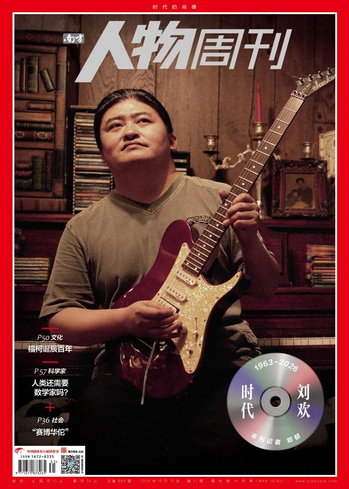
2026年9月25日，音乐人刘欢去世，终年63岁。
人们想到刘欢，往往是一个扎马尾、着黑T、嘴角微扬的自信歌者形象。他的一生见证了中国流行音乐从萌芽走向成熟，从文工团、青歌赛时期，到唱片工业、流媒体时代，他的音乐生涯横跨几个周期，成为不可忽视的厚重之声。
中国音协流行音乐学会的悼文中，称刘欢为“杰出的音乐创作人、制作人、歌唱家、音乐教育家”。乐评人金兆钧形容，刘欢的一生是“复调人生”，多个声部和谐地交织在他40年的音乐旅途当中。
他的作品有如“时代的K线图”，穿越数十载岁月，连接起原本或不相通的人群。刘欢去世后，人们重温那些熟悉的歌曲、演出，翻出他的受访视频，很多人第一次知道他还是一名大学老师，扶持过数十位音乐新人，拼凑出更鲜活的音乐人的多重面向：原来，在一把好嗓之外，他还兼具格局、学识与一腔赤诚。
刘欢相信：多提供一些美、帮助人，可以让那些微弱而有质感的声音被听见。缅怀刘欢，既是对过去的回望和追思，亦是渴望纯真与美好的一次集体迸发。他的作品、教学和为人既为至少三代人留下宝贵的记忆，也成为我们看待艺术和人之修养的参照。

本文首发于南方人物周刊
文 / 南方人物周刊记者 邓郁 发自北京
编辑 / 杨静茹 rwzkyjr@163.com

**江湖儿女日见少**
“刘欢走了。”
2026年9月26日中午，刘欢离世的消息在网上刷屏时，在北京工作的叉叉正在收拾下午出发的行李。她和妈妈刚结束日本旅行回到北京，正要沿着三峡线路，一路坐火车、轮渡、汽车回家乡重庆。看到消息，她大声叫了叫正在厨房忙活的妈妈。
“我妈的第一反应跟我一模一样：啊？刘欢？唱歌的那个刘欢？”
两人忽地失语。除了惋惜，不知该说些什么。
在后半段的行程里，叉叉在火车上一边重听刘欢的歌，一边用手机整理思绪。她想起“江湖儿女日见少”，那句来自张纪中版《笑傲江湖》主题曲中王菲的唱段——儿时她常模仿的对象。但开头那一声，她却无论如何都学不来，那声好似“东方不败”，又像是山谷里传来的：“咿……呀！”童年的她只觉神秘至极，后来才知道，那是刘欢的声音。
“很多人说我爸长得特别像李亚鹏，我对那一版《笑傲江湖》的印象深刻，有音乐的关系，也有家庭的因素。”
上世纪90年代，叉叉的父母分别在重庆主城外的綦江和北碚的煤矿工作，矿业不景气，先后关停。妈妈外出打工，寒暑假才能回家；爸爸跟人合伙开过几年舞厅。
舞厅也是那个年代的KTV。正中一块舞池，地板被皮鞋磨得发亮，一盏旋转彩灯、几盏红绿射灯，简陋的条凳和音响，便围出一方半公开半私密的娱乐之所。摇晃的光影间，一支麦，一段快意或柔情的歌唱，短暂地把现实隔开。像《少年壮志不言愁》《弯弯的月亮》《好汉歌》等，长年都是舞池的必点曲目。
“来舞厅的人唱，爷爷、爸爸、姑姑、姑父也爱哼。从小记住了那些旋律和歌词，哪怕不会主动去听，也忘不了。”
叉叉的爷爷会乐器，也买过很多的歌词本，上面有简谱和歌词，一本歌本囊括十余年的流行金曲，想唱就能随时开唱。从收录机到后来的VCD、DVD，再到后来爷爷“砸过重金”买的功放，刘欢的歌声或重或轻地流出，伴随了叉叉的少年。
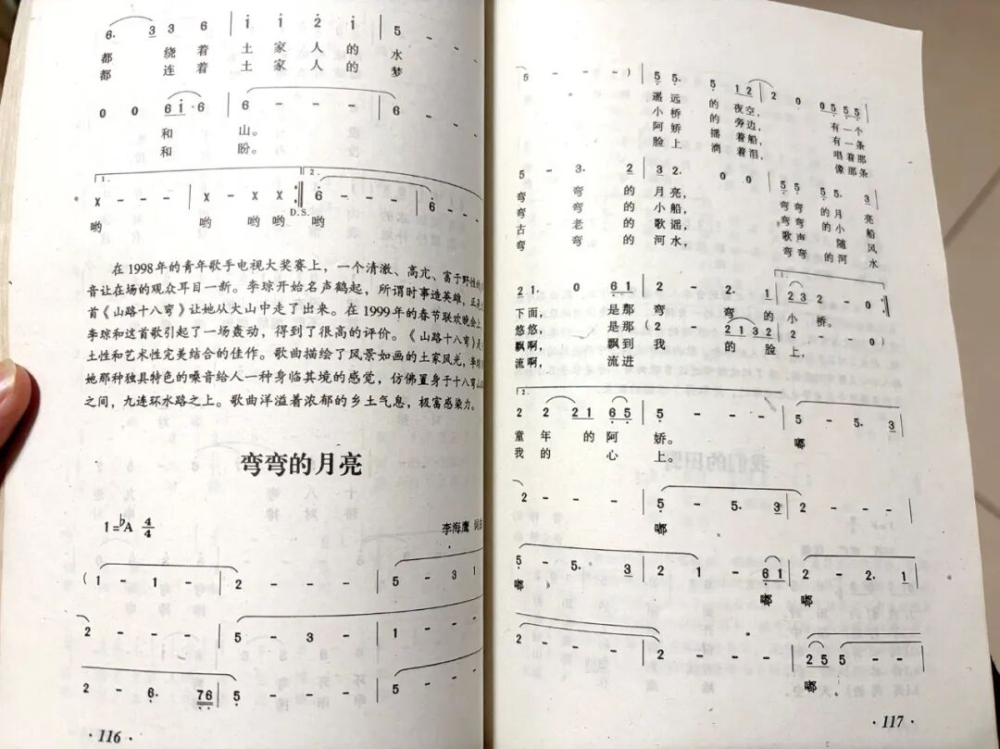
▲叉叉的爷爷在近20年前购买的《同一首歌》歌本，内有《弯弯的月亮》等多首流行歌曲 图/南方人物周刊记者 邓郁
叉叉和妈妈结伴旅行的次数并不多，最早的一次是2008年的盛夏。8月8日那天，妈妈带着刚考完中考的叉叉从老家坐车到重庆市区，就为了在解放碑下和众人一起迎接那个历史性的时刻。“那之前一直在县城，去到主城就相当于是旅行了。”
广场上有块大屏幕，许多路人在广场上游走、等待，叉叉和妈妈在花坛的台子边席地而坐，累了就站一会儿。晚上8点左右，屏幕中的二十多个大脚印焰火沿着北京中轴线一路“蹦”到鸟巢上空，解放碑前的人群里不时传出惊呼。
不到一个小时后，巨型的蓝色地球装置升起，刘欢用他舒缓醇厚的节奏和音色，与莎拉·布莱曼一起演唱起《我和你》。尽管广场上还有各种人声，叉叉的心在那一刻却静了下来。“没有炫技，没有多余的动作和舞台编排。很感动。”

▲2008年8月8日，北京鸟巢，刘欢和莎拉·布莱曼在奥运会开幕式上演唱歌曲《我和你》 图/视觉中国
开幕式后，她拿妈妈的手机给爷爷打电话。“那年爷爷还在，他是一个很关心国家大事的人，平时不太能喝酒，但那天晚上他应该是喝了不少的酒。他很高兴，我也很高兴。”叉叉的父母分居多年，各自打拼，姑姑没有所谓的正式工作，但做过育儿嫂，大家都没真正颓唐过。
音乐评论家严锋说，刘欢的歌声里有一种升腾之气，即便那时的生活不全是明亮的，有咬着牙迈不过去的坎，“但他的歌声响起时，整个屋子都会亮一下，让人觉得日子还可以往前走，可以凭着自己的一点力气，活出一个模样。”
在本刊近两周多的采访中、在网络上，不同年龄段的人都在分享他们和刘欢的音乐一起渡过的日子：
在海拔4300m的地方执勤，警营里放的集合号声正是刘欢老师唱的《少年壮志不言愁》。每天早上这首歌响起时就该集合了，慢慢地都会唱了。
《我欲成仙》在电视台放的时候（《西游记后传》片头曲）不出歌词，我们好多朋友都在猜，“我欲成仙”四个字后边究竟是“快乐齐天”还是“快乐七天”……
90年代过得还是蛮开心的，哪怕荷尔蒙失调的时候会不舒服，哪怕那时娱乐只能靠电视，可电视给了我们真善美，那时的剧和音乐艺术水准也不低。大家放了学、工作完就赶紧回家，因为都知道到几点什么台要播什么……
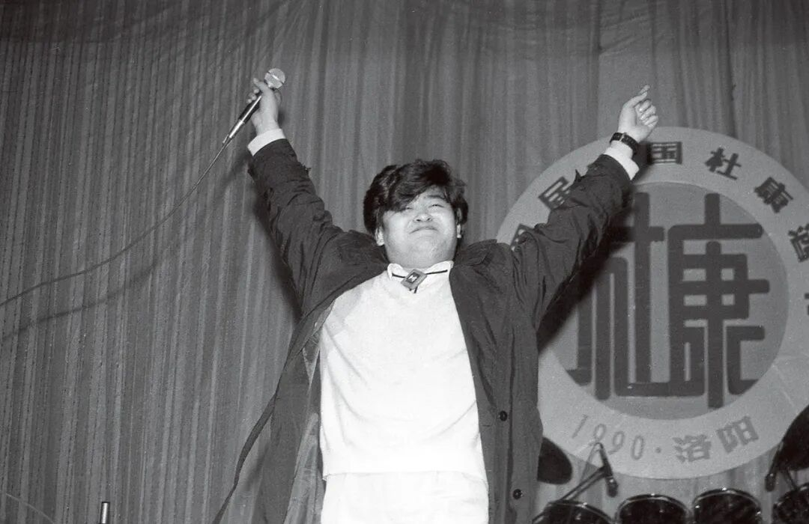
▲1990年12月28日，刚刚获得第二届全国影视十佳歌手的刘欢随天津艺术团来到河南洛阳演出 图/视觉中国
唱作人丁薇告诉我，她父亲是一个根本不听流行歌的人，在听觉上相对保守。“但他非常喜欢《心中的太阳》还有《离不开你》，会觉得那时的中国有这样子的歌手和作品，挺特别。你看，刘欢他天生具备这样的一种能力，既可以表达他自己，又可以让大众接受，这挺厉害的。”
叉叉说，所有划时代的歌者留下的不只是一种独特的嗓音，邓丽君如此，迈克尔·杰克逊如此，中岛美雪如此，刘欢也是如此。只是刘欢留下的，是一个由声音、电视、音乐，以及人与人——准确来说，是三代人共同的生活经验——组成的中国大众文化江湖。

**“人声是最丰富的乐器”**
是时代选中了刘欢吗？他的过人之处究竟有哪些？
有评论指出，因为早年学过相声和京剧等传统曲艺，刘欢的发声带有明显的压缩和咽音技术，鼻音重，但咬字清晰又流利。《心中的太阳》《少年壮志不言愁》等曲目是“质量极大、高度极高”的声音，别人难以效仿出他的演唱效果。“他的声音天生比一般男生高五度，张力特别强，一般说唱High C就很紧张了，他正舒服，同时又有人文底蕴和他的一股气场。”与刘欢交往多年的乐评人、《人民音乐》顾问金兆钧说。
据央广网和纪录片《我和你的故事》，2008年奥运主题曲《我和你》的舞台呈现，原本主创选出了两位年轻歌手，打算让他们以近乎青年志愿者的面貌站上鸟巢二十多米高的地球装置，只用朴素的声音传递奥运主题。然而几轮预演过后，一个现实的难题摆在主创面前：台下数万观众，大多把高处的两个身影当成彩排的替身，没能达到开幕式终章该有的厚重与共鸣。最终团队改变了原有思路，距离奥运会开幕仅剩17天和一周时，刘欢和莎拉·布莱曼先后接到突如其来的邀约。
“他往那儿一站，就像天地间有了一根台柱。这种心理因素，太神奇了。这还没说到他演唱中的生命感，那种饱满的，似乎是灼热的、滚烫的激情。”乐评人李皖评论。
令《爱乐》前主编朱伟称道的是，在技术条件和情绪之外，刘欢早早就意识到“人声是最丰富的乐器，且能有意识地在每一首歌里寻找自己的声音表现能力”，会根据歌曲风格变换音色，传递出不同的生命情怀与个性。
1986年，国际声像艺术公司承接了电视连续剧《雪城》的音乐制作。在片头歌《心中的太阳》演唱的结尾，李黎夫原创的旋律是平直走向的，刘欢则把最后一个音前的音处理为现在的倚音。“就那句，‘天上有个太阳……’”金兆钧边描述边哼唱模仿，“他一拐拐成一个极短的倚音，最后的力度就全出来了。这就是通过一点小的气口和节奏来顿挫，给原作品增辉，是很高级的歌手。”
《弯弯的月亮》是另一个经典例子。这首李海鹰用半小时写出的歌，他先找了其他歌手，觉得不合适，打电话给刘欢，没料到刘欢在间奏位置加入了一段飘渺空灵的假声吟唱。“当年李海鹰给我听的时候，在广州就说刘欢太聪明，到这儿也还不够底儿，还得来段‘嗯……呜……’（哼唱），结果成了最精彩的一部分了。”金兆钧边回味边露出微笑。
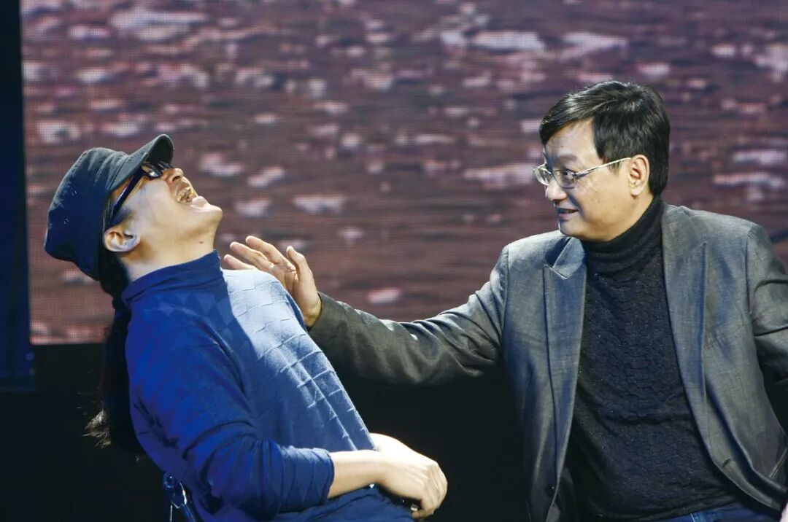
▲2011年1月12日，北京，刘欢和李海鹰在音乐节目《百年歌声》中聊歌曲《弯弯的月亮》，畅谈兄弟情谊 图/视觉中国
“不少人说刘欢既能唱庙堂之高，也能唱江湖之远。”我向金兆钧提起坊间对刘欢的评点。
他却不这么看。“不是说他什么都能唱，而是他把（接到的）哪样的歌都唱到了一定的水平。一个是自个儿的根底，还有明白创作者要什么，更重要的是面对一个时代要求的时候的态度。你给刘欢哪怕是一个应用型的作品，他也能完成得很讲究，用行话说，能唱出你的那个版本来。”
从《心中的太阳》的丰沛磅礴，到《弯弯的月亮》的婉约细腻，再到《好汉歌》的豪迈肆意，刘欢一次次颠覆了业内和听众对他的既定印象。同时，他对自己的声音定位不乏自信与自觉。
“我也给他录过音，（他）拿个谱子来看两眼，看看歌词，听一遍，伴奏带走一遍，就过去了。”金兆钧说过一个真实的段子：一个外地的作曲家写了一首城市歌曲请他找刘欢唱。“不巧那天刘欢正闹肚子，说可能吃火车站卖的烧鸡之类的吃坏了，我说那改天算了。他说还不至于不能唱，结果也是一气呵成。完了我问作曲家，还有什么不满意的地方。作曲家坐在那儿直发愣，说这是我写的歌吗？（唱得超乎预期的好）”
金兆钧说，流行音乐圈形容有成就的歌手有一个标志性的说法——“自监歌手”，即用不着作曲家和录音师跟着指点，歌者可以自己做到监制和录音。“刘欢很早便做到这点。”在刘欢的演唱技巧日渐成熟之后，一些词曲作家瞄着他的特定条件来写歌，他会加入自己的处理。再后来，词曲作者、项目方和刘欢会从一开始便商量着来共同创作。“现在说似乎他每首歌都是历史节点，只能说是每个历史节点，那些质量上乘的歌，作曲作词家多半会找上他。”
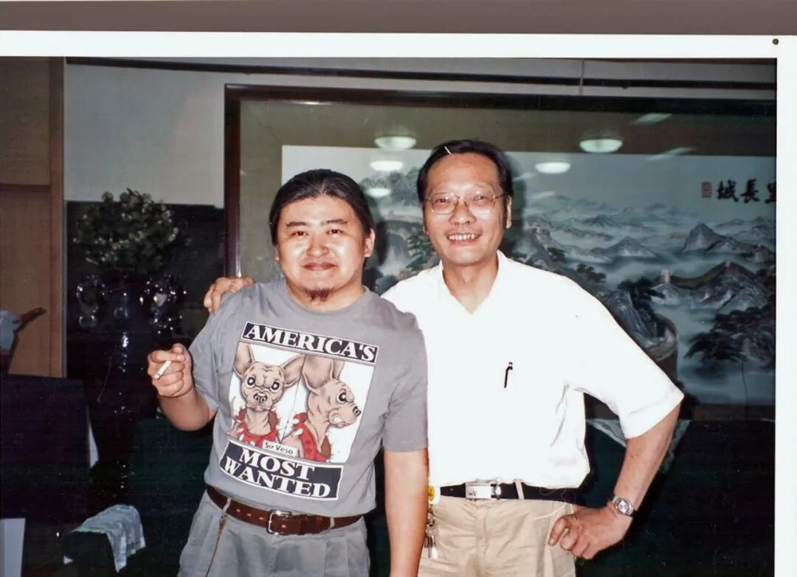
▲2000年第九届“青歌赛”期间，担任赛事评委的刘欢（左）和金兆钧 图/受访者提供

**先锋与颠覆**
从北京回重庆的路上，叉叉翻出刘欢的歌一首首听，忽地“捕捉”到《千万次的问》里，结尾处的采样，竟来自德沃夏克的《自新大陆》交响曲。
“我从前听歌不会太注意这个细节，但是那天不知怎么的，突然就听到了——怎么会如此的天才？遇到一个新大陆上开启新生活的场景，然后自然而然地融入一个古典的、又能表意的片段，是那种让人起鸡皮疙瘩的巧思。”
“原来我们对他了解很少，因为看似对这个人太熟悉了。但当他离开的时候，才会觉得这些年好像错过了他很多的作品，很多丰富的细节。”
丁薇也说，相比演唱，刘欢在音乐创作上的能力，还未得到更充分的了解和梳理。“既有他对西方音乐的吸收和理解，又有中国传统的东西，好听，还不跟时代脱节。”
1980年代中期，音乐人捞仔还在广州时，与刘欢在太平洋影音公司的招待所初见，颇为投缘。“我一看，嘿，这个人头发那么长；他一看，我头发也那么长。等我练琴完了，他过来跟我说，你琴弹得不错。再一聊，我俩喜欢的乐队都一样，平克、深紫、吉他英雄（在重金属/硬摇滚黄金年代以高超技术和鲜明的个人风格著称的顶尖吉他手）那些，便互留了联系方式。”
1988年，太平洋发行刘欢、田震、范琳琳、王迪担纲演唱的《四巨星》，里头10首歌都是李海鹰原创，捞仔为吉他手。对编曲、制作的兴趣，刘欢和捞仔也在那两年同时发端。后来捞仔从广州到北京定居，与刘欢住得越来越近，交情弥深。“当时他在亚运村住，楼下有个湘菜馆，我经常吃完饭去他家聊聊音乐。我比较懂电脑，能拾掇他的音乐制作系统。”
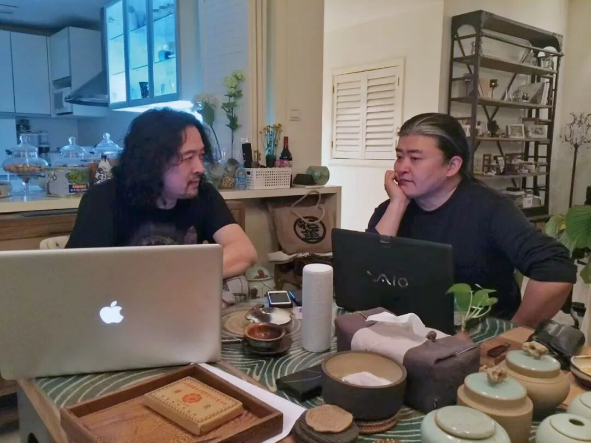
▲刘欢和捞仔 图/资料照片
刘欢是国内最早用MIDI的一拨人：硬件音序器、合成器、音源模块、监听音箱，包括调音台，他在1980年代末到1990年代初便一股脑添置，没有中文界面，全靠自己摸索。那时节，听到刘欢用外文哼唱写下的某些音乐片段，金兆钧深信它们迟早会有人欣赏，刘欢却说“太洋了”，得等待一个机会。
1993年，机会来了。
那年《北京人在纽约》的导演郑晓龙找上刘欢，希望他在一个多月里完成主题曲加多段配乐。刘欢听了大量的百老汇、美式流行，吸收管乐编配、和声走向，尝试了摇滚和放克风，效果都不好。“最后发现还是对本子理解得不对，毕竟不是美国片。”
最终刘欢确定吸收美国传统流行音乐的风格及电影管弦乐的写作手法来组织。金兆钧回忆，“创作上他并没感到太难，因为他终于感到这是比较适合自己的一个本子。片头曲《千万次的问》的前奏和间奏采用了《自新大陆》，不过因时间问题被删除了许多，否则整体气氛的感染力还将大大增强。”
独特的韵律，加上Time and time again, you ask me的歌词，唱出了上世纪末海外追梦者不能言说的心事。参加过《中国好歌曲》第一季的王矜霖生于1990年代，他在若干年后听到这首歌仍为之一震。采访时他随口唱出“千万里我追寻着你”，“第一句一出来，便有那种辽阔而纷乱的画面呈现在眼前，原来世界是这样子的，那种‘我也得好好打拼’的感觉油然而生。”
刘欢去世后，多位音乐UP主在节目里不仅分享《千万次的问》，还有《Someone》等剧中插曲：轻快的雷鬼风、合成器的装饰音，配上快速切换的纽约街头众生相的画面，一下便勾起异域风情下人心飞扬又不定的感觉。“好洋气”“这么潮”的弹幕一行行飘过，而今的听众难以想象，这么耐听的作品出自1990年代初一个没有去过纽约的人之手。
《北京人在纽约》热播，这部剧的配乐也改变了一些人对刘欢的初始印象。北京交通广播《徐徐道来话北京》制作人张世强说，1980年代他刚迷上流行音乐那会儿，对港台的创作歌手更感兴趣，“觉得刘欢就是‘晚会歌手’，不是‘唱片歌手’。等《北京人在纽约》出来，想不到作曲居然这么好，对他的观感就很不一样了。”
张世强疑惑，这么好的音乐人，怎么没有唱片公司签他？
1997年，刘欢加盟索尼唱片。签约后推出了个人首张精选双张专辑《记住刘欢》，收录了28首代表作，其中第二张的曲目如《去者》《情怨》《爱之无奈》《L'amour》《报应》等，均为刘欢本人作词作曲。这张唱片销量突破40万张，创下当时大陆原创音乐CD的销量纪录。
不过刘欢不是“见好再追”、满足于既有风格的音乐人。由京文唱片发行于2003年的《六十年代生人》，便像一个音乐顽童的任性产物。这张的混音全由捞仔完成，六七十年代的老歌，被他们和其他编曲的朋友玩出各种花样：《亚非拉》一开场，满满的实验电子与工业金属感；童谣《喂鸡》加入了大量电子乐的混响。一时间，惊喜者有之，摸不着头脑甚至排斥者，亦有之：新世纪伊始的年轻歌迷普遍听港台R&B、追流行偶像，中老年人也不大能接受大刀阔斧的老曲改编。尽管业内认可刘欢的勇气和超前的审美，采访时捞仔回忆“朋友圈里有人一箱一箱地买”，但这张专辑正版的整体销量最终统计为五位数（在那个年代不算高）。
而刘欢对此早有心理准备。在专辑的自序中，他这样写道：
再癫狂的时代都会留下一些美好，因为有人在，因为有音乐在。我们以今天的方式唱起这些老歌——对于我们的后代来说可能是些新歌了——是为了忘记一些苦难，记住一些美好，这也叫做“为了忘却的纪念”吧。
他曾在访谈中自陈：本来就没打算做一张商业唱片，《六十年代生人》是一张给同龄人和后代的“私人作业”，不以唱片销售为目标。
在金兆钧看来，玩起创新和实验的刘欢，偶尔或许“用力稍猛”。“比如为电视剧《胡雪岩》所写的《去者》和《情怨》很有京剧风，可能也有对昆曲的吸收，不过他把调性弄得有点复杂，其他人很难唱了呵，到《甄嬛传》就成熟多了。”
为一部电视剧做全案配乐，自《北京人在纽约》后，刘欢已多年未接。接下《甄嬛传》的任务，纯粹出于跟郑晓龙的多年私交，他戏称自己“被拉上贼船”。
根据央视网的报道，2010年秋，身在海外的刘欢接到剧组的紧急需求：几段歌舞戏即将开拍，演员急需旋律对口型，可整部剧集当时连粗剪版本都还没拿出。在没看过完整成片的情况下，刘欢写出了《采莲》《金缕衣》《惊鸿舞》《菩萨蛮》四支插曲的曲调，也生出了《凤凰于飞》最早的器乐雏形。一个可窥其职业态度的细节是，配乐时他要尽量匹配演员弹奏古琴、吹笛的动作，避免音画脱节——而饰演者大多非专业的古乐演奏者，动作乃随机而成。
回国后，刘欢闭关三个月，完成了整部剧集九十余段配乐的打磨。片尾曲《凤凰于飞》被公认为一首上乘之作。区别于简单的“笛子+古筝”式的古曲新编，乍听旋律不上口，但那种迂回往复，分外贴合人物命运的悲欢跌宕。刘欢本人曾言，《甄嬛传》里的作品在和声和转调上的处理“挺有颠覆性”。
因为频繁转调，编曲孟可笑着吐槽，刘欢的写法打破了自己的“固有信仰”，几乎在那段时间把和弦和中国古乐知识给重学了一遍。
剧集刚播出时，曾有人表示：曲子好听，但很难唱。刘欢的观点很清晰：如果配乐做成朗朗上口的流行风格，会直接跳出整部戏的氛围。音乐只需要“传听”，不必人人都会唱。
时至今日，《甄嬛传》配乐的含蓄和克制成为他后期审美的注脚，逐渐深入听者。“他对中国传统文化和西方音乐的积淀，在这张专辑里有爆发式的展现。”张世强认为，从流行音乐的调性和制作水准而言，《甄嬛传》OST可以说是里程碑式的作品。

▲2012年4月30日，北京，刘欢和姚贝娜出席《甄嬛传》原声大碟签售活动 图/视觉中国

**无用之用**
“我们拉开时间看，刘欢的歌唱到底是什么呢？普遍却又独特，根源不明，大气而无霸气，洋气而无异域感。中国吗？不好说，但是他对歌词的情感把握，他在歌曲里自加的衬词歌咏，无一不在展现他的素养。”李皖提出疑问，似乎也给出了答案。
听刘欢为《流浪地球》前两部所做的配乐，王矜霖能听出很深的古典音乐的底子。“仿佛有第三人称视角，跟现代人在对话。整个音乐的结构、张力和词在一起，形成了磅礴的气势。”
说到音乐积淀和修养，刘欢算是乐坛的另类。
在天津长大，差点成了相声演员常宝华的徒弟；就读国际关系学院法国文学专业期间（1981-1985），先后在法国大使馆法语歌曲比赛和北京高校首届英语歌唱比赛中夺冠，才引起了音乐圈的注意。
“（19）80年代中他刚出现那会儿，中国压根儿没有什么独立的‘流行音乐人’，基本上玩（流行和摇滚）音乐的，都是从职业圈里出来的。”按金兆钧的描述，所谓“职业音乐圈”，即当时各种军队文工团、中央乐团、歌舞团、音乐学院。譬如王勇，早年在东方歌舞团任键盘手，古典、民乐的底子深厚；栾树出身中央音乐学院附中，也曾在文工团的体系浸染过，古典、摇滚皆通。
音乐人张岭也成长于中央歌舞团大院，1986年与好友秦勇、曹军、蒋文华等人组过“五月天”乐队（11年后，台湾成立的那支乐队与之同名），后来何勇、骅梓、刘峥嵘等人也加入过。快30年后，他和刘欢在《中国好歌曲》里“转椅相逢”，成为佳话。其实早在刘欢读大学时，因为有共同认识的朋友，两人便结识了。“国关（国际关系学院）算是个比较正统的学校，但刘欢却是个个例了。”
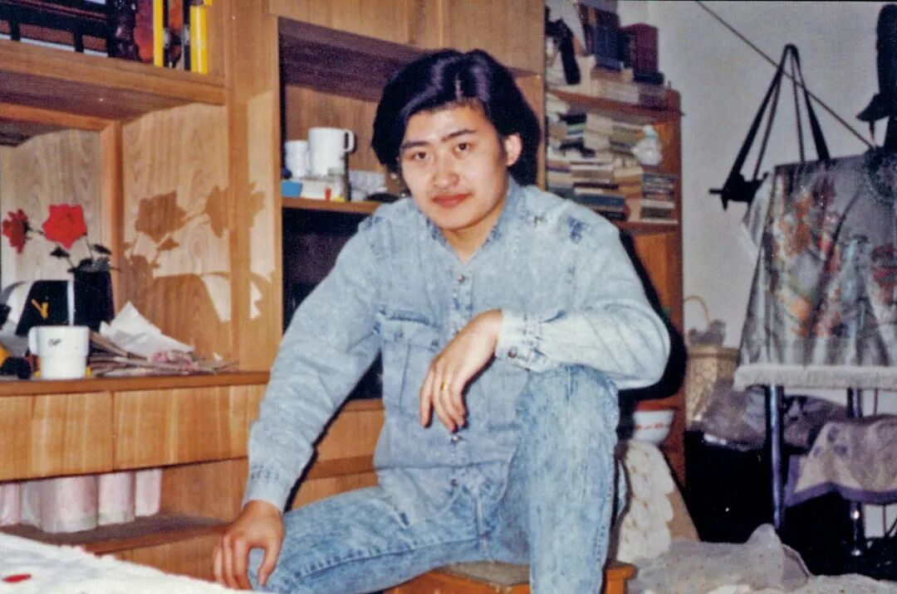
▲1988年，刘欢在国际关系学院一号楼320室。这一年的6月8日他戴上了婚戒 图/受访者提供
几乎同时出道的张蔷，属于翻唱西方金曲的“鼻祖”。据不完全统计，她在1980年代的卡带卖出了超2000万张，上了美国的《时代》周刊。刘欢也翻唱过西方流行乐，“还翻唱过崔健”，但不论是对身处的校园，还是那时的流行、摇滚歌手，刘欢都显得“独一份儿”。
首先，这人非科班出身，痴迷古典乐；其二，学东西“特灵”——二胡、手风琴、吉他、钢琴，都靠“自摸”自学；其三，胆子大，常有“惊人之举”。
那个年代古典音乐资源稀缺，唱片盒带都极少，得到处托朋友去找。中央乐团在海淀影剧院的星期音乐会，刘欢几乎一场没落过。多年后他谈起自己的（音乐）入门缘起，“因为那时电台里播外国音乐都是古典乐，流行音乐不介绍。我听披头士，接触流行音乐，都是从大二才开始。” 
不仅国关学生会那架没人弹的钢琴，当时学校能找到的乐器，刘欢都玩了个遍。校友李国威记得，刘欢作为学生会文艺部长“忽悠”学校买了一台8000元“天价”的立式雅马哈电子琴。“那时我们学生的生活费每月（才）30元。刘欢兴冲冲地叫我一起过来拆箱，说百货大楼只进了两台，被他抢来一台。”
李国威形容：刘欢手触琴键的第一声，如同一道彩色的光“唰”地冲进来，整个房间都亮了。
1986年的英语歌曲比赛，上千人看着这俩人呼哧带喘地推着两架大琴上台。李国威自觉尴尬，提醒刘欢先说一句“抱歉让大家等候”，“刘欢说你别管，直接起你的前奏。他是借鉴交响乐的演出‘套路’，第一乐章明亮，第二乐章抒情，第三/四乐章Grand Finale。最后果然全场都嗨了。”
早年浸淫摇滚和电子音乐的捞仔，1990年代中期开始钻研中国民乐。受刘欢的影响，40岁后，捞仔深扎进古典乐的世界。他跟着交响乐大师罗忠镕学习三年，后来写出《命运》等多部歌剧、为电视剧《山海情》做全案配乐。
“欢哥提高了流行音乐的层次，让流行和古典的界限没那么分明。我们时常说融合，但只有对民族音乐、西方音乐都有体系地学习，才能说把它们有机地融合到一起。应该放开枷锁，让思想更自由，这样大家都会朝更好的方向去。”
如今，社交平台上风传刘欢在对外经济贸易大学讲课的照片和给学生的赠言。1991年，当时的贸大校长孙维炎想发展美育，邀请刘欢来任教。自那时起，除开生病、动手术，刘欢一直讲课至2023年退休。在世人看来，一个处于流行乐坛一线的歌者、创作人，每年划出10周安心地为大学生教授《西方音乐史》，是难得一见的“淡泊”与坚持。于刘欢，却并非多么稀有和“高贵”，不过忠于自己所爱罢了。
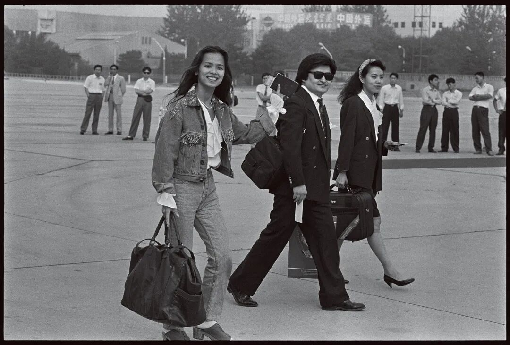
▲1993年9月16日，首都机场，北京申办2000年第27届夏季奥运会代表团启程前往摩纳哥蒙特卡洛，刘欢（中）和韦唯（左）作为随团文艺工作者同行 图/视觉中国
在咨询行业工作多年的絮语，1990年代早期听过刘欢讲课。短短一学期的《西方音乐史》，是他认为最具有大学意义、对他终生有益的课程。
相隔三十多年，他依然记得刘欢开着那台大切诺基，常穿皮风衣，课前爱抽支骆驼牌香烟。没有任何讲义，不过一杯水、数根烟——原来还可以这样上课。
经典的古典音乐，讲者几乎烂熟于心。“听到的音乐种类、版本也多，是非常有世界性体验的一个人。”絮语沉浸在回忆中，“那时他微胖，头发很长，唱起来不只眉毛，连头发都会飞扬起来，他会不断地去捋他的头发。刘欢在讲课时的陶醉，那种享受感，是我觉得比内容更加感染人的。”
这门课与学生的期末成绩、毕业并无多大关系，但絮语感到，跟他当时爱上的《英语泛读》一样，它打开了另一个世界，从此他会带着好奇和探索欲去接触文学、语言和音乐。
在前任贸大校长陈准民的记忆中，刘欢从未申报过教授，“他就要一个讲台。”
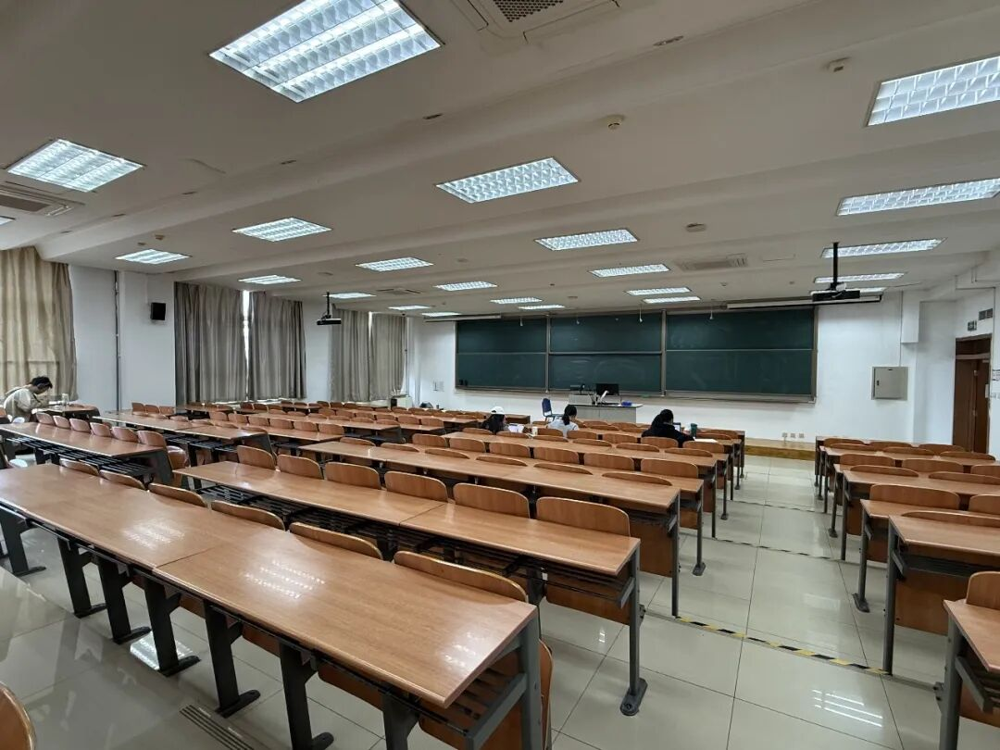
▲对外经贸大学宁远楼828教室。2007至2023年，除去两年因病停课，刘欢在这里讲授了十余年的《西方音乐史》（此前他在诚信楼102授课）图/南方人物周刊记者 邓郁
看到刘欢大把花钱买进口的原版唱片，金兆钧打趣他。刘欢直言：要是哪天课堂上有学生站起来问，老师这个版本怎么样？可不能我都没听过。“他说我挺爱当这个老师的，为什么？因为我们一天天在老，可是孩子们永远不老，他们永远20岁……而且你给他们东西，他们也给你东西。他的意思，因为古典音乐也是活的——虽然曲目就那么多，那他跟着世界上最‘先进’的古典音乐的发展走。”
刘欢与朋友喝酒聊天，经常会谈黑格尔、费尔巴哈、尼采，谈巴尔扎克的小说，“他眼界宽，正所谓‘功夫在诗外’。”金兆钧眼中的刘欢，跟起用他的贸大前校长孙维炎、继任校长陈准民在理念上如出一辙：希望学生全面发展，有高尚的趣味、现代审美，“首先人格健全，其次才是掌握技能。” 
絮语本科念的是会计专业，他说当年老师曾正告：“你们是学财经的，要对自己有很高的道德要求。第二要有很高的人文要求，当你去跟外商谈判的时候，了解莎士比亚，会对你的工作和生活都有助益。”
刘欢去世两周后，我在贸大校园遇到刘欢当年报到时在场的一位贸大老师。他透露，孙维炎与刘欢初见便相谈甚欢，但校内有不同意见，“刘欢当时可是时髦青年，但他毕竟是‘圈外人’，也不知道会讲多久，讲得怎样。”
10月初的中午，宁远楼的828阶梯教室，多名学子在座位上伏案温书或休息。问起好几位，他们都听说了刘欢去世，但并不知在许多年里，刘欢曾在这间教室为三百多个学生授课。
“能有一些浸润人心的通识课很好，但今天选课，更会在意是否计入学分吧。”一位受访的学生这样说。
工作后的絮语买过莫扎特、德彪西的唱片，如今更多在手机上听古典音乐。“不管懂不懂乐理，去听就可以了。”他坦承自己在音乐上走得不远，但出于兴趣，最近用两年读完了莎士比亚英文全集；因为好奇还自学了三年的拉丁语，希望能去读维吉尔。
与当年大学老师忠告有别的是，工作中当他与外国同事讲到戏剧和莎士比亚，没有人懂，“他们只觉得高中学这些够痛苦了，会诧异你一个中国人为什么对这个感兴趣？他们难以理解当中的美好，我也没办法去跟他们解释。”
刘欢多年前在课堂上对学生讲过的一席话，这些天正以各种版本在互联网上流传：
音乐真的没有什么作用，我们这个世界就是这样。
音乐没有消除过贫困，没有阻挡过战争……但是对于我们来说，音乐可能又有作用。因为我们爱它，我们可以留住一个随时可以去盼望美好的希望，一个希冀。音乐和所有的艺术在人类文明中的位置是一样的，就是一个不停地对美好的追问和探索。
“W·H·奥登在致叶芝的悼亡诗中也写道，For poetry makes nothing happen（诗无济于事）。”刘欢去世后，絮语在朋友圈里写道，“音乐、诗歌、哲学、美术都是无用的。无用之用，谁用谁知道。”

**星星点灯**
2013年12月的一天，捞仔接到刘欢的一通兴奋不已的电话：
“他跟我说可太好了！先给我发来（录制节目时）听到的一首叫《卷珠帘》的歌，接着又给我发来赵雷的《画》，说歌词写得太好了，完了他把每一个学员什么乌拉多恩有多好，李夏多好，一个一个讲给我听，说‘张岭是我好朋友，我（19）80年代就认识他了，结果他竟然来参加这节目了’。”
让刘欢激动的这档节目正是次年1月播出的第一季《中国好歌曲》。在担任《中国好声音》第一季的导师时，刘欢战队涌现出吉克隽逸、袁娅维等特色鲜明的乐坛新人，《好声音》也接连办了好几届。但刘欢不时流露对当时乐坛过度依赖翻唱的忧虑。“到后来绞尽脑汁你都找不出来歌。老炒冷饭，有一天连冷饭都没了，你怎么办？”
于是在他的主导和策划下，由央视与灿星制作联手打造了《中国好歌曲》这个国内首档主打原创作品的音乐真人秀。
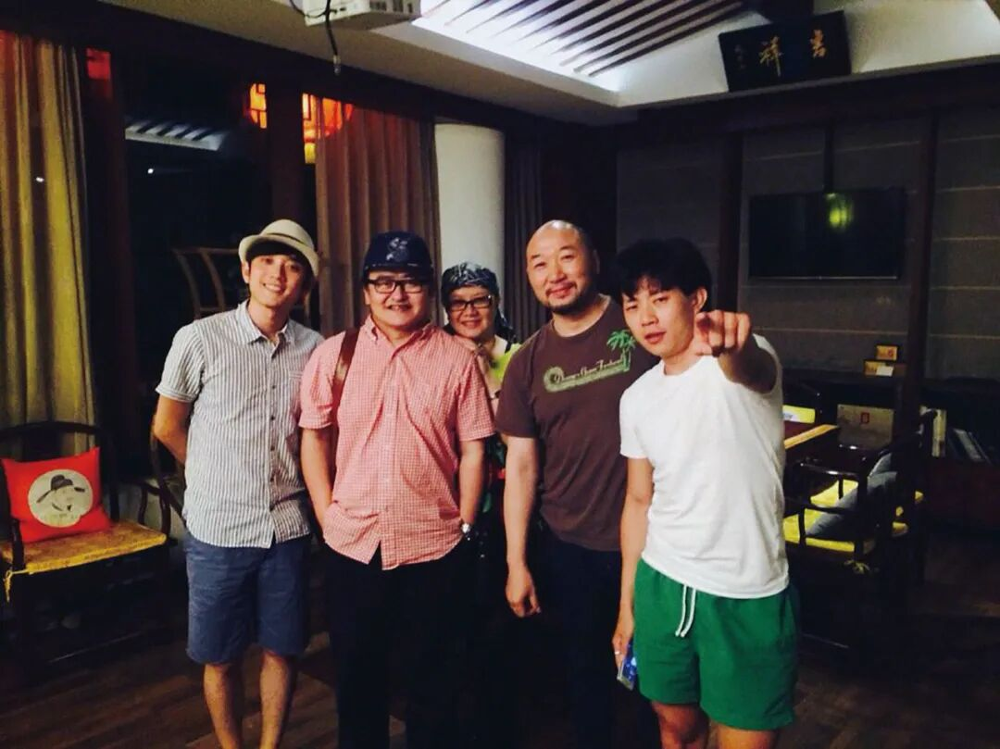
▲刘欢夫妇和第一季《中国好歌曲》战队部分成员：（左起）王矜霖、刘欢、卢璐、张岭、赵雷 图/受访者提供
首轮（导师）盲选之后，捞仔也加入，担任刘欢团队的编曲和音乐制作顾问，并多次以吉他手的身份上台助演。“第一轮之后，欢哥天天到我家聊编曲怎么弄，包括说涂议嘉这小孩16岁，懂各种调式音阶，特别兴奋。”
总决赛时，轮到张岭的《喝酒Blues》，捞仔操起吉他，张晓松吹口琴，张岭主唱兼贝斯，刘欢弹钢琴兼人声即兴，与张岭一问一答，一首带着自嘲调侃感的蓝调，成了不插电现场和一出情景短剧，也成就了那一季最为松弛的现场。
“欢哥非常的慷慨，遇到好的音乐和好东西，会毫不吝惜自己的赞美与欣赏，像个天真的小孩。”张岭感叹。
被刘欢夸赞的涂议嘉，节目结束后还获得了意外之喜：刘欢找来捞仔、谷粟、谭伊哲、崔恕、科尔沁夫等人加盟，他本人担任制作人，共同打造涂议嘉的首张专辑《十七》。在12首原创曲目中，浓缩了一个个体迈入成年前的期待、失落、自我认同和社会观察。
《中国好歌曲》第二季时，涂议嘉去探班，跟杭盖乐队有了深入交流，也在心里埋下一颗想做世界音乐的种子，这成为她后来赴伦敦大学亚非学院和牛津大学深造的缘起。“做音乐对我来说是一个内化的过程，我特别感兴趣的就是怎么把传统音乐、民族音乐，跟西方流行音乐结合，作为一个桥梁来跨越不同文化，更感兴趣的是音乐和人类学、哲学、心理学的交互。”
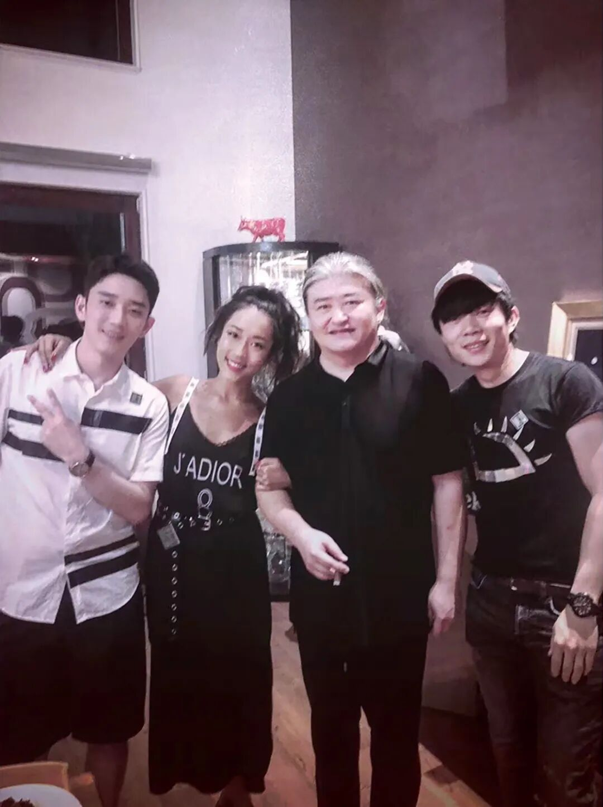
▲参加过《中国好声音》和《中国好歌曲》的部分学员和刘欢：（左起）王矜霖、吉克隽逸、刘欢、赵雷 图/受访者提供
此后，据说因收视或赞助商因素，《中国好歌曲》止步于第三季。刘欢拼尽全力也没能留住这档心血节目，他在朋友圈发文：
往年此时快要开始的忙碌没有了，持续了三季的《中国好歌曲》搁浅……原因不详，其它卫视又没有同类节目的“牌照”，就这么简单。放眼熙来攘往的中国电视，终于容不下这唯一一档以原创为核心的音乐真人秀，慨当以叹！
但三季节目留下了一批被长久传唱的作品：莫西子诗的《要死就一定要死在你手里》、苏运莹的《野子》、戴荃的《悟空》、赵雷的《画》……此前只在小众音乐圈活动的一批年轻创作者，由此进入大众视野。“我觉得他就是默默地给我们做音乐的人点亮这盏灯。后来再没有看到其他类似节目有这样大批的原创好作品出现。”王矜霖说。

▲2017年6月6日，浙江杭州，从左至右：周杰伦、刘欢、那英、陈奕迅在《中国新歌声》第二季发布会上合影 图/视觉中国
不过，对原创音乐的心念，刘欢不仅没有放弃，还转为了更实在的扶持。
2019年年初，他宣布以个人名义捐资2000万元人民币，由芒果V基金运营、中国社会福利基金会体系监管，每年1月11日出资100万元，资助一位才华出众的年轻的华语原创唱作人。这个被称为“刘欢原创音乐公益金”的项目，每期有10位推荐人，根据各自推选的原创作品在专设的App上投票，选出前三名，最后由刘欢来选出当年的公益金得主。
丁薇已做了四年的推荐人。前年刘欢还曾请包括她在内的几位推荐人吃饭，商量如何优化赛制，做到更公平和高效。“我记得大家有讨论说，申请者在资料里一定要填清楚是不是已经签约了哪家公司，我们还是希望把机会给到那些更需要的人。不是说你签约了就不可以，但是你不能隐瞒事实，最终推荐人会综合考量。还有最早的投票模式容易出现平票，那次也讨论改善了这点。”
自2020年起，已有秦凡淇、裘德、阿弗娄、吴汉霄、闫泽欢、普阿山、杨格等七位青年唱作人获得公益金。他们累计完成61首原创歌曲，37首已经公开发表。在刘欢眼里，新一代的音乐人大有希望。“他们耳朵特别敏感，就我对他们的了解，不管什么音乐一耳一听，这是哪路，是什么样的，应该（怎么做，效果）更能怎么样，他们是很懂的。”
丁薇从心里感到，这个项目对好些获奖者的职业发展起到了至关重要的作用。“比如说像裘德做新专能够用大编制的乐队来录，如果没有这笔钱，是很难完成的。这满足了创作者对自己的音乐表达。”谷粟也讲到，闫泽欢的一些作品如今也有别的歌手去翻唱，得到了更多人的认可。“有了这批原创音乐人的作品，华语音乐多了一大片天空。”

**“只有歌，没有王”**
《中国好声音》和《中国好歌曲》播出后，导师刘欢经常与其战队成员、团队搭档聚会，2015年后，逐渐演变成每年6月1日在刘欢家的欢乐派对。Mr. Miss组合成员之一的杜凯，曾和刘恋一起参加《中国好歌曲》第一季，也参加过好几次聚会。
在刘欢去世后的回顾播客中，杜凯说，每次聚会他都腼腆得不太敢说话，只是一遍一遍地看着刘欢书架上的书和光盘，把那些书单影单默默地记在手机备忘录里，待日后去搜集。
刘欢家有很多的音乐设备，某个角落放着一组音箱，正前方是一个按摩椅。杜凯想，那大约是刘欢时常聆听音乐的地方。一次，他在那套音响的碟机里发现了一张没来得及拿出来的唱片。“那是皇后乐队1975年发行的《A Night at The Opera》，我当时意识到原来刘老师最近在听前卫摇滚音乐。当时我们都知道他正在潜心创作一首作品，一直到后来在《中国之星》节目的总决赛上，听到了那首让人震惊的华丽的《夜》，才明白这或许就是刘老师倾注了极大心力的潜心之作，在这首歌里他真的装下了非常多他喜欢的东西。”
三年之后，在《歌手2019》舞台上，刘欢的第一首表演曲目同样是这首《夜》。哥特式摇滚风格融合了圣咏与歌剧元素。电吉他、弦乐、架子鼓，循序渐进，直到最后抵达安魂曲般的高点，继而又转向宁和，好似夜晚与黎明的交叠。
尽管演出时刘欢身患感冒，降调演唱，但这首比之前编制更宏大、更有空间感的《夜》，依然助力刘欢拿下了首期冠军。

▲2019年，刘欢在湖南卫视《歌手2019》节目中演唱 图/湖南卫视《歌手2019》
刘欢曾说，自己享受夜，享受寂寞，他的一生有无数个宁静而丰富的夜。这首歌写于《中国好歌曲》时期，写完他自己也比较满意，第一时间在家中弹琴给捞仔听。捞仔内心觉得，这位至交属于夜晚，“这（首歌）可能也是他对自己的一个总结。”
随着赛程推进，刘欢在《歌手》中的演绎，既有《沧海一声笑》与《好汉歌》的电音+rap组合，又有法国香颂与披头士《挪威森林》的融合改编等等。担纲部分编曲的谷粟说，刘欢很接受天马行空的想法。越往后，他越发冲开了竞技的羁绊，把对音乐和人的情感投注其中。
到“歌王冲刺夜”，刘欢与袁娅维合唱《爱乐之城》名曲《City of Stars》。两位演唱者除了歌声往来，还有一段Scat——用“嘟、哔、哒、吧”即兴演唱，并随之摇摆。两人唱得酣畅，听者也沉醉其中，一位网友借用其中歌词评论：真的是 Are you shining just for me。
在一些乐迷心中，尽管节目流程存在一定的争议和瑕疵，但那季《歌手》是节目史上艺术性最强的一季：光刘欢一个人就尝试了民族风、迷幻摇滚、说唱、爵士等若干风格。“选歌自由又充满艺术性……过去这么多年回头看，那是音乐行业还没有被短视频‘洗劫’前的最后余晖。”
而让那一季更区别于其他季的，还有刘欢准备良久的一些“谋划”。
譬如在位于长沙的这个舞台上，为妻子卢璐演唱了他为她专属创作的情歌《璐璐》；到总决赛，刘欢将《金缕衣》《菩萨蛮》《凤凰于飞》重新编排成《甄嬛》，唱到中间，姚贝娜的袅袅歌声突然出现，刘欢与她隔空合唱，在哽咽中帮助她完成了她生前希望能上《歌手》的心愿。
摘得“歌王”，他所说的那句“只有歌，没有王”流传至今。节目制作人洪涛曾透露，打动刘欢参加那季《歌手》的核心条件，正是节目组承诺2019这季转向创作、扶持原创，联合设立“刘欢原创音乐公益金”。那一季也成了《歌手》历史上第一次完全不限制选曲的一季，而以往的核心规则是参赛歌手必须改编翻唱他人作品，本人原唱歌曲不能作为竞演曲目。
再往后，刘欢在公众面前的演唱仅限于几次央视和地方台春晚，几场晚会活动和《歌手2024》的帮唱嘉宾现场。像《歌手2019》那样精心创意编排、集中展现其艺术造诣的演唱，就此成为绝响。
曾与刘欢多次合作的制作人陈牧荻向刘欢提过，《歌手2019》的十多首曲目之精彩，完全可以出一张专辑，“但也就是说了一句，没有下文。”
杜凯的电脑里有一套文件夹列表，集合了他喜欢的中外流行歌曲作者的创作作品。其中刘欢的文件夹是收集起来最困难的。“因为太零散，有的歌曲在网络时代甚至很难找到stereo（立体声）的版本。”
“出道”40年，刘欢名曲加身，但个人专辑数量不算多，专场演唱会也只有2004、2006和2013年共三场。不少乐迷惋惜，“现场和专辑太少了”，“像《夜》这样质量高的原创曲目，好希望能再多听到一些。”

▲张世强收藏的刘欢专辑（包括本人专辑、《中国好歌曲》三张专辑和其演唱会录制专辑，含有他的曲目的其他专辑/合集等）图/受访者提供
关于刘欢的创作，李皖曾直言：“由于时代赋予，属于‘天生丽质难自弃’的那种境遇，刘欢被限定在非个性化的歌曲创作上，他在演唱上也是如此。作为个人表达，言及自我的人生体验，他未曾瞩目，也未有重要成就，对此我一直引为遗憾。”
金兆钧对此付之一笑。“（19）80年代没有现代唱片制作概念，当时的情况下，刘欢和许多同代歌手一样，演唱了大量的影视歌曲，只能是‘有人让他干什么活，他干什么活’的阶段。后来索尼签了他，我们说你怎么好像没啥动静？他说躺在床上或者听着音乐的时候，自个儿（想写）的旋律就出来了，往钢琴那一坐，没了。创作这事儿确实需要契机。”
写过不少OST作品的丁薇不觉得影视配乐就不如其他的个人创作。“有时可能因为一个影视剧，反而会给出一种创作上的提醒。有的OST脱离了电视剧播出之后，开始有了自己的路，并不见得就不是个人表达。我觉得李皖追求的大概是能做比较完整的概念性的专辑。”
刘欢有没有过这方面的计划和行动，我们很难获悉了。但他曾说过，自己最大的毛病就是鉴赏能力太强，作曲又太慢，导致他总是看不顺眼“半成品”，一次次推倒重来。1999年为动画电影《宝莲灯》而写的《天地在我心》，是在美影厂提供的编曲框架上重新创作旋律和填词，反复修改打磨，历时八个月才完成。
丁薇对此深有感触。“他未必没有做（个人表达的创作），但是他可能觉得没有到达可以发表出来的程度。可能一直要在吸收学习，完善自己。他能出更多个人专辑，我们当然会觉得更圆满，但出与不出在他已经纯粹是满足自我表达的事情，而他对于这一点的标准应该是定得很高的。”

▲2014年，刘欢为涂议嘉首张专辑《十七》担任制作人 图/梦响强音提供，摄影/姚立

**“人散曲不终”**
刘欢去世引发的“怀念潮”，在9月25日后的一周里，高涨不退。大众和朋友哀悼如此富有才华的音乐人英年不在，对他的人品也充满了感念。 
金兆钧说，他已经听到三首网友向刘欢致敬的歌曲。“是那种新创作的献给他的歌。过去很少会用献歌的形式来纪念一位音乐人。我知道他的音色有很多人并不喜欢，鼻音有点重，但并不会因此而讨厌他。这是他的人格魅力。”
朱伟曾好奇，凭什么刘欢有那样蓬勃的人气：余隆亲自指挥中国爱乐乐团伴奏，三宝放下手里的一切活帮他做效果，歌手们有求都应。“好像他成了某种象征。”
在《关于刘欢的疑问》一文里，他提到，《爱乐》创刊后，曾想与刘欢做个对话，但因时间错过，也就作罢。凑巧当时两人住处很近，朱伟在路上不时与刘欢相遇。
见他时时手里托一斤切面，有时还有黄瓜，不须墨镜，见到所有人都点头报以微笑。晚上也能碰到他们一家回来停车，月光下（刘欢夫妇）很亲昵地窃窃私语，很亲昵地笑，感觉他们过着平静的日常生活，也听说刘欢是个生活在现实之中，又将情感看得很重的人。
要是仔细分析，刘欢真正吸引我们的是他的情感发散能力……只要大多数人都无法脱离情感纠缠，刘欢的歌就能以一种理想的情感境界，给情感稀缺中的大家以抚慰，他就好比是一根琴弦。
歌声里的情，刘欢给得热烈澎湃。但在生活中，他对朋友的照应往往如细雨无声。
第九届“青歌赛”时，刘欢和田青同为评委，因为对某些问题的看法而惺惺相惜。田青称两人属于“见面亦无事，不来常思君”的朋友。十余年前，刘欢曾找过研究传统音乐的田青，希望从他那儿获得一些古代音乐资料，两人畅谈了一下午。田青当时并不知刘欢是在为《甄嬛传》创作。直到剧集播出，经学生提示，他看到字幕栏写着“古曲顾问田青”，才知道刘欢默默地把他的名字加进了制作名单。
捞仔说，大家都知道刘欢爱烧饭，但他会的可不只这个。“有一次他来我在亚运村租的房子，洗脸的水龙头水特别小，他说不对，我给你弄弄。隔一会儿水就‘哗哗哗’出来。我说你这不抢物业的饭碗么？”
王矜霖曾做过“六一派对”筹划小组的一员。他从刘欢和卢璐身上感到一种温厚，“他们只想让我们围在一起时，像孩子一样无拘无束、纯粹地玩着音乐，吃吃喝喝。”
好几次布置现场，卢璐带着大家吹气球，挂彩灯，准备小礼物。等人到齐了，大家猜字谜，玩“你比划我猜”，常常乐得前仰后合，性格爽朗的卢璐也参与其中。刘欢更多是在旁边微笑着看，或者给小伙伴们伴奏，听大家唱奏新作的作品。

▲刘欢和“六一派对群”的伙伴们在家中联欢 图/受访者提供
也有很坚决、不容分说的时刻。“比如说去什么地方演出，或者做什么综艺，他只要觉得违反他的原则，比如说像贫困地区有人要借着办商演来敛财，他就断然不会去，不管是什么人找他。”捞仔说。
我问受访的每位相识者，他们最近一次与刘欢的联系是关于什么，答案近乎统一：是刘欢发来有关音乐的有趣视频。每每看到一些别出心裁的音乐表演形式，他就会转发到群里，或分头发给友人。
大家印象中的刘欢，动过髋部手术后，多年里行动自如，开车也精神得很。2019年录制《歌手》时，刘欢心脏不舒服、需要停下休息，大家才从节目组那儿了解到他刚做过心脏支架手术。恢复后再上台，他的状态也比较稳定。
最近几年，因为各自忙工作或不想打扰，朋友们较少有机会再见到他。
采访时，陈牧荻才意识到，自己大约是最近一年内与刘欢有过交集的少数友人之一。2025年年末的B站跨年演出，陈牧荻曾为他做编曲。今年春节他曾想给刘欢寄个礼物，但刘欢没有给他自己的地址。
“前些年他戒酒了，但戒酒之后他睡眠就更不好，B站演出之前，估计也没睡好觉。上台之前他在我们那儿试唱来着，唱了一会儿，声音稍微有点卡。那是我们最后一次见面……”
过去一整年，捞仔一直忙着自己作曲的歌剧《可可西里》，他邀请刘欢来观看，结果刘欢外出有事。“好些年前他在美国陪女儿，时不时也会给我打一电话聊音乐。当时我给杨亚洲（执导的电影）《雪花那个飘》作曲，他会具体到某段怎么处理得巧妙，跟我聊半天。我也经常跟他聊和声、古典音乐的音级集合什么的，可以用在流行音乐里。”

▲刘欢与女儿刘熠思 图/视觉中国
《甄嬛传》多首曲目的演唱者姚贝娜，当初是捞仔推荐给为音乐剧《金沙》寻找主唱的三宝，后来又推荐给刘欢，并深受刘欢的赏识。如今，二人在天上相见，捞仔有百般感慨，却化不出一个字。
停顿片刻，他说道，“以他的学识和对音乐的理解、沉淀，现在该是果子结得最结实的时候。可能欢哥很年轻的时候就走上巅峰了，天妒英才对吧？我只能这么想……”
有人说，有了AI以后，对原创流行音乐不是一个好的时代。还有人把刘欢称为大众审美和社会认同上的“中国式公约数”，感叹当一个社会不再拥有共同叙事，人也变得谨慎和缺乏活力。“弯弯的月亮还在，只是月亮下面的人，已经越来越少同时抬头了。”
但多档泛文化播客的主播老马Diego却很乐观：“刘欢老师虽然人不在了，但他的精神、音乐，对于学生的爱护和指导会有人记住。”他拿《喜人奇妙夜》的sketch作品《越狱的夏天》为例，作品中有人扮宋江，有人扮李逵，冷不丁一个长头发的人冒出来，“好汉歌刘欢在此”，全场为之捧腹。老马觉得，这说明不论是剧、音乐还是歌者，都留下了不可磨灭的印记，无法超越。“咱们不用再期望另一个刘欢，未来会有未来的东西。”
两年前的“六一”，因为年纪和身体的缘故，刘欢夫妇宣布派对将是最后一次。王矜霖记得，原本大家相约“曲散人不散”，后来改成了“曲终，人不散，人散曲不终”。
现实中，那些与音乐有关的愿景、行动，都在继续。
上《中国好歌曲》节目之前，倾心蓝调音乐的张岭把重心放在运营“CD布鲁斯”酒吧上。节目播出后的几个月，他惊觉来店里面的人突然间多了，但大多是看热闹，“合个影、点个卯走人。”他原本觉得做音乐不过尔尔了，但在节目内外仍然感受到了一些同道和听众的共鸣。在那个拐点，他去美国录专辑，写了很多新的作品，“算是开通了不一样的格局，正式定位为唱作人了。”
陈牧荻曾经做过三年的音乐制作人培训，遇见过有灵气的学生，然而课程结束后，学生又开始做“土歌”——为了生存。而今他也会接一些行活，但总会给自己留出时间，“做一些有意思的东西。”
参加《中国好歌曲》后，王矜霖进入了主流唱片公司，但录的一些东西并不是他最想表达的。“后来的一两张专辑我都不好意思给欢哥听，觉得自己还差蛮多的。”如今他定居长沙，做了一个小小的Livehouse，鼓励驻唱歌手带乐队来演，“不用场地费，来开专场都可以。我也欢迎他们来我的工作室录音，教他们一些制作。”他会把自己在北京的某些资源（比如制作的案子），找长沙有能力的乐手去表达。因为他相信，有好的内容产生，有健康的产业链出现，音乐人才能得到应有的收益和尊重。
曾经带着梦幻与思辩的涂议嘉，目前在英国生活，担任欧洲亚音乐人协会（ESEA MUSIC）的会长，同时还为一家国际性的唱片公司开拓中国市场。
“我在英国经常会问朋友，你们有没有听过任何的中国音乐人的歌？他们都摇头，只说知道韩国和日本。”她希望借由自己的工作，了解西方的音乐氛围、文化差异、市场运作模式，有一天也让更多的中国音乐人能在海外推广他们的音乐。
研究民族音乐、推动跨文化音乐交流，帮助更多音乐人连接不同市场，这些兴趣与做自己的（原创）音乐，就像是硬币的两面。而这些看似分叉的小径，都离不开刘欢对她潜移默化的影响。
涂议嘉印象中那个笑呵呵的刘欢老师，做音乐从来都是“由心而发”，而非“由脑而发”，她希望只要还在这个领域里，自己就持续有输出，但不会受到某个概念或者标签的束缚。
对叉叉而言，刘欢的离去不是影响了她如何听歌，而是她对待生命的方式，“别纠结内耗，及时地去做一些想做的事情。”
她说，也许多年后回忆2026，这会成为回想这段时光绕不开的一个事件。“就像奥运会那一年，或是我奶奶走的那一年，还有——刘欢走的那一年。人生朝露，艺术千秋，总会有故事让后人看。”

▲2006年6月9日，上海，刘欢在个人演唱会“欢歌2006”上演唱 图/视觉中国
（参考资料：金兆钧、鲁健等人对刘欢的采访，李皖、李广平对刘欢的评论，朱伟《关于品质》，李国威个人公号怀念刘欢的文章，杜凯、周杨、“珍妮说”等谈及刘欢的播客。文中叉叉、絮语为化名。）

## 摘要

（待补充）

## 我的笔记

（待补充）
