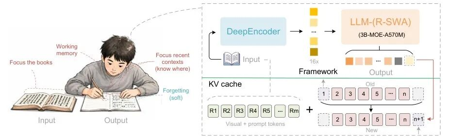
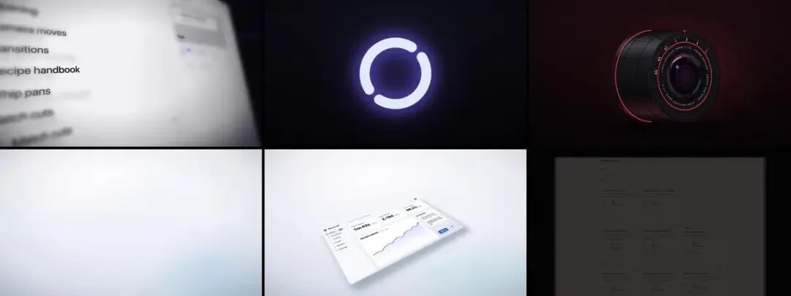
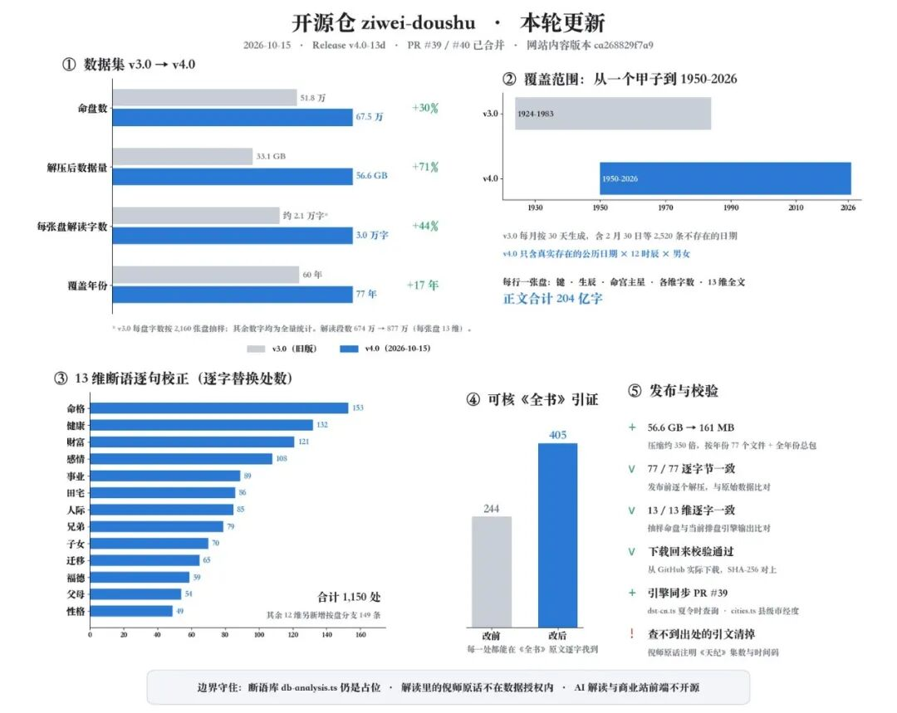

# 10/24：百度长文档 OCR 一口气读完整份 PDF 的 OCR 模型，book-to-skill 把书变成 Skill 和自带边界的浏览器
> 💡 备注属性未写入，可能是备注属性名称或者类型被修改了，建议将字段类型设置为 rich_text，可以在小程序-操作-修改文章数据库页面进行调整
> 💡 原文链接:[https://mp.weixin.qq.com/s?__biz=MzA3MjUyNjk4NA==&mid=2647746749&idx=1&sn=d44dbc9621381e87edbadee9a47104d1&chksm=86d85d1486feac69dc674e3d7634c1f1f3a008305299494736e8d33d943d44b0a8a38e93d91b#rd](https://mp.weixin.qq.com/s?__biz=MzA3MjUyNjk4NA%3D%3D&mid=2647746749&idx=1&sn=d44dbc9621381e87edbadee9a47104d1&chksm=86d85d1486feac69dc674e3d7634c1f1f3a008305299494736e8d33d943d44b0a8a38e93d91b#rd)
今天日榜挑了六个：百度开源的长文档 OCR 模型，把一本技术书变成 Agent 技能的 book-to-skill，能自己部署的 AI 同事 Rakazo，让 Claude Code 做产品宣传片的 video-shotcraft，一个按场景分开登录状态的 Mac 和 iPhone 浏览器，最后是一个挺较真的紫微斗数排盘引擎。
### 1. baidu/Unlimited-OCR：一口气读完整份 PDF 的 OCR 模型

约 2.83 万星，代码和模型权重都是 MIT，百度出的。它是在 DeepSeek-OCR 的思路上往前推了一步，主打“长程解析”：不是一页一页认字，而是把多页甚至整份 PDF 一次喂进去，输出带版面结构的结果。
模型约 33 亿参数，Hugging Face 上最近一个月有两百多万次下载。vLLM 和 SGLang 都支持，vLLM 有现成的 Docker 镜像，批量处理一个文件夹的扫描件或一份长 PDF 都有脚本。
适合要把大量扫描件、合同、论文、老书变成可搜索文本的人，尤其是做知识库和 RAG 的团队。
坑：这是要 NVIDIA 显卡的模型，官方只写了 CUDA 环境，Mac 和纯 CPU 别指望。README 里没给显存要求，自己先拿一张卡试。输出里带着版面标记，要干净文本得按它给的那段代码后处理一遍。不想自己部署，可以先去 Hugging Face 的在线 Demo 试几页。
### 2. virgiliojr94/book-to-skill：把一本技术书变成 Agent 能随时翻的技能

约 3.59 万星，MIT，Python。买了本好书读一遍，三个月后连第七章讲什么都忘了，这个就是治这个的。
你把 PDF、EPUB、Word 或者一整个文档文件夹丢给它，它拆成一个技能包：一份核心思路加章节索引，每章一个文件，外加术语表、模式清单和速查表。之后你在 Claude Code、Codex、OpenCode 里问问题，Agent 只翻对应那一章来回答。作者实测比把整本书塞进上下文省 24 到 51 倍的 token。
我觉得最有用的不是读书，而是公司内部文档：架构决策、运维手册、品牌规范，整个 docs 文件夹折成一个技能，写代码时随手问。
坑：扫描版 PDF 没有文字层，它会直接停下，要先自己跑一遍 OCR，刚好可以接上面那个百度的模型。代码、表格多的书最好装 docling，慢一点但表格不乱。转出来的技能只能自己用，别人的书做成技能拿去分享，有版权风险，作者自己也写了别分发。
```
npx skills add virgiliojr94/book-to-skill 
```
### 3. elie222/rakazo：能自己部署的 AI 同事

5462 星，Apache-2.0，TypeScript，作者是 Inbox Zero 那位。它想做的是“长期在岗的 AI 同事”：每个 bot 有自己的对话、记忆、定时任务和一台电脑，能开浏览器、终端、桌面，还能把活分给别的 bot。网页、桌面 App、iPhone 和安卓都有客户端，界面有简体中文。
模型自己接，电脑可以是本机 Docker，也可以是 E2B、Daytona 这类云沙箱。装起来就一个脚本，起好之后打开本机 5173 端口注册账号、连模型就能用。
适合想要一个类似托管式 AI 助手、但数据和模型都得握在自己手里的技术团队或个人。
坑：官方自己说还在 beta。想让 bot 一直在线、定时任务按时跑，后端得放在一台不关机的服务器上，公网访问还要自己配 HTTPS。接第三方应用要么用 Composio、Pipedream 的 Key，要么自己加 MCP，没有开箱即用的一大串连接。
### 4. Vincentwei1021/video-shotcraft：让 Claude Code 给你的产品剪一条宣传片

约 1.33 万星，Apache-2.0，一个给 Claude Code 和 Codex 用的视频技能。你说一句“给我的产品做个宣传片”，Agent 会去截你产品的真实页面，从 150 个调好的镜头里挑、写分镜，用 Remotion 做动画，卡音乐节拍、加音效，逐帧检查，最后交一个 1080p 的 MP4。
它不是 AI 生成视频，每一帧都是代码画出来的，所以字是清楚的、品牌色是对的，也能接着改。做完还能导出成剪映草稿，镜头、字幕、音效分轨，国内用户挺方便。
适合独立开发者和小团队做产品发布片、功能演示片，不想请人剪也不想用 AI 视频那种糊字的效果。
坑：它跟 10 月 18 号写过的 HyperFrames 是一类东西，那个是写 HTML 出片，这个镜头库更现成。要装 Node、ffmpeg，Remotion 第一次渲染会自己下载无头 Chrome，国内经常下不动，得手动指定本地的 chrome-headless-shell。作者只在 Mac 上测过，Linux 服务器上会撞几个坑，README 里有写。另外商用前看一眼 Remotion 自己的授权，公司超过一定规模要买许可。
### 5. pauljoda/Crest：工作和生活分开登录的浏览器

669 星，MPL-2.0，Swift，今天在 Swift 日榜上涨得最快。它的核心是“空间”：工作、生活、调研各开一个，每个空间的 Cookie、登录状态、历史、密码、扩展全分开。同一个网站在两个空间里可以登两个号，不用开无痕。
Mac 上默认用去掉谷歌服务的 Chromium 内核，能装 Chrome 商店扩展；遇到要放付费视频的页面会自动切到 WebKit。侧边栏、分屏、链接预览这些用过 Arc 的人会很熟悉，iCloud 同步到 iPhone 和 iPad。
适合 Arc 停更后还在找替代、或者经常要在多个账号之间来回切的人。
坑：门槛很高，Mac 版只支持 Apple 芯片和 macOS 26.1 以上，iPhone、iPad 也要 26.1。版本号还在 0.8，开发版一天发好几个，日常用选 Stable 通道。扩展兼容性官方说因扩展而异，广告拦截在 Chromium 页面上要自己装扩展。
```
brew install --cask crest-browser 
```
### 6. Renhuai123/ziwei-doushu：一个很较真的紫微斗数排盘引擎

6902 星，代码 MIT，TypeScript。先说清楚，我不评价紫微斗数准不准，推它是因为这个仓库做得认真。
排盘引擎开源了，真太阳时、中国 1986 到 1991 年的夏令时、农历闰月边界这些细节都处理了，还补了回归测试。更大的是数据：10 月 15 号放出 67.5 万张命盘乘 13 个维度的解读数据集，CC BY 4.0，可以商用，标注来源就行；压缩后才 161 MB，按年份分包下载。倪海厦《天纪》里讲紫微斗数的原话整理了 1848 条，每条带视频时间码。
适合做命理类 App、内容号的开发者，或者想找一份大规模中文结构化文本练手的人。
坑：作者写得很坦白，线上那套上万行的断语库、AI 解读的提示词、后端都不开源，仓库里的界面只是个 Demo。数据集解读是规则生成的，不经 AI，但 10 月 20 号改了星曜亮度的默认算法，v4.0 数据里少量句子会跟新版排盘对不上。倪师原话那部分是非商用授权，别跟数据集的 CC BY 混在一起用。
