# 1000集的《持械入宋》怎么防串脸？一篇教会你做AI短剧人物资产
> 💡 备注属性未写入，可能是备注属性名称或者类型被修改了，建议将字段类型设置为 rich_text，可以在小程序-操作-修改文章数据库页面进行调整
> 💡 原文链接:[https://mp.weixin.qq.com/s?__biz=MzcwMjM4NzAzMA==&mid=2247485406&idx=1&sn=7907ae4521709eb911b1b25ce7df8411&chksm=f59a457d64fcdb569161f12dffb8334d6815e319c3aea7d09772a627fe5b3cd986a94ad70c74#rd](https://mp.weixin.qq.com/s?__biz=MzcwMjM4NzAzMA%3D%3D&mid=2247485406&idx=1&sn=7907ae4521709eb911b1b25ce7df8411&chksm=f59a457d64fcdb569161f12dffb8334d6815e319c3aea7d09772a627fe5b3cd986a94ad70c74#rd)
全网累计播放超过40亿，红果收藏1141万。《持械入宋》拍了10季，五个主角关掉人名条也能认出来。
1000集不串脸，靠的是人物资产：每个出场人物都有专属资产，大臣、士兵、路人都算，主角还单独设计发型、脸型和气质，光前期就花了约半个月。**防串脸的功夫，都下在开拍之前。**
这篇就教你做这套人物资产，一篇教会：人物怎么写才不撞脸，画之前要改什么，同一个人怎么每集都是这张脸。
我用猫斯卡（www.maosika.com）的数字专家，照这个方法做了部穿越爽剧《枪响落雁关》。先看成品，五个女角色：每张图上面那句是我写的设定，图是数字专家按设定自动画的。
**狙击手沈冰**，27岁女，冷艳高挑，175cm，长腿，丹凤眼，高鼻梁，黑色高马尾，话少枪准。
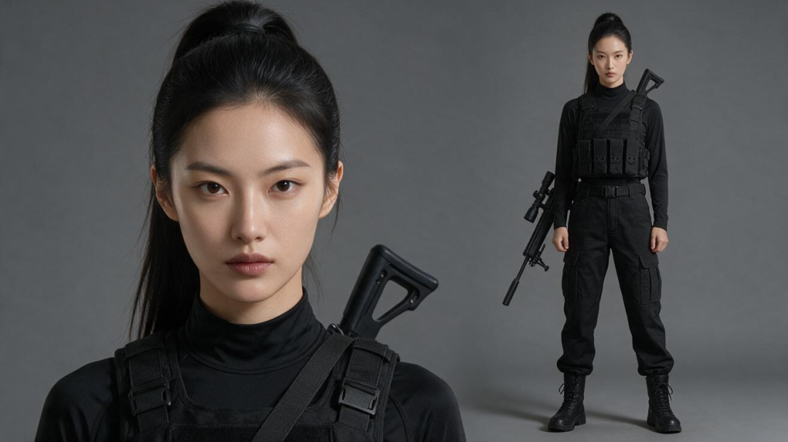
沈冰｜狙击手
**军医林小棠**，25岁女，甜美娇小，160cm，圆脸杏眼，浅酒窝，栗色齐肩短发，爱笑，胆子大。
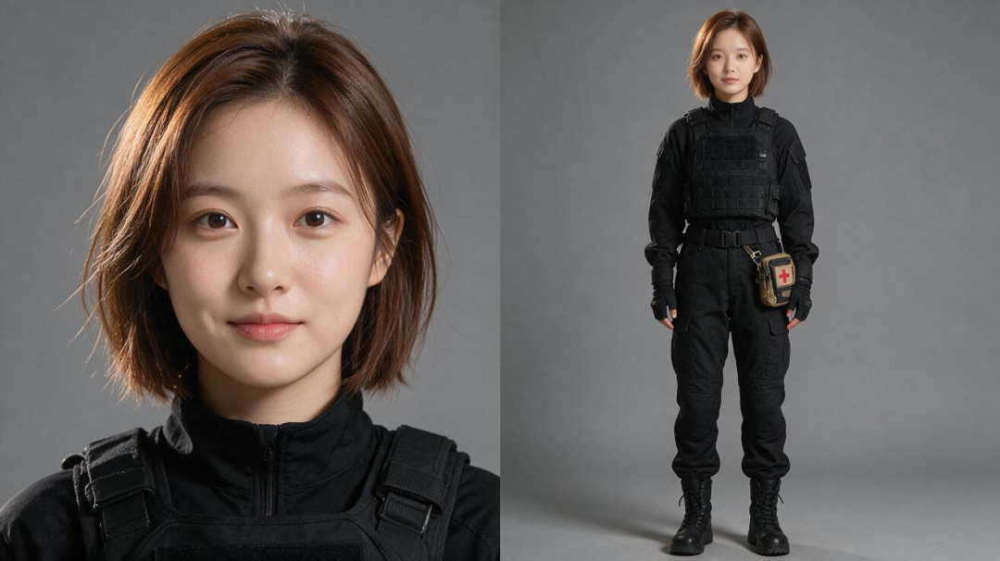
林小棠｜军医
**女将军萧红缨**，28岁女，英气，剑眉，鹅蛋脸，小麦肤色，高束发，172cm，健美，穿黑色束腰鱼鳞甲配暗红内衬。
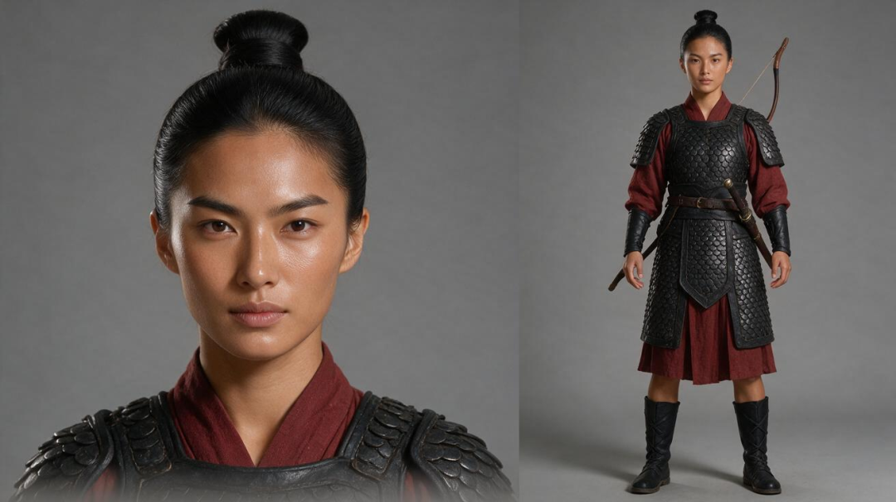
萧红缨｜女将军
**长公主燕明珠**，24岁女，明艳华贵，瓜子脸，桃花眼，云髻金钗，身材丰满，穿月白金线宫装。
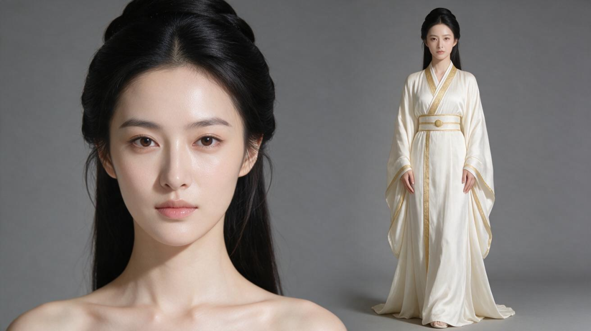
燕明珠｜长公主
**女刺客柳青**，26岁女，妩媚，狐狸眼，尖下巴，黑色长直发披肩，纤细柔韧，穿墨绿色贴身夜行衣。
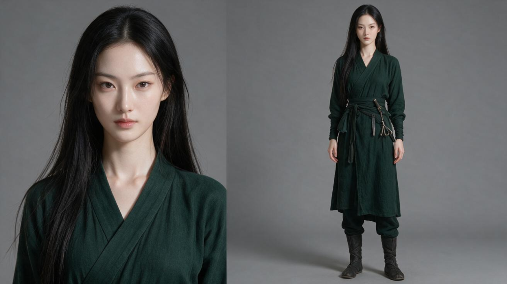
柳青｜女刺客
这五个人，我是比着写的。一个高马尾，另一个就别再扎马尾；一个 175cm，另一个就写 160cm。**这就是关掉人名条也认得出的底子。**
现代特战小队穿同一身黑，衣服帮不上忙，就全靠脸和身形。
**队长秦烈**，34岁男，方脸，寸头，高大宽肩，话少。
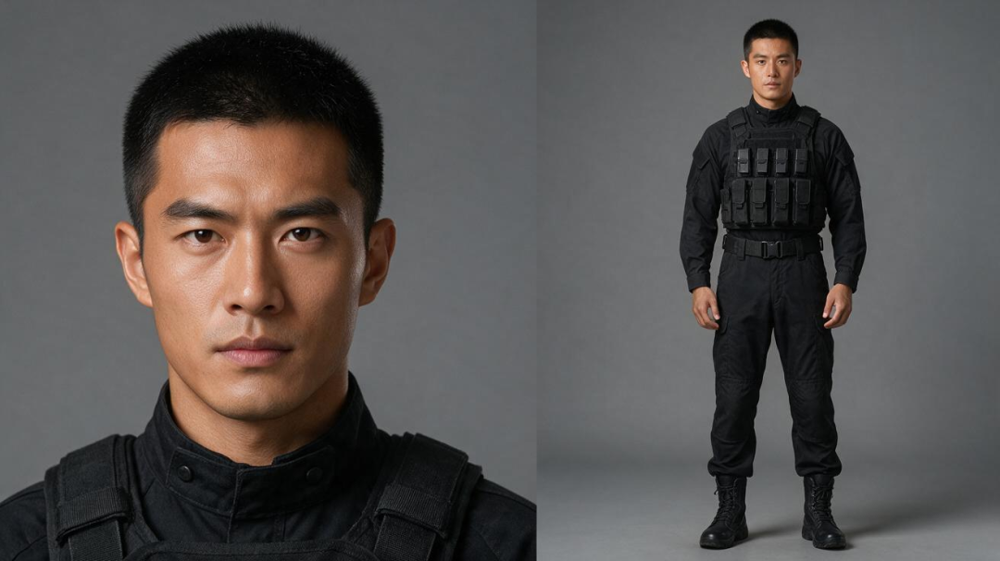
秦烈｜队长
**机枪手赵山河**，32岁男，长脸浓眉，190cm，魁梧，脑后扎短发小辫。
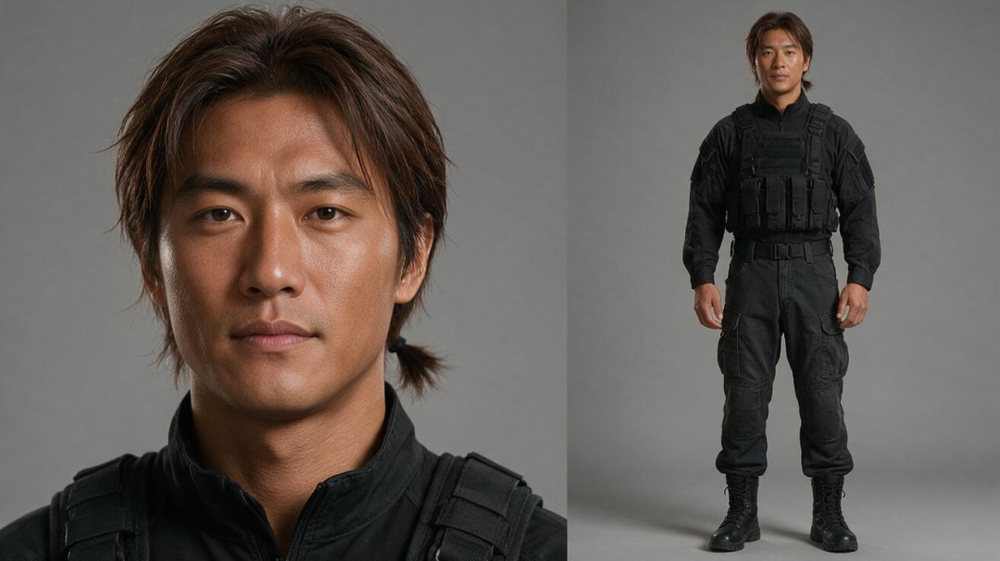
赵山河｜机枪手
**爆破手雷大勇**，40岁男，圆脸光头，矮壮，络腮胡，嗓门大。
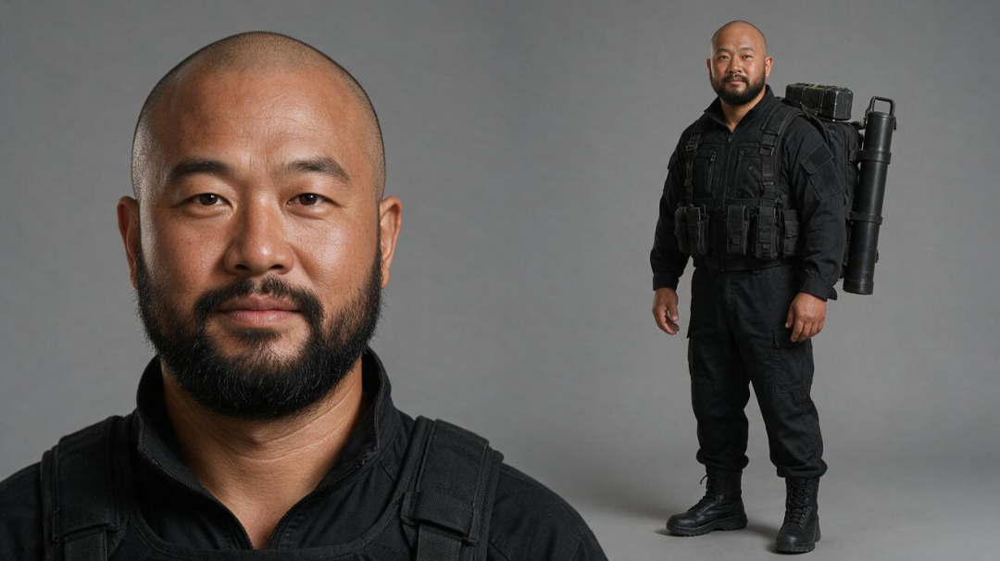
雷大勇｜爆破手
**无人机手许一鸣**，24岁男，娃娃脸，微卷碎发，清瘦，爱说话。
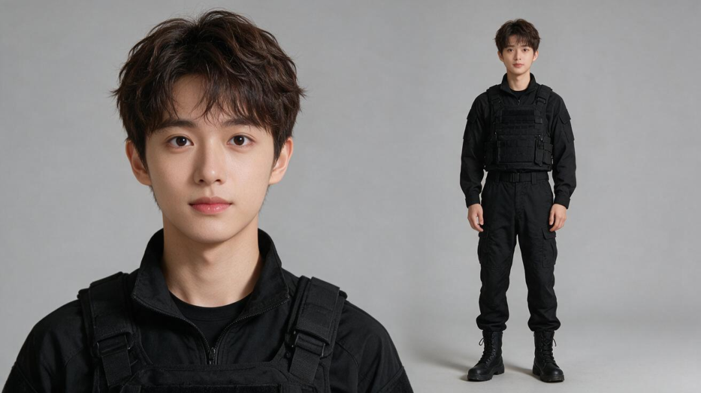
许一鸣｜无人机手
人物定了，分镜接着用。第1集第1场，剧本只有两句：北狄骑兵的马刀劈向萧红缨面门，她横剑格挡，虎口震裂。
数字专家里的分镜师读完这场剧本，再看人物和场景图，自动拆成了六格。
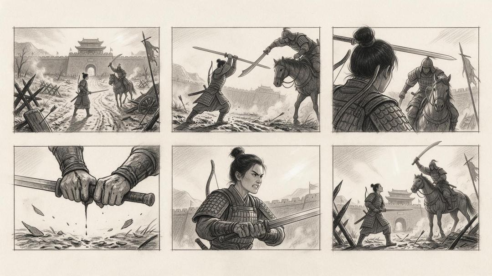
第1集第1场六格分镜｜萧红缨横剑格挡
高束发、鳞甲和背上的弓，都是设定图上的萧红缨。关门、拒马、残旗和破车，也是下面这张场景图里的位置。
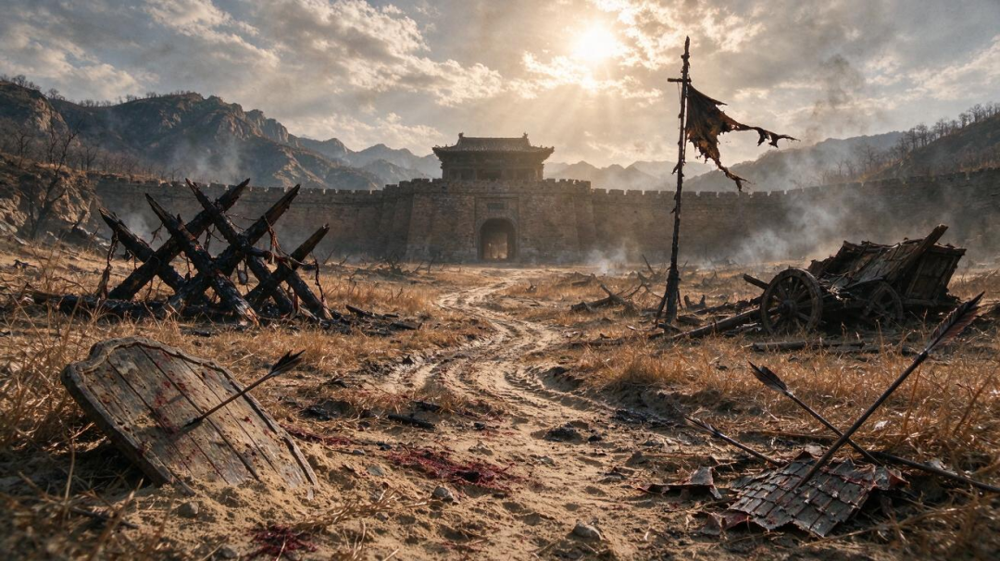
开场场景｜落雁关外侧战场
上面这些图，人物设定、出图和分镜都是数字专家自动完成的。你只要说清想要什么，再把像的人改开。
**01｜先把每个人的长相，一个个写开**
下面开始教。防串脸其实是两件事：**不同的人不能撞脸，同一个人不能换脸。**先解决第一件。
只写“美女”“军人”，AI 画出来的脸很容易往一个模样走。所以从最开始的故事想法起，就要把人分开。
打开猫斯卡首页，选“剧集短剧”，把故事和开头那些人物设定一起填进去，再点“试试看，开始创作”。

首页：选择剧集短剧，填写故事和人物
衣服只写第一次出场那一套，也写明小队不加古代服饰。现代人穿越，这句不写，现代装和古装容易混在一身上。
**02｜确认故事，再确认这些人**
这段话交出去，数字专家先写创意简报。我主要看三件事：**现代装备有没有保留，每集有没有碾压古代军队的戏，人物不撞型有没有写进去。**
翻到写作要点，第 7 条就写着女角色的脸型、发型、身材、气质和服装必须严格区分。
下面是后来画好的人物页，林小棠和萧红缨站一排，就是这条的样子。

人物页：林小棠和萧红缨，一眼分得开
接着是角色档案，每位角色一份人设，点开都能改。确认后，数字编剧开始写，这次先写前三集。
写好的每一场，都标好了场景和出场人物。

剧本阅读器：每一场都标好场景和出场人物
上面这套流程，你可以自己走一遍
**www.maosika.com**
电脑浏览器打开，复制这个地址就行
**03｜画之前，把像的人改开**
剧本写好，进“人物”页，点开“角色设定”。“决定长相”这一栏，出图时直接看。

人物页：每个人下面都有“角色设定”和“绘制设定图”
这一步要比着看：和自己写的比，人和人也比。机枪手赵山河这版是国字脸、板寸、185cm，和我要的不一样，也和队长秦烈的方脸寸头太近，又穿同一身黑，画出来就像兄弟俩。
直接改回来：长脸、浓眉、脑后扎短发小辫、190cm。外貌、体态和视觉描述一起改，存好再画，省得画完重来。
确认好，点“绘制设定图”，猫斯卡（www.maosika.com）就会按设定自动画出人物，一张脸部特写，一张全身。

人物页：改完再画的赵山河，旁边是雷大勇
这回赵山河和秦烈站一起，不会再认错。沈冰的狙击枪、林小棠的急救包、雷大勇背上的爆破筒，也都画在了全身图里。
**04｜看稿，看每个人有没有自己的戏**
脸分开了，戏也要分开。进阅读器，左边选集，中间看这一集的场次和对白。

剧本阅读器：沈冰一枪打落敌将，只报一句“1发”
第1集，沈冰隔着八百米一枪打落敌将，只报一句“1发。”赵山河的机枪扫倒一排骑兵。萧红缨活下来，第一件事是拿剑尖抵住秦烈的咽喉：“你使的是何妖法？”
第2集，韩守义要缴枪，秦烈只回“三息，退开。”当夜柳青摸向机枪，被戴夜视仪的沈冰按在地上。
第3集，雷大勇炸塌峡谷，埋掉北狄的攻城器械。萧红缨和燕明珠一左一右逼秦烈站队，敌营却传来一声枪响。秦烈说：“这声音，跟我们的枪一样。”
**05｜同一个人，每一集都用这张脸**
不同的人分开了，接下来是第二件事：同一个人不能换脸。
设定图画好，就是这部剧的人物资产。第1集画好的秦烈，第2、3集的人物页里还是这一张，不用每集重画，后面有新人物出场再画新的。集数越长，这份资产越省事。
场景也一样。在“场景”页确认地点、日夜和环境描述，猫斯卡自动画图，开头那张战场就是这样来的。
拍视频时，猫斯卡（www.maosika.com）会把这一场的场景图和人物设定图一起带上，外观以图为准，提示词只写动作和表情，减少文字和图打架。用 Seedance 出片，人物参考图有 30 天有效期，界面会提示，到期前用上。
**想开自己的故事，可以先这样说**
下面是一段可复制改写的创作输入示例。换成你喜欢的朝代、队伍和人物，就能开始。
**提示词 · 军事穿越剧人物示例**
我想写一部现代特战小队携械穿越古代边关的爽剧，100集，每集约2分钟。六人小队带着狙击步枪、机枪、炸药、夜视仪和侦察无人机，第1集第一场就在古代战场，穿越只用一句台词带过。每集至少有一场现代装备当场碾压古代军队的戏。 主要人物都要一眼分得开，脸型、发型、身材、气质和衣服都不能撞。女角色都年轻貌美、身材好，各有各的美，全部是成年人.
上面这套流程，你可以自己走一遍
**www.maosika.com**
电脑浏览器打开，复制这个地址就行
