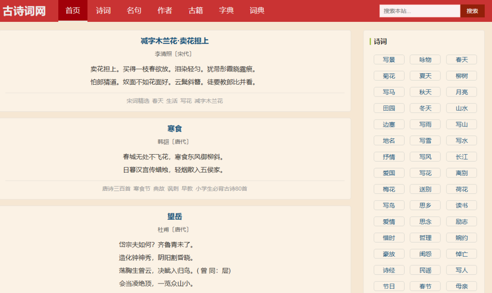
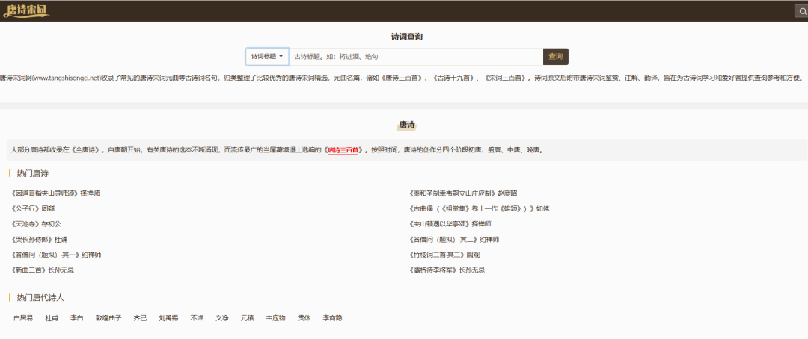
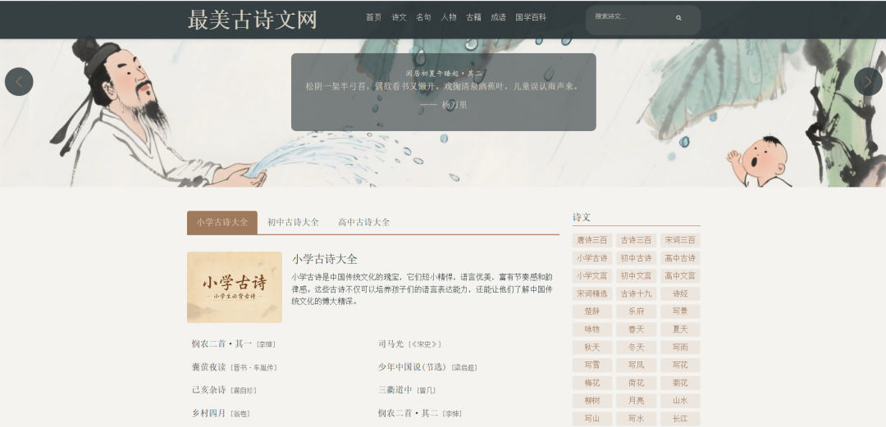
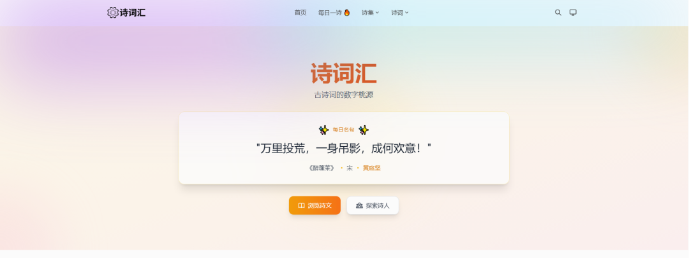
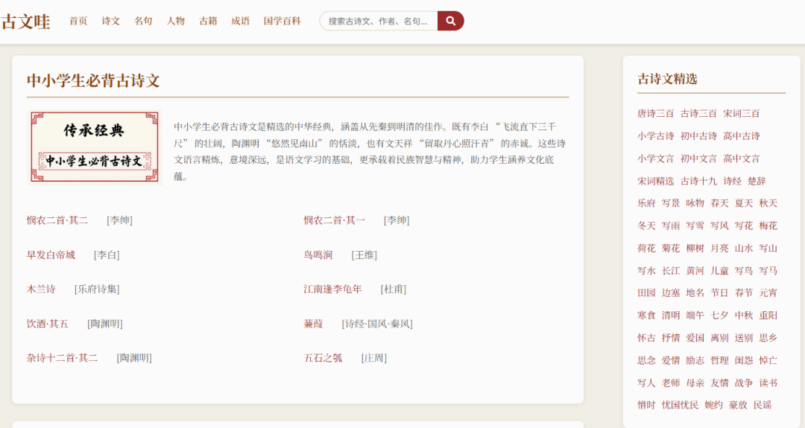
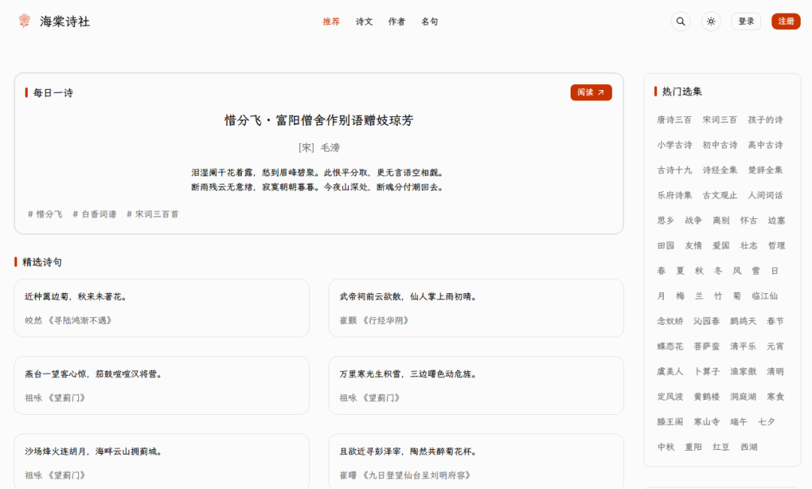
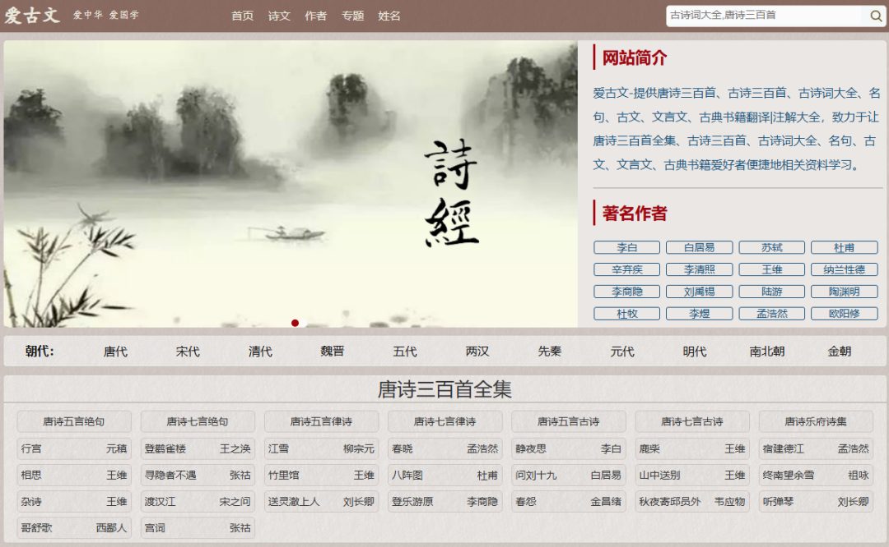
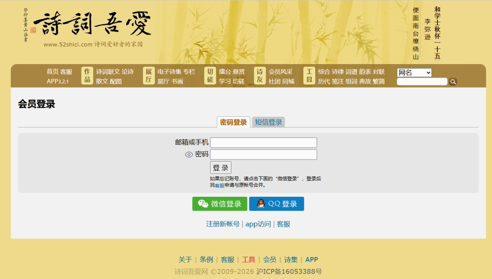

# 10个免费古诗文网站，专治看不懂、记不住
> 💡 备注属性未写入，可能是备注属性名称或者类型被修改了，建议将字段类型设置为 rich_text，可以在小程序-操作-修改文章数据库页面进行调整
> 原文链接:[https://mp.weixin.qq.com/s/8G_sNm2ywil4JWYtJPhovg](https://mp.weixin.qq.com/s/8G_sNm2ywil4JWYtJPhovg)
古诗文，小学要背，初中要考，高中要默，一篇《琵琶行》长得能绕教室两圈。
买资料吧，厚厚一本翻两页就吃灰；报班吧，钱花了，孩子照样背了忘。
其实真不用这么辛苦——今天分享 10 个免费古诗文学习网站，从小学到高中全覆盖，背诵、默写、文言文、课外拓展，一个不落。
全都免费，亲测能打开，建议先收藏再往下看。
**一、古诗词网**
**网址：https://www.gushici.org**

这个网站是妥妥的"全家桶"：**诗词、名句、作者、古籍、字典、词典**，六大件一次配齐。
想看时令诗，首页翻到李清照的《减字木兰花·卖花担上》，点进去原文、注释全都有；
想查古籍，《论语》《史记》《山海经》《三字经》也都在。
**全站免费，没有充值入口。**
要说注意什么，就是界面朴素，没什么花哨功能——但人家主打一个"全"，孩子查到冷门篇目，来这里基本不会扑空。
**二、唐诗宋词网**
**网址：https://m.tangshisongci.net**

名字直白，内容也实在：唐诗、宋词、元曲三座大山都收全了，《唐诗三百首》《宋词三百首》《古诗十九首》按选本归好类。
最让我满意的是每首诗词后面都跟着**赏析、注解、韵译**，家长辅导不抓瞎。
它还按**初唐、盛唐、中唐、晚唐**分了阶段，连《全唐诗》里的冷门诗都有收录，碰到"偏门考点"也不慌。
手机版打开就能用，等公交的功夫都能翻两首。
唯一的提醒：内容太全，容易翻着翻着忘了本来要查哪首。
**三、中国诗词欣赏网**
**网址：http://m.mcww.cn**

一个"老古董"网站，但老有老的好。
**诗文、作者、名句、典籍、成语**五个板块，干净利落，一点广告都没有。
我特意翻了翻，像《金缕衣》这种"劝君莫惜金缕衣"的考试常客都在，李白、李煜、李清照的名篇也不少。
界面确实朴素得像十年前的老站（它也确实是那个年代出生的），但**胜在加载快、不弹窗、不诱导下载APP，旧手机打开都流畅。**
这种踏踏实实的网站，现在真不多见了。
**四、古诗屋**
**网址：https://www.gushi5.com**

这站是十个里面最"会玩"的，玩得还都挺有用：**必背古诗、格律入门、每日打卡、诗词填空，外加古汉语词典、诗人百科**。
我最喜欢诗词填空——把诗挖几个空让你填，孩子刷上几遍，默写基本就稳了；
每日打卡跟朋友圈打卡一个套路，能帮孩子把背诗养成习惯。
它还整了一堆AI功能：**AI配水墨图、AI诗词问答、AI续写诗句、古今互译**，当个玩具玩特别有意思。
网站完全全部免费，但要注意两条：打卡功能需要登录账号；AI功能玩归玩，正经学习还得靠"填空"和"必背古诗"这两个主力。
**五、最美古诗文网**
**网址：https://zmgsw.com**

名字起得好，内容也对得起名字。
它的杀手锏是按学段整理：**小学古诗大全、初中古诗大全、高中古诗大全**，直接对标课堂——部编版课本里的《愚公移山》《论语十二章》《过秦论》全在，连《少年中国说》都有。
还专门做了"四季古诗""节日古诗"专栏，中秋节前搜个"中秋"，一晚上能给娃讲出一堂文化课。
**免费、无广告、分类清楚，家长拿来搞"课本同步"最顺手，没有之一。**
**六、诗词汇**
**网址：https://shici.znkong.com**

如果你家娃是"颜值党"，这个站一定长在他审美上：支持暗色模式，能按朝代、诗人、主题检索，用快捷键就能呼出搜索框，体验相当现代。
数据也够硬气：**光宋代就收录了679位诗人、3700多首作品，唐代331位诗人、1600多首。**
主题分类特别贴心——**思乡、离别、壮志、边塞、田园**，写作文想引用名句，按主题一搜一个准。
还有一套专门的"给孩子的诗"，适合亲子共读。
**免费无广告，学生自己用、家长带着用都合适。**
**七、古文哇**
**网址：https://www.guwenwa.com**

这站厉害在"诗文通吃"：**不光有唐诗宋词元曲，还专门做了"中小学生必背古诗文"板块，小学、初中的文言文都给安排明白了。**
想读古籍也方便，红楼梦、世说新语、菜根谭、增广贤文随手点开就是。
它还有个"诗人合称"专栏：**初唐四杰、竹林七贤、唐宋八大家**，篇篇都是现成的人物知识素材，老师备课、学生写人物作文都用得上。
**注意一条**：站里的"国学百科"板块混了不少民族风情内容，跟古诗文学习关系不大，别让孩子逛偏了，直奔"古诗文精选"就行。
**八、海棠诗社**
**网址：https://haitang.app**

名字最有诗意的网站，没有之一。
界面走极简风，每天推一首诗，首页挑的句子都是"泪湿阑干花著露，愁到眉峰碧聚"这种能直击灵魂的。
选集也全：**《唐诗三百首》《宋词三百首》自然有，惊喜的是还有《古文观止》《人间词话》《诗经》《楚辞》。**
想按词牌逛也行：**临江仙、念奴娇、沁园春**，一个词牌下面串一串名篇，特别适合想系统了解宋词的孩子。
页面上有注册入口，但阅读完全不用登录，放心用。
**九、爱古文**
**网址：https://aiguwen.oulujixie.cn**

这站专注干一件事：把"全集"给你整理明白。
唐诗三百首按**五言绝句、七言绝句、五言律诗、七言律诗、乐府**分得清清楚楚，想练哪类点哪类；
**小学、初中、高中**的古诗文言文也各自成册。
还附赠"诗人称号大全"：**诗仙李白、诗圣杜甫、诗鬼李贺、诗佛王维**，一个称号一段典故，孩子记诗人再也不串台。
页面也比较素，但内容都是干货，免费可看，手机直接打开就能读。
**十、诗词吾爱**
**网址：https://www.52shici.com**

压轴这位跟前面九位走的不是一条路——前九个是"读诗"的，它是"写诗"的。
诗词吾爱最有名的武器是格律检测：写完一首诗贴进去，平仄、押韵、对仗哪儿不对，直接给你标出来，连"拗救"这种进阶操作都支持。
**词谱、韵表、对联、典故、组词、繁简转换**，写作者的工具栏它配得整整齐齐。
还有**擂台、悬赏、社团**，诗友互相切磋，氛围特别好。

想让孩子从"背诗的人"升级成"写诗的人"，选它准没错。
**要注意：发作品、打擂台得注册登录，但浏览学习完全免费；**
格律对中学生有点难，大学生和爱写诗的家长正合适。
**写在最后：**
好了，十个网站都在这儿了，最后给大家划个重点：
查资料找古诗词网和唐诗宋词网，课本同步找最美古诗文网和爱古文，刷默写找古诗屋，系统了解诗词找诗词汇和海棠诗社，想动手写诗就上诗词吾爱。**全部免费，全部亲测能打开。**
背古诗这件事，真不用跟它死磕。
工具选对了，孩子自己就愿意翻，翻着翻着就背下来了，背着背着说不定就写出自己的诗了——这比逼着抄十遍强多了。
**如果觉得有用，就帮忙点个**🤍**、转发给身边的家长和老师，让更多孩子少遭背诵的罪。**
收藏好这份古诗文学习网站清单，以后找不到了，记得回来看。
**您可能还喜欢：**
[这10个免费学习网站，够你从小学用到大学！](https://mp.weixin.qq.com/s?__biz=MzA3NDU2Njc4Nw%3D%3D&mid=2652233402&idx=1&sn=0702b48c92e611d906925058307c4eb7&scene=21#wechat_redirect)
[5个免费文言文网站，专治看不懂、背不下！](https://mp.weixin.qq.com/s?__biz=MzA3NDU2Njc4Nw%3D%3D&mid=2652234123&idx=1&sn=41d93d34de3ba7c60a7a07c474b567b7&scene=21#wechat_redirect)
[这9个免费学习网站，轻松搞定初高中全部学科！](https://mp.weixin.qq.com/s?__biz=MzA3NDU2Njc4Nw%3D%3D&mid=2652233735&idx=1&sn=31a4c253aee3e75558d8d68c00e3a1d7&scene=21#wechat_redirect)
#古诗文 #学习网站 #免费学习资源 #语文学习 #背诵方法 #学习方法
