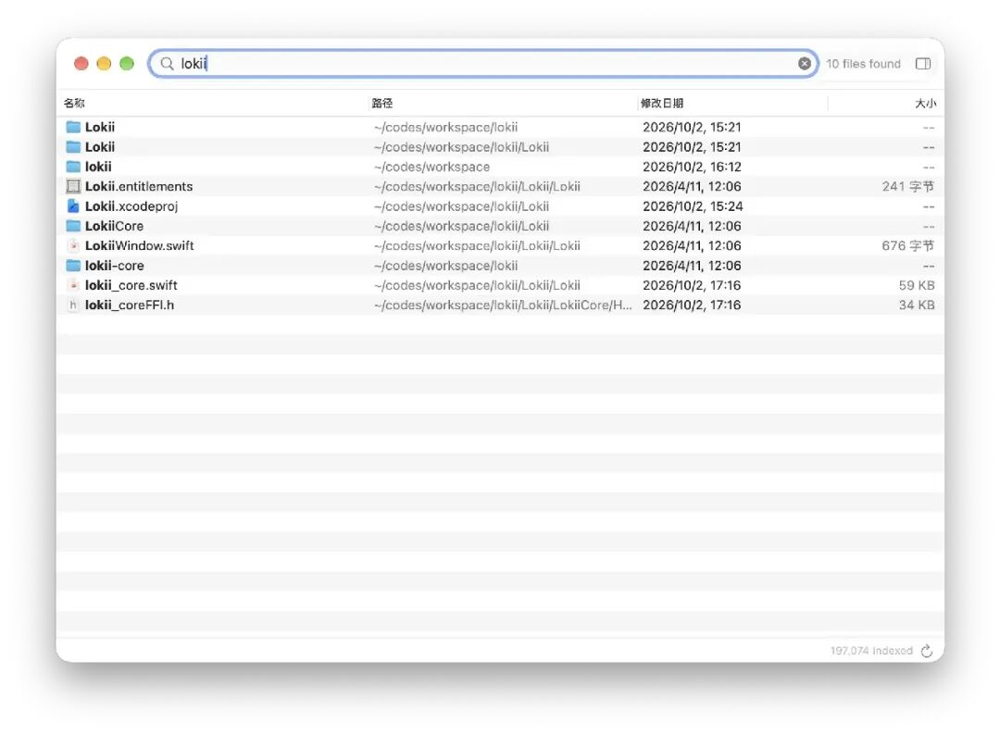

# 10款大家发现的好评软件[2026年第41期]
> 💡 备注属性未写入，可能是备注属性名称或者类型被修改了，建议将字段类型设置为 rich_text，可以在小程序-操作-修改文章数据库页面进行调整
> 💡 原文链接:[https://mp.weixin.qq.com/s?__biz=MjM5NDMwMTI2MA==&mid=2651703153&idx=1&sn=ff6bd2ac3b48d3d282a81d53b6eb8359&chksm=bc6a8516fda487ba896aae0745a5c1e6d2188ce4a0fd0398694d149ee835a68f7e57659cc261#rd](https://mp.weixin.qq.com/s?__biz=MjM5NDMwMTI2MA%3D%3D&mid=2651703153&idx=1&sn=ff6bd2ac3b48d3d282a81d53b6eb8359&chksm=bc6a8516fda487ba896aae0745a5c1e6d2188ce4a0fd0398694d149ee835a68f7e57659cc261#rd)
又到周一总结发现频道内容的时候了。
最近青小蛙有一个感受，就是开发者自荐异常的多，以前一天一两个，现在要上10个以上...
看起来，每个人都是开发者了啊。

这一期继续从论坛发现频道挑选 10 个主题：有 Mac 文件搜索、扫描书阅读器、Windows 原生 Markdown 编辑器，也有看城堡、查高速路况和临时传文件的网站。想折腾一点，还可以在 Windows 上跑 DNS 服务，或者用自己的 API 和 AI 练口语。
直接列出来：
### 目录
- • **Lokii**：给 Mac 做一个像 Everything 的文件搜索工具
- • **Thousand** Castles：在地图上逛逛世界各地的城堡
- • **Modu 默读**：让扫描 PDF 在手机上也好读一些
- • **红果**桌面版：在 Windows 上找短剧，接着上次看
- • **Shazao 沙枣**：单 EXE 的 Windows 原生 Markdown 编辑器
- • **全国高速路况**：按道路编号和收费站查近期信息
- • **残留清理卫士**：卸载软件后，再查一遍留下的东西
- • **smartdns-rs**：在 Windows 上原生运行的 DNS 服务
- • **网络剪贴板**：不用登录，临时在手机和电脑间传文件
- • **芯语伴 SprechMate**：和 AI 聊几句，再跟读纠音
#### Lokii：给 Mac 做一个像 Everything 的文件搜索工具
昨天还有同学问，这款与前天介绍的这款相比，有什么区别[比 Finder 快 17000 倍？开源 macOS 全盘文件搜索工具](https://mp.weixin.qq.com/s?__biz=MjM5NDMwMTI2MA%3D%3D&mid=2651703079&idx=3&sn=dec0a39da512912f93cc65513461a466&scene=21#wechat_redirect)。
青小蛙表示还没测Lokii，它就上榜了，所以不太清楚，两者发布时间间隔非常近，推荐都试试。
meta.appinn.net/t/93005

Lokii 是免费开源的 macOS 原生文件搜索软件，采用 MIT 许可证，用 Rust 做索引，界面基于 AppKit。界面类似 Everything。
它搜索的是文件名和路径，支持通配符、多关键词、正则表达式，以及拼音首字母和全拼模糊匹配，还能按文件类型、路径过滤。目前没有文件正文的全文搜索。
第一次运行需要遍历文件建立索引，之后通过 macOS 的 FSEvents 监听变化、增量更新。按开发者在回复中的说明，50 万文件的检索通常在 2～5 毫秒，常驻内存低于 100MB；这些是开发者给出的数据，具体表现还要看自己的文件数量和设备。
索引在本机处理，开发者表示没有网络遥测。主要想快速找文件、工程目录和文档的 Mac 用户，可以看看。
---
青小蛙分析了代码（找AI），得到的结论是：Lokii 和 FSearch 的基本原理相同，但 FSearch 在索引结构、搜索优化、增量同步和大规模文件处理方面设计得更深入。
| 技术维度 | Lokii | FSearch |
| 核心语言 | Rust | Rust |
| 产品形式 | macOS 原生 GUI | CLI + Daemon + Rust 库 |
| 文件扫描 | jwalk 多线程递归遍历 | `getattrlistbulk` 批量枚举 |
| 默认扫描范围 | 用户主目录 `~` | 根目录 `/` |
| 索引数据结构 | `Vec` | 自定义紧凑二进制索引 |
| 内存管理 | 将文件信息加载到堆内存 | mmap 内存映射 |
| 文件名存储 | 每个文件记录保存名称和路径 | 相同文件名去重存储 |
| 搜索算法 | 逐条遍历、字符串匹配 | 位图过滤、候选筛选、并行搜索 |
| 模糊搜索 | nucleo-matcher | 自研模糊匹配与拼写纠错 |
| 目录限定搜索 | 路径或范围筛选 | 利用索引中的目录连续区间 |
| 文件变化监控 | notify + FSEvents | 直接使用 FSEvents |
| 索引增量更新 | 修改内存数组 | 不可变基础索引 + 增量层 |
| 重启后恢复 | 加载缓存，再重新扫描校验 | 加载索引，回放 FSEvents |
| 索引持久化 | bitcode 序列化 | 自定义二进制文件 |
| 文件内容搜索 | 尚未实现 | Trigram 索引 |
| API | UniFFI（Swift 调 Rust） | Unix Socket JSON / Rust API |
| 图形界面 | AppKit + 部分 SwiftUI | 无官方 GUI |
#### Thousand Castles：在地图上逛逛世界各地的城堡
这款前几天介绍了，[这大概就是互联网最初让人喜欢的样子](https://mp.weixin.qq.com/s?__biz=MjM5NDMwMTI2MA%3D%3D&mid=2651703004&idx=2&sn=5e0436e59933ae334d1ffa419e447190&scene=21#wechat_redirect)。来自荷兰的开发者给青小蛙发了邮件，青小蛙让他发到发现频道，然后就有了这个帖子：
meta.appinn.net/t/93043
Thousand Castles 是一个免费的历史建筑目录网站，支持包括中文在内的 15 种语言。

虽然名字叫“千座城堡”，收录范围还包括要塞、宫殿、设防城镇、庄园和设防教堂。按作者介绍，网站整理了 170 个国家的 57,000 多处历史遗迹，每处配有资料、照片和介绍。
可以在地图上找，也可以看世界排名、各国排名，或者顺着 43 个专题慢慢逛。长城、福建土楼、日本城堡、卢瓦尔河城堡都在其中，还能为下一次旅行建立自己的合集。
#### Modu 默读：让扫描 PDF 在手机上也好读一些
meta.appinn.net/t/93226
Modu 默读是一个免费开源的跨平台阅读器，支持导入 EPUB、PDF、MOBI、AZW3、TXT、Markdown 等格式，整理书架、做笔记，也能听书。
支持 Android、Windows、macOS、Linux 还有自签名的 iOS，和鸿蒙。

扫描 PDF 是它比较有意思的一部分：可以裁边、旋转、分格、调整阅读顺序，再通过漂白、加黑、对比度和锐化改善页面显示。这些处理不改写原书，可以随时对照原图。
有文字层的 PDF 可以重排，纯图片则通过 OCR 识别。模型按需下载，下载后在本机识别；识别出的文字可以调字体、复制、查词和标注。复杂分栏、模糊扫描的识别结果，仍需要对照原图。
#### 红果桌面版：在 Windows 上找短剧，接着上次看
meta.appinn.net/t/93111
在电脑上看红果。提供搜索、选集、收藏、观看历史、倍速和自动连播。播放时可以用老板键隐藏窗口并暂停，恢复后继续；如果之前是手动暂停，恢复窗口也会保持暂停。
收藏和观看进度保存在当前电脑，不与手机账号同步。播放需要联网，内容和网络可用性可能变化。
这是第三方独立维护的桌面软件，未开源，GitHub 只用于托管发行文件。
#### Shazao 沙枣：单 EXE 的 Windows 原生 Markdown 编辑器
meta.appinn.net/t/93080
Shazao 是一个免费的 Windows Markdown 阅读与编辑器，无需注册或登录。作者来自西北，取名“沙枣”，是想留下一点故乡的记忆。

吃过这个的举手！
Shazao 保持单 EXE，不依赖 Electron 或 WebView2。平时可以直接打开 Markdown 阅读，需要修改时在排版后的内容中编辑，也能切换到源码模式。
大纲、表格、图片、代码块、任务列表和搜索都有，还支持 HTML、PDF、Word、EPUB 等导出方式，以及多种 Mermaid 图。从 Word、浏览器、Excel 复制富文本时，也会尝试转换成对应的 Markdown。
目前项目暂未开源，GitHub 用于版本说明、下载和反馈。帖子里已有用户反馈窗口位置、滚动显示和代码块输入的问题，作者表示会在后续版本处理。喜欢原生小工具、想找一个日常 Markdown 阅读器的同学，可以试试。
#### 全国高速路况：按道路编号和收费站查近期信息
meta.appinn.net/t/93204
这个有点神，它就是一个单纯的网页，汇总了全国高速信息，以至于我以为是某个信息源。

由于没有标注具体的信息来源出处，所以建议看看就好。参考的话隔壁打开高德。
#### 残留清理卫士：卸载软件后，再查一遍留下的东西
meta.appinn.net/t/92934
残留清理卫士 ResidualCleaner 是一个 Windows 卸载与残留清理工具，重点处理 数字 及相关软件，支持 Windows 10 / 11，运行需要管理员权限，单文件免安装。

按开发者介绍，它提供官方卸载与强力卸载两种机制，扫描残留目录、服务、计划任务、快捷方式和注册表项。清理项目可以勾选，失败项会单独标注，也能查看日志；清理注册表前会自动备份。
注意该软件有付费高级版本。
#### smartdns-rs：在 Windows 上原生运行的 DNS 服务
meta.appinn.net/t/93282
自建一切！

smartdns-rs 是用 Rust 编写的跨平台本地 DNS 服务。作者希望让 Windows 用户也能直接运行，不必为了使用原版 smartdns 先装 Docker 或 WSL。
项目以选择响应较快的网站 IP 为目标，支持 DoT、DoQ、DoH、DoH3 等协议。内置 Web 界面可以查看最近 1,000 条查询日志，按域名、客户端和查询类型过滤，也能看各个上游的成功率、平均耗时，以及热门域名和客户端排行。
作者表示，针对自己长期使用时遇到的上游异常、延迟上升等问题做了修复。帖内的缓存命中率与延时数字来自作者自己的环境，不代表换一个网络也会得到相同结果。
#### 网络剪贴板：不用登录，临时在手机和电脑间传文件
meta.appinn.net/t/93004
网络剪贴板是一个简单的临时文件与文本传输工具，打开网页就可以输入文本，或者上传文件。
当前单个文件最大 100MB，文件合计最大 300MB，上传文件会在 7 天后自动清理。
#### 芯语伴 SprechMate：和 AI 聊几句，再跟读纠音
meta.appinn.net/t/93099
芯语伴 SprechMate 是一个免费开源、可以自行部署的口语练习网页工具。作者原本用它练德语，按介绍支持用 23 种语言与 AI 聊天，再生成语音、录音跟读，通过 Azure 做发音评估。

它是纯静态 PWA，可以部署到 Cloudflare Pages。安卓可以安装为 PWA，作者建议 iOS 直接使用网页版。
使用时需要自行配置聊天模型 API 和微软 Azure Speech Key。
青小蛙觉得，这个机制很不错呀，外语环境，这不就是在大模型时代，到来了么。

## 摘要

（待补充）

## 我的笔记

（待补充）
