# 12 万 Star 的 DeepSeek Harness 桌面版来了，还有一堆实用插件！
> 💡 原文链接:[https://mp.weixin.qq.com/s?__biz=MzA5MjU0NzQ3Ng==&mid=2651431541&idx=1&sn=e775b3d228b5c4b9d868dc4c49ebcbde&chksm=8a3c6574fc293134ba4153d92a222817d01c9ed0a6defe3597ea77755cb17e48fbcb7538f169#rd](https://mp.weixin.qq.com/s?__biz=MzA5MjU0NzQ3Ng%3D%3D&mid=2651431541&idx=1&sn=e775b3d228b5c4b9d868dc4c49ebcbde&chksm=8a3c6574fc293134ba4153d92a222817d01c9ed0a6defe3597ea77755cb17e48fbcb7538f169#rd)

关注 “**AI 工具派”**
探索最新 AI 工具，发现 AI 带来的无限可能性！
Hi，我是Chris，一个专注于探索各类 AI工具的博主，与大家一起发掘 AI 的潜力。我正在开发[WiseMindA](https://mp.weixin.qq.com/s?__biz=MzA5MjU0NzQ3Ng%3D%3D&mid=2651429730&idx=1&sn=14456a0880d01521dbbd6f0e3f82c79f&scene=21#wechat_redirect)，期待它能成为提升学习好搭子。
大家好，我是 Chris。
DeepSeek Harness 的火爆程度有点夸张，开源到今天才 3 天，GitHub Star 就冲到了 **12 万+**。它的核心理念 **Everything is a Plugin** 非常巧妙，Agent、Skill、工具、工作流全都能通过插件扩展，可玩性非常高。
不过它目前处于开发预览版，需要依赖终端命令启动，对不熟悉命令行的用户门槛不低。
今天 Chris 刚好看到一个 DeepSeek Harness 开源桌面客户端项目，支持一键安装，还优化了多模型适配，体验更友好。
Chris 第一时间装上体验了下，今天就跟大家分享下。
### 一、工具介绍 🛠️
**DSH Desktop** 是一个可以装在电脑上的 DeepSeek Harness 桌面应用，支持 **macOS（Apple Silicon / Intel）和 Windows x64**，MIT 协议完全开源。
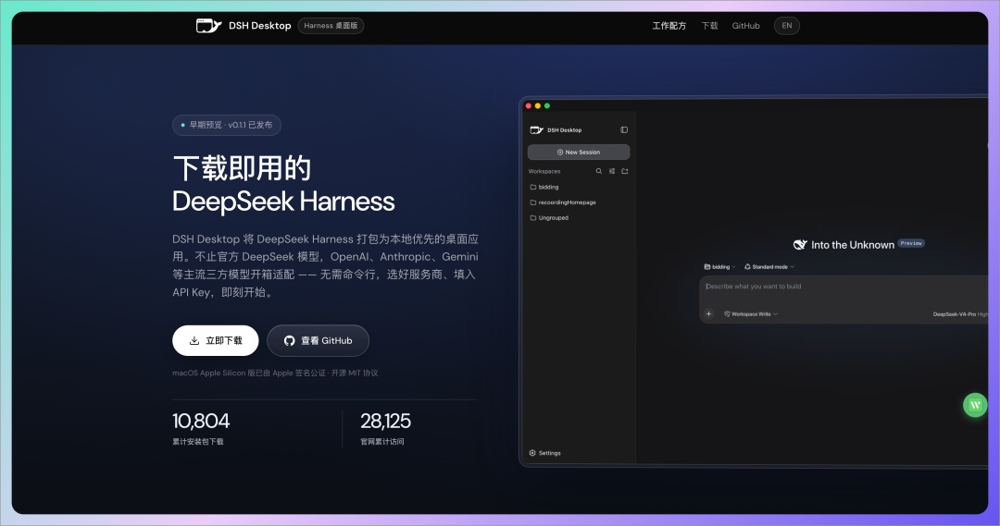
它是把 Harness 的本地 Web 体验封装成桌面应用，点击图标启动后，它会在后台把 Harness 安装好，自动管理随机回环端口、启动检测、日志和退出，就绪后直接进入完整界面。
原本 Harness 里的**项目管理、Agent 和插件能力全部保留**，你在里面添加项目文件夹，就能开始和 Agent 对话，不用再单独开一个终端窗口。
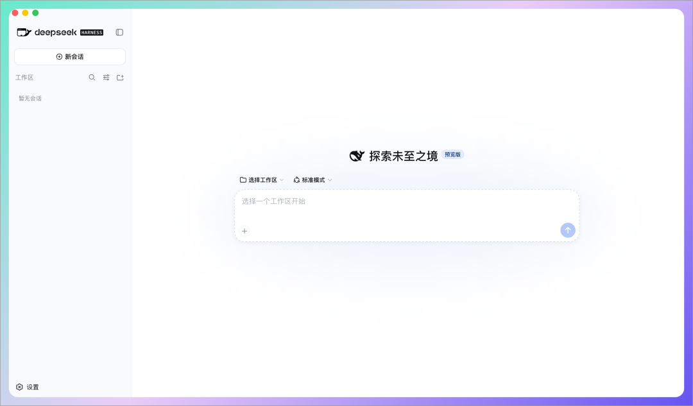
注意了：**DSH Desktop 是社区开发的独立项目，并非 DeepSeek 官方桌面客户端**。不过也正因如此，它在模型适配和桌面体验上做了很多官方没做的事。
### 二、快速上手 🚀
上手非常简单，三步搞定：
1. 去官网 www.dshdesktop.com 下载安装包，支持 **macOS Apple Silicon、macOS Intel 和 Windows x64** 三个版本
1. 安装后双击启动，首次配置时选择你手里已有 API Key 的模型服务商，默认使用 DeepSeek，你可以到 platform.deepseek.com/api_keys 去创建一个 API Key。
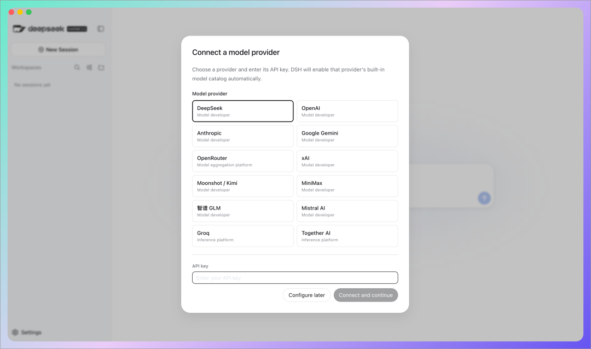
1. 填好 Key，直接进入 Harness 完整界面，就可以使用了
接下来 Chris 使用 DeepSeek-V4-Flash 做一个知识卡片页面，输入提示词就可以了：
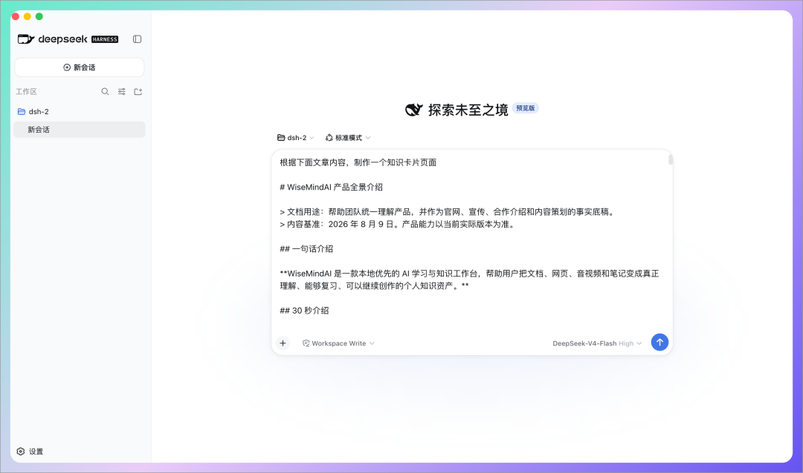
接下来 DeepSeek Harness 就会开始拆解任务并执行，最终生成一份我需要的知识卡片页面。
**不过 DeepSeek Harness 是不支持直接预览文档的**，需要打开电脑软件去预览。因为对于 DeepSeek Harness 来说一切都是插件，所以后续再安装一个文档预览插件即可。
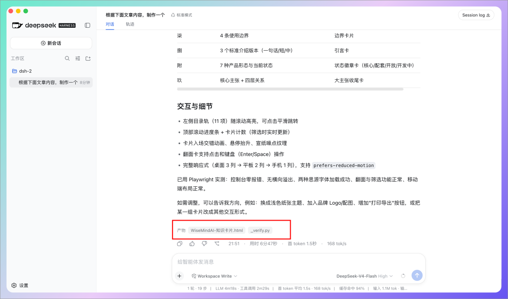
这里我们先用默认浏览器去打开这个知识卡片页面：
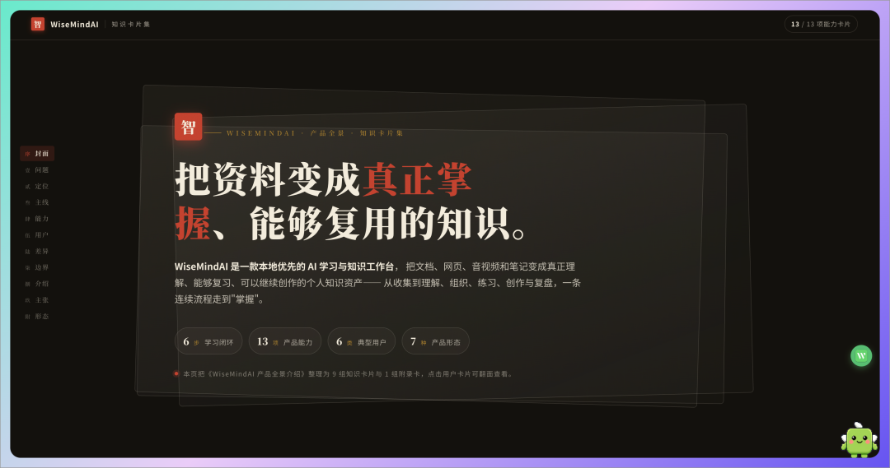
这样就可以正常使用 DeepSeek Harness 客户端了，后续大家正常输入需求使用即可。
### 三、核心功能 🔍
#### 1. 不用再折腾命令行
DSH Desktop 最直接的价值就是直接点击图标就能打开使用 DeepSeek Harness 完整版。
Harness 启动时要处理的准备工作，比如创建子进程、监听端口、启动检测，DSH Desktop 全在后台完成了。每次启动只监听随机的 **`127.0.0.1`** 端口，不会把管理页面暴露到网络上。
还有个细节很贴心：你的对话、插件和个人设置保存在应用安装目录之外，**更新应用不会顺手把它们清掉**。macOS 和 Windows 版本会在启动后及每 6 小时自动检查更新，新版本后台下载好再提示重启安装。
#### 2. Preset 广场
Preset 是 DeepSeek Harness 里非常重要的概念，因为它一切皆插件，也就是**一堆插件的组合，就是一个 Preset**。
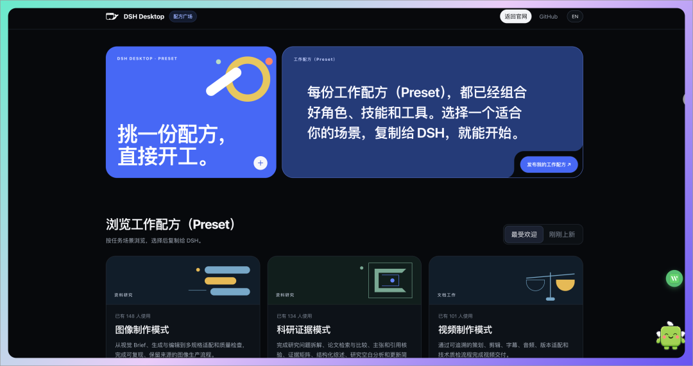
有了 Preset 的 Agent 能更好地干专业的活儿。可以理解为“**通用 Agent + Preset = 专业 Agent**”。
未来各种定制需求和垂直场景任务，都可以封装成 Preset。如果 DeepSeek Harness 的理念被验证有效，Preset 很可能像之前的 Skill 一样全面爆发。
DSH Desktop 顺势推出了 **Preset 广场**，打开 www.dshdesktop.com/preset/ ，你可以在这里直接挑选别人配好的“工作配方”。
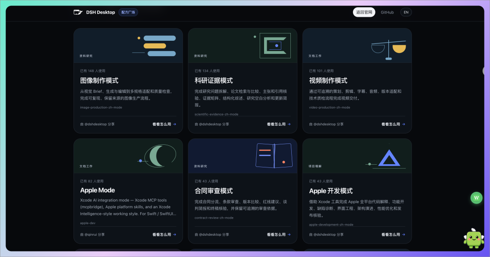
打开一个 Preset 后，在详情页直接点击“复制安装请求”，然后到 DSH 客户端发送就可以：
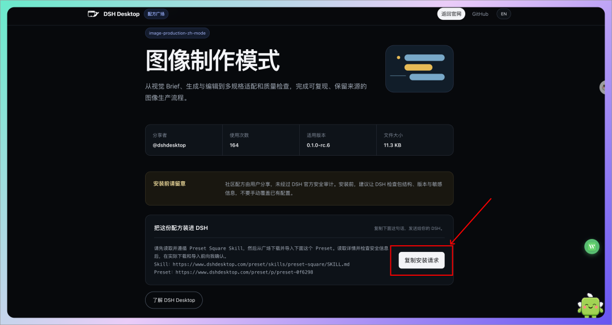
然后等待安装完成就可以：
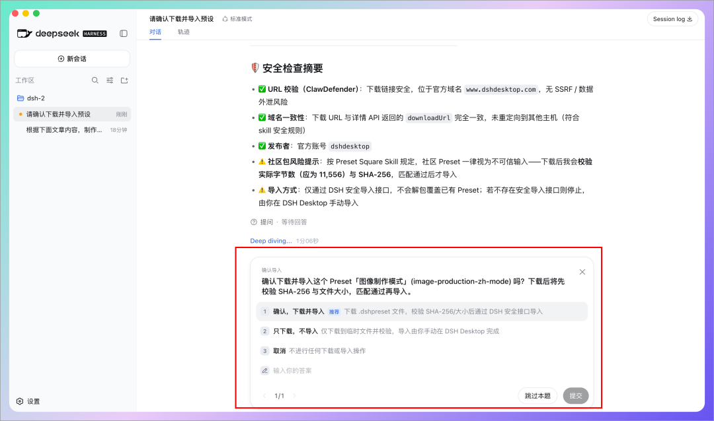
Chris 理解 Preset 跟 Skill 的区别是**更底层、能改的东西更多**，系统提示词、工具、Skill、上下文策略、子 Agent 编排逻辑……因为一切皆插件，跟 Agent 相关的一切都能配。
#### 3. 模型可以自己选
首次配置时，你可以自由选择模型服务商，填入 API Key 就行。
当前内置了 **DeepSeek、OpenAI、Anthropic、Google Gemini**，还有 xAI、Kimi、MiniMax、智谱 GLM 等。如果平时通过 **OpenRouter** 用模型，这里也能直接接入。
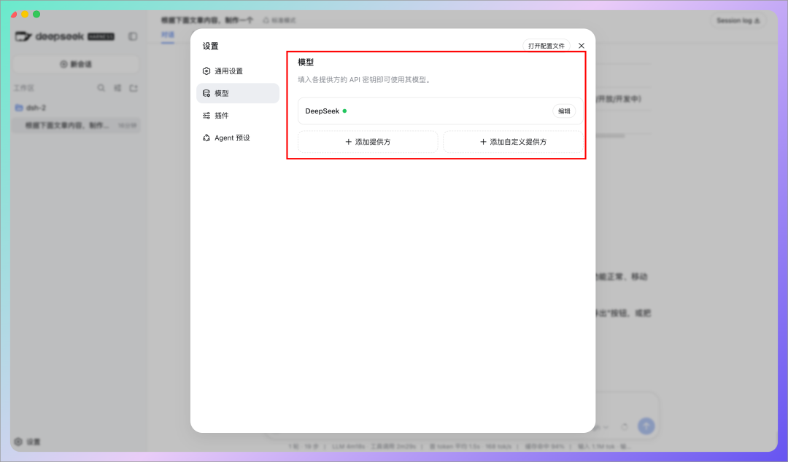
另外，**软件会自动列出该服务商的可用模型，不需要你手工填写模型 ID**。后面想接其他模型，也可以在设置里继续添加。
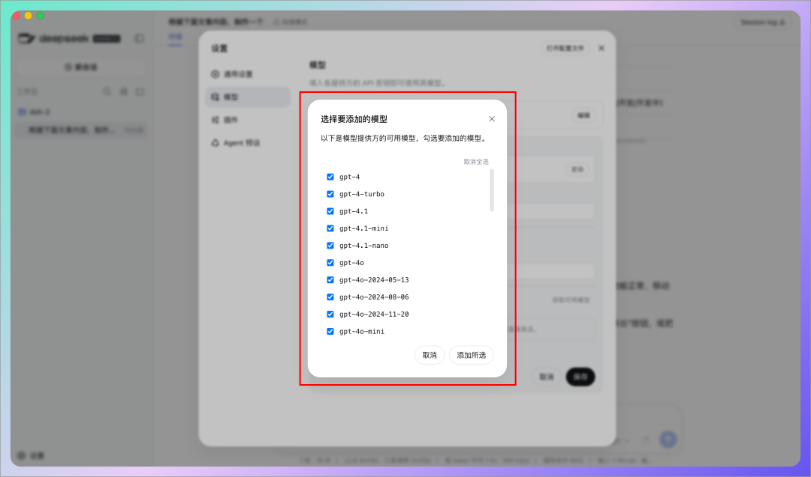
这一点比官方 Web UI 的默认体验好不少，也是 DSH Desktop 的重点打磨方向。
#### 4. 调好的 Agent 可以打包带走
你可以把 Agent 理解成一个按自己需求调好的 AI 助手，装了几个 Skill 和插件，写好了固定的工作要求。
新版本已经支持把整套 Agent 设置**导出为一个 ****`.dshpreset`**** 文件**：换电脑可以带走，也可以发给别人直接用。
几个细节说下：
- 导入时会先展示文件信息，**确认后才安装**
- 如果和本机已有内容重名，不会直接覆盖，会提示你换个名称
- **API Key、对话记录、项目文件不会放进分享包**
不过 Chris 要提醒一句：Agent 里安装的插件可能拥有运行命令或读取文件的权限，**网上下载的 Preset，一定要先确认来源**。
#### 5. 数据主要存在自己电脑上
Harness 和相关设置都运行在你本地，对话、插件和个人设置也主要保存在自己电脑上，平时只有这台电脑能访问应用界面。API Key 会放在专门保存密钥的位置。
但注意，这不代表模型在本地跑——选 OpenAI、Anthropic 这类云端模型时，你发出的问题依然会交给对应服务商处理。介意数据出域的伙计，选模型时要想清楚。
### 四、插件生态推荐 🔌
DSH 装完其实是个“毛坯房”，一切皆插件的玩法就是：需要啥装啥。装完 DSH Desktop 之后，Chris 推荐几个插件可以安装下：
#### dsh-market
仓库地址 github.com/dsh-market/dsh-market
这是 DeepSeek Harness 插件市场，可浏览搜索社区 900+ 插件，截图预览、一键安装/更新/启停，多数插件免重启即时生效。
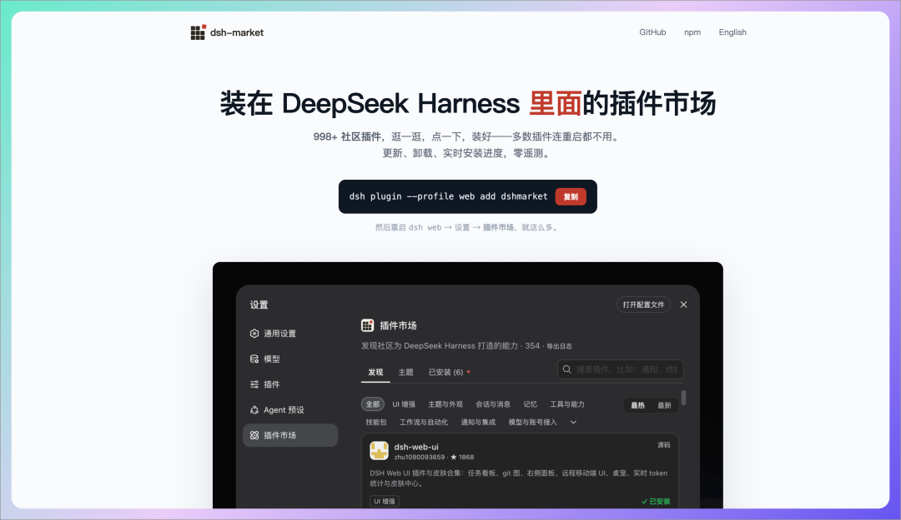
安装完成，就可以在设置弹框中看到“插件市场”，需要什么插件直接点击安装即可，太方便了：
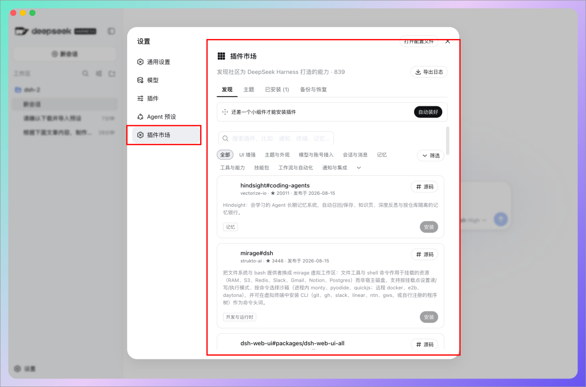
#### 识图插件
给 DSH 装上眼睛，官方暂时不支持识图，社区已经有好几个方案，比如 github.com/liustack/modlens 、github.com/Anionex/dsh-vision-toolkit
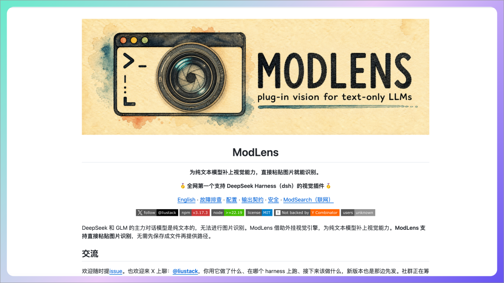
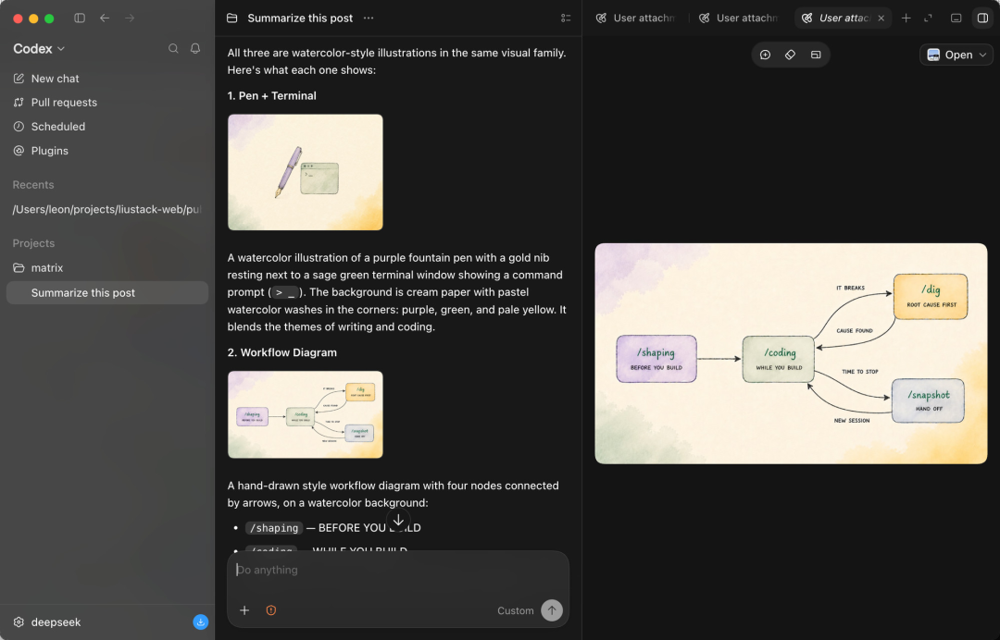
#### dsh-TUI
仓库地址：github.com/ccch1mneyyy/dsh-TUI
类 Claude Code 风格的终端界面，补全官方无终端 TUI 的痛点，还被 DSH 官方公众号收录过
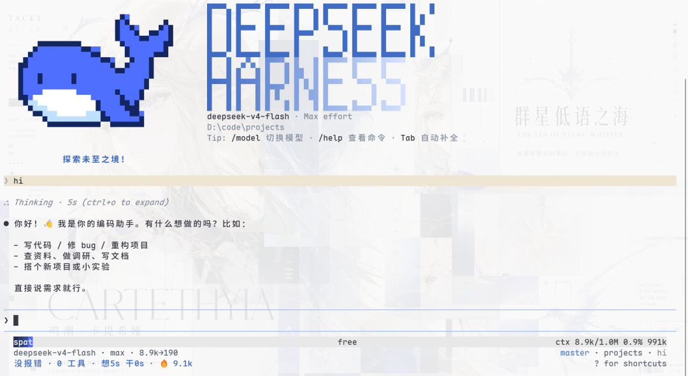
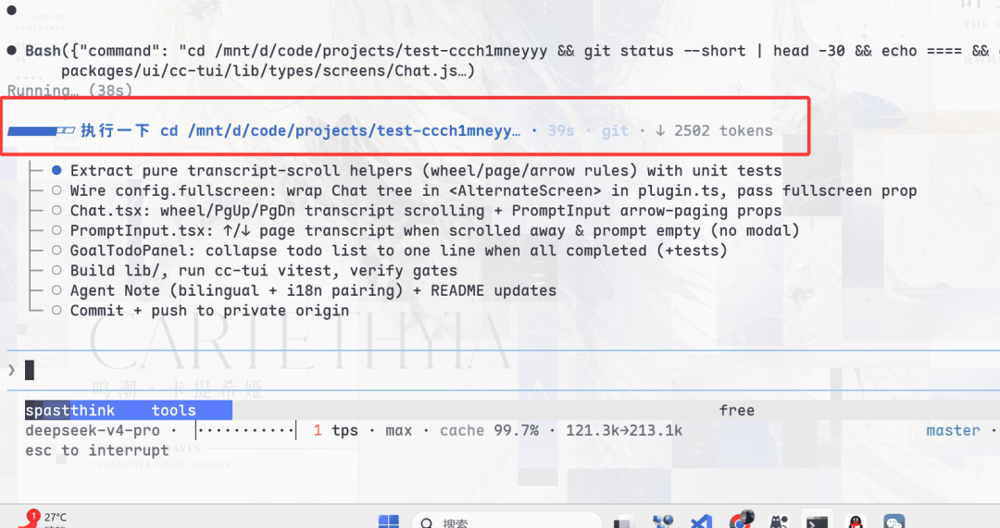
#### 主题换肤
gallery.dsh-market.com 项目里面，内置很多套不错的皮肤可以选择，效果如下：
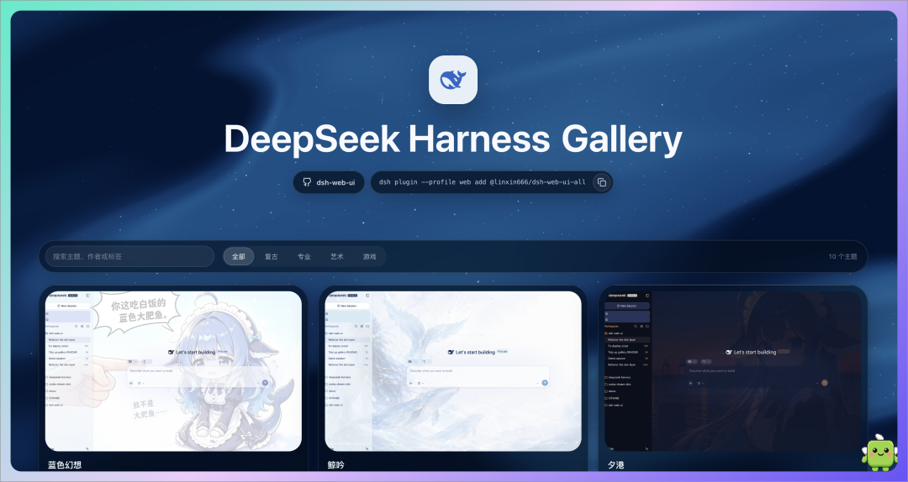
#### 查看余额
仓库地址：github.com/crazywoola/dsh-balance
DeepSeek Harness 插件，用于查询 API 余额和当前可用模型。API Key 仅由本机 Host 使用，不会发送到浏览器。

另外，想系统学 DSH 的伙计，直接看最强社区教程站 deepseekdocs.com ，从安装使用、学习路径到插件开发，一应俱全。
### 五、总结 📝
DSH Desktop 概括下来：**安装够简单、模型够自由、数据够安心**。
如果你对 DeepSeek Harness 感兴趣，又不想每次都打开终端，DSH Desktop 会是一个更省事的入口。
感兴趣可去试试，冲～
