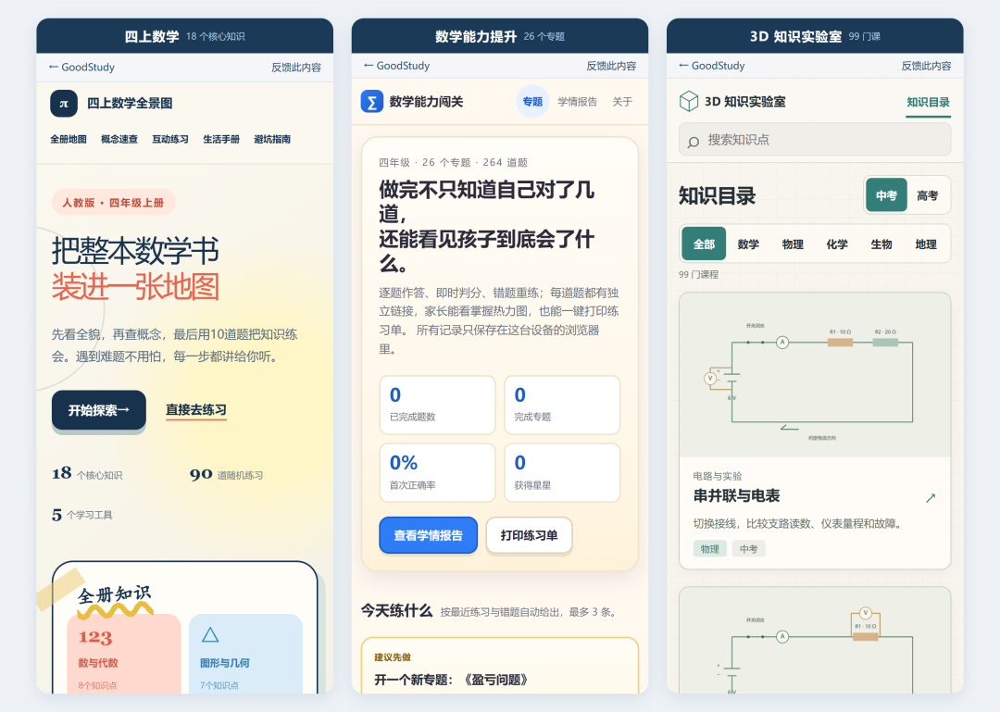
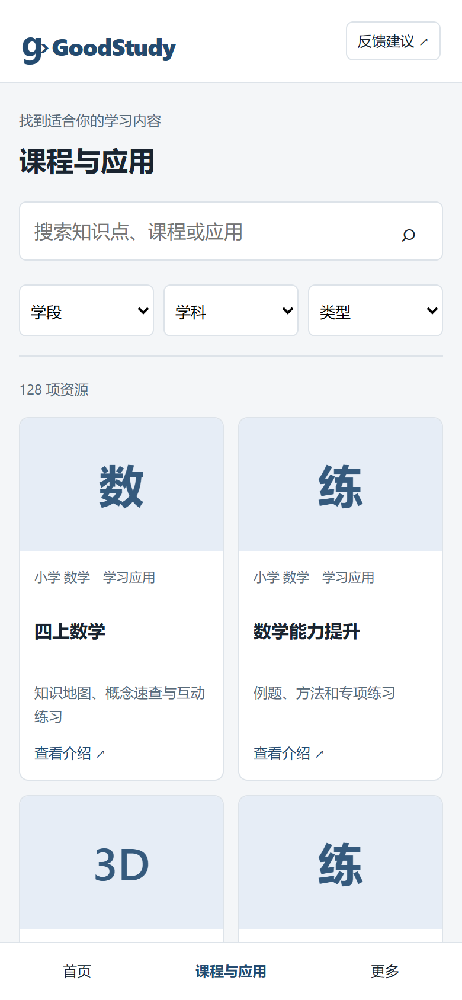
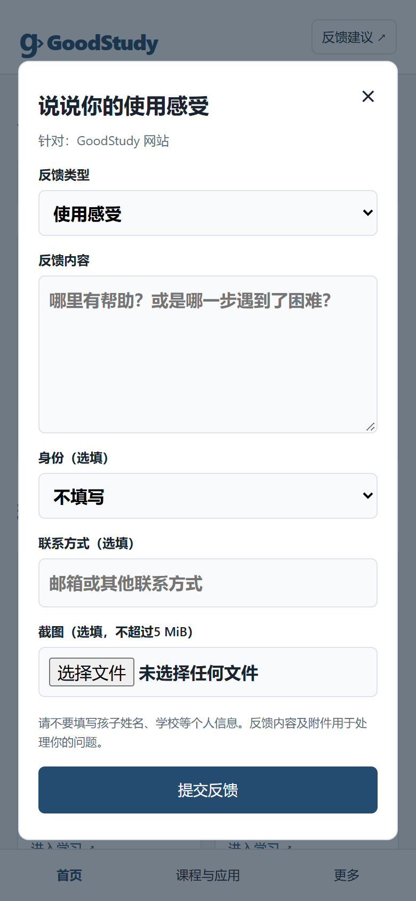
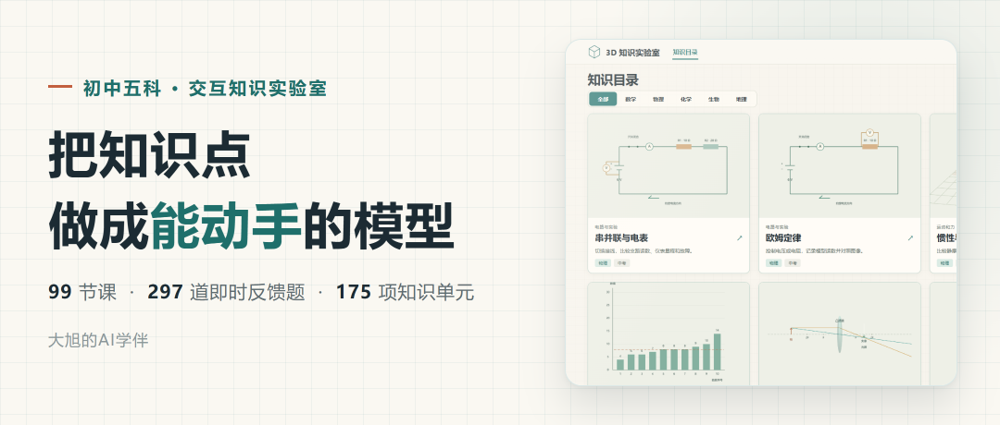

# 128 项课程和模型，我给女儿做的学习网站上线了
> 💡 备注属性未写入，可能是备注属性名称或者类型被修改了，建议将字段类型设置为 rich_text，可以在小程序-操作-修改文章数据库页面进行调整
> 💡 原文链接:[https://mp.weixin.qq.com/s?__biz=MzA5MzQ3NjIzMQ==&mid=2447908066&idx=1&sn=57d38e15b7d1068ddc55551c6abc2029&chksm=85dedc2c827052cb28b2f3c0d712a69fbe716c7837d285e060fd635b5e17997bd7cc67d3d38c#rd](https://mp.weixin.qq.com/s?__biz=MzA5MzQ3NjIzMQ%3D%3D&mid=2447908066&idx=1&sn=57d38e15b7d1068ddc55551c6abc2029&chksm=85dedc2c827052cb28b2f3c0d712a69fbe716c7837d285e060fd635b5e17997bd7cc67d3d38c#rd)
这个网站，一开始没打算给别人用。
里面的课程，是我给自己女儿做的。她上四年级，数学开始变难的时候，我想给她一个能自己翻、自己点、自己看的东西，而不是又一本题册。
上次发完那篇 3D 知识实验室的文章，留言和私信里问得最多的一句是：能不能给我家孩子试试。
问的人有点多。我想了几天，决定把它放出来。
今天上线了：**goodstudy.store**。电脑能开，微信里点开也能用，不用下载，不用注册，不用登录。
### 一、里面有什么：128 项
不是一个大而全的课程库，是三个东西合到了同一个门里。
**四上数学**，人教版四年级上册。18 个核心知识、90 道随机练习、5 个学习工具。整本书做成一张地图：先看全貌，再查概念，最后动笔练。
**数学能力提升**，四年级 26 个专题、264 道题。鸡兔同笼、流水行船、火车过桥、盈亏、容斥、鸽巢……逐题作答、即时判分、错题重练，能出学情报告，也能一键打印成 A4 练习单。
**3D 知识实验室**，初中五科 99 门课。数学、物理、化学、生物、地理，每门课一个能拖、能转、能改参数的模型，配分步观察和题目。
三块加起来 128 项：小学 28 项，初中 100 项。

### 二、手机能直接用，这是这次最要紧的改动
之前这三个东西是三个独立网页，各有各的地址，发给别人得发三条链接，还得解释哪个是哪个。
现在合成一个站。首页三个入口，点进去就是。
手机上是底部三个标签，电脑上是左侧导航。**在微信里点开就能用**，不用跳浏览器，不用装 App，也不用先注册。
这一点我专门试过：微信内置浏览器对网页的限制比普通浏览器多，能打开和能好好用是两件事。

### 三、说实话的部分
我不是程序员，也不是老师。
这两句话不是谦虚，它带来的后果很具体：
· **内容可能有错。**数学题的答案、讲解的措辞、模型里的参数和读数，我一条条核过，但一个人核不完 264 道题加 99 门课。
· **教材版本可能对不上。**四上数学标的是人教版，孩子学校如果用别的版本，章节顺序和深浅会有差异。
· **不是必考清单。**3D 那 99 门课按 2022 版义务教育课程标准梳理，覆盖不等于考纲。
· **没有老师审定。**教学上到底该怎么讲，这一关我没走过。
· **学习效果没有数据。**好看不等于有用，这句话我一直记着。
所以它现在是一个「能用、但不完美」的东西。我把不完美的地方尽量写在明处，剩下的，得靠用的人告诉我。
### 四、所以我留了一个反馈的口子
既然错漏是必然的，那就让「发现错漏」这件事尽量容易。
每一页右上角都有「反馈建议」。点开是这样：类型可以选，内容随便写，能附截图，联系方式选填，提交完会给你一个编号。

三类话我都想听：
**1. 哪里错了** —— 答案不对、讲解看不懂、模型读数和题目对不上。这类我优先处理。
**2. 哪里不好用** —— 手机上点不到、字太小、加载慢、某一步绕。
**3. 想加什么** —— 哪个年级、哪个学科、哪类题。按问的人多少排先后。
不用写孩子姓名和学校。
我一个人做不完所有内容，但**哪一块先做，可以按大家说的来**。
### 五、怎么打开
公众号正文里放不了外部链接，所以给你三个口子，任选一个：
**1. 长按下面这张二维码**，点「识别图中二维码」。手机最快。
**2. 拉到文末**，点左下角的「阅读原文」。
**3. 电脑上直接输** goodstudy.store。

### 六、最后
这东西现在还是半成品。
但它已经能用了，最早的用户是我女儿。她现在就在上面练四年级那 26 个专题。
如果你家也有四年级的孩子，可以拿去试试；如果你是老师，更想听你说哪一题讲错了——那比点赞有用。
有想加的内容，也一并告诉我。我按大家说的改。

