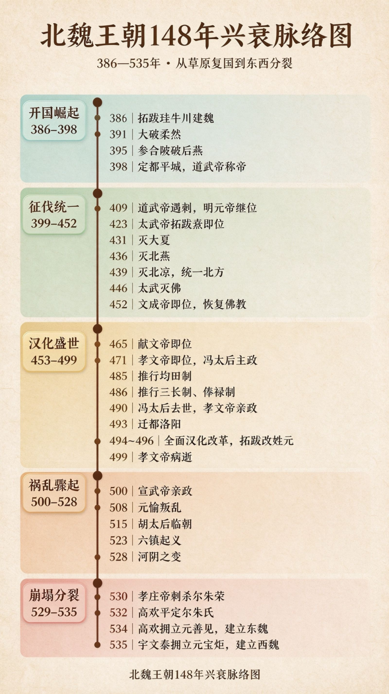

# 148 年北魏兴衰：从草原鲜卑到隋唐的伏笔，一场注定崩盘的伟大实验
> 💡 备注属性未写入，可能是备注属性名称或者类型被修改了，建议将字段类型设置为 rich_text，可以在小程序-操作-修改文章数据库页面进行调整
> 💡 原文链接:[https://mp.weixin.qq.com/s?__biz=MzY5NDQ4NzU0OQ==&mid=2247483834&idx=1&sn=bac3adf98de00b51bff515f36d4722c2&chksm=f5673aa39d6168efc056fb2a376184e1a63132780507d019176e5f1e6df6e1dbb25bb97f10ca#rd](https://mp.weixin.qq.com/s?__biz=MzY5NDQ4NzU0OQ%3D%3D&mid=2247483834&idx=1&sn=bac3adf98de00b51bff515f36d4722c2&chksm=f5673aa39d6168efc056fb2a376184e1a63132780507d019176e5f1e6df6e1dbb25bb97f10ca#rd)
**点击蓝字**
**长**
**安**
**关注我们**

很多人知道孝文帝迁都、云冈石窟、龙门石窟。却很少把整条线串起来看。
这个鲜卑拓跋部建立的王朝，只有 148 年国祚。它从草原里杀出，统一破碎的北方，主动拥抱汉文明，亲手埋下后世隋唐大一统的根基。但它又在极短时间里，矛盾集中爆发，内乱、屠杀、分裂，轰然崩塌。
它不是简单的 “少数民族政权”。它是一场轰轰烈烈、利弊交织的文明融合试验。试验成功了，成果留给隋唐；试验失败了，代价由北魏自己吞下。
**少年复国：草原上重新竖起拓跋的大旗**
前秦淝水战败，北方瞬间四分五裂。曾经被前秦俘虏、颠沛流离的拓跋珪，才 16 岁。
他在牛川召集离散的拓跋部落，先称代王，同年四月改国号为魏，这就是北魏的起点，定都盛乐。
此时的北魏，还只是一个松散的游牧部落联盟。拓跋珪做了一件很关键的事：**解散旧部落，把牧民改成国家编户。不再是部落酋长各自说了算，而是王权直接管到百姓。游牧部落，开始往王朝体制转型**。
但危机很快接近。东边强大的后燕，慕容垂父子，根本不把这个少年政权放在眼里。
**参合陂：一战打掉后燕的脊梁**
后燕太子慕容宝，率领十万大军西征，想要一举消灭拓跋珪。
拓跋珪不硬拼，一路后撤、诱敌深入，等到燕军军心浮动、准备撤退，在参合陂山谷发动突袭。燕军主力全军覆没，数万降兵被坑杀。
参合陂一战，直接改写北方格局。后燕从此一蹶不振，北魏一跃成为北方最强势力。
**398 年，拓跋珪迁都平城，也就是今天的山西大同，正式称帝，史称道武帝**。平城，就是云冈石窟的故乡，北魏百年的旧都。
只是道武帝晚年性情暴虐，猜忌嗜杀，最后被自己的儿子拓跋绍刺杀。一场开国的辉煌，以宫廷血案收尾。
**三代接力，统一整个北方**
道武帝死后，长子**拓跋嗣（明元帝）**平乱继位。他稳固内政，向南蚕食刘宋的土地，为儿子铺路。
接力棒交到**拓跋焘**手上，也就是大名鼎鼎的**太武帝**。这是北魏武功的顶峰。他北击柔然，解除草原后方威胁；向西、向东逐个清扫割据政权：大夏、北燕、北凉。
公元 439 年，北凉灭亡。持续上百年的五胡十六国时代正式结束，北方全部归于北魏。南北朝对峙的局面，从此成型。
太武帝一生强悍，但是留下两件极具争议的大事。一件是赫赫武功，奠定北方秩序。另一件，就是太平真君七年的太武灭佛。
寺院占有大量土地、人口，规避赋税兵役。为了收拢人力财力，拓跋焘重拳打击佛教，毁寺、焚经、坑杀僧尼。这是中国历史上第一次大规模灭佛运动。
强权可以压制信仰，却压不住暗流。等到太武帝死后，佛教迅速反弹，在北魏迎来空前繁荣。
**孝文帝豪赌：迁都洛阳，全盘汉化**
北魏在平城安稳近百年。但新旧矛盾，越积越重。鲜卑勋贵守着草原旧俗，和中原汉地士族，始终隔着一层。
**孝文帝拓跋宏**，五岁登基，由文明太后冯氏主政多年。冯太后已经先期推行均田制、三长制，给改革打好底子。等到孝文帝亲政，他决定下一盘大棋：离开平城，迁都洛阳。
为了顶住鲜卑老贵族的阻力，他用了一个计谋：以南征为名，带着大军南下。走到洛阳，大雨连绵，群臣叫苦不迭，他顺势敲定迁都。
落地洛阳之后，改革密集出台：
✅ 拓跋改姓元；
✅ 朝堂禁用鲜卑语，以汉语为官方语言；
✅ 鲜卑贵族穿汉服、行汉礼
；✅ 强制鲜卑高门和汉族士族通婚。
这就是后世说的孝文帝汉化改革。也是整个北魏历史，最耀眼、也最致命的转折点。
很多人只看到改革的伟大：胡汉融合、文化互通，龙门石窟就在洛阳兴起。却容易忽略另一面。旧军功集团、边镇武士，被这场改革远远抛下。他们留在北方六镇，地位一天天下滑，不再是帝国的宠儿。裂痕，已经悄悄埋在北疆。
孝文帝寿命很短，三十三岁离世。他走之后，改革的红利还没吃完，矛盾开始加速发酵。
**六镇起义：北疆的怒火点燃帝国**
北魏在平城北方，设置六个军镇：怀朔、武川、抚冥、柔玄、怀荒、御夷。这是保卫国都、抵御柔然的前线，早年都是精锐鲜卑子弟，地位尊贵。
迁都洛阳之后，帝国重心南移。六镇军人慢慢被边缘化，待遇变差、晋升无望，大量底层军民困苦不堪。
523 年，怀荒镇率先暴动，六镇大起义爆发。席卷北疆，战火迅速蔓延整个北方。
六镇之乱，不只是一场农民起义。这里走出了一大批后来搅动天下的人：高欢、宇文泰、贺拔胜、独孤信……也就是日后东魏、西魏、北齐、北周、隋唐关陇集团的源头。
北魏朝廷已经无力独自平叛，只能依靠尔朱荣这样的地方豪强。前门驱狼，后门迎虎。更大的灾难，正在靠近洛阳。
**河阴之变：黄河边上，一场血腥屠杀**
胡太后毒杀孝明帝，另立幼主，朝政大乱。晋阳的尔朱荣，以此为借口，领兵南下，进入洛阳。
他以祭天为名，把北魏王公、百官两千多人，诱到河阴的黄河滩上。铁骑合围，大肆屠杀。宗室亲王、世家大臣，几乎被一扫而空，史称河阴之变。
繁华洛阳，一夜之间精英尽丧。北魏中央朝廷，实质上已经被打断脊梁。名义上的皇帝，从此只是军阀手里的傀儡。
尔朱荣后来被孝庄帝刺杀，紧接着尔朱氏家族内乱。两大枭雄趁机崛起：**出自怀朔镇的高欢，掌控东部；出自武川镇的宇文泰，掌控西部**。
**帝国分裂：北魏，正式落幕**
东西两股势力再也无法调和。
534 年，高欢拥立元善见，迁都邺城，是为东魏；宇文泰在西边拥立元宝炬，定都长安，是为西魏。
曾经一统北方、煊赫一时的北魏，就此分裂，国祚定格在 148 年。
它没有直接灭亡于外敌，不是被南朝攻灭。它死于自己内部的撕裂：草原旧传统，和中原新秩序，没能找到长久共存的平衡点。
后来，东魏变成北齐，西魏变成北周。北周灭北齐，统一北方；北周又被杨坚篡夺，建立隋朝，一统天下。再之后，大唐登场。
**北魏大总结**
北魏是一个非常矛盾的王朝。
**它伟大之处，在于敢于主动拥抱文明。在那个族群对立、仇杀不断的乱世，它主动推动胡汉融合，铸造新的制度、新的文化。云冈、龙门，直到今天依然是中华文明的瑰宝；均田制、府兵制，撑起了几百年后世王朝的骨架。没有北魏这一场融合，就没有后来隋唐开放包容的盛世气质。**
**它悲剧之处，在于改革的失衡。孝文帝把资源、荣誉全部倾斜给洛阳的汉化贵族，抛弃了起家的边镇军功集团。一边是洛阳城里吟诗、通婚、穿汉服的元氏权贵；一边是北疆苦寒之地，心怀怨愤的六镇武士。巨大落差，最后用战火和鲜血来清算。**
一句话概括北魏：**它用一场主动汉化，完成了华夏文明的扩容；也因为融合的步伐太急、取舍太偏，耗尽了自己的生命。**
**王朝倒下了，但它种下的种子，在百年之后，开出隋唐的繁花。**
求点赞

求分享

求喜欢

