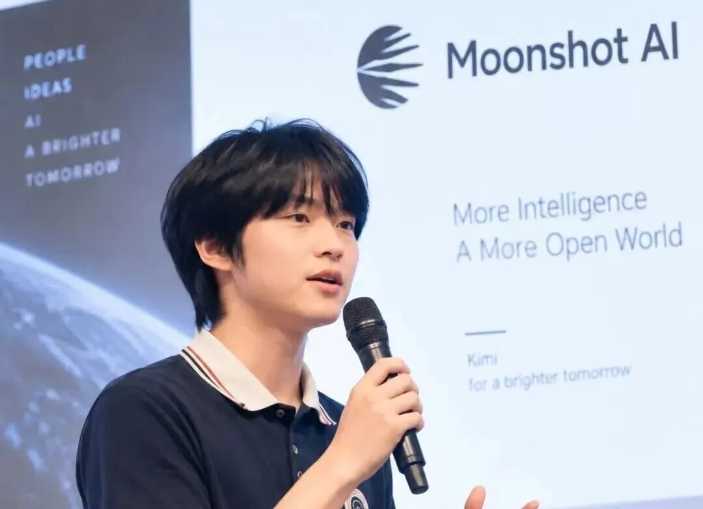
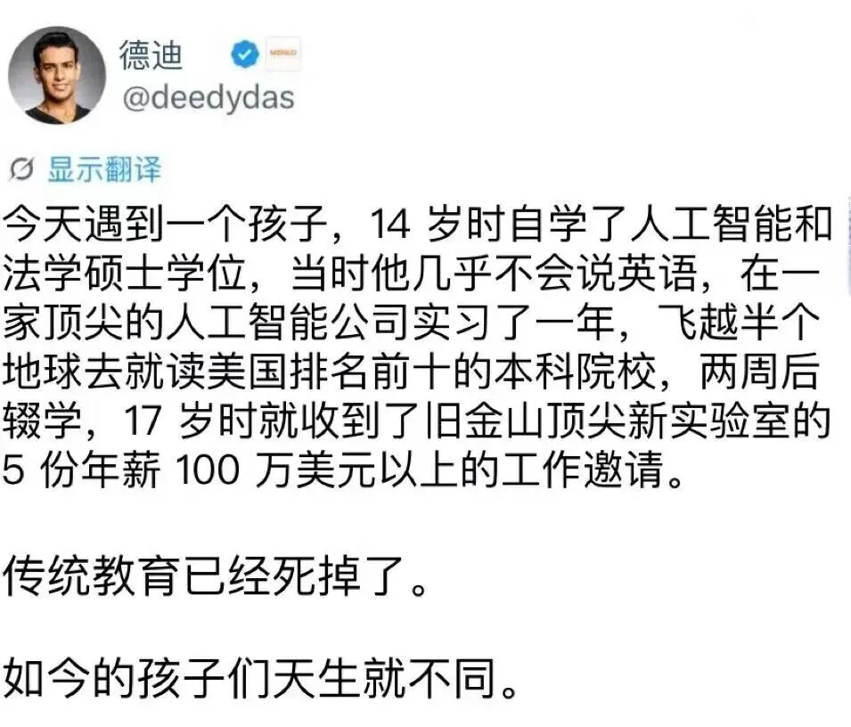

# 17岁，年薪700万，他凭什么？
> 💡 备注属性未写入，可能是备注属性名称或者类型被修改了，建议将字段类型设置为 rich_text，可以在小程序-操作-修改文章数据库页面进行调整
> 💡 原文链接:[https://mp.weixin.qq.com/s?__biz=MzkxMzI2NzcxOA==&mid=2247498527&idx=1&sn=38fb3553592a0673dbc692455926273d&chksm=c043449ffb6ca4e340ade85c1c18b9a20bd38cbdf76b31eb644c79e07484b6919bf9d5e8f890#rd](https://mp.weixin.qq.com/s?__biz=MzkxMzI2NzcxOA%3D%3D&mid=2247498527&idx=1&sn=38fb3553592a0673dbc692455926273d&chksm=c043449ffb6ca4e340ade85c1c18b9a20bd38cbdf76b31eb644c79e07484b6919bf9d5e8f890#rd)

陈广宇
作者 | 邱鑫浩

来源 | 邱处机
一位高中生，让硅谷和深圳同时屏住了呼吸。
近日，17岁的陈广宇在社交平台发了一封告别帖，寥寥数语，宣布离开Kimi。没有解释原因，没有公布下一站，只在末尾留下一句“还有更多值得探索”。
评论区瞬间炸了。Anthropic的可扩展强化学习负责人Sholto Douglas半开玩笑地递出邀约：“要不要来旧金山一起工作？”陈广宇回了一句“正要去湾区”，紧接着又补了一个“no :)”，把围观者的猜测吊到了半空。
但真正让这件事从“天才少年离职”变成现象级话题的，是另一条几乎同时浮出水面的消息。
硅谷投资人Deedy Das此前描述过一名17岁少年：手握5份来自旧金山顶尖AI实验室的邀约，金额均在100万美元以上，约合人民币700万。年龄、经历、时间线，所有线索都指向同一个人——那就是陈广宇。

17岁，年薪700万，他凭什么？
答案藏在一篇论文里。
**01**
**万亿参数模型背后的贡献者**
今年3月，还在读高三的陈广宇，以共同第一作者的身份，与张宇、苏剑林一起发表了《Attention Residuals》。苏剑林是RoPE旋转位置编码的提出者，张宇是Kimi Linear架构的第一作者。
而一个高中生，名字竟然排在这两个人前面。
马斯克转发了这篇论文，配了一句“令人印象深刻”。到了7月，这项技术被塞进了Kimi K3——总参数量2.8万亿，全球首个开放权重的3T级模型。Attention Residuals成了它的底层架构之一。
更硬核的数据来自实验：在Kimi Linear 48B模型上，用1.4万亿token训练，AttnRes达到同样效果只需要基准模型约80%的算力，推理延迟增量不到2%。
这意味着什么？大模型烧钱烧的是算力，省下20%的训练成本，在万亿参数的游戏里，是以千万美元计的账。
而陈广宇做的，远不止挂名。他最早参与的工作之一是加速KDA的计算内核，后来又与张宇共同提出了Block AttnRes——把上百层网络划成区块，块内低成本累加，块间精细聚合，显存复杂度从层数级压到了块数量级。
苏剑林后来在回忆录里写得很清楚：初步实验是他做的，但张宇和陈广宇加入后，才把方案推到了大规模模型可用的形态。
一个16岁的实习生，干了核心架构组的活。
**02**
**非典型“天才剧本”**
陈广宇的路径，和大多数人想象的“天才剧本”不太一样。
他2009年出生在深圳，中学时用家长身份注册Shopify店铺，搞过青少年开源社区，做过Crypto机器人，甚至想过当职业滑雪运动员。
准备申请大学时，陈广宇把那些“为了升学但自己不喜欢”的活动全停了，翻出一本AI安全的书开始读，接着读物理、读宇宙、读乔布斯。
他在博客里写，那几周学习只是为了满足好奇心，但看着同学忙申请，自己也会焦虑，怕做的事“没有意义”。
转折发生在2025年2月。他参加月之暗面的中学生AI黑客松，靠社交平台上的技术分享拿到了一家硅谷初创公司的实习。同年11月，16岁的他正式加入Kimi，身份是实习生，职位是机器学习研究员。
在Kimi的日子，他每天在办公室待15个小时。今年1月某天，他正和张宇研究一个模型架构改进，母亲打来电话祝他生日快乐，他才意识到自己17岁了。
后来他在告别帖里回忆，最喜欢的记忆包括和张宇优化KDA内核、和苏剑林完善注意力残差、为K3发布准备材料时，一边工作一边看世界杯。
杜雨伦，当年拍板招他进来的人，在陈广宇离开时透露两人长谈过几次。不舍，但希望他在这个年纪尽可能探索。
**03**
**AI人才争夺战**
“我只想学习，完全不在乎钱。”
这句话是Deedy Das转述的，出自那个手握5份百万美元offer的17岁少年之口。Deedy没有公开姓名，不过陈广宇的履历和这句话的气质，吻合得令人无法忽视。
但钱可能恰恰是这件事里最不重要的部分。
目前AI人才争夺战早已把战线推到了本科毕业之前。Meta用四年2.5亿美元挖一个年轻研究者，国内大厂给应届博士开600万年薪，字节、腾讯鼓励低年级实习生直接主导项目。
顶尖模型架构人才的定义正在被重写：不再看论文数量、不再看教职头衔，看的是你能不能在一线把loss降下来，能不能在GPU集群上把内核优化到极致。
陈广宇的特别之处在于，他既能在论文里提出Block AttnRes这样的结构设计，又能蹲下去写Triton矩阵乘法、搞TileLang Flash Attention的前向计算。架构感和工程手感长在同一个人身上，这在AI研究圈里是稀缺品。
他离开Kimi时，K3刚刚发布三个月。Attention Residuals和KDA两大核心架构，他都深度参与过。一个实习生的离职帖，能让Anthropic的研究员在评论区抢人，这本身就已经说明了问题。
至于那700万，陈广宇从未公开确认过。他在告别帖里感谢了杜雨伦“当年相信并聘用了一个16岁的我”，然后转身走向湾区。有人问他是不是去Anthropic，他说“no :)”。有人说他要去卡内基梅隆读书，Sholto Douglas拿这个开玩笑，他也没接茬。
一个17岁的人，已经学会了让全世界猜他的下一步，同时把答案留给自己。
陈广宇在Kimi的告别帖最后写了一句话，语气轻松得像在说下周去哪吃饭：“还有更多东西要探索。”
他没说的是，探索这些东西的代价，正在被市场标上越来越高的价码。而他，刚好站在了定价权的那一边。
（全文完）
【邱处机简介】
主理人来自福建龙岩，公众号专注于撰写商业牛人的成长经历和认知升级，让我们一起向他们学习，不断成长，不断进化。
【邱处机旗下公众号】

## 摘要

（待补充）

## 我的笔记

（待补充）
