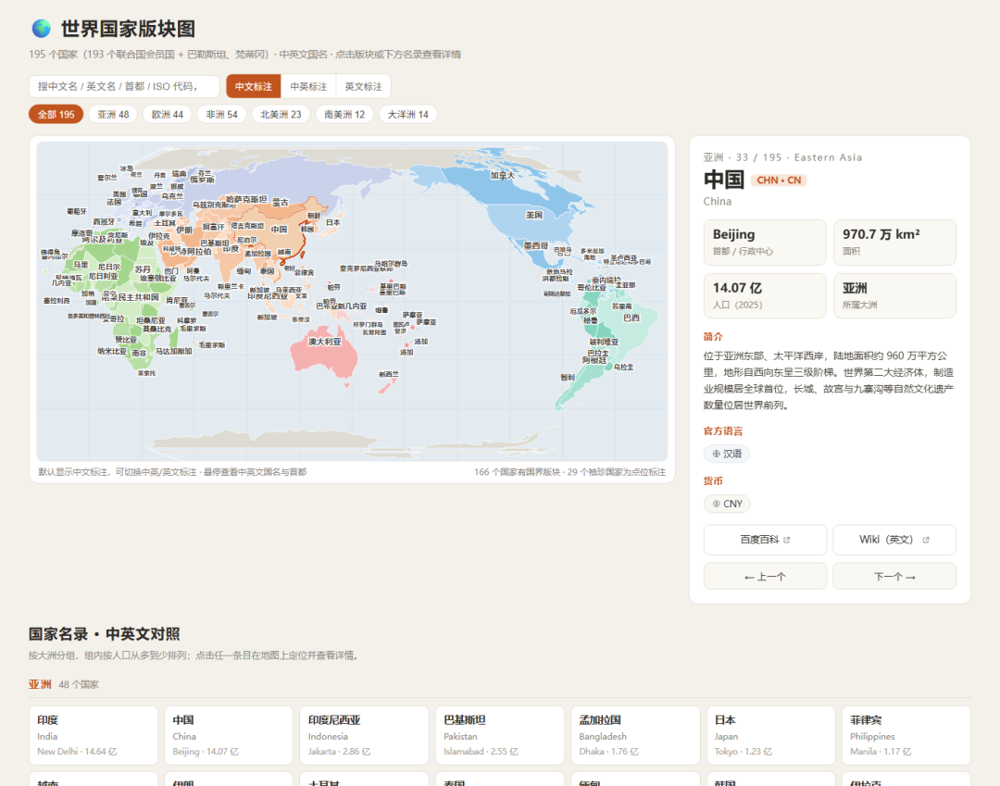
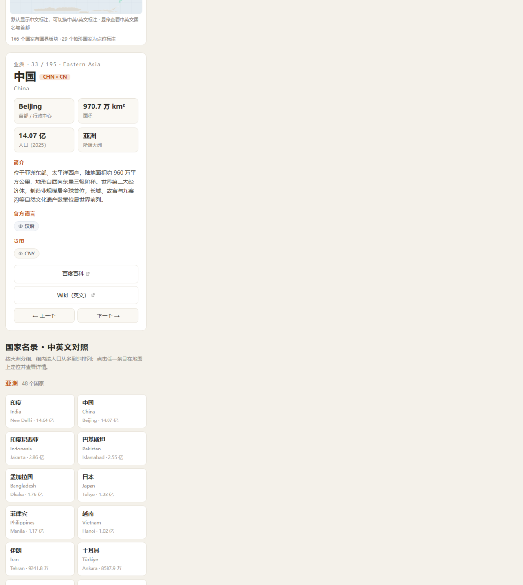

# 195 个国家装进一张网页，点开就是一节地理课
> 💡 备注属性未写入，可能是备注属性名称或者类型被修改了，建议将字段类型设置为 rich_text，可以在小程序-操作-修改文章数据库页面进行调整
> 原文链接:[https://mp.weixin.qq.com/s/krHhgHuET1mFJUFN5Jh3fw](https://mp.weixin.qq.com/s/krHhgHuET1mFJUFN5Jh3fw)
## 195 个国家装进一张网页，点开就是一节地理课
> 「单文件工具箱」系列 · 第 2 篇 ｜ 罗宾逊投影 · 太平洋居中 · 中英双语 · 数据可溯源
> 

### 
### 那句「这在哪儿」，我答不上来
孩子看新闻，指着屏幕问：「马里在哪儿？」
我打开手机地图 App，搜「马里」，跳出来一个小圆点，标着国名。面积多大？说什么语言？首都在哪？还得再搜一次。三个 App 来回跳，孩子的注意力早就跑了。
问题不在信息稀缺，而在信息被切碎了：地图给位置，百科给知识，数据给数字，各自都不肯让步。我想要的是一张能点、能读、能顺着往下走的世界地图。
于是有了这一篇：世界国家版块图。
### 一眼看全 195 个国家
打开就是这个样子：一张完整的世界的版块图，每个国家一块颜色、一块形状、一个可以点的区域。
收录的是193 个联合国会员国，加上巴勒斯坦和梵蒂冈，共 195 个。这不是随手定的口径——国际上对「国家」的定义有争议，我采取的是最通行的统计口径，并把边界情况写清楚，免得孩子问「为什么没有某某」时我答不上来。
两个关键的呈现选择：
罗宾逊投影。世界上主流的投影有几十种，各有取舍。罗宾逊投影是折中方案：面积和形状的变形都比较温和，既不像墨卡托那样把格陵兰放大成一个怪物，也不像等积投影那样把形状拉得认不出来。给孩子看世界，正合适。
太平洋居中。这是更重要的一条。默认的欧美地图把大西洋放中间，太平洋被切成两半——中国在最左边，美国在最右边，看一次要横跨整个屏幕。太平洋居中之后，中国在中间偏左，日本、东南亚、澳洲、美洲西岸连成一片，这才是我们看世界的真实视角。
### 点开一个国家，会看到什么
点任意一块版块，弹出一张资料卡：
中英文国名。中文名 + 英文名并列，孩子认字，大人查资料，两个都在。
首都。有些国家的首都不止一个（比如南非的三个首都），这类情况按实际写。
面积与人口。面积用平方公里，人口用最新可得数据，并标注统计口径与年份——数字不说话，但来源必须清楚。
官方语言。一个国家可能有好几种，全列出来。这一栏常被忽略，但它是理解一个国家最好的入口。
货币。名称与代码。做跨境生意、看汇率、出国旅行时，这一栏比什么都实用。
一段简介。不是维基词条的复制，而是我按「能讲给孩子听」的标准重写的：这个国家最值得知道的一件事是什么。有的写地理（内陆国、岛国、跨洲），有的写历史（曾经的名字、独立时间），有的写文化（语言、宗教、饮食）。
继续深挖的入口。卡片底部可以直接跳转百度百科或英文维基百科。地图负责建立空间感，百科负责展开细节——两个配合起来，一个国家的轮廓就立住了。
### 找国家，有三种打开方式
搜索。输中文或英文国名，直接定位到那个国家。支持模糊匹配，输「哈萨克」能出「哈萨克斯坦」。
大洲筛选。只亮出某一洲，其余淡出。想「今天专讲非洲」，点一下非洲，图上就只剩非洲五十四国。这个功能对备课特别有用——一节课讲一个洲，视觉上先收窄。
标注切换。中文、英文、中英双语三种模式一键切换。孩子小的时候用中文，学英语时切到英文，做国际新闻的成人用中英对照。
### 数据是从哪来的
这一点我想说清楚，因为地图类内容最怕「来路不明」。
- 国家边界与几何形状：Natural Earth（公共领域的制图数据集，被大量地图产品使用）
- 国名、首都、语言、货币等属性：mledoze/countries 开源数据集
- 人口等统计数据：世界银行公开数据
而且，这个页面不是手写的。它由 Node 脚本从上述数据集生成：脚本读数据、算投影、拼 SVG、写 HTML。这意味着两件事：数据更新后重跑一遍脚本即可；手改 HTML 反而会在下次生成时被覆盖。
我在页面里明确标注了数据来源，也让每条数据都能追到出处。
### 手机上什么样

版块图在手机上会自适应缩放，点击同样精准。资料卡在小屏上变成底部抽屉，不遮住地图，滑一下就关。孩子在车上、餐厅里问「这个国家在哪」，掏出手机就能答。
### 可以怎么用
给孩子当地理启蒙。每天一个国家，三分钟。讲完一个，让他在地图上找下一个——找的过程就是记忆。
备课。讲到某个区域，先亮出这一洲，让学生建立整体感，再逐个点开。
查资料时当地图用。写文章、做方案需要确认某个国家的位置、语言、货币，比搜索引擎快。
满足自己的好奇。有时候只是想知道「莱索托为什么被南非包着」——点开就有答案。
### 常见问题
为什么没有某些地区？采用 193 个联合国会员国 + 巴勒斯坦、梵蒂冈的口径。这是国际统计中最通行的做法，也让「195」这个数字有据可查。争议地区的处理，以联合国会员国身份为准。
人口数据是哪一年的？以数据集中最新可得的年份为准，页面内有标注。不同国家统计年份不一致是常态，这在世界银行的数据里也是如此。
能离线用吗？能。整个页面是单个 HTML 文件，不依赖任何在线服务。断网、内网、没有网络的老电脑，双击都能打开。
边界准确吗？数据来自 Natural Earth，是国际制图中广泛使用的公共数据集。它不是权威的国界认定文件——如果有严肃的边界用途，应以官方地图为准。
### 技术上做了什么
三个点值得说：
投影。罗宾逊投影没有解析公式，只有一组查表系数。做法是把经纬度按表插值成平面坐标，再缩放到画布。太平洋居中不是改投影，而是在经度上整体平移 180°，让 180° 经线落在画布中间。
版块交互。每个国家是一个 SVG 路径，点击命中靠的是路径本身，不是包围盒——所以形状奇怪的岛国也点得准。
生成管线。数据、投影、排版分三层：数据是 JSON，投影是纯函数，模板在脚本里。改数据不动代码，改样式不动数据。
一张地图的价值，一半在数据，一半在视角。视角选对了，孩子才看得进去。
---
下一篇：同样的思路做给中国——34 个省级行政区，一节课的地理启蒙。
