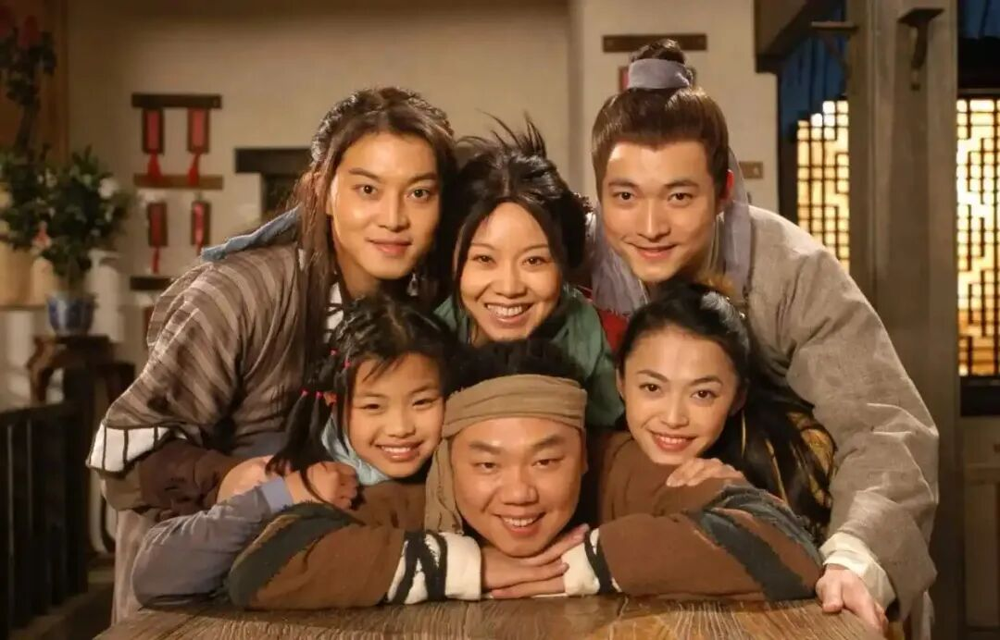

# 1980-2025电视剧分题材（96部）
> 💡 备注属性未写入，可能是备注属性名称或者类型被修改了，建议将字段类型设置为 rich_text，可以在小程序-操作-修改文章数据库页面进行调整
> 💡 原文链接:[https://mp.weixin.qq.com/s?__biz=MzUyOTg0MTM5NA==&mid=2247487508&idx=1&sn=18931a760a11cd911589763c22e95feb&chksm=fbd2bda6ab7c7e76cb456e99bc3cda962f8f84bed81e5ba893f09d6ca105f8457bcbbc1d5748#rd](https://mp.weixin.qq.com/s?__biz=MzUyOTg0MTM5NA%3D%3D&mid=2247487508&idx=1&sn=18931a760a11cd911589763c22e95feb&chksm=fbd2bda6ab7c7e76cb456e99bc3cda962f8f84bed81e5ba893f09d6ca105f8457bcbbc1d5748#rd)

**一、年代/家族/生活史（10部）**
1.上海滩（1980，年代传奇/黑帮爱情）
2.四世同堂（1985）
3.一年又一年（1999）
4.**大宅门**（2001）
5.金粉世家（2003，年代家族爱情）
6.**父母爱情**（2014）
7.平凡的世界（2015，年代农村）
8.大江大河（2018，年代改革）
9.人世间（2022）
10.小巷人家（2024）
**二、古装历史/历史故事（13部）**
1.秦始皇（1986）
2.**三国演义**（1994，名著历史）
3.武则天（1995）
4.东周列国·春秋篇（1996）
5.隋唐演义（1996）
6.雍正王朝（1999）
7.康熙王朝（2001）
8.孝庄秘史（2002）
9.走向共和（2003，近代历史正剧）
10.汉武大帝（2005）
11.**大明王朝1566**（2007）
12.大秦帝国之裂变（2009）
13.大秦帝国之纵横（2013）
**三、古装名著/神话/公案/传说故事（17部）**
1.济公（1985，神话喜剧）
2.**西游记**（1986）
3.红楼梦（1987）
4.聊斋（1988）
5.封神榜（1990）
6.**新白娘子传奇**（1992，神话爱情）
7.包青天（1993，古装公案）
8.宰相刘罗锅（1996，古装官场喜剧）
9.还珠格格（1998，宫廷喜剧爱情）
10.上错花轿嫁对郎（2000，古装爱情喜剧）
11.少年包青天（2000，古装悬疑公案）
12.铁齿铜牙纪晓岚（2001，古装官场喜剧）
13.神探狄仁杰（2004，古装悬疑公案）
14.甄嬛传（2011，宫斗）
15.琅琊榜（2015，古装权谋/复仇）
16.庆余年（2019，古装权谋/穿越）
17.梦华录（2022，古装女性爱情）
**四、武侠/功夫/动作（15部）**
1.大侠霍元甲（1981）
2.陈真（1982）
3.射雕英雄传（翁美玲版，1983）
4.再向虎山行（1983）
5.霍东阁（1984）
6.雪山飞狐（1991）
7.射雕英雄传（朱茵版，1994）
8.神雕侠侣（古天乐版，1995）
9.天龙八部（黄日华版，1997）
10.**鹿鼎记**（陈小春版，1998，武侠喜剧）
11.太极宗师（1998）
12.小李飞刀（1999）
13.笑傲江湖（央视版，2001）
14.倚天屠龙记（苏有朋版，2002）
15.天龙八部（央视版，2003）
**五、刑侦/悬疑/谍战/反腐（10部）**
1.抉择（1997，反腐）
2.暗算（2006，谍战）
3.**潜伏**（2008，谍战）
4.黎明之前（2010，谍战）
5.伪装者（2015，谍战）
6.人民的名义（2017，反腐）
7.**狂飙**（2023，扫黑刑侦）
8.漫长的季节（2023，悬疑/年代）
9.我是刑警（2024，刑侦）
10.沉默的荣耀（2025，谍战/革命，待正片确认）
**六、军旅/战争/革命（5部）**
1.**亮剑**（2005）
2.**士兵突击**（2006）
3.恰同学少年（2007，革命青春）
4.雪豹（2010）
5.觉醒年代（2021，革命历史）
**七、情景喜剧/喜剧（8部）**
1.编辑部的故事（1992）
2.我爱我家（1993）
3.山城棒棒军（1997，方言生活喜剧）
4.炊事班的故事（2002，军旅情景喜剧）
5.家有儿女（2005）
6.**武林外传**（2006，古装情景喜剧）
7.爱情公寓（2009）
8.屌丝男士（2012，网络情景喜剧）
**八、都市情感/家庭/青春偶像（5部）**
1.渴望（1990，家庭伦理）
2.北京人在纽约（1994，都市移民）
3.**流星花园**（2001，青春偶像）
4.欢乐颂（2016，都市女性）
5.都挺好（2019，家庭）
**九、仙侠/奇幻/穿越/科幻（7部）**
1.家有仙妻（1991，都市奇幻喜剧）
2.我和僵尸有个约会（1998，都市奇幻）
3.仙剑奇侠传（2005）
4.三生三世十里桃花（2017）
5.想见你（2020，爱情/穿越/悬疑）
6.**凡人修仙传**（2020）
7.三体（2023）
**十、现实/农村/职场/治愈（6部）**
1.岁月（2007，官场现实）
2.**天道**（2008，商战现实）
3.蜗居（2009，都市现实）
4.警察荣耀（2022，公安职场）
5.去有风的地方（2023，田园治愈）
6.我的阿勒泰（2024，现实治愈）
[1980年-2025年经典电视剧（96部）](https://mp.weixin.qq.com/s?__biz=MzUyOTg0MTM5NA%3D%3D&mid=2247487501&idx=1&sn=d1bfacd666210e19081d740e303b76c0&scene=21#wechat_redirect)
[1970-2025经典流行音乐（323首）](https://mp.weixin.qq.com/s?__biz=MzUyOTg0MTM5NA%3D%3D&mid=2247487464&idx=1&sn=fdb340baad208c96245a62c7217baa4f&scene=21#wechat_redirect)
[1972-2026经典电影（94部）](https://mp.weixin.qq.com/s?__biz=MzUyOTg0MTM5NA%3D%3D&mid=2247487449&idx=1&sn=41da4f551df975756168e681f4054962&scene=21#wechat_redirect)
