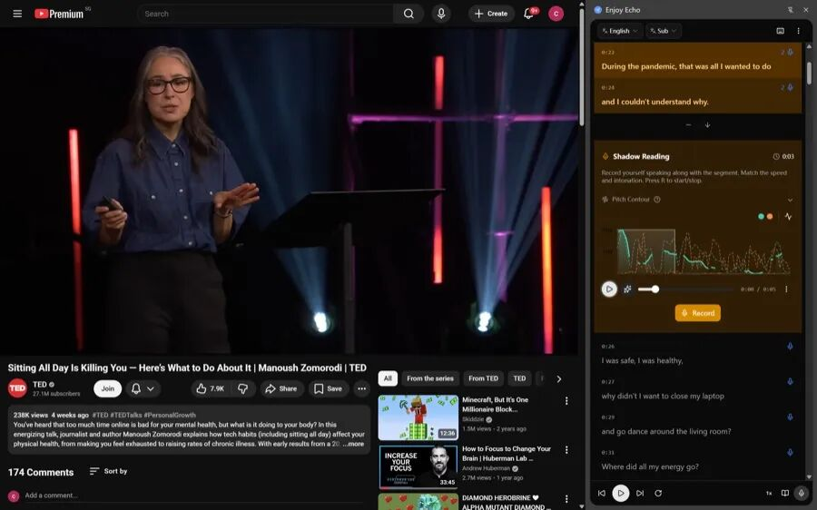

# 2.3万 Star：qwerty-learner——不用下载、不用注册、不用付费的打字背单词神器
> 💡 备注属性未写入，可能是备注属性名称或者类型被修改了，建议将字段类型设置为 rich_text，可以在小程序-操作-修改文章数据库页面进行调整
> 💡 原文链接:[https://mp.weixin.qq.com/s?__biz=MzY5MTM2MjA5OQ==&mid=2247485064&idx=1&sn=39613193e6e302520bf41aa6c5454f1a&chksm=f5c807f649129227f3c0ab314a2fe63ec1dd0143526f6af0e47848f7b7b393101a5a3b4f5a0b#rd](https://mp.weixin.qq.com/s?__biz=MzY5MTM2MjA5OQ%3D%3D&mid=2247485064&idx=1&sn=39613193e6e302520bf41aa6c5454f1a&chksm=f5c807f649129227f3c0ab314a2fe63ec1dd0143526f6af0e47848f7b7b393101a5a3b4f5a0b#rd)
⌨️
**qwerty-learner**
打字背单词神器 · 不用下载 · 不用注册 · 不用付费
23,527 Star在线即用GPL-3.0
### ⌨️ 它是谁
**qwerty-learner**（RealKai42/qwerty-learner）是一款为键盘工作者设计的**打字练习 + 单词记忆**在线工具：把英语单词记忆和键盘肌肉记忆结合，一边背单词一边练打字。
实测**23,527 Star**、2,695 fork、TypeScript（React）、2021-01 创建、昨天还在更新、协议**GPL-3.0**。**不用下载、不用注册、不用付费**——浏览器打开就能用。
### ✨ 为什么值得用
🌐
不用下载
浏览器打开在线版即用，零安装
🔓
不用注册
无需账号，打开就能开始练
💪
肌肉记忆
背单词同时练英语键盘输入，打错要重输
🧑‍💻
程序员词库
内置常用单词 + 多语言 API 练习
### 🧩 能做什么
| 词库丰富 | CET-4/CET-6/GMAT/GRE/IELTS/SAT/TOEFL/考研/专四专八，还有程序员常用词 |
| 音标发音 | 边打字边看音标、听发音，读音记忆一起抓 |
| 默写模式 | 一章练完可默写巩固，加深记忆 |
| 速度正确率 | 量化输入速度和正确率，看着自己提升 |
| 程序员 API | 多种编程语言常用 API 练习，边打边熟悉 |
| 多端可用 | 在线版 + VSCode 插件版，随时开练 |
### 🖼️ 效果展示

打字练习界面（官方截图）

速度/正确率统计（官方截图）
### 🚀 快速上手
① 打开网址
浏览器打开 `qwerty.kaiyi.cool`（或 GitHub Pages 在线版），不用下载、不用注册。
② 选词库
选四六级/GRE/雅思/考研或程序员词库，直接开始打。
③ 边打边背
看着音标、听着发音，把单词打出来；打错了要重打，巩固正确肌肉记忆。
④ 看提升
速度、正确率实时显示，练完还能默写巩固。程序员可装 VSCode 插件版随时开练。
### 🎯 适合谁
🖥️ **程序员/键盘工作者**：练英语肌肉记忆 + 熟悉 API
🎓 **备考党**：四六级/考研/GRE/雅思词库直接开练
🌱 **想学打字的人**：零门槛在线工具，打开即用
✍️ **机考人群**：练键盘输入速度，机考不吃亏
### 📈 为什么值得用
想练英语输入、背单词，市面工具要么要下载要么要注册要么收费。qwerty-learner 把**打字练习 + 单词记忆 + 音标发音 + 程序员词库**合在一起，**不用下载、不用注册、不用付费**，浏览器打开就用，是目前很顺手、零门槛的免费背单词练打字方案。
### ❓ 常见问题
**Q：要下载安装吗？**
不用。浏览器打开 qwerty.kaiyi.cool 在线版即用；也有 VSCode 插件版可选。
**Q：要注册/付费吗？**
不用注册账号，完全免费开源（GPL-3.0）。
**Q：有哪些词库？**
CET-4/CET-6/GMAT/GRE/IELTS/SAT/TOEFL/考研/专四专八，还有程序员常用词和多语言 API。
**Q：适合程序员吗？**
适合。专门为键盘工作者设计，内置程序员常用单词和多语言 API 练习。
**📎 GitHub 地址：https://github.com/RealKai42/qwerty-learner**
在线版：qwerty.kaiyi.cool · 关注「AI工具匠」获取更多实用工具
