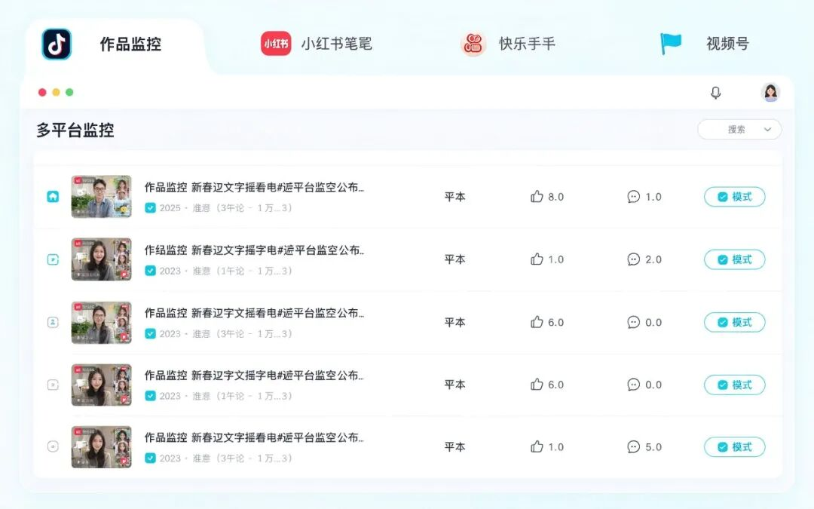

# 2.4k Star：一个 Web 后台管起抖音/小红书/快手/视频号——CreatorHub 完整教程
> 💡 备注属性未写入，可能是备注属性名称或者类型被修改了，建议将字段类型设置为 rich_text，可以在小程序-操作-修改文章数据库页面进行调整
> 💡 原文链接:[https://mp.weixin.qq.com/s?__biz=MzY5MTM2MjA5OQ==&mid=2247484204&idx=1&sn=3caf83d832bc918cd2bca99a88b0dfbb&chksm=f55b38b9ac617efdef9ac50cabfa45aa91ef64d2e505ddc2855d0e09eb5ef5f51f6b31d8b457#rd](https://mp.weixin.qq.com/s?__biz=MzY5MTM2MjA5OQ%3D%3D&mid=2247484204&idx=1&sn=3caf83d832bc918cd2bca99a88b0dfbb&chksm=f55b38b9ac617efdef9ac50cabfa45aa91ef64d2e505ddc2855d0e09eb5ef5f51f6b31d8b457#rd)
🖥️
**一个 Web 后台，管起你的四个平台**
CreatorHub：本地运行的多平台内容管理面板，登录、监控、采集、下载、评论、发布、私信集中处理
2.4k Star开源免费本地运行
### 📖 它是什么
**CreatorHub**（3441293738/creatorhub）是一个**本地运行的多平台内容管理面板**，用 Python + FastAPI 提供统一 Web 界面，把 **抖音、小红书、快手、视频号**拢到同一个后台。账号登录、作品监控、评论监控、内容下载、发布、私信、通知——这些操作集中到一个 Web 面板里完成，不用在几个平台和后台之间来回切。
核心机制：浏览器交互按平台使用系统 Chrome CDP 或免费开源的 Patchright，业务层统一用兼容的 Playwright API；每个账号使用独立的浏览器 Profile，Cookie、缓存和本地存储互不共享。账号登录态、数据库及媒体文件都保存在**本地**，不把账号数据上传到第三方。
版本沿革：项目 2026-07 上线，GitHub 上已获 **2.4k Star**（439 fork），Python 语言，2026-10 仍在活跃更新。协议仓库暂未提供 LICENSE 文件（以仓库为准）。提供 Windows 一键安装包，也支持源码运行（macOS / Linux / 开发者）。
### ✨ 核心亮点
🗄️
一屏管四平台
抖音/小红书/快手/视频号集中到一个 Web 后台
🛡️
本地运行隐私安全
账号登录态、数据、媒体文件都存本地，不上传第三方
🔐
每账号独立 Profile
Cookie/缓存/本地存储互不共享，多账号隔离
📦
Windows 一键安装
桌面安装包双击即用，无需装 Python/跑命令
### 🖥️ 环境要求
| 操作系统 | Windows 10/11 x64（推荐安装版）；macOS / Linux 可源码运行 |
| 运行环境 | Python 3.10+（源码模式）；桌面环境（扫码登录需弹浏览器） |
| 硬件 | 常规电脑即可；运行多个浏览器 Profile 建议内存充裕 |
| 关键依赖 | Chrome（小红书扫码建议装）、Node.js 18+（小红书 api 模式）、ffmpeg |
### 🖼️ 效果图与演示

演示示意：多平台作品监控，列表集中展示各平台数据

演示示意：一次编辑，四平台同时发
### 🚀 上手步骤
① Windows 一键安装（推荐）
在仓库 Releases 下载 CreatorHub-Setup-windows-x64.exe，双击安装，用桌面快捷方式启动。无需自己装 Python 或跑构建命令。
`在 Releases 页面下载 CreatorHub-Setup-版本-windows-x64.exe，双击安装`
② 源码运行（macOS / Linux / 开发者）
`git clone https://github.com/3441293738/creatorhub cd creatorhub ./start.sh # macOS/Linux；Windows 用 start.cmd`
③ 启动本地服务并登录
点击「启动本地服务」，首次会自动下载浏览器组件，就绪后打开工作台。每个平台按需扫码/创作者/Cookie 登录，各账号独立 Profile。
④ 开始监控 / 采集 / 发布
配置关键词批量采集、作品/评论/弹幕监控、内容下载；需要时统一发布到多平台，或开自动评论回复，接收 Bark/钉钉/Telegram 通知。
### 🎯 典型玩法
🚀 **跨平台发布**：一次编辑，抖音/小红书/快手/视频号同时发
🔍 **竞品监控**：按关键词批量采集作品与评论，盯对手动态
💬 **评论/私信集中处理**：多平台评论自动回复，私信统一管理
💾 **内容下载**：下载作品媒体文件，支持选画质/图集
📢 **数据通知**：监控触发 Bark/钉钉/Telegram 提醒
🗃️ **多账号运营**：独立 Profile 隔离账号，安全运营多个号
### 📊 和同类做法比
| 各平台后台手动切 | 登录态分散、操作重复、难以批量监控与采集 |
| 云端多平台 SaaS | 账号数据要交第三方、有订阅费用、采集受限 |
| CreatorHub | 本地运行、数据隐私、每账号独立 Profile、免费开源 |
原理一句话：用 Playwright/Patchright 驱动真实浏览器会话、通过拦截网络流量采集数据，绕过复杂签名，所以多平台统一监控采集不依赖平台开放 API。
### ❓ 常见问题
**Q：需要把账号数据交给第三方吗？**
不需要。账号登录态、数据库及媒体文件都保存在本地，浏览器交互走的是你系统里的 Chrome CDP 或开源 Patchright。
**Q：支持哪些平台、各能做什么？**
抖音（采集/监控/弹幕/下载/发布）、小红书（采集/监控/下载/发布）、快手（监控/下载/发布）、视频号（仅本账号发布与数据）。视频号不支持监控或下载他人作品。
**Q：Windows 怎么装最省事？**
下载 Releases 里的 CreatorHub-Setup-windows-x64.exe 双击安装，用桌面快捷方式启动即可，无需自己装 Python 或跑命令。
**Q：源码运行要什么环境？**
Python 3.10+、桌面环境（扫码登录需弹浏览器）、建议装 Chrome；小红书 api 发布模式还需 Node.js 18+；缺 ffmpeg 会自动用内置的。
**Q：多个账号会串吗？**
不会。每个账号用独立浏览器 Profile，Cookie、缓存、本地存储互不共享，多账号隔离。
**Q：可以免费商用吗？**
项目开源、可本地免费运行。仓库暂未提供 LICENSE 文件，具体协议以仓库实际声明为准；涉及平台自动化请遵守各平台用户协议。
**📎 GitHub 搜索 3441293738/creatorhub · 在线预览 3441293738.github.io/creatorhub**
关注「AI工具匠」，获取更多 AI 工具实操教程
