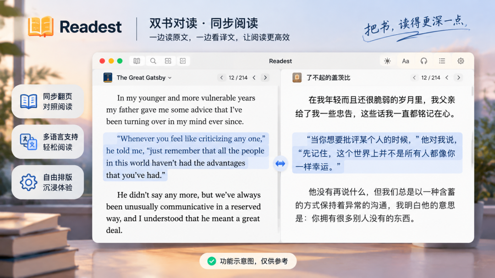
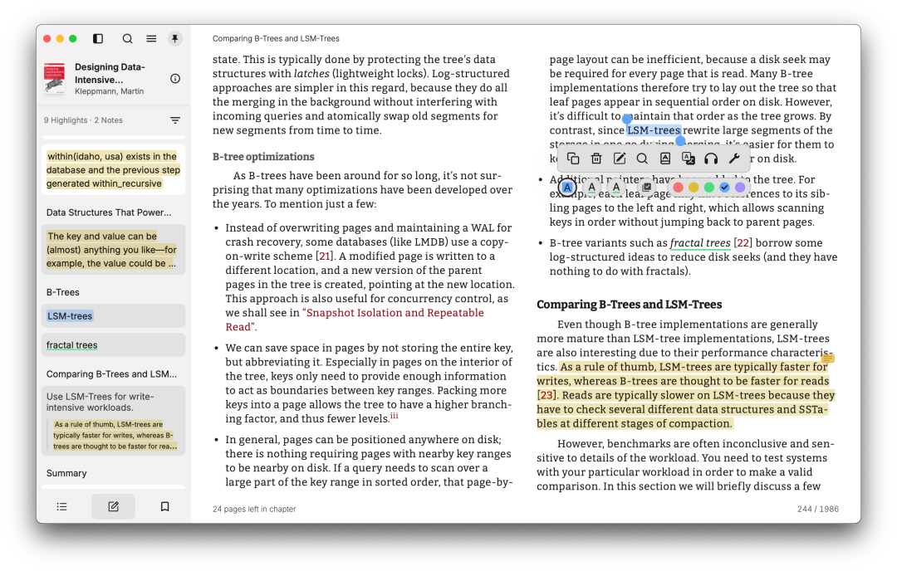
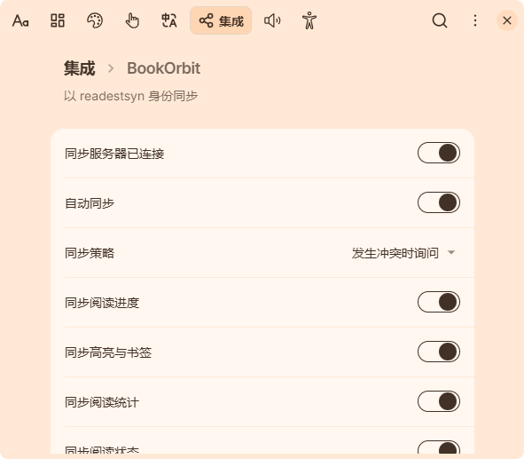
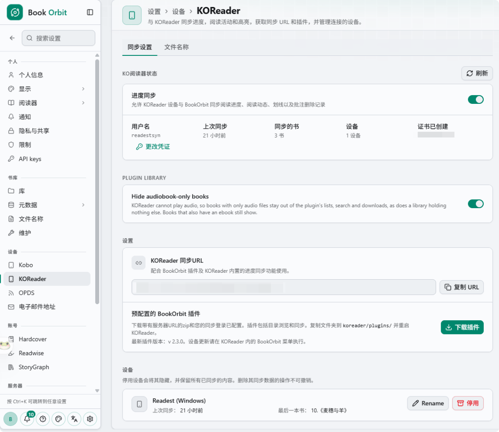

# 2.6 万 Star 的开源阅读器 Readest：把书库、批注和阅读进度掌握在自己手里
> 💡 备注属性未写入，可能是备注属性名称或者类型被修改了，建议将字段类型设置为 rich_text，可以在小程序-操作-修改文章数据库页面进行调整
> 💡 原文链接:[https://mp.weixin.qq.com/s?__biz=MzkwNDczNjYxMw==&mid=2247483682&idx=1&sn=9de9a3218d7d2afb38e2dcfd16db3292&chksm=c1fff36d0e2991c100160582b97e61a7ebf9a37565c3355349ae44a9886c0b7d6a653a340387#rd](https://mp.weixin.qq.com/s?__biz=MzkwNDczNjYxMw%3D%3D&mid=2247483682&idx=1&sn=9de9a3218d7d2afb38e2dcfd16db3292&chksm=c1fff36d0e2991c100160582b97e61a7ebf9a37565c3355349ae44a9886c0b7d6a653a340387#rd)
一个开源阅读器，能不能同时解决电子书管理、跨设备阅读、批注同步和外文学习？Readest 给出了一个不错的答案。本文结合实际使用体验，从功能、同步机制、NAS 配合、收费模式和适用人群几个方面，看看它是否值得成为你的主力阅读器。
## 项目入口及下载
```bash
GitHub项目地址：
https://github.com/readest/readest

小飞机网盘(无需登录直接下载)：
https://share\.feijipan\.com/s/ohzI6f1W?code=5836

官网地址：
https://readest.com/zh
```
Readest 是一个试图把选择权交还给读者的开源项目。它不只是提供一个阅读界面，还把书籍管理、阅读进度、批注、跨设备同步和外文阅读工具放进了同一套产品里。截至 2026 年 11 月 22 日，Readest 的 GitHub 仓库已经达到约 2.66 万 Star、约 1.9 千 Fork。数字当然不能直接代表软件质量，但至少说明它已经获得了相当规模的关注，而且项目仍在持续更新。
## 01 它不是又一个阅读器，而是一次跨平台重写
Readest 的项目介绍将它称为 Foliate 的现代化重写版本。它使用 Next.js 16 和 Tauri v2，覆盖 Windows、macOS、Linux、Android、iOS 和 Web。不同平台共享阅读引擎和文件格式支持，目的就是让同一本书可以在不同设备上继续阅读。
这件事听起来像是一个技术选型问题，但对普通读者来说，解决的是一个很具体的麻烦：不必因为换了手机、电脑或平板，就重新选择一款阅读软件，也不必把阅读习惯拆散在多个 App 里。
项目采用AGPL-3.0开源许可证。它不是“代码放出来看看”的宣传式开源，而是有明确许可证约束的自由软件项目。对于希望了解实现方式、参与开发或自行构建的人，完整代码和构建说明都可以在 GitHub 仓库中查看。
第一次打开 Readest，我最直观的感受是界面比较克制：书架、搜索和阅读入口占据了主要位置，没有把推荐流、社区动态或内容商城放在核心位置。它更像一张等待你放上书的书桌，而不是一个希望你不断浏览内容的书城。

## 02 六组功能，决定它能不能成为主力阅读器
### 一本原文，一本译本，并排放着读
并行阅读（Parallel Read）是 Readest 很有辨识度的功能：可以在同一个窗口中并排打开两本书或两份文档。桌面端和大屏平板采用左右分栏，屏幕较窄时则会改为上下排列。
默认情况下，两侧内容可以同步滚动或翻页。读译本时对照原文、学习外语时对照参考资料、研究某个主题时一边看正文一边查另一份文档，都不必再开两个窗口来回切换。
不过，两本书的篇幅和章节结构如果差异很大，同步滚动未必总是准确对应。这时可以关闭同步，让两侧独立阅读。它更适合“对照阅读”，而不是简单地把两个阅读窗口拼在一起。

### 格式覆盖面够广，但不代表所有电子书都能直接打开
Readest 支持的常见格式包括：
- EPUB、PDF、MOBI、AZW、AZW3（KF8）
- FB2、CBZ、ZIP 漫画压缩包
- TXT、HTML、Markdown
此外，DOCX 和 RTF 文件在导入时可以转换为 EPUB。不同格式的阅读能力并不完全相同：EPUB 是官方文档推荐的格式，具有较完整的目录、排版和标注支持；文本型 PDF 可以选择文字、高亮和查询，图片型 PDF 则会受到原文件内容形式的限制。
这里有一个需要提前提醒的地方：格式兼容不等于 DRM 解密能力。对于带有数字版权保护的电子书，不能只看文件扩展名就认定它一定能打开。官方文档对 AZW4、KFX 和带 DRM 的 EPUB3 等格式建议先使用 Calibre 等工具转换，再导入 Readest。
它的标注也不只是给文字涂一层颜色。阅读时可以添加高亮、书签和笔记，之后再从侧栏集中查看并跳转回原文；书内全文搜索和书架检索也能帮助定位内容。对于经常需要从书里摘录资料的人，这比单纯记录阅读进度更有价值。

### 排版细节，决定长时间阅读舒不舒服
字体、字号、行距、页边距、主题和阅读布局，是电子书阅读器的基本功。Readest 还提供滚动与分页模式、阅读标尺、逐段阅读、速读辅助、页面翻转效果等选项。
阅读技术资料时，它还支持代码语法高亮；如果你习惯把阅读界面调整到适合自己的状态，也可以逐项设置字体、主题和布局，而不是被固定的阅读样式限制。
这些功能未必每个人都会用到，但对经常长时间阅读的人来说，能把界面调整得舒服，往往比多一个花哨功能更重要。
### 外语阅读：查词、翻译、朗读和生词管理
阅读外文书时，选中单词或段落后，可以调用词典、Wikipedia 或翻译服务。项目支持导入 Yomitan ZIP、RDICT 等本地词典包，也提供句子和段落翻译能力。具体可用的翻译引擎与额度，会受到当前设置和套餐限制影响。
朗读（TTS）也是 Readest 的一项重要功能。它可以朗读书籍内容，并在播放时同步标记当前阅读位置。根据所选语音引擎，支持句子级或单词级高亮；不同平台和语言的高亮精度并不完全相同，中文等 CJK 文本通常以句子为单位。
语音引擎需要特别留意：Readest 可以使用设备自带语音、浏览器语音或云端语音。Windows 和 macOS 当前并没有接入 Readest 的原生系统 TTS 引擎；常见选择是 Edge TTS 或浏览器语音。Edge TTS 需要网络连接，并会把当前句子发送到 Microsoft 服务进行语音合成。如果你更在意离线和隐私，应先确认自己选择的语音引擎，而不是把“支持 TTS”理解为所有平台都能完全离线朗读。
Readest 还加入了生词本，可以把查过的词标记为“学习中”或“已掌握”，并与 Anki 同步。对于通过阅读原文学习外语的人来说，这让查词不再只是一次性的动作，而是可以继续整理和复习的学习流程。

### 跨设备同步：先分清书籍文件和阅读记录
Readest 的同步设计需要讲清楚，因为它实际包含不同类别的数据。
简单理解：书籍文件是 EPUB、PDF 等原始文档；阅读记录则包括书架条目、阅读进度、书签、高亮和笔记。Readest Cloud 可以同步书籍文件和阅读数据，但它们可以分别控制。打开同步后，其他设备可以先看到书架条目，需要阅读时再下载对应的书籍文件；Readest 不会在后台自动把整个书库全部下载到每一台设备。已经下载到设备上的书籍，也不会因为关闭 App 就自动消失。
普通导入会在当前设备保存一份书籍副本；如果你使用“Read books in place”方式，则可以登记一个文件夹并直接读取原位置的书籍。免费套餐包含 500MB 云同步空间。若你的书库比较大，需要关注容量；如果希望把数据同步到自己控制的存储服务，还可以考虑第三方云存储或自建同步方案，但两者的功能和收费条件并不相同。
| 同步方式 | 可以同步什么 | 需要注意什么 |
| Readest Cloud | 书籍文件、书架信息、阅读进度、书签、高亮和笔记等 | 免费套餐含 500MB 云空间；书籍文件和阅读数据可以分别控制 |
| BookOrbit | 阅读进度、高亮、书签、阅读统计和阅读状态 | 不传输书籍文件；通过这条路径同步时，PDF 和漫画等固定版式内容不支持进度与标注同步 |
| 第三方云存储 | 阅读状态；也可以按设置选择是否同步实际书籍文件 | 支持 WebDAV、Google Drive、OneDrive、iCloud Drive 和 S3 兼容存储，但需要 Plus、Pro 或 Full Customization |
我自己比较关注的是 NAS 场景。我会把 Readest 和部署在 NAS 上的 BookOrbit 配合使用。这里必须说明一个容易混淆的细节：BookOrbit 不是用来存放和传输 EPUB、PDF 文件的书库网盘，它负责的是阅读状态同步。
Readest 通过 KOReader 同步协议连接 BookOrbit 后，可以同步阅读进度、高亮、书签、阅读统计和阅读状态。书籍文件仍然需要保存在你自己的书库中，并且 BookOrbit 需要能够识别对应的书籍文件。简单说，NAS 负责保存和管理原始书籍，Readest 负责阅读，BookOrbit 负责让不同设备的阅读记录保持一致。
还有一个限制需要注意：通过 BookOrbit 这条同步路径，PDF、漫画等固定版式内容不会同步阅读进度和标注。如果你的阅读主体是 PDF 或漫画，不能把 BookOrbit 当成完整的跨设备同步方案，应该根据需求考虑 Readest Cloud 或其他兼容的存储方式。


### 书怎么进来：它更像书架，不是内容商城
除了从本地文件导入，Readest 还支持 OPDS 目录和 Calibre 书库，可以连接已有的电子书资源；也可以通过内置浏览器保存网页，或者从 Web Novel 功能中选择章节并整理成电子书。
此外，项目还支持附近设备传书（Nearby BookDrop）、LocalSend 传书，以及 Audiobookshelf 有声书服务等功能。对于已经有 NAS、Calibre 或其他自建书库的用户，这些入口能减少反复下载和手动整理的步骤。
这些功能的方向都比较一致：把你已经拥有或管理的内容导入自己的书架，然后专心阅读。它没有把重点放在排行榜、评论区和猜你喜欢上。如果你需要的是一个内容丰富的中文网文书城，那 Readest 并不是在解决同一个问题。
## 03 两年多的项目，更新是否还在继续？
Readest 的仓库创建于 2024 年 10 月。截至 2026 年 11 月 22 日，GitHub 上约有 2.66 万 Star 和 1.9 千 Fork。Star 数只能反映项目受到的关注，不能直接等同于稳定性或软件质量；但结合持续发布的版本来看，它并不是一个发布后就停止维护的项目。
以目前能查到的正式版本为例，Readest 0.12.20 于 2026 年 11 月 5 日发布。这个版本加入了生词本、学习状态管理和 Anki 同步，也增加了阅读统计面板、页面翻转和纸张卷曲效果、拖动进度条时的页面预览，以及键盘选择文本等功能。
比起单纯列出提交次数，我更愿意关注这些具体更新：它们是否持续解决真实阅读场景中的需求，是否让书籍阅读、外语学习和个人知识积累变得更顺手。对普通用户来说，持续有功能迭代和问题修复，比一个漂亮的 Star 数字更有参考价值。
## 04 它并不适合所有人：使用前需要知道的限制
第一，它没有内置中文书城。Readest 的定位是阅读器，不是内容平台。它不会替你提供完整的中文网文书库、热门榜单或读者社区。书籍需要自己导入、购买或通过 OPDS、Calibre 等已有渠道管理。
第二，免费云空间有上限。免费套餐目前提供 500MB 云同步空间。对于只存阅读记录、少量 EPUB 的用户可能够用；如果你有大量 PDF、漫画或有声书，容量可能很快就会成为限制。使用 Readest Cloud、第三方云存储和 NAS 自建服务时，数据流向也不同，需要先决定自己更看重方便还是存储控制权。
第三，自建同步并不等于所有内容都能同步。BookOrbit 可以同步阅读状态，但不传输书籍文件；通过它同步时，PDF 和漫画等固定版式内容也有功能限制。NAS 用户需要把书籍文件管理和阅读记录同步分开规划。
第四，部分功能存在付费门槛。例如 WebDAV、Google Drive、OneDrive、iCloud Drive 和 S3 兼容存储的第三方云同步，需要 Plus、Pro 或一次性购买 Full Customization。云存储空间包本身并不包含第三方云同步权限。
第五，受 DRM 保护的电子书不一定能直接打开。AZW、AZW3 等格式名称并不代表所有 Kindle 购书文件都能读取。对于官方列出的不兼容或受保护格式，需要先确认版权保护情况和转换可行性。
所以，如果你希望安装后就能直接搜索、购买、阅读网文，微信读书等带有内容平台属性的产品可能更适合；如果你已经积累了自己的电子书文件，习惯在多台设备间阅读，或者有 NAS 和 Calibre 书库，那么 Readest 值得花时间尝试。
## 05 三步上手：先试，再决定要不要迁移书库
1. 先试网页版。打开https://web.readest.com/，登录后导入一本 EPUB 或 PDF，先感受排版、翻页和阅读操作。官方文档说明，Web 版首次访问后也可以离线使用。
2. 再安装对应平台版本。Windows、Linux 和 Android 可以从官网或 GitHub Releases 获取安装包；macOS 和 iOS 可以通过 App Store 安装。建议优先使用官网或 GitHub 官方发布页，不要把来源不明的第三方安装包作为首选。
3. 导入一本常读的书。可以从本地文件导入，也可以拖拽文件；如果你已经有 Calibre 或 OPDS 书库，再按需连接。刚开始不建议一次性把整个书库全部迁入，先用几本常读的书检查格式、排版和同步是否符合自己的习惯。
随后只需先调整三项设置：字体与主题、滚动或分页模式、是否开启阅读标尺。等确认使用习惯后，再配置跨设备同步、BookOrbit 或第三方云存储。
## 06 免费版够不够？收费方案怎么选？
Readest 采用免费套餐加订阅和一次性功能解锁的模式。下面价格依据官网 2026 年 11 月 22 日可见的价格页整理，均为美元；实际价格、税费和应用商店内购金额以购买页面为准。
| 方案 | 价格 | 主要权益 |
| 免费版 | US$0/月 | 跨平台同步、500MB 云空间、每日 10,000 字符 AI 翻译额度、AI 朗读和基础阅读设置 |
| Plus | US$4.99/月 | 5GB 云空间、每日 100,000 字符翻译额度、DeepL Pro、无限 AI 朗读时长、高级语音及更多功能 |
| Pro | US$9.99/月 | 20GB 云空间、每日 500,000 字符翻译额度、Pro 专属语音、进阶 AI 工具和新功能抢先体验 |
这里最容易混淆的是：购买额外云存储，不等于解锁第三方云同步。WebDAV、Google Drive、OneDrive、iCloud Drive 和 S3 兼容存储同步，需要 Plus、Pro 或一次性 Full Customization。Full Customization 还包含专属“发送到 Readest”邮箱、按章节下载朗读音频、从 Audiobookshelf 下载书籍离线使用，以及受信任设备之间免确认传书等功能。Plus 和 Pro 套餐也包含这些功能。
如果只是普通阅读，免费版可以先用起来；如果需要更大的 Readest Cloud 空间、更多翻译额度和无限朗读时长，可以考虑订阅；如果你已经有自己的 WebDAV、OneDrive 或 S3 存储，并且希望把同步数据放在自己控制的服务中，再考虑 Full Customization 或订阅方案。另需注意，Readest Voice 的订阅专属高级音色不包含在一次性 Full Customization 中。
## 07 写在最后：它更像一张书桌，而不是一个书城
过去很多阅读 App 都在努力把书城、榜单、评论、社交和会员体系整合到一起。Readest 走的是另一条路：它更关心你已经拥有的书，能不能在不同设备上方便地读；读过的内容，能不能留下笔记和标注；换一台设备时，能不能接着上次的位置继续。
它当然不是完美的。免费云空间有限，第三方云同步有付费门槛，BookOrbit 也不能替你传输书籍文件；如果你主要阅读受 DRM 保护的电子书，也需要先确认格式兼容性。
但如果你有自己的电子书文件，平时会在电脑、手机和平板之间切换，或者已经搭建了 NAS 书库，那么 Readest 的价值就不只是“又多了一个阅读器”。它让书籍文件、阅读记录和个人批注有了更清晰的管理方式，也给喜欢折腾自建书库的用户留下了空间。
书可以放在自己的硬盘、NAS 或自己选择的云存储里；阅读器负责把它们组织起来。对我来说，这种把选择权交还给读者的思路，正是 Readest 最值得尝试的地方。
如果你也在不同设备上读着不同的书，不妨先拿一本常读的 EPUB 试试。没有必要马上迁移整个书库，先确认它适不适合自己的阅读习惯，再决定要不要让它成为主力阅读器。
---
## 
## 资料来源与核对链接
以下资料用于核对功能、技术栈、同步机制、版本和价格；功能与价格可能随版本更新而变化，发布前建议再打开官方页面确认一次。
1. GitHub 项目主页与 README：https://github.com/readest/readest
1. GitHub Releases：https://github.com/readest/readest/releases
1. 官方文档：https://readest.com/docs
1. 支持格式与上手说明：https://www.readest.com/docs/getting-started
1. 并行阅读说明：https://readest.com/docs/parallel-read
1. 同步与备份说明（包含 BookOrbit 和第三方云存储）：https://readest.com/docs/sync
1. TTS 朗读说明：https://readest.com/docs/listen
1. 官方价格页：https://www.readest.com/zh/pricing
1. GitHub Star 数变化参考：https://topairepos.com/repos/readest/readest
