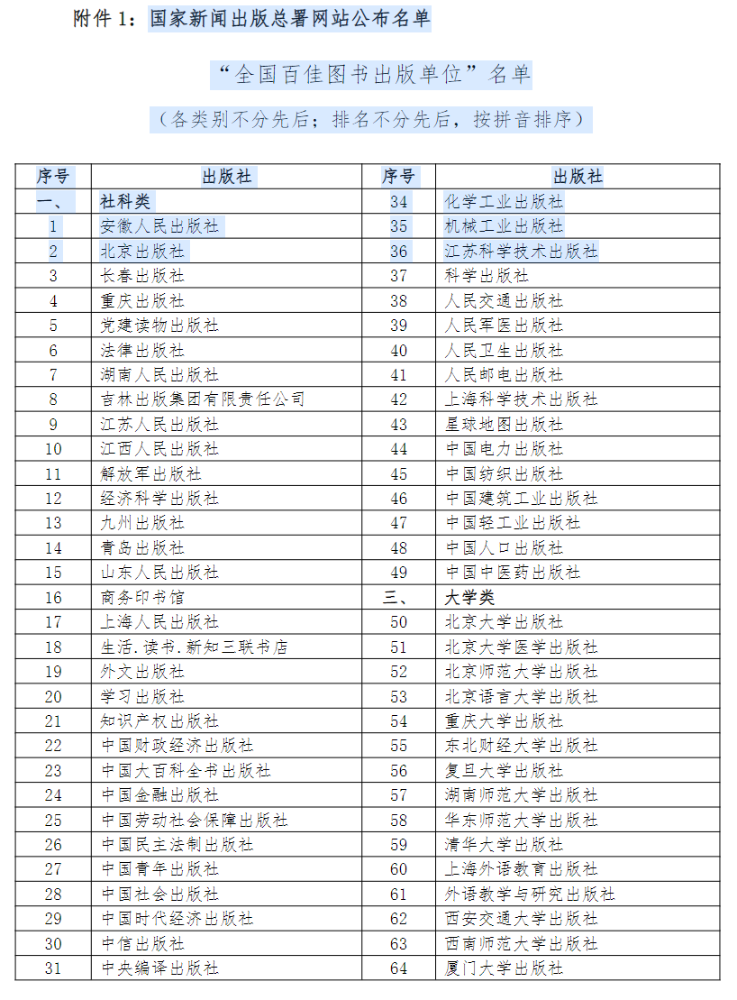
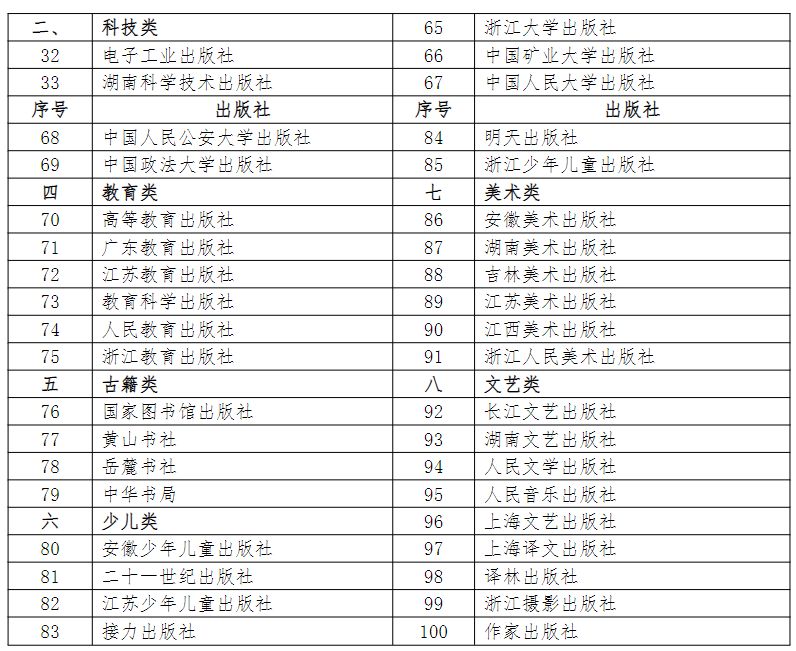

# 2025全国百佳出版社目录一览表
> 💡 备注属性未写入，可能是备注属性名称或者类型被修改了，建议将字段类型设置为 rich_text，可以在小程序-操作-修改文章数据库页面进行调整
> 💡 原文链接:[https://mp.weixin.qq.com/s?__biz=MzY4OTQwNTM5OA==&mid=2247484261&idx=1&sn=90bde27e1e288048b5629e1054be51d9&chksm=f2a7ce25735861e3344eeaca7a6030761f17ef4aabf02b7877cb346804a8c8fb33db60901db0#rd](https://mp.weixin.qq.com/s?__biz=MzY4OTQwNTM5OA%3D%3D&mid=2247484261&idx=1&sn=90bde27e1e288048b5629e1054be51d9&chksm=f2a7ce25735861e3344eeaca7a6030761f17ef4aabf02b7877cb346804a8c8fb33db60901db0#rd)
“全国百佳图书出版单位”国家新闻出版署为表彰国内优秀出版社而设立的荣誉，在各自领域内具有极高的声誉、专业性和影响力，对于职称评定和学术出版来说，出版的作品是备受认可的。以下是**2025全国百佳出版社目录一览表**，供大家参考：
　　全国百佳出版社是指在中国出版行业中，在出版质量、经济效益、社会效益等方面表现优秀的100家出版社。这些出版社涵盖了社科类、科技类、大学类、教育类、古籍类、少儿类、美术类、文艺类等多个领域。

**　如何选择百佳出版社的图书**
　　1、根据需求选择
学术研究可选择科学出版社、高等教育出版社等。
　　文学阅读可选择人民文学出版社、作家出版社等。
　　少儿读物可选择中国少年儿童新闻出版总社、接力出版社等。
　　2、关注出版社品牌
　　选择知名出版社的图书，质量更有保障。
　　3、查看图书评价：
　　通过读者评价、专家推荐等方式了解图书的实用性。
　　全国百佳出版社在各自的领域内都取得了显著的成就，为中国出版事业的发展做出了重要贡献。这些出版社不仅注重图书的质量和学术价值，还积极适应市场需求，推动出版行业的创新和发展。
