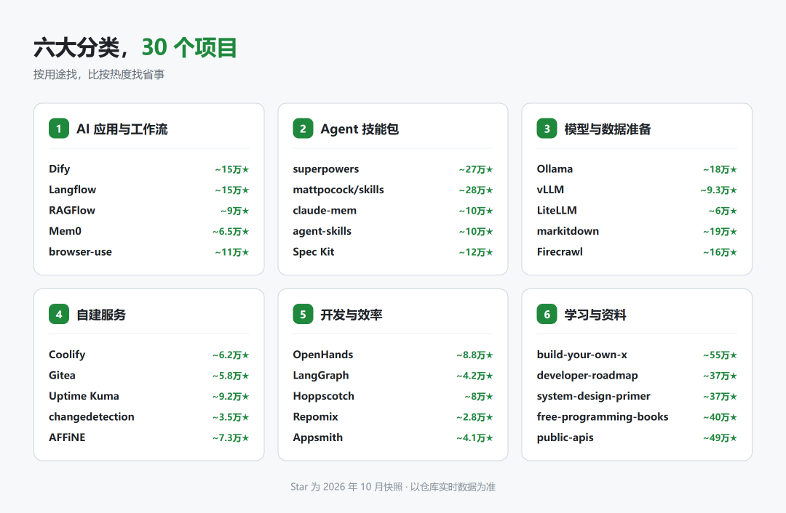
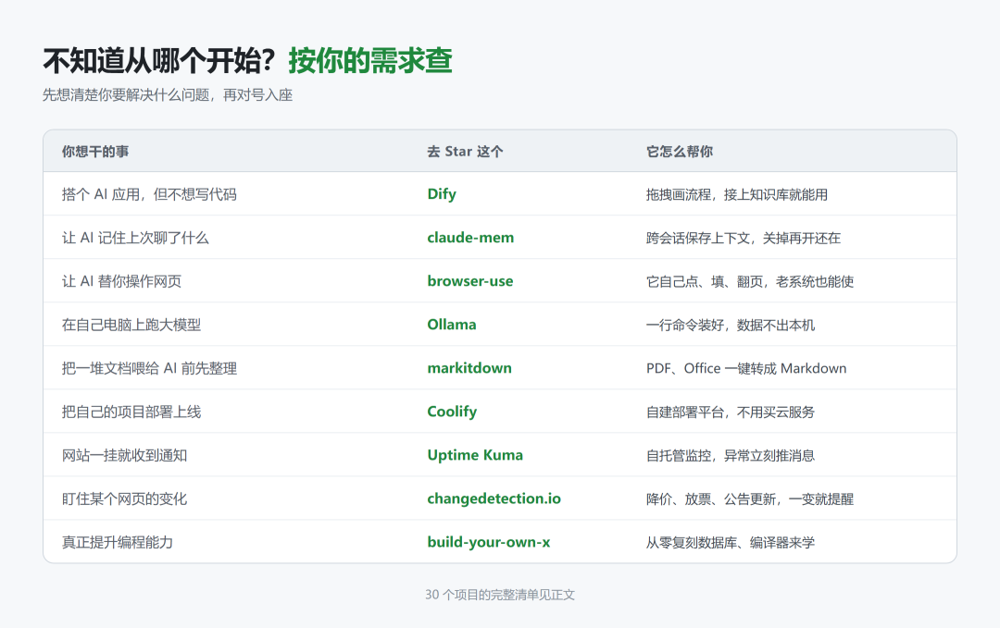
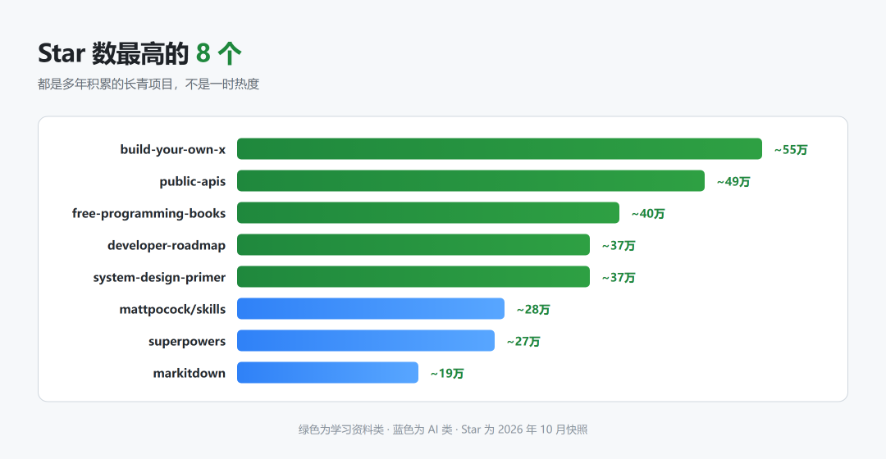

# 2026 年 GitHub 上最值得 Star 的 30 个项目
> 💡 备注属性未写入，可能是备注属性名称或者类型被修改了，建议将字段类型设置为 rich_text，可以在小程序-操作-修改文章数据库页面进行调整
> 原文链接:[https://mp.weixin.qq.com/s/zalBtGg0hIqTv0jBIzV5oQ](https://mp.weixin.qq.com/s/zalBtGg0hIqTv0jBIzV5oQ)
按 6 个用途分类，每个附 Star 量级和一句话说明（Star 为 2026 年 10 月快照，以仓库实时数据为准）。

### 一、AI 应用与工作流
1. **Dify** · ~15 万★ — 拖拽式搭 AI 应用：工作流、知识库、模型管理都在一个面板里，不写代码也能上线
1. **Langflow** · ~15 万★ — 把 Agent 的每一步画在画布上，提示词、检索器、工具一眼看清，改起来比改代码快
1. **RAGFlow** · ~9 万★ — 把一堆 PDF 和文档变成"能问答的知识库"，回答带原文出处，可追溯
1. **Mem0** · ~6.5 万★ — 给 AI 加长期记忆，一行 API 接进去，它下次还记得你说过什么
1. **browser-use** · ~11 万★ — 让 AI 真的去点网页：填表、翻页、抓数据，那些没有接口的老系统也能操作
### 二、Agent 技能包
1. **superpowers** · ~27 万★ — 给编程助手装上工程师的工作方式：先出计划、写完自测、再交付，告别自由发挥
1. **mattpocock/skills** · ~28 万★ — 一位资深工程师把自己日常在用的技能包直接开源，拿来即用
1. **claude-mem** · ~10 万★ — 让 AI 记住上一次会话聊了什么，关掉窗口再打开，上下文还在
1. **addyosmani/agent-skills** · ~10 万★ — 大厂性能专家整理的"生产级"技能：性能预算、可访问性、安全加固
1. **Spec Kit** · ~12 万★ — GitHub 官方的规格驱动开发工具：先把需求写成规格，再让 AI 照着实现

### 三、模型与数据准备
1. **Ollama** · ~18 万★ — 一行命令在本机跑开源大模型，不用 API Key，数据不出这台电脑
1. **vLLM** · ~9.3 万★ — 高吞吐推理引擎，自己部署模型服务时用它，速度是标准实现的好几倍
1. **LiteLLM** · ~6 万★ — 一个接口调 100 多家模型，自带成本统计、限流和负载均衡
1. **markitdown** · ~19 万★ — 把 PDF、Word、Excel、PPT 统统转成 Markdown，喂给 AI 之前先过它
1. **Firecrawl** · ~16 万★ — 把任意网页抓成干净的 Markdown 或结构化数据，专为喂模型设计
### 四、自建服务
1. **Coolify** · ~6.2 万★ — 自托管的部署平台，把自己的项目一键发到自己的服务器，不用买云服务
1. **Gitea** · ~5.8 万★ — 自己搭一个 Git 服务，代码放自己机器上，轻量到一个二进制就能跑
1. **Uptime Kuma** · ~9.2 万★ — 监控你的网站和服务，挂了立刻推消息给你，自托管零成本
1. **changedetection.io** · ~3.5 万★ — 盯着网页变化：降价、放票、公告更新，一变就通知你
1. **AFFiNE** · ~7.3 万★ — 本地优先的笔记与看板工具，Notion 和 Miro 的开源替代
### 五、开发与效率
1. **OpenHands** · ~8.8 万★ — 自主编程 Agent，在沙箱里自己读代码、改代码、跑测试
1. **LangGraph** · ~4.2 万★ — 写有状态、可恢复的 Agent 流程，跑长任务不怕中途断掉
1. **Hoppscotch** · ~8 万★ — 开源版 Postman，浏览器里直接测 API，不用装客户端
1. **Repomix** · ~2.8 万★ — 把整个代码仓库打包成一个文件，丢给 AI 就能让它读懂整个项目
1. **Appsmith** · ~4.1 万★ — 拖拽搭内部管理后台，连上数据库就能用，不用写前端
### 六、学习与资料
1. **build-your-own-x** · ~55 万★ — 从零复刻你天天在用的技术（数据库、编译器、操作系统）来学编程
1. **developer-roadmap** · ~37 万★ — 前端、后端、运维各方向的完整学习路线图，知道自己下一步学什么
1. **system-design-primer** · ~37 万★ — 系统设计入门，面试和能力提升都用得上
1. **free-programming-books** · ~40 万★ — 免费编程书合集，按语言和主题分好类
1. **public-apis** · ~49 万★ — 免费公开 API 大全，做练手项目时来这里找数据源

## 摘要

（待补充）

## 我的笔记

（待补充）
