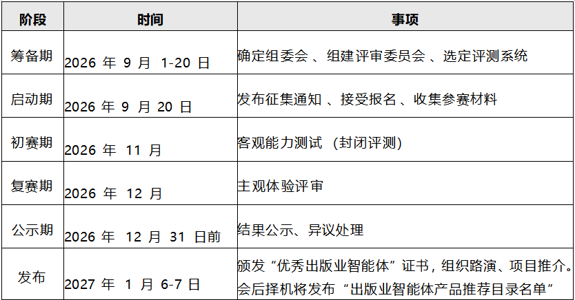

# 2026年度出版业智能体大赛报名延期至11月20日
> 💡 备注属性未写入，可能是备注属性名称或者类型被修改了，建议将字段类型设置为 rich_text，可以在小程序-操作-修改文章数据库页面进行调整
> 💡 原文链接:[https://mp.weixin.qq.com/s?__biz=MzAwNzEwMDMwOQ==&mid=2651004756&idx=1&sn=2b148b9495e6f3cd5714108cf2c54c93&chksm=81ec9d62f34e398017ca8a3014251b340a847d281aab8995a2c2cd5ff62b4b2e6ece9b68ee65#rd](https://mp.weixin.qq.com/s?__biz=MzAwNzEwMDMwOQ%3D%3D&mid=2651004756&idx=1&sn=2b148b9495e6f3cd5714108cf2c54c93&chksm=81ec9d62f34e398017ca8a3014251b340a847d281aab8995a2c2cd5ff62b4b2e6ece9b68ee65#rd)
**关于举办 2026 年度**
**出版业智能体大赛的通知**
一
**活动背景**

“十五五”规划开局之年，人工智能的发展深刻影响了出版业，人工智能 Agent （智能体）技术在出版领域的应用日趋深入，面向出版全流程的各类智能体产品快速涌现，已经成为出版全流程中不可或缺的新质生产力。然而，市场上出版智能体产品百花齐放，产品形态多样、能力各有侧重。不少出版机构面对纷繁的智能体产品缺少客观的评测标尺，选型甄别存在困难；同时，一线编辑面对层出不穷的智能工具，缺少真实场景下实操体验、对比的渠道，难以直观把握智能体的能力边界、优势与短板。
为此，作为出版行业权威媒体，《中国出版传媒商报》发起 2026 年度出版业智能体大赛，旨在：
1. 建立行业评测标准：为出版业智能体应用提供客观参考依据，提升出版行业创新活力和场景探索能力；
1. 推动技术迭代升级： 以赛促研，激励出版机构、技术厂商、科研机构联合，构建健康、 可持续的出版行业生态；
1. 搭建产研合作平台：促进智能体产品与出版机构、场景使用者、投资人的深度交流合作，打通产品供需对接渠道，促产融对接；
1. 树立行业应用标杆：推广优秀出版智能体应用案例，推动人工智能技术服务出版业务场景，赋能行业数智化转型。
通过大赛，达到“以赛促创新活力、以赛促场景探索、以赛促生态构建、以赛促产融对接”，推动出版行业数智化转型。
二
**大赛基本情况**

**（一）大赛名称**
2026年度出版业智能体大赛

**（二）组织单位**
**主办单位：**《中国出版传媒商报》社有限公司
**支持单位：**传播大脑科技（浙江）股份有限公司
上海软件中心
出版业科技应用促进联合体

**（三）参赛赛道**
本次大赛设置四大业务场景赛道，面向出版社、科技企业、高校及科研院所等主体征集，各主体单位可自主选择赛道，统一报名参赛。
1.赛道设置
**赛道一：面向读者用户——图书、期刊智能体**
本赛道服务广大读者、教学使用群体，围绕单本图书、丛书构建角色化智能体矩阵。重点考察面向外部用户的交互服务能力，涵盖图书、期刊内容解读、读者问答、角色对话、导读讲书、听书、教学辅助、研究辅助、知识图谱构建、跨语言阅读辅助、多模态解析等业务能力。
**赛道二：面向作者、编辑——内容生产与编校辅助智能体**
本赛道服务作者与编辑、校对等内容生产及编校业务人员，既覆盖作者从构思到成稿的自主创作与投稿准备，也覆盖编辑的组稿加工与编校审校，完整覆盖出版稿件从创作到成书的全业务链条。下设两个子方向，参赛可选择单个或同时选择两个子方向：
子方向①内容生产：支撑选题策划、资料汇编、组稿提纲生成、稿件整理、多角色稿件协同、编撰辅助等编辑内容生产业务，以及长文创作、设定与人物管理、情节推进与可控续写、风格一致性保持、多轮修改等作者自主创作业务，并支撑选题申报材料、内容简介与投稿材料准备；
子方向②编校审校：聚焦AI智能审校，包括文字差错、语法规范、政治导向、知识性错误、格式体例、多语种审校、自定义词库规则库、审校痕迹留存等审校业务能力；
子方向③：集成了以上①内容生产+子方向②编校审校的两大功能。
**赛道三：面向发行营销部门——出版营销传播智能体**
本赛道服务发行、营销、运营业务人员，聚焦图书宣发、市场推广与读者运营场景。重点考察宣传物料生成、营销文案与脚本创作、活动策划、读者运营辅助、传播素材自动生成、多端分发物料制作等营销传播能力。
**赛道四：面向管理层与职能部门——出版业务管理智能体**
本赛道服务社领导，总编办、项目管理与行政职能部门人员，聚焦出版机构业务管理与内部办公场景。重点考察出版项目全流程管控、选题进度跟踪、任务督办、经营数据统计分析、 内部协同流转、业务报表生成、风险预警等管理办公能力。
**赛道五：面向全流程集成——多智能体协同智能体**
本赛道面向覆盖两个及以上赛道业务场景的集成型智能体产品，如同时具备内容生产、编校审校、营销传播、管理与办公能力的出版集团平台。参赛产品须至少覆盖两条赛道的业务场景，并在报名表中注明所覆盖的赛道；仅覆盖单一环节的产品，应报对应单一赛道。本赛道不重复评测单个环节的基础能力，重点考察多智能体在统一编排下的角色分工、任务路由、跨环节上下文传递、共享知识底座与数据一致性、权限审计与人工接管，以及跨环节任务闭环带来的协同增益。

**（四）参赛主体**
参赛主体为独立法人单位者，须经营状态正常，包括并不限于出版机构、 文化企业、科技企业、 高校科研单位等。
团队参赛核心成员不少于 3 人，须提供团队人员名单、相关资质佐证材料；个人参赛者提交单位工作证明即可。
同一参赛主体可同时报名多个赛道，但须以不同智能体分别报名。

**（五）参赛要求**
（1）产品要求
参赛智能体须已经完成测试阶段，并已经落地试用；须按各赛道的两轮赛制参加评测，不可挑选轮次。
（2）合规与知识产权要求
所有智能体均须符合国家产业政策规定，无危害意识形态、违反出版管理规定内容；参赛主体对参赛项目拥有自主知识产权，并未侵犯任何他人的专利权、著作权、商标权及其他知识产权。
（3）参赛承诺
参赛方承诺无虚报项目、虚构事实等失信行为。一旦发现团队存在违反上述承诺的失实或失信行为，不论处于何种阶段或赛后，团队承担取消参赛资格、撤销所有奖项及相关后续支持的风险等。
三
**测评办法**

大赛设置“客观封闭测评+ 主观体验评审”两轮赛制，各赛道按相应方案组织实施。详细评测方案将单独通知参赛单位。
四
**荣誉设置**

各赛道实际参赛智能体数量的前30%确定为优秀等级；每个赛道设置优秀等次不少于3个，不足3个时按实际参赛数的1/3入围；报名参赛作品不足3个时，该赛道合并或取消。最终根据报名总量和智能体评测结果动态调整。
五
**获奖权益**

1. 荣誉证书：组委会颁发“2026年度优秀出版业智能体”证书。
1. 采购对接：优秀智能体进入“出版业智能体产品推荐目录”，组委会组织优秀智能体参加路演直播、项目推介会。
1. 投资对接：联合投资机构设置“最具投资价值奖”，入选项目可获得投资机构推荐的各种路演机会。
1. 宣传报道：《中国出版传媒商报》全媒体矩阵除了对活动全程专题报道之外，还会为每个优秀智能体进行深度或案例报道。
六
**赛事安排**

七
**参赛报名**

请填写参赛报名表发至邮箱：**cbyzntds@163.com**
报名截止时间：2026年11月20日
咨询电话：
赛道一：陈老师13601001502
赛道二：张老师15801161396
赛道三：王老师13651059523
赛道四：陈老师15601392742
赛道五：林老师18601076339
附件一关于举办2026年度出版业智能体大赛的通知.pdf
附件二2026年度出版业智能体大赛报名表.doc
排版：陈锴怡
初审：张绮月
复审：陈 芬
终审：马雪芬 林 晓
