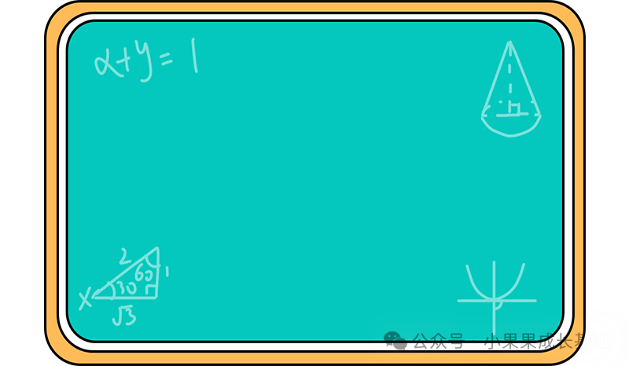
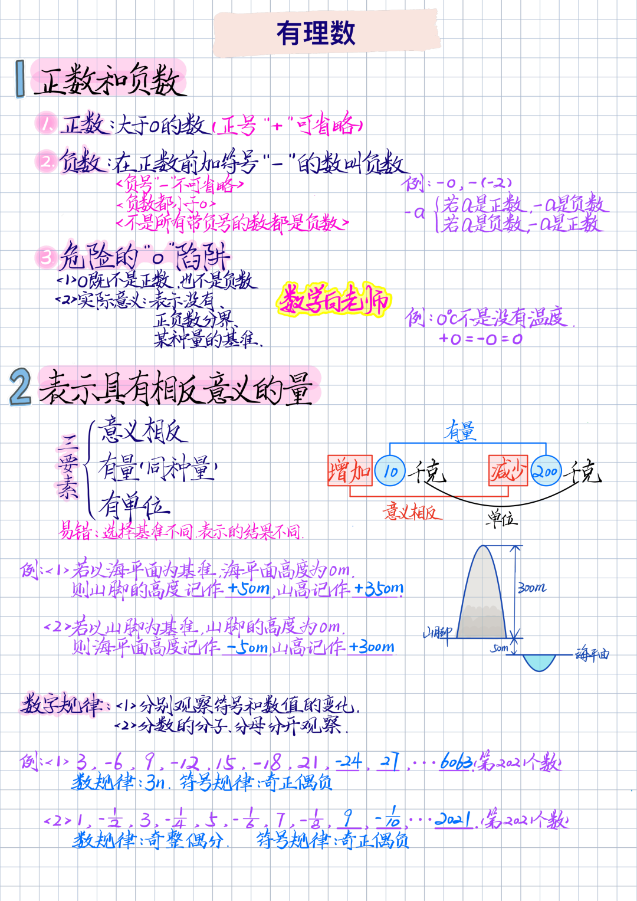
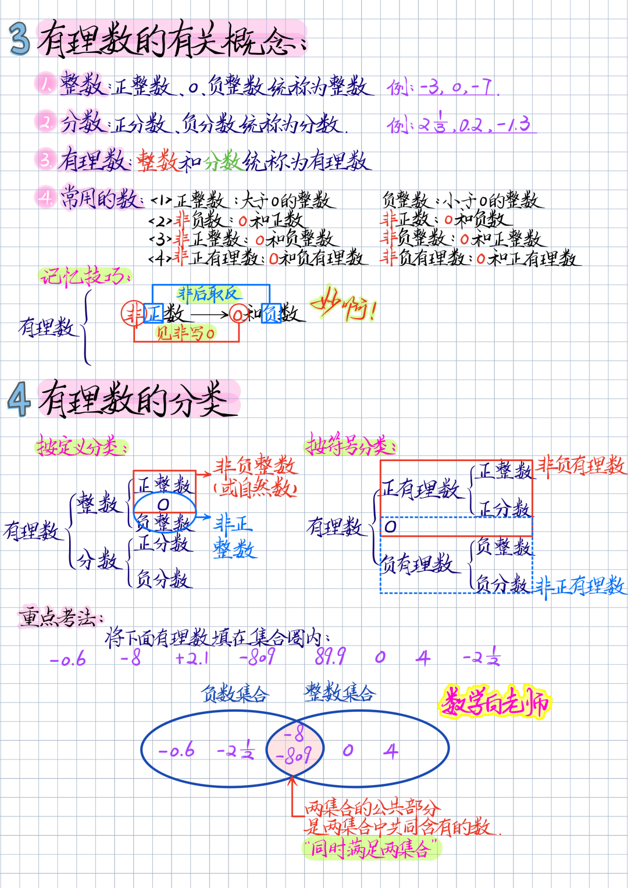
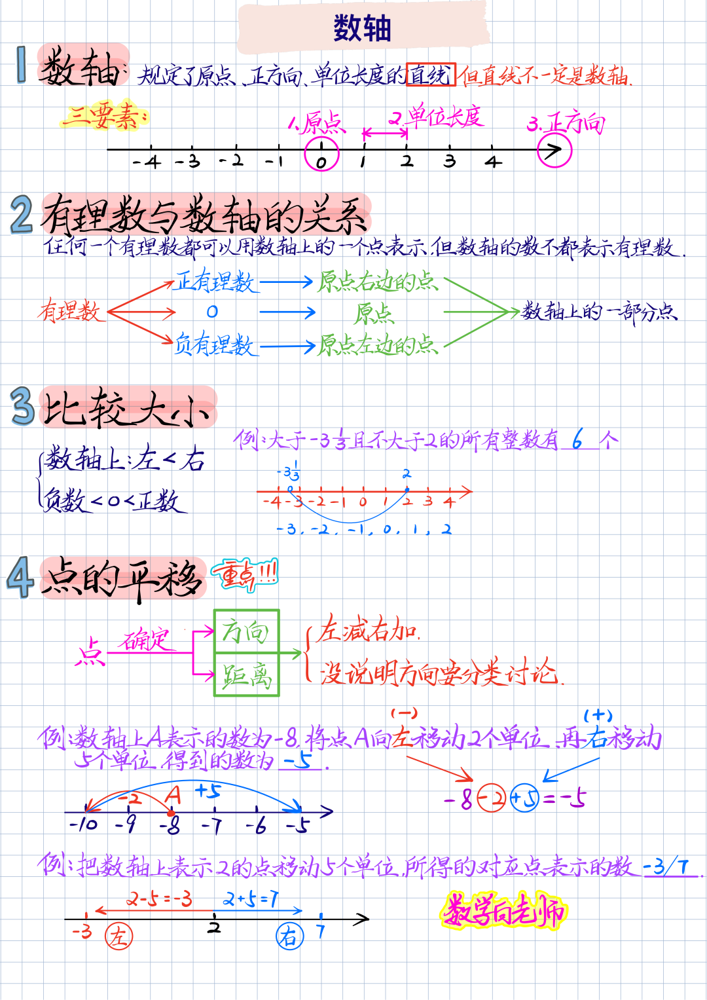
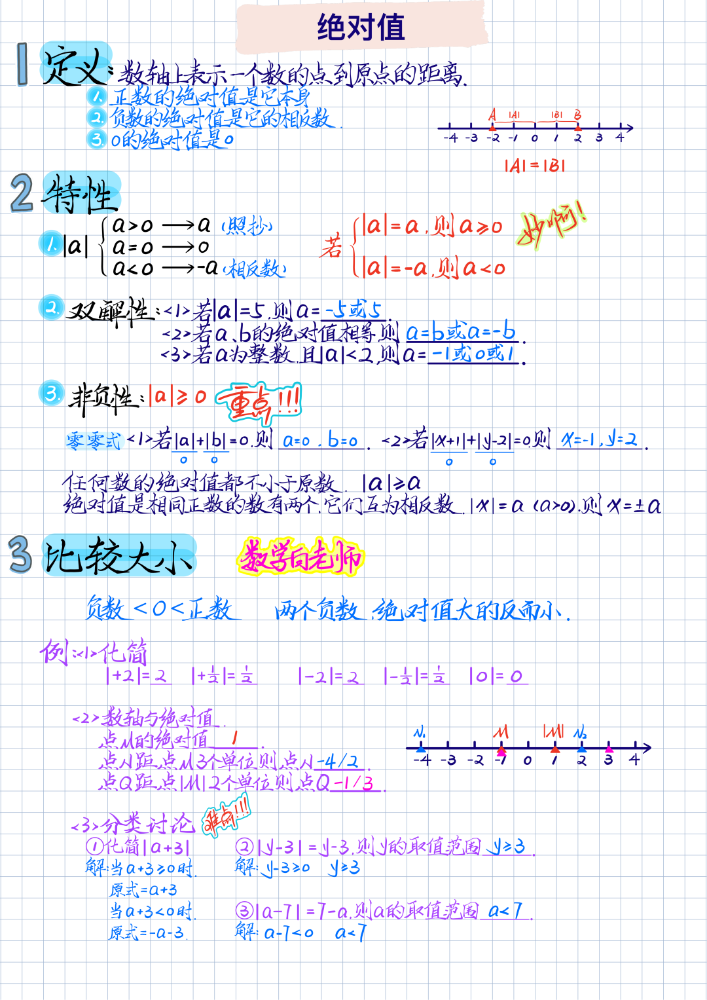
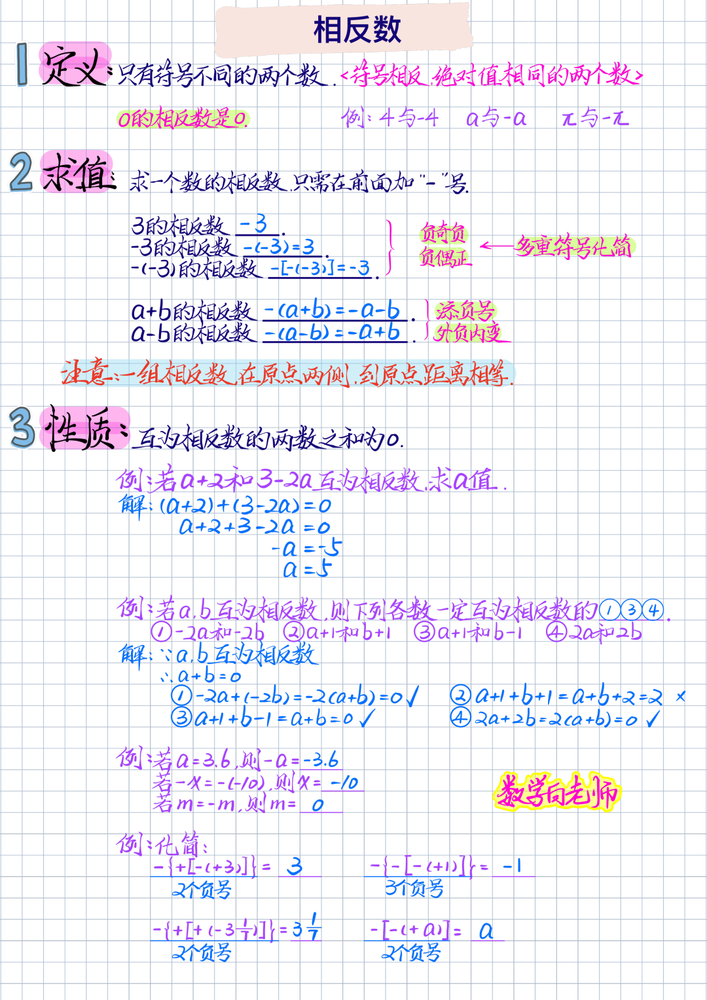
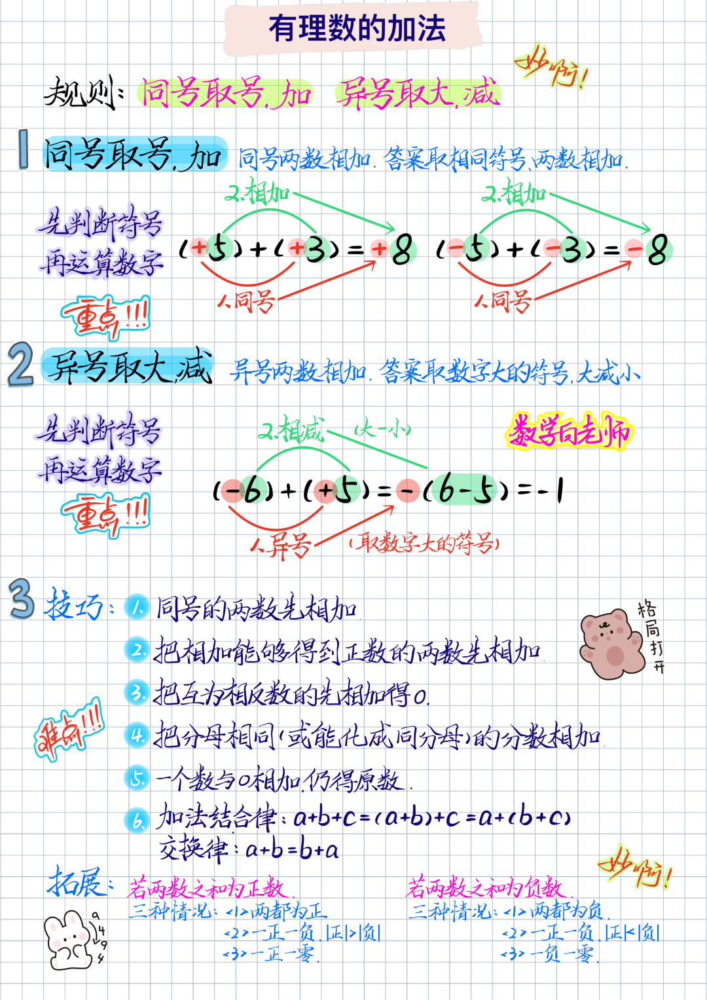

# 2026秋新版七年级上册人教版数学《知识笔记》，完整电子版可打印
> 💡 备注属性未写入，可能是备注属性名称或者类型被修改了，建议将字段类型设置为 rich_text，可以在小程序-操作-修改文章数据库页面进行调整
> 💡 原文链接:[https://mp.weixin.qq.com/s?__biz=MzA5ODk3MDQ2OQ==&mid=2454421327&idx=1&sn=38cc00927a730d2ec7c0ac526e07b1f8&chksm=868568f2c8f9e68d3fe58b83a43f0aa88375ec8407f4cc1413cc857cc9e65761b468d34a7164#rd](https://mp.weixin.qq.com/s?__biz=MzA5ODk3MDQ2OQ%3D%3D&mid=2454421327&idx=1&sn=38cc00927a730d2ec7c0ac526e07b1f8&chksm=868568f2c8f9e68d3fe58b83a43f0aa88375ec8407f4cc1413cc857cc9e65761b468d34a7164#rd)
**点击上方蓝字**
**获取更多资料~**

**专注分享七年级学习资料**
**学习基地**
**新起点·新成长**

**🌈今日给大家分享的学习资料是：2026年秋新人教版初一七年级上册数学《全册重点知识点总结》，高清完整电子版可打印**。家长可以打印出来让孩子记一记，巩固课本核心知识点，夯实基础，助力数学学习吧~🌸**欢迎分享到家长群或班级群，帮助更多孩子高效学习吧~**
**温馨提示：文末有完整电子版领取方式**

**点赞和分享，让我元气满满哦！**
**👇领取完整高清电子版：**
**①先点一点右下角的“👍”和“❤️”，感谢🙏**
**②再关注公众号，点【发消息】输入：七年级**
