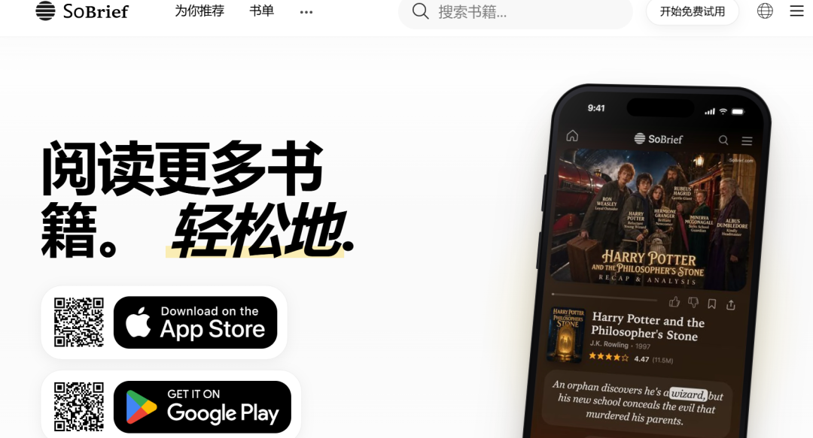
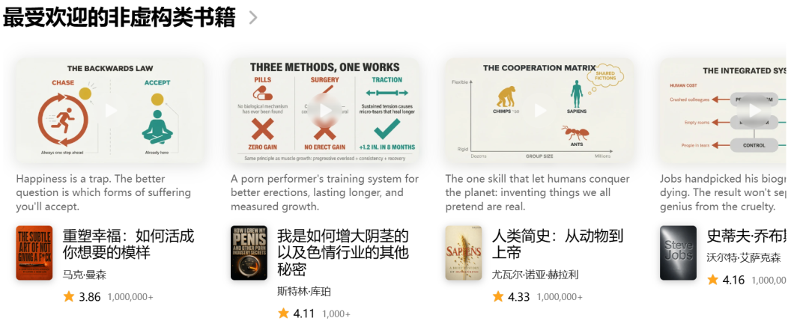
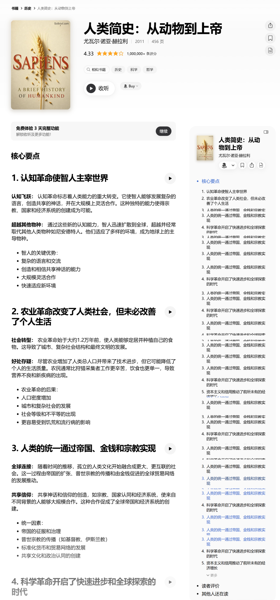

# 26000本好书，帮你「读薄」｜这个免费网站，治好了我的囤书焦虑
> 💡 备注属性未写入，可能是备注属性名称或者类型被修改了，建议将字段类型设置为 rich_text，可以在小程序-操作-修改文章数据库页面进行调整
> 💡 原文链接:[https://mp.weixin.qq.com/s?__biz=MzY4NzE4NDcwMA==&mid=2247485491&idx=1&sn=bd1ea1d896e0c024aeb9d69bf8967697&chksm=f2424aab3848f0188a2f43ca0cbd84c9812c64119868debb684ee082c2d16e4688957e36fa9b#rd](https://mp.weixin.qq.com/s?__biz=MzY4NzE4NDcwMA%3D%3D&mid=2247485491&idx=1&sn=bd1ea1d896e0c024aeb9d69bf8967697&chksm=f2424aab3848f0188a2f43ca0cbd84c9812c64119868debb684ee082c2d16e4688957e36fa9b#rd)
## 
小众网站推荐 · 阅读约4分钟
你有没有过这种时刻：书买了一书架，拆封的不到三分之一；收藏了几十份「年度书单」，一本都没翻完。
不是不想读，是**时间碎成渣，好书厚得像砖**。直到我撞进今天这个网站——SoBrief，它的口号简单粗暴：**阅读更多书籍，轻松地**。

### 01 26000 本书的「精华版」，免费开放
SoBrief 是一个书籍摘要平台，收录了 **26000 多本书的核心要点**，号称有 60 万读者在用。每一本书都被拆成「一句话简介 + 分章要点」，几分钟就能抓住一本书的骨架。
更贴心的是格式：**能读、能看、还能听**——网页版直接看，PDF 和 EPUB 可以存下来慢慢消化，音频版适合通勤路上戴耳机「听书」。首页还有正版 App，手机上更顺手。
### 02 分类逛起来，像在书店里散步
首页按题材分成一排书架：虚构、非虚构、浪漫、奇幻、自我提升、心理学、商业、悬疑……每本书都标着**真实评分和阅读人数**，比如《哈利·波特与魔法石》4.47 分、百万人读过，《人类简史》4.33 分。

我特别喜欢它给每本书写的一句话简介，短得像书腰上的金句，却句句到位。比如《人类简史》那句：**「让人类征服地球的技能：发明我们都假装真实存在的东西。」**——一句话就把这本书的灵魂点透了。
### 03 点开一本书：几分钟吃透一本砖头书
随手点开《人类简史》的详情页：封面、作者、页数、评分一目了然，下面是**分好章节的「核心要点」**，从认知革命到科学革命，一节一节往前翻，每节都能单独收听。

我的真实用法是三步：**先花五分钟读摘要，判断这本书值不值得读原书；值得的加书架排期，不值得的就此放过**。一个月下来，我淘汰了三本本想冲动下单的书，也真的读完了两本原书——囤书焦虑，就是这么被治好的。
要说明的是：站内摘要免费看，音频等完整功能需要会员（有 3 天免费体验），属于「免费 + 增值」模式，用不用随你。
它对三类人格外友好：**通勤族**——地铁上戴耳机听一章《沉思录》，比刷短视频踏实得多；**选书困难户**——下单前先用摘要试毒，再也不怕被漂亮书腰骗钱；**读书博主**——找选题、列书单、提炼金句，26000 本书的要点库就是现成的素材矿。
我自己最常用的场景是晚上哄睡之后：点开一本书的音频，调 15 分钟定时，听两章要点，比刷手机入睡快多了——**相当于把「睡前阅读」这个flag，变成了不用意志力的习惯**。
> 当然，摘要替代不了原书——它替代的是
> **「在错的书上浪费时间」
> **。
> 
· · ·
在这个信息爆炸的年代，愿意花五分钟看清一本书值不值得读，本身就是一种稀缺的能力。**读书的意义从来不是翻完每一页，而是让对的东西进入脑子。**
如果这篇帮你省下了未来的书钱，就点个**「收藏」**、转发给那位总说「等有空再读」的朋友吧。，下次买书前先来这里查一查。
互动你最想先「读薄」哪一本？
**A.** 《人类简史》——看看人类凭什么称霸地球
**B.** 《掌控习惯》——把坏习惯连根拔起
**C.** 《思考，快与慢》——看看大脑怎么骗自己
**D.** 评论区告诉我你的私藏书
网址直达：**https://sobrief.com/zh/**（中文界面，无需科学上网）

## 摘要

（待补充）

## 我的笔记

（待补充）
