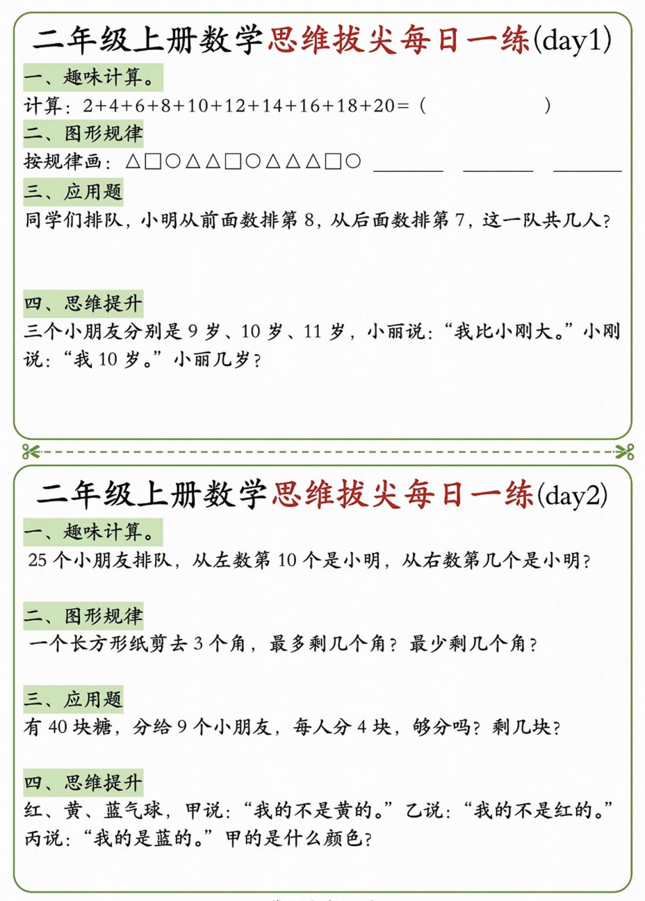

# 26新版｜1～6年级数学思维\\应用题专项训练
> 💡 备注属性未写入，可能是备注属性名称或者类型被修改了，建议将字段类型设置为 rich_text，可以在小程序-操作-修改文章数据库页面进行调整
> 💡 原文链接:[https://mp.weixin.qq.com/s?__biz=MzI5NjQyMTIyOA==&mid=2247507651&idx=1&sn=4c9f030e44e57ea7420cc59b3743e48e&chksm=edaabb43b2792c3688925c331046937bbe465d870b299277bd965590f8aaf171268b1de15027#rd](https://mp.weixin.qq.com/s?__biz=MzI5NjQyMTIyOA%3D%3D&mid=2247507651&idx=1&sn=4c9f030e44e57ea7420cc59b3743e48e&chksm=edaabb43b2792c3688925c331046937bbe465d870b299277bd965590f8aaf171268b1de15027#rd)
[26新版｜1～6年级数学《期中测试卷》](https://mp.weixin.qq.com/s?__biz=MzI5NjQyMTIyOA%3D%3D&mid=2247507607&idx=1&sn=6484fa3af4295fa55f5b3c4834993bca&scene=21#wechat_redirect)
[26新版｜1～6年级语文《期中测试卷》](https://mp.weixin.qq.com/s?__biz=MzI5NjQyMTIyOA%3D%3D&mid=2247507627&idx=1&sn=b40cf95c2df1667302bf0383c21830d1&scene=21#wechat_redirect)
[26新版｜3～6年级英语《期中测试卷》含答案带听力](https://mp.weixin.qq.com/s?__biz=MzI5NjQyMTIyOA%3D%3D&mid=2247507632&idx=1&sn=c7cb7edcfb08e7cb10610bb0bc260a89&scene=21#wechat_redirect)
**26新版｜1～6年级数学思维\应用题专项训练**
一年级（上）数学思维训练小纸条
二年级（上）数学思维训练小纸条
三年级（上）数学思维训练小纸条
四年级（上）数学思维训练小纸条
五年级（上）数学思维训练小纸条
六年级（上）数学思维训练小纸条
链接：https://pan.quark.cn/s/d2043b38eeac
复制🔗发给我即可直接打开
怎么下载为PDF文档⏬
[怎么用夸克网盘免费保存下载资料？](https://mp.weixin.qq.com/s?__biz=MzI5NjQyMTIyOA%3D%3D&mid=2247507322&idx=1&sn=34916c570e8922e67c392a53fa5a95f1&scene=21#wechat_redirect)

