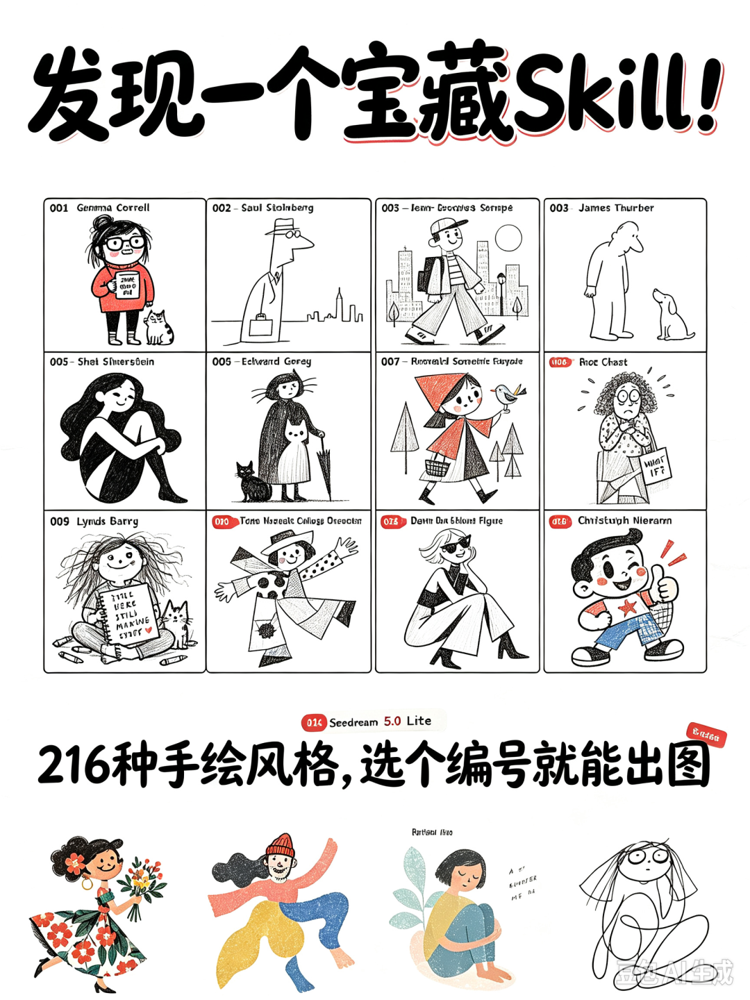
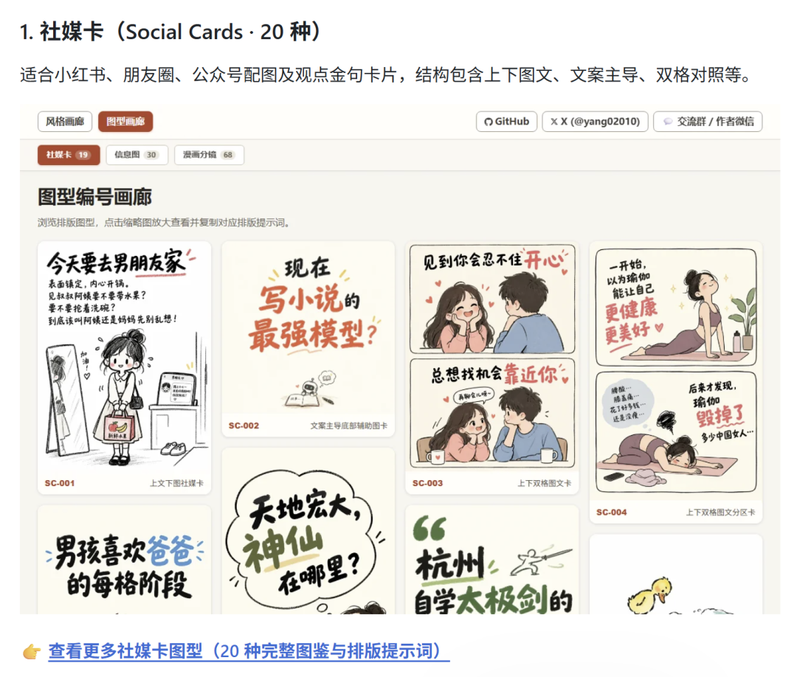
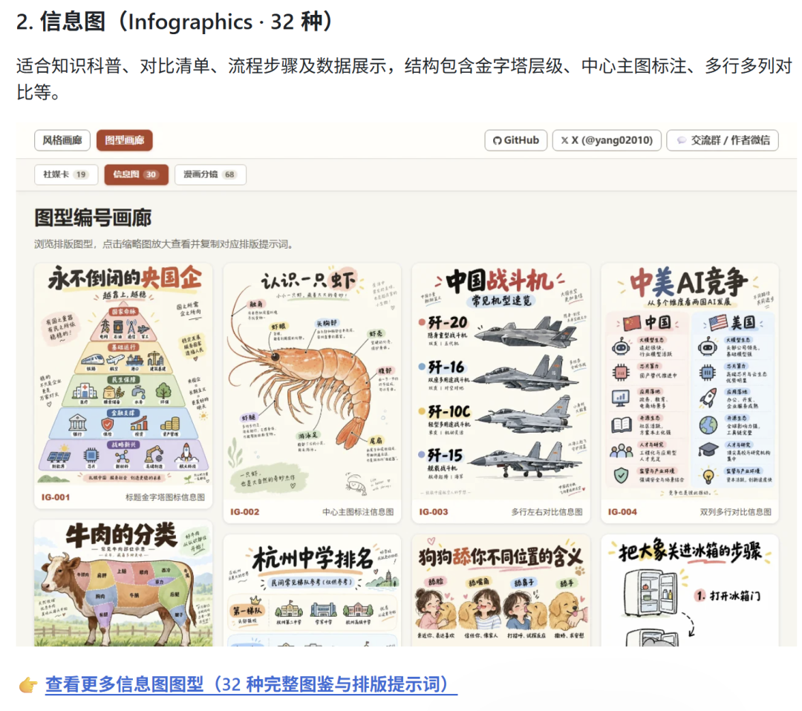
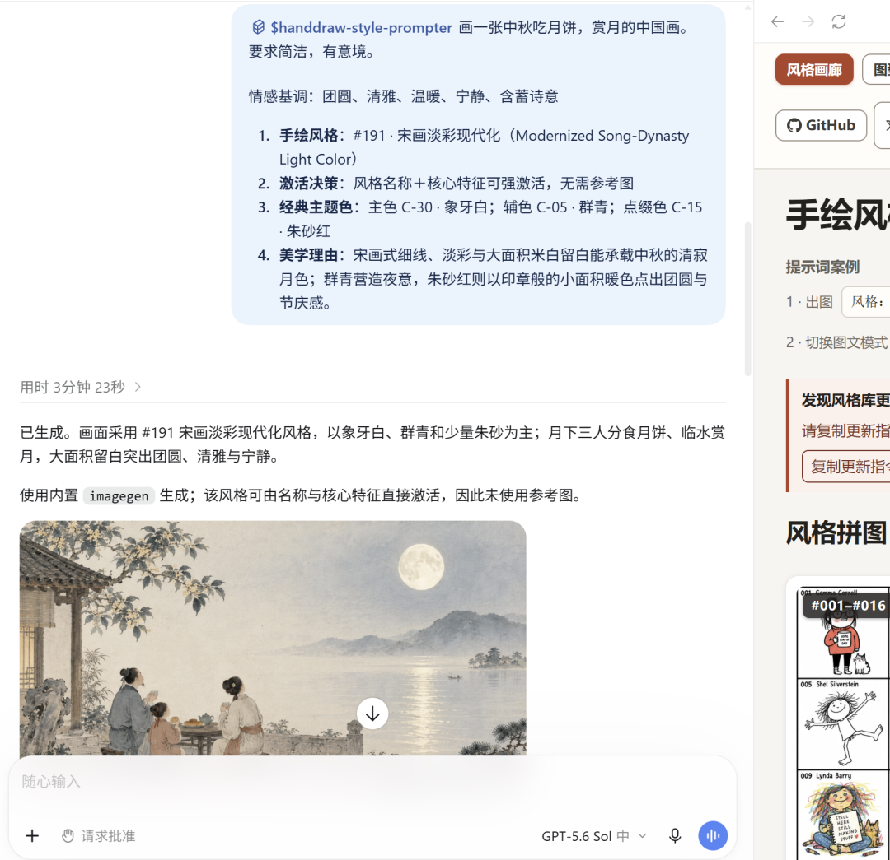
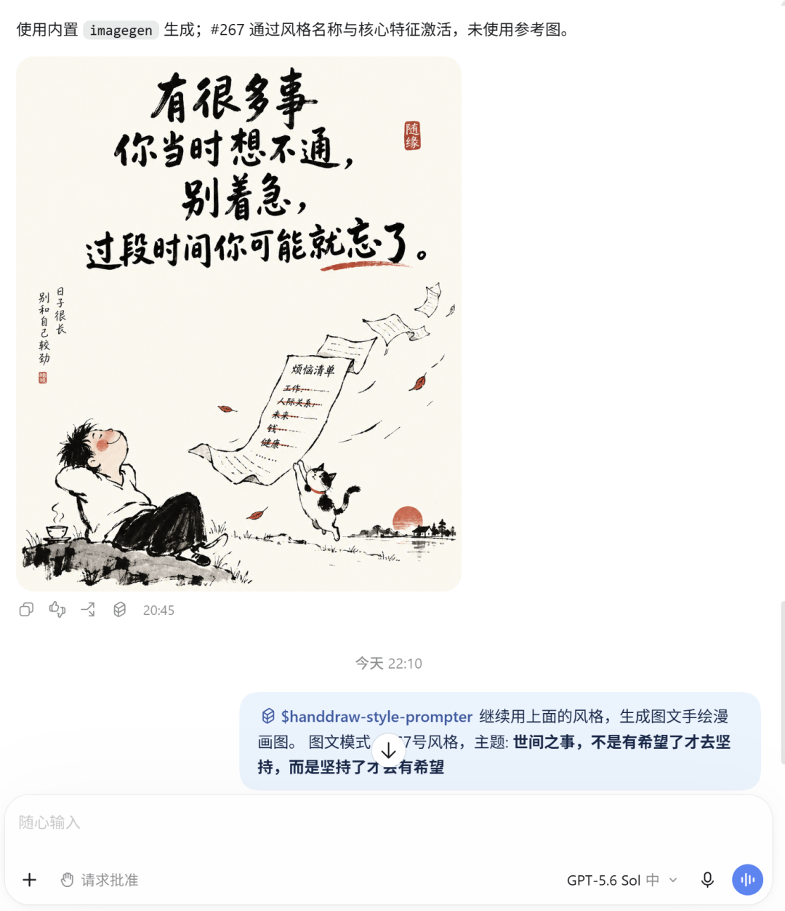
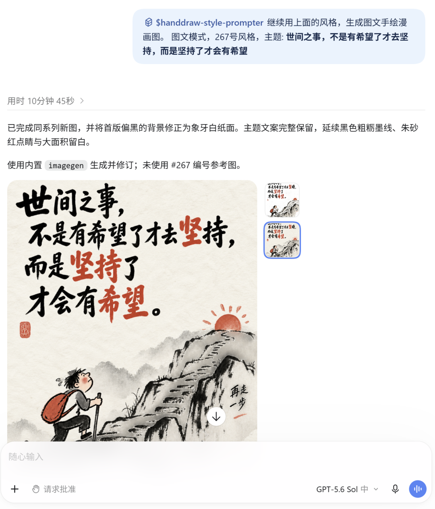
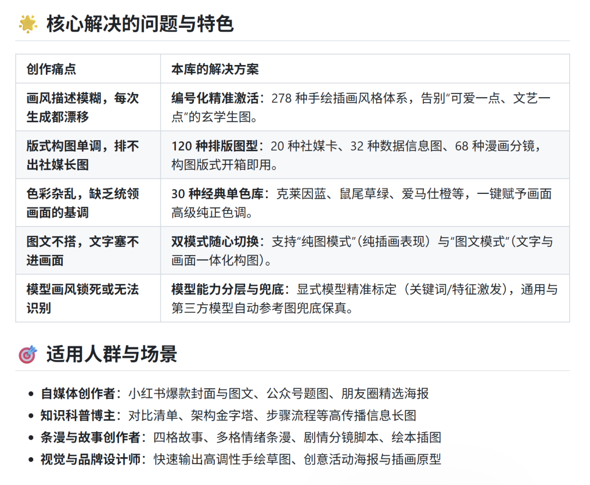

# 279 种宝藏手绘风格 Skill又更新了：这次能自由切换图文模式
> 💡 备注属性未写入，可能是备注属性名称或者类型被修改了，建议将字段类型设置为 rich_text，可以在小程序-操作-修改文章数据库页面进行调整
> 💡 原文链接:[https://mp.weixin.qq.com/s?__biz=MzkzMjE5MDk0Ng==&mid=2247484564&idx=1&sn=4b5a9a0a51f6150d65e9b7c18b60e055&chksm=c32bf7da0a903cb572fff412cbd534a84efdc60129b88d52d31bc38dd0f7042978dfc70b9f15#rd](https://mp.weixin.qq.com/s?__biz=MzkzMjE5MDk0Ng%3D%3D&mid=2247484564&idx=1&sn=4b5a9a0a51f6150d65e9b7c18b60e055&chksm=c32bf7da0a903cb572fff412cbd534a84efdc60129b88d52d31bc38dd0f7042978dfc70b9f15#rd)
上次分享的手绘风格宝藏 Skill 又更新了!
279 种手绘风格、还能一句话切换图文模式。以前做插画和做金句海报，得找两个工具，现在一个就够了——说一句"切换为图文模式"，字就自己进画里了。
[🎨 宝藏Skill，216种手绘风格，迅速出图](https://mp.weixin.qq.com/s?__biz=MzkzMjE5MDk0Ng%3D%3D&mid=2247484528&idx=1&sn=60392038daf9bb93ede95ca28ca4a5f4&scene=21#wechat_redirect)

### 一、这次更新了什么
- 手绘风格 → 279 种，每种都有编号和名字
- 排版图型 → 120 种，分社媒卡20 / 信息图32 / 漫画分镜68
- 新增两种模式自由切换
- 30 种经典单色库，配色不用自己配

**二、先看效果:**
刚好中秋节，来一张中秋节的图片试试

### 
图文｜主题："有很多事你当时想不通，别着急，过段时间你可能就忘了"

图文｜主题："世间之事，不是有希望了才去坚持，而是坚持了才会有希望"

### 三、两种模式，一句话切换
### 
🎨 纯图模式｜主题只决定画什么，字不上图
✍️ 图文模式｜主题原文保留，文字参与构图
默认走纯图，切换直接说"切换为图文模式"就行

### 
### 几个用过才知道的细节：
### 
📌 中文提示词 + 英文提示词都给，能复制到别的模型用
📌 它会解释配色理由，比如为什么选象牙白配朱砂红
📌 不需要参考图也能激活，靠风格名称就行
📌 不满意它会自己改，第二张就是首版背景偏黑被修正成象牙白纸面，文案一个字没丢
### 它解决的老问题：
### 
画风描述模糊 → 编号化，说 267 就是 267
文字塞不进画面 → 图文模式让文字参与构图
排不出长图 → 120 种版式直接套
### 四、我的感受
### 
整个手绘Skill 覆盖多种风格与排版，让AI画画变简单了，
你不用再写两百字描述"我要那种带抖动的铅笔素描感"，记住编号就行 💡
图文模式也是，把"字要不要在画里"变成了一个简单的开关，喜欢的可以试试~
🔗 GitHub 搜：yang0/handraw-style
#AI工具分享 #AI绘画 #手绘插画 #提示词 #AI绘画咒语 #自媒体干货 #配图神器 #设计师工具 #AI技能
