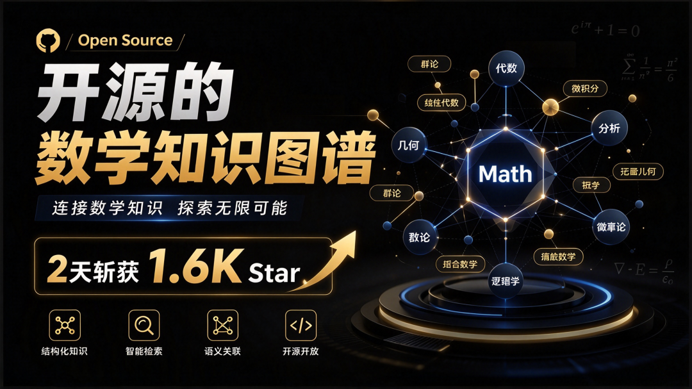
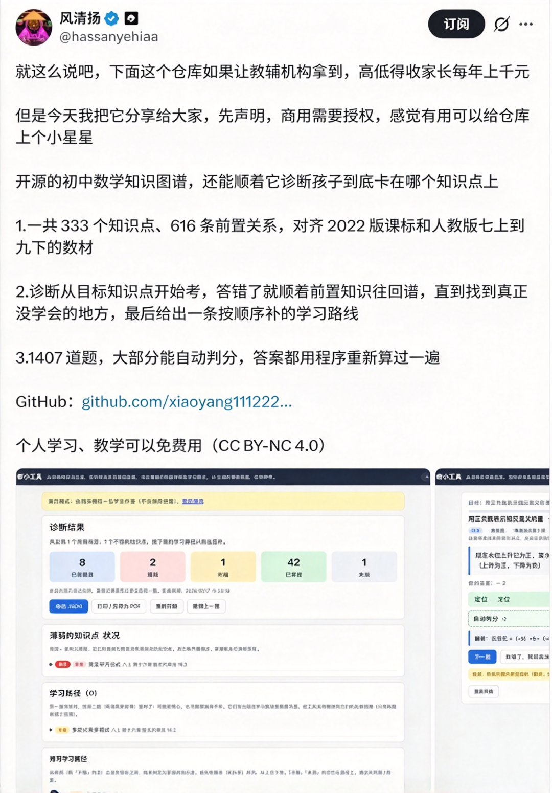
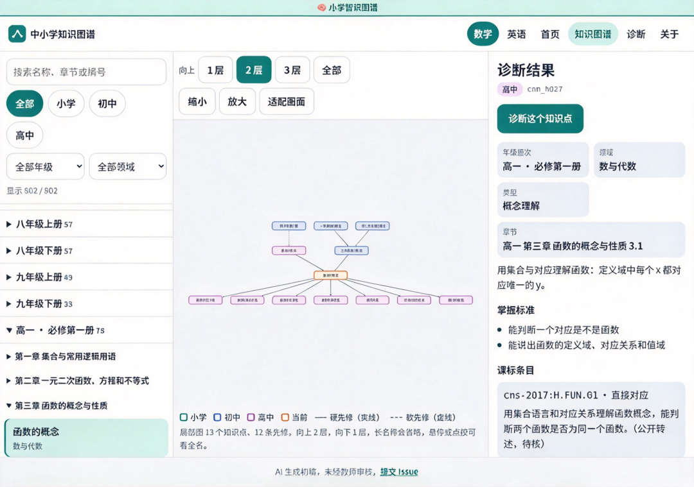
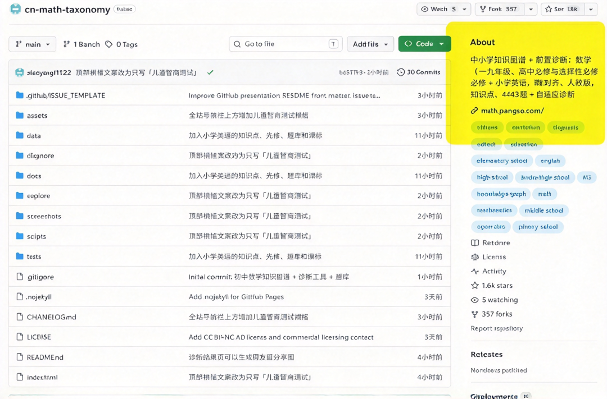
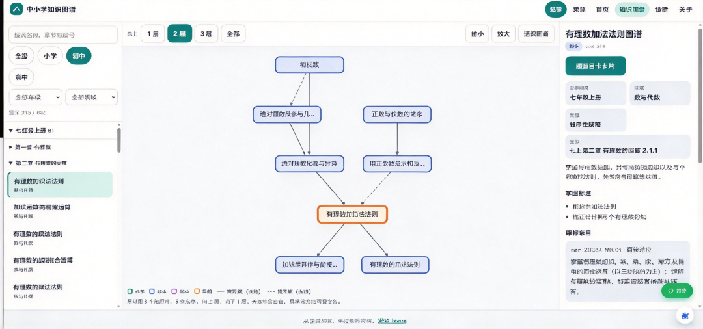
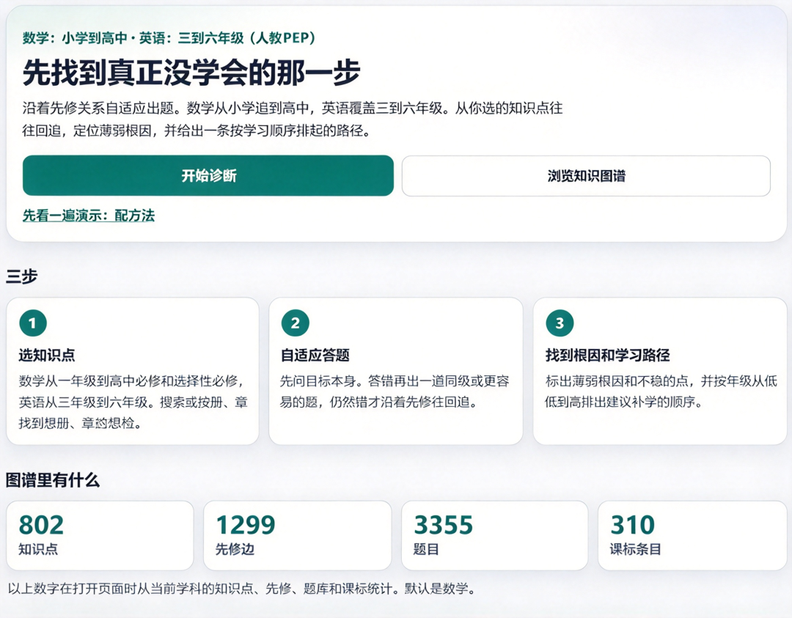

# 3 天冲上 1.7K Star 的开源知识图谱，把中小学数学知识点串成一张地图：cn-math-taxonomy
> 💡 备注属性未写入，可能是备注属性名称或者类型被修改了，建议将字段类型设置为 rich_text，可以在小程序-操作-修改文章数据库页面进行调整
> 💡 原文链接:[https://mp.weixin.qq.com/s?__biz=MzY4NDQxNjMyMg==&mid=2247484346&idx=1&sn=39d0921f39832cf1c556f936c5e6c339&chksm=f25ef7c83b8b98b564b0ead4138df1f3fb8b9264ef00b28b0c867aa44d364493190011e810dd#rd](https://mp.weixin.qq.com/s?__biz=MzY4NDQxNjMyMg%3D%3D&mid=2247484346&idx=1&sn=39d0921f39832cf1c556f936c5e6c339&chksm=f25ef7c83b8b98b564b0ead4138df1f3fb8b9264ef00b28b0c867aa44d364493190011e810dd#rd)
SITE · 学习工具
2026.10
孩子数学总卡壳，却不知哪一步没学扎实？
**顺着知识图谱 找薄弱点**
**一眼看清卡在哪**
1244 知识点 · 5123 道题 · 课标对齐
cn-math-taxonomy
开源项目中小学
📦 3 Parts + Conclusion
👉 滑动
**PART 01**
**快速认识**
它到底是什么
 
**PART 02**
**六大亮点**
凭什么值得用
 
**PART 03**
**官网直达**
打开就能用
 
**PART ///**
**写在最后**
注意与叮嘱
一句话看懂它的价值
**把知识点按前置关系连成一张地图，顺着图谱找到卡住孩子的上游环节，再决定练什么**

辅导孩子数学，最头疼的不是某道题不会做，而是不知道到底哪一步没学扎实：盯着错题讲半天，下一次还是同一个地方卡住。
**cn-math-taxonomy** 是一个开源的中小学知识图谱项目：把知识点按前置关系连成一张地图（课标对齐、人教版），数学覆盖一到九年级与高中必修、选择性必修，英语覆盖小学与初中，官方口径含 1244 个知识点、5123 道题，并配有自适应诊断。
对家长和老师来说，它更像一张「查漏补缺地图」：先顺着图谱找到卡住孩子的上游环节，再决定练什么，省去大量翻教材和凭感觉猜的时间。适合陪写作业的家长、备课的老师，以及想自建学习系统的技术团队。
**01**
**PART**
**快速认识 cn-math-taxonomy**
GETTING STARTED · 它到底是什么
**cn-math-taxonomy** 是一个开源的中小学知识图谱项目，把知识点按前置关系连成一张「查漏补缺地图」；网页端打开即用、不用装软件，家长、老师和想自建学习系统的团队都能用。
**注意：**项目新建、迭代活跃，内容与题目质量建议结合孩子的实际使用反馈来判断。
**02**
**PART**
**六大亮点速览**
FEATURES · 凭什么值得用
TOOL 01
**查漏有依据**
知识点按前置关系组织，能顺着图谱回溯到卡住孩子的上游环节，而不是只对着错题讲。
TOOL 02
**覆盖够完整**
数学从一年级到九年级、再到高中必修与选择性必修；英语覆盖小学与初中。
TOOL 03
**课标对得齐**
内容按课标与人教版组织，家长对照孩子课本时不容易对不上号。
TOOL 04
**边诊断边练**
内置自适应诊断与配套题目（官方口径 1244 个知识点、5123 道题），先测出薄弱点，再给练习方向。
TOOL 05
**开源可自建**
代码公开，有技术背景的团队可以自行部署和二次整理（具体授权范围以仓库 LICENSE 为准）。
TOOL 06
**使用方式**
网页端（电脑/手机浏览器）打开即用；项目新建、迭代活跃，内容与题目质量建议结合孩子的实际使用反馈。
**03**
**PART**
**官网直达**
WEBSITE · 打开就能用
**✦ 网站截图**

官网地址
**cn-math-taxonomy · 中小学知识图谱**
官网链接（复制到浏览器打开）
https://math.pansgo.com/
项目地址（GitHub）
https://github.com/xiaoyang111222/cn-math-taxonomy
适用设备：电脑 / 手机浏览器均可
**✦ 顺手推荐**
**
桌面级 AI 助理 · 每日免费 2000 万 token**
https://loomy.cgref.cn/s/p3kq22wkol

**
爆火 AI 短剧一键生成工具**
https://seko.cgref.cn/s/1le0ww8noq
**
我的文章封面图是它做的**
https://aipyaipy.cgref.cn/s/omkldd8n4d
**///**
**LAST**
**写在最后**
FINAL WORDS · 注意与叮嘱
与其盯着错题反复讲，不如先搞清楚孩子到底卡在哪一步。这个项目把知识点连成一张地图，顺着前置关系就能找到上游薄弱点，再有的放矢地练。它开源、还能自建，不过内容还在迭代中，最终效果要结合孩子的真实反馈来看。
我是**不兮先生**，热衷于分享 AI 观察与干货。
如果你觉得今天这篇有收获，欢迎**点赞、在看、转发**三连，我们下篇见。
**既然看到这里了，如果觉得有用，随手点个赞、在看、转发三连吧。**
点赞
在看
转发
THANKS FOR READING
