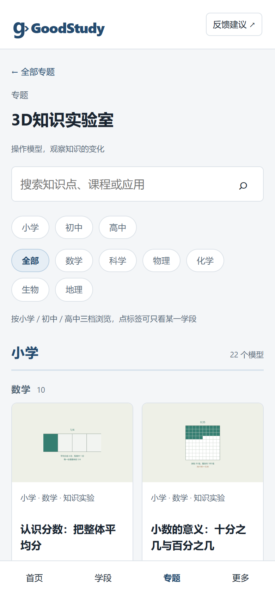
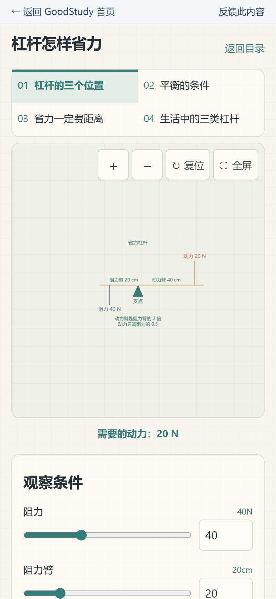
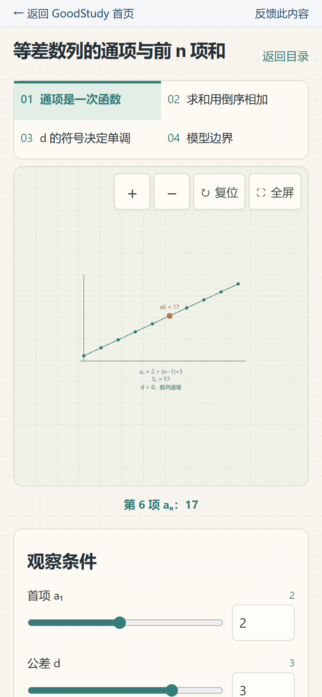
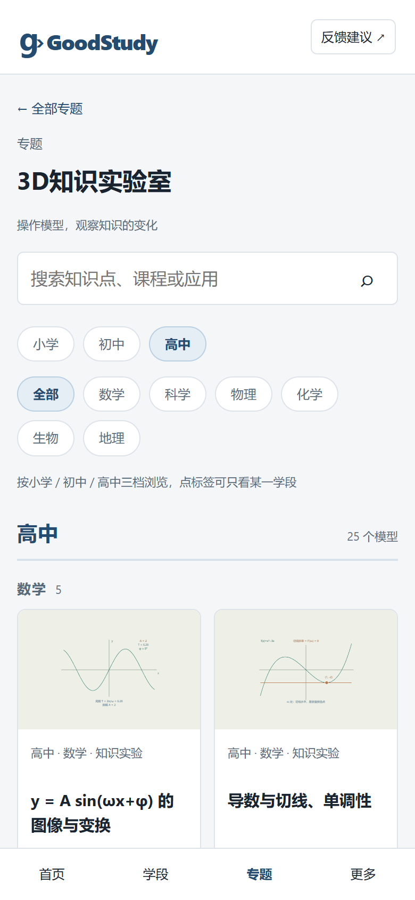

# 3D知识实验室从 99 课扩到 146 课，小学到高中都能动手拖一拖
> 💡 备注属性未写入，可能是备注属性名称或者类型被修改了，建议将字段类型设置为 rich_text，可以在小程序-操作-修改文章数据库页面进行调整
> 💡 原文链接:[https://mp.weixin.qq.com/s?__biz=MzA5MzQ3NjIzMQ==&mid=2447908125&idx=1&sn=a3549a40f02ca06cfdaf9ba60386f114&chksm=85f1f4fe3072c0a21cdb70f9be198617331b9eefb62359fdba4b30ccfa3883942c5ee09e112c#rd](https://mp.weixin.qq.com/s?__biz=MzA5MzQ3NjIzMQ%3D%3D&mid=2447908125&idx=1&sn=a3549a40f02ca06cfdaf9ba60386f114&chksm=85f1f4fe3072c0a21cdb70f9be198617331b9eefb62359fdba4b30ccfa3883942c5ee09e112c#rd)

上一篇写这个网站，说的是初中和高中数学接进来了。
这一版动的是另一块：3D 知识实验室。上一版里面只有初中的 99 门课，小学和高中是空的。现在填到 146 门——小学 22、初中 99、高中 25。

### 一、先把范围说清楚
146 门课，六个学科：**数学、科学、物理、化学、生物、地理**。
小学 22 门，一半数学一半科学。数学是认识分数、长方形面积、比值这些；科学是杠杆、月相、影子长短、简单电路这些。
初中 99 门没动，还是原来那些。
高中 25 门，数学、物理、化学、生物、地理各 5 门。
小学和高中为什么只有这么点？不是偷懒。
这个实验室的判断标准只有一条：**这件事能不能靠「改一个条件、看结果怎么变」讲明白。**能，才做成可以拖的模型；不能，硬做成 3D 只会添乱。有些知识点适合一张图、一个算式，转起来反而看不懂。
按这条标准筛，小学和高中能留的就是这个数。
### 二、「能动手」具体是什么样
拿小学科学「杠杆」说。
屏幕上是一根横杆、一个支点、两边各挂一个力。底下三个滑块：阻力多大、阻力臂多长、动力臂多长。拖一下，图上直接告诉你现在需要多大动力、这是省力杠杆还是费力杠杆。
孩子自己能把「动力臂越长越省力」这句话试出来，比背下来强。

再看高中化学「物质的量」。这个概念抽象就抽象在看不见。
页面先让你选物质——水、氧气、食盐、硫酸。再拖质量。中间那一步 **n = m ÷ M** 会把数字代进去算给你看，右边同时给出微粒数是几乘十的二十三次方。一条链子摊开，摩尔就没那么玄。

高中数学「等差数列」也一样：拖首项和公差，通项和求和跟着变；公差拖到负数，会明确告诉你这是递减数列。

每门课都是同一个结构：左边一个模型，右边几行读数，底下几个滑块。改条件，图和数一起变。
### 三、这次最花时间的不是加课，是修图上的字
加 47 门课，是往框架里填内容。真正耗时间的是另一件事——图上那些说明文字。
上一版有些课的说明太长，一行的位置放不下，程序就按字数硬切。结果 **H₂O 被拆成两行**：第一行 **H**，第二行 **₂O**。孩子看了只会懵。
还有更麻烦的：有几个课的标注正好压在坐标轴上。竖着的轴线从字中间穿过去，把等号劈成两半，**切线斜率 = f'(x₀)** 看上去成了 **切线斜率 ≠ f'(x₀)**——意思正好反过来。
这两个都不是「不好看」的问题，是**会看错**的问题。
改法是两种：把话拆成两行说，或者把轴线缩短、让开文字。改完还不够，我写了一段脚本，把每门课所有滑块能组合出的情况都跑一遍——一共六十九万多种，扫下来零处超限。现在这个检查是固定跑测试的，以后再改内容，超了会直接报错。
### 四、还有一件不体面的事：页码错了一页
每门课都标了课标出处，写着「人教版必修第一册 第 29 页」这种。
这一版核对的时候发现，高中 25 门、小学 22 门的页码**整体少了一页**。原因不复杂：上一版是按电子目录推的，没对着书翻。
改的办法笨一点：把 PDF 一册一册打开，读页眉上印的页码，跟电子页对一遍，算出差几页，再回头改。四十六个条目全改了一遍。
这个错机器发现不了——它只能验证「页码在合理范围内」，验证不了「这一页讲的到底是不是这个知识点」。只能人对着书看。
### 五、怎么看，怎么发
入口在首页「专题」里的 3D 知识实验室，或者直接开这个链接：
**https://goodstudy.store/#topic/lab-3d**
进去先选学段——小学、初中、高中三个标签。点一个，只剩那个学段的课，而且**筛选结果写在网址里**：刷新不丢，把链接发给别人，对方打开也是筛好的那一档。

这也是上一版改的东西。以前筛选只存在页面上，一转发就回全列表，还得跟人解释「你再点一下小学」。
最后说一句边界。
这是一个能动手的实验室，不是课程，也替代不了做题。它的用处是让「改条件、看变化」这件事变得便宜——试十次也不心疼纸笔。孩子对某个概念有感觉了，再回去做题，比一上来就刷题有效。
内容来自人教版、苏教版等公开教材的课标条目；模型与读数是按教材公式算的，不是拍脑袋编的。发现哪里讲错了，随时告诉我。
