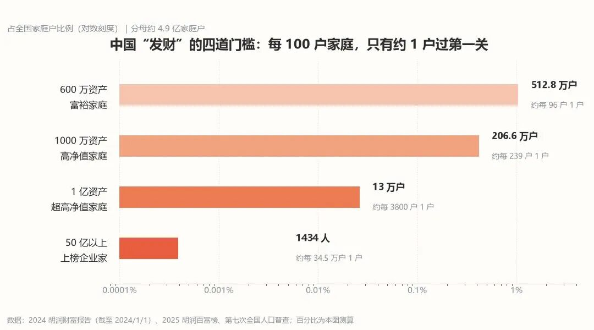
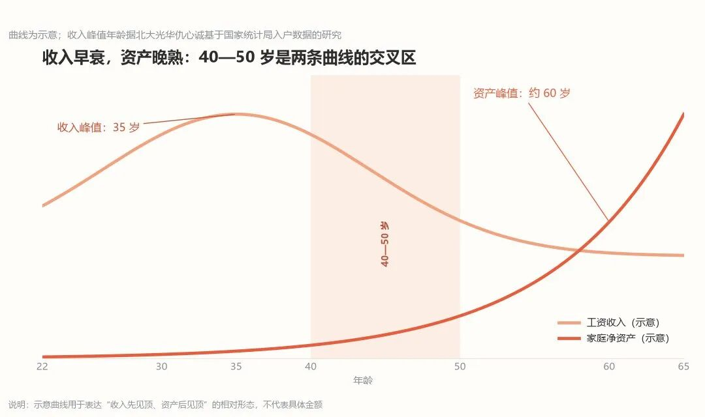
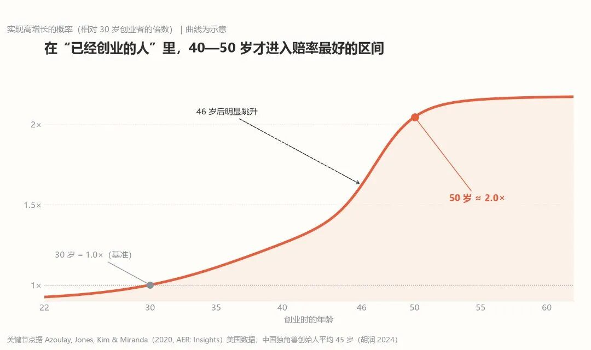

# 40岁不惑、50知天命：那40—50岁发财的概率有多大
> 💡 备注属性未写入，可能是备注属性名称或者类型被修改了，建议将字段类型设置为 rich_text，可以在小程序-操作-修改文章数据库页面进行调整
> 💡 原文链接:[https://mp.weixin.qq.com/s?__biz=MzI4NDAyNTY0Mg==&mid=2647666144&idx=1&sn=186520f35ac12f6c4eb1b330f5655c9f&chksm=f27a404e58011d6eb58c785aaf9ed48ec038789d309b498c34bbf81a0b9ed9e773c57de9be13#rd](https://mp.weixin.qq.com/s?__biz=MzI4NDAyNTY0Mg%3D%3D&mid=2647666144&idx=1&sn=186520f35ac12f6c4eb1b330f5655c9f&chksm=f27a404e58011d6eb58c785aaf9ed48ec038789d309b498c34bbf81a0b9ed9e773c57de9be13#rd)
同学四十岁生日那晚，老同学群里有人晒了新车。你把手机扣在桌上，算了算房贷余额、孩子的补习费、爸妈的体检单，心里冒出一句：**四十不惑**。
可孔子说“不惑”的本意，不是“什么都明白了”，而是“不再被外物迷惑”；“五十知天命”也不是认命，而是分清哪些事由自己、哪些不由自己。两句话翻译成现代话：40岁起，你该换一套算法了。那这套算法里，**“发财”的概率到底有多大**？我把四组数据摊开算了一遍。
**一先定义“发财”：四道门槛，第一关就刷掉 99%**
胡润研究院《2024胡润财富报告》给过一组存量数字（截至2024年1月1日）：全国拥有600万元资产的富裕家庭**512.8万户**；千万资产高净值家庭206.6万户；亿元资产超高净值家庭13万户。到2025年胡润百富榜，50亿元以上的企业家是**1434人**。
全国大约有**4.9亿个家庭**（第七次人口普查口径）。拿这两个数一除：
600万这一关，每100户过1户（约1.04%）；千万，每239户过1户（约0.42%）；亿元，每3800户过1户（约0.026%）；50亿上榜，约每34.5万户家庭摊1人（约0.0003%）。

图1：中国“发财”的四道门槛（图源：星辰根据胡润《2024财富报告》《2025胡润百富榜》及七普家庭户数绘制，比例为测算值）
所以“发财”从来不是年龄事件，是**分布尾部事件**——它在任何年龄段都是小概率。你觉得“身边人都发了”，多半是社交半径里的高收入浓度，不是真实分布。
**二工资这条曲线：黄金年龄 35 岁，已经过了**
北大光华管理学院仇心诚基于国家统计局入户数据的研究，结论很直接：中国居民收入的**“黄金年龄”**，从上世纪90年代的55岁，一路提前到2010年的**35岁**；同期美国稳定在50岁上下。
原因有两个：一是**代际教育红利**——当下30岁左右的劳动者普遍接受过高等教育，50岁以上群体里高中及以下学历仍是主流；二是“时间效应”——1985年后中国人力资本价格以远超美国的速度上涨（美国同期增速仅约1%），谁赶上窗口期，起点就被放大。
再看绝对量级：2024年城镇居民人均可支配收入**中位数49302元**，全国居民收入里**56.5%靠工资**。把这两条放在一起，结论很冷静：指望工资在40—50岁陡然翻倍，不现实。**40—50岁发财，靠的从来不是工资。**

图2：收入早衰，资产晚熟（示意曲线；收入峰值年龄据北大光华仇心诚研究）
研究还做了反事实模拟：未来30年若出生组效应和时间效应放缓，到2035年，收入黄金年龄会回升到**45—50岁**，接近美国水平。“经验重新值钱”正在发生，只是还没完全回来。
**三财富曲线：上榜的人平均 60 岁**
结果端更扎眼。2025胡润百富榜：1434位上榜企业家**平均年龄60岁**，前十名平均62岁，首富钟睒睒71岁；40岁以下的白手起家创业者，全榜只有**40人**，占比约2.8%。
这不矛盾——发大财的“结果”集中在50—60岁，因为它需要**时间做乘数**：复利、股权、品牌、客户关系，都要年限发酵。网上流传“巴菲特99%的财富来自50岁以后”，方向没错（复利在后半段发力），但具体比例没有可靠原始出处，别当精确数据引用。
当然也有压缩周期的例外：张一鸣42岁、陈天石40岁、王宁38岁——新经济把致富时间从30年压到10年。但他们是尾部里的尾部。
**四创业曲线：40—50 岁，是赔率最好的区间**
如果你问“那40岁该不该折腾”，有一项研究必须摆出来：Azoulay、Jones、Kim与Miranda（2020，AER: Insights）基于美国国税局与人口普查局大样本的研究发现——
美国所有初创公司，创始人平均年龄**41.9岁**；增长最快的前0.1%企业，创始人平均**45.0岁**；50岁创业者实现高增长的概率，约是30岁创业者的**2倍**；25岁以下表现最差，35岁后开始上行，**46岁出现明显跳升**，一直持续到60岁。

图3：创业成功率随年龄上行的形态（示意；关键节点据 Azoulay 等 2020 研究结论绘制）
中国也有对照：胡润2024全球独角兽榜显示，独角兽创始人**平均45岁**，平均35岁开始创业；任正非43岁创办华为，张忠谋55岁在中国台湾创办台积电。
但请注意口径：这是**“已经创业的人”里的成功概率**，不等于“40—50岁的人”整体的发财概率。前者说机会在，后者提醒基数小——两件事都得记住。
**五中国式发财的三条真实通道**
第一条是**房产**。央行2019年对3万余户城镇家庭的调查显示：住房资产占家庭总资产的**59.1%**，户均住房1.5套，有负债家庭里房贷占总负债75.9%。过去四十年普通人最大的“发财引擎”其实是房子，尤其2010—2021那波主升浪。这条路今天还能不能复制，你心里有数。
第二条是**生意与股权**。千万资产高净值家庭里，企业主占比约**54%**（2024胡润财富报告）。发财的主要形态不是“工资攒出来的”，是所有权攒出来的。
第三条很多人不情愿说：**继承**。胡润测算，未来10年中国将有20万亿元财富转移给下一代，30年内累计79万亿元；2025年百富榜的二代接班人数量创下历史新高。
**先泼冷水｜口径陷阱，别装作没看见**
“平均60岁”是存量结果，不是年龄承诺——他们60岁的财富，是30—50岁埋下的种子；幸存者偏差无处不在——逆袭故事会上热搜，失败者不会。另有两个常见说法未经独立核验：巴菲特“99%财富来自50岁后”方向对、数字无原始出处；“中小企业平均寿命2.5—3年”各口径差异大。引用时请标注“据常见说法”。
**先泼冷水｜40—50 岁的真实账单**
35岁就业门槛仍在、房贷在尾段、上有老下有小、体检报告开始画重点。任何“发财计划”，都得先过**现金流**这一关——先留在牌桌上，再谈赔率。
**六40 岁起，比“发财”更值得算的三笔账**
第一笔，把“发财”换成**净资产增速**：一年净资产增10%，比追涨杀跌现实得多；目标是让被动收入覆盖基本支出——那是你的“财务天命”。
第二笔，**押注能复利的东西**：股权、技能、内容、品牌，而不是纯体力和单一雇主。研究里“至少三年相关行业经验的人，创业成功率翻倍（0.11%→0.22%）”——40岁最贵的资产，是判断力、人脉和行业经验。
第三笔，**现金流优先，杠杆克制**：别用高息负债赌最后一波。你还有15—20年的赔率期，前提是留在牌桌上。
**孔子没说 40 岁该有多少钱。
他说的是：不被别人的朋友圈惑，
知道自己那颗棋子落在哪。**
你今年多大？觉得自己离“发财”最近的一次机会，是什么时候？
评论区聊聊，转给那个 40 岁还在攒劲的朋友。
数据与引用：胡润《2024财富报告》《2025衡昌烧坊·胡润百富榜》；北大光华仇心诚基于国家统计局入户数据的研究（据《中国经营报》2025-09 报道）；Azoulay 等《Age and High-growth Entrepreneurship》（AER: Insights, 2020）；央行《2019年中国城镇居民家庭资产负债情况调查》；国家统计局2024年居民收入数据；第七次全国人口普查。示意曲线仅表达相对形态；概率为按上述口径的测算值。本文为个人观察，不构成任何投资建议；配图为程序绘制，图注已标来源。
