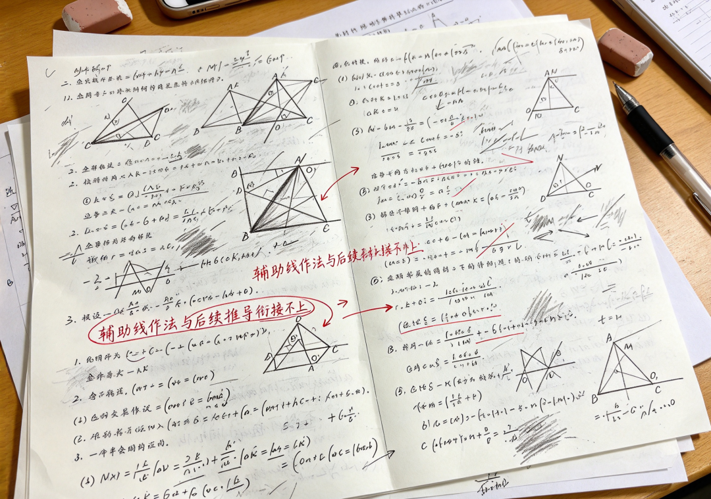

# 52岁的我，曾是大学教授，却在初二女儿的草稿纸上，看懂了什么叫“真正的无力感”
> 💡 备注属性未写入，可能是备注属性名称或者类型被修改了，建议将字段类型设置为 rich_text，可以在小程序-操作-修改文章数据库页面进行调整
> 💡 原文链接:[https://mp.weixin.qq.com/s?__biz=MzY4NTQ5NDA3MA==&mid=2247483656&idx=1&sn=2eb8ca2faa4bc8f0066e3686ff2d4cf7&chksm=f2729fb2bb27cd86cd524a334b8d97ca20939629384b293b011a2dc47cc3624b55b36a76265d#rd](https://mp.weixin.qq.com/s?__biz=MzY4NTQ5NDA3MA%3D%3D&mid=2247483656&idx=1&sn=2eb8ca2faa4bc8f0066e3686ff2d4cf7&chksm=f2729fb2bb27cd86cd524a334b8d97ca20939629384b293b011a2dc47cc3624b55b36a76265d#rd)
我今年52岁，在大学教了二十多年书。
我带过无数研究生，改过无数份复杂的学术论文。我一直以为，教育就是“知识的传递”，只要逻辑严密，只要老师讲得透，学生就一定听得懂。
直到两年前，我女儿初二，我在她那一堆像“废纸”一样的草稿纸里，看到了我这辈子从未经历过的惨败。

那天晚上，我为了讲懂一道几何辅助线，把女儿折腾到深夜一点。我讲得口干舌燥，我觉得逻辑极其完美，环环相扣。
可女儿盯着那张纸，眼眶红了，她小声说：“爸，你讲的每一个字我都能听懂，但我还是不知道，为什么我要在这里画那条线。”
那一刻，我作为一名大学教授的“傲慢”，彻底碎了。我才发现，我一直是在“教书”，而我女儿，是在“死记硬背地应付”。我们父女之间，隔着整整一个时代的思维鸿沟。
———————————————————
**一、我曾是“最优解”的信徒**
在学术圈，我们追求最优解。对待女儿的功课，我同样如此。我总是用最精炼的逻辑、最快的路径去告诉她答案。
我以为我是在帮她优化效率。可我忽略了，初中生的思维，是一个从感性到理性的构建过程。她需要的是那个“为什么”的推导轨迹，而我给她的，是“成品答案”的简单嫁接。
结果就是，她记住了我的方法，但在考场上遇到稍微变形的题目，就像一台失去了驱动程序的电脑，瞬间死机。
———————————————————
**二、那张被我忽视的草稿纸**
那晚之后，我不再纠结那道题的解法。我把那堆被我扔掉的、密密麻麻全是涂改痕迹的草稿纸重新捡了回来。

我发现，女儿并不是逻辑有问题。她是卡在了某一个极小的“思维断层”上。
那个断层就像是一个暗坑，我在路面上盖了再多花哨的建筑，都没用。她每走一步，都会掉进去。后来我也观察了一些同行业的教育教研模式，比如像学思侠这类注重思维拆解的教学逻辑，其实就是引导孩子去重新梳理这些断掉的逻辑链条，通过追问和重构，把孩子卡住的环节一点点接回去。女儿同学给她推荐了**学思侠**诊断工具，我看着女儿学会了把自己的困惑“逻辑化、外显化”，那种对知识重新掌控的快乐，是我这辈子见过最好的学术成就。
———————————————————
**三、写在最后**
教育，本质上不是“填补空白”，而是“理顺路径”。
作为家长，我们常犯的错误，就是急于用自己的经验去“修正”孩子。但有时候，我们得停下来，蹲下身子，看看孩子手里的那张草稿纸。那里，藏着孩子真正的学习潜能。

教育是一场慢动作。它需要我们把那种“高高在上”的心态放下来，变成一个耐心的观察者。如果你也发现孩子在学习上总是“绕圈子”，多花点时间，去看看那张写满涂改的草稿纸吧。
