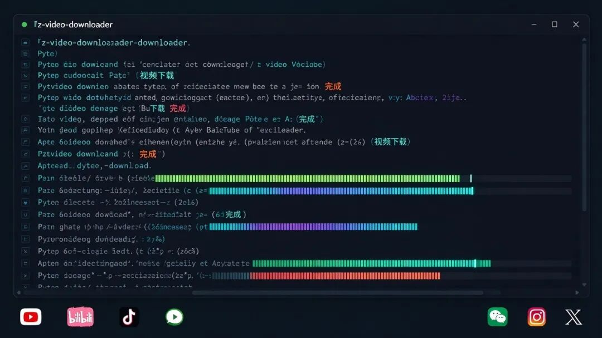
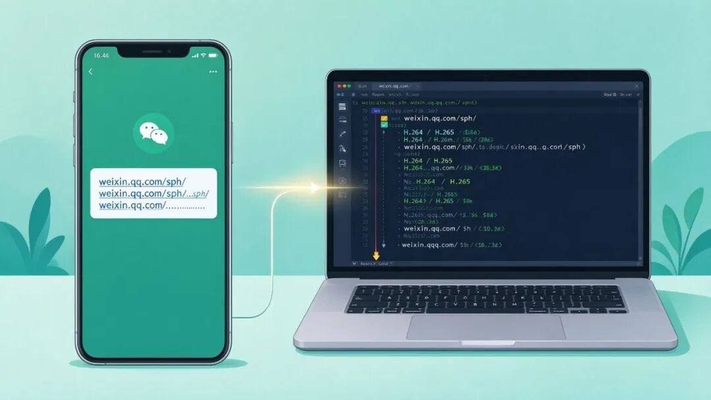

# 555 Star：把视频链接一键下载成本地文件，微信视频号也能免登录下载——z-video-downloader
> 💡 备注属性未写入，可能是备注属性名称或者类型被修改了，建议将字段类型设置为 rich_text，可以在小程序-操作-修改文章数据库页面进行调整
> 💡 原文链接:[https://mp.weixin.qq.com/s?__biz=MzY5MTM2MjA5OQ==&mid=2247484463&idx=1&sn=684ead31aee0462b047932f914077335&chksm=f5f579bddd1ce48da0c32b8e8a47e65831935f050c4982d1375a221ac0b8efe0149c139dd675#rd](https://mp.weixin.qq.com/s?__biz=MzY5MTM2MjA5OQ%3D%3D&mid=2247484463&idx=1&sn=684ead31aee0462b047932f914077335&chksm=f5f579bddd1ce48da0c32b8e8a47e65831935f050c4982d1375a221ac0b8efe0149c139dd675#rd)
⬇️
**把视频链接一键下载成本地文件**
z-video-downloader：支持 YouTube/B站/抖音/微信视频号等多平台，视频号分享链接还能免登录在线解析
555 StarPython免费开源
### 📖 它是什么
**z-video-downloader** 是**tjxj/z-skills** 这个"可复用 skills 集合"仓库里的一个视频下载工具（Python，核心脚本 `scripts/download_video.py`）。它解决一件事：**把视频链接下载成本地视频文件**，支持 YouTube、Bilibili、Vimeo、X/Twitter、TikTok、抖音、Instagram、Facebook、**微信视频号** 等平台以及常见视频直链。
原理上，它基于**yt-dlp**（解析并下载各平台视频）+**requests**+**ffmpeg**（合并音视频流），外层封装了批量下载、断点续传（.part + HTTP Range / yt-dlp 分片）、字幕/封面/元数据、下载历史去重、平台风控自动 cookie 重试。最亮眼的点是**微信视频号分享链接在线解析下载**：识别 `weixin.qq.com/sph/xxx`，通过公开在线解析服务自动拿真实地址下载，**免登录、免装证书、免改系统代理**，默认同时保存 H.264（高清兼容）和 H.265（省空间）两个版本。
所在合集**z-skills**（tjxj）在 GitHub 上已获**555 Star**，2026-09 仍在更新，Python 语言。对常要保存各平台视频、尤其是想把微信视频号内容存到本地的朋友，是个很实用的小工具。
⚠️ 请遵守版权与平台规则：项目仅用于技术交流学习，请尊重内容创作者权益，只下载你有权访问和保存的内容。
### ✨ 核心亮点
💬
视频号免登录下载
sph 分享链接在线解析，免登录/免证书/免改代理，H.264+H.265 双保存
🌐
多平台
YouTube/B站/Vimeo/X/TikTok/抖音/IG/Facebook/直链
🔁
断点续传
直链 .part + HTTP Range、yt-dlp 分片续传，中断不重下
🛡️
风控自动重试
平台风控时自动带 cookie 重试，附字幕/封面/元数据
### 🖥️ 环境要求
| 系统 | Windows / macOS / Linux（命令行运行） |
| 运行环境 | Python 3.10+ |
| 硬件 | 常规电脑即可，下载主要吃网络带宽 |
| 低配方案 | 无图形界面，适合服务器 / 低配机 / 树莓派跑 |
| 关键依赖 | requests、yt-dlp、ffmpeg |
### 🖼️ 效果图与演示

命令行批量下载多平台视频（演示示意）

微信视频号分享链接 → 电脑在线解析下载（演示示意）
### 🚀 上手步骤
① 拉取代码并装依赖
`git clone https://github.com/tjxj/z-skills.git cd z-skills/z-video-downloader pip install requests yt-dlp # Windows 装 ffmpeg: winget install ffmpeg / macOS: brew install ffmpeg`
② 下载一个视频
传视频链接 + 一个标题即可，YouTube、Bilibili 都适用。
`python3 scripts/download_video.py --title "主题名" "https://www.youtube.com/watch?v=..." python3 scripts/download_video.py --title "主题名" "https://www.bilibili.com/video/BV..."`
③ 微信视频号下载（亮点）
识别 weixin.qq.com/sph/xxx 分享链接，在线解析自动拿真实地址下载，默认同时存 H.264 和 H.265 两版。
`python3 scripts/download_video.py --title "视频号主题" "https://weixin.qq.com/sph/Axv548mzBF" # 免登录、免证书、免改系统代理`
④ 批量下载
把链接逐行写进一个文本文件，用 --url-file 传入即可一次全下。
`# video-urls.txt（每行一个链接） python3 scripts/download_video.py --title "主题名" --url-file "video-urls.txt"`
### 🎯 典型玩法
💬 **保存微信视频号**：收藏重要视频号内容，免登录在线解析下载到本地
🎓 **离线学习**：把教程/公开课视频存本地，没网也能看
🎬 **剪辑素材**：下载视频作二次创作素材（注意版权）
🗂️ **资料归档**：批量保存收藏夹，断点续传不怕中断
🎵 **提取音视频**：配合 ffmpeg 提取视频中的音频/字幕
🤖 **脚本化批量**：写进脚本/流水线做定时采集
### 📊 和同类做法比
| 网页在线解析站 | 免安装、方便；但要把链接交给第三方，常有广告/限制/失效 |
| yt-dlp 裸用 | 通用下载引擎、强大；但要自己拼命令、处理平台差异/风控 |
| z-video-downloader | 封装批量/续传/去重/风控重试，视频号可在线解析；是合集子项 |
原理一句话：核心是 yt-dlp（解析各平台并下载）+ ffmpeg（合并音视频流）；微信视频号走公开在线解析服务（上游 ltaoo/wx_channels_download 的 sph.litao.workers.dev）把 sph 链接换算成真实视频地址，所以本地不用装证书、不用登录态。
### ❓ 常见问题
**Q：z-video-downloader 是什么？**
tjxj/z-skills 合集里的一个 Python 视频下载工具，把视频链接下载成本地文件，支持 YouTube/B站/抖音/微信视频号等多平台及直链。
**Q：微信视频号能下载吗？**
能，这是它最亮眼的点。识别 weixin.qq.com/sph/xxx 分享链接，通过在线解析服务自动拿真实地址下载，免登录、免装证书、免改代理，默认保存 H.264+H.265 双版本。
**Q：需要什么环境？**
Python 3.10+、requests、yt-dlp、ffmpeg。命令行运行，Windows/macOS/Linux 均可。
**Q：能批量下载吗？**
能。用 --url-file 指定一个每行一个链接的文本文件即可。
**Q：下载中断怎么办？**
支持断点续传：直链用 .part + HTTP Range，yt-dlp 走分片续传，中断后可接着下。
**Q：有图形界面吗？**
没有，是命令行工具。要图形界面可考虑 yt-dlp 的 GUI 前端或浏览器扩展。
**Q：是否合法？**
项目声明仅用于技术交流学习。请遵守法律法规与平台规则，尊重创作者权益，只下载你有权访问和保存的内容。
**Q：Star 数多少？**
z-video-downloader 是合集 z-skills 的子目录，整个 z-skills 仓库当前 555 Star（2026-10 实测）。
**📎 GitHub 搜索 tjxj/z-skills · z-video-downloader**
关注「AI工具匠」，获取更多 AI 工具实操教程
