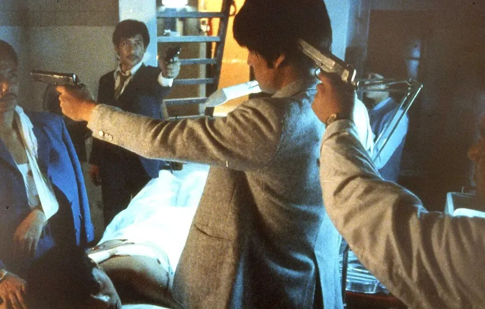
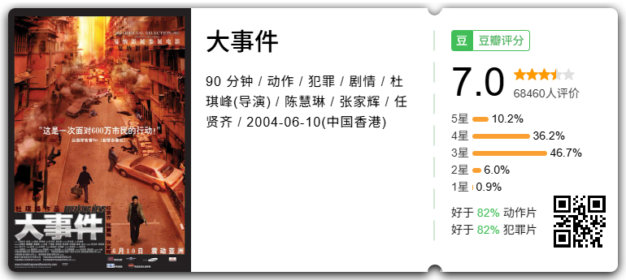
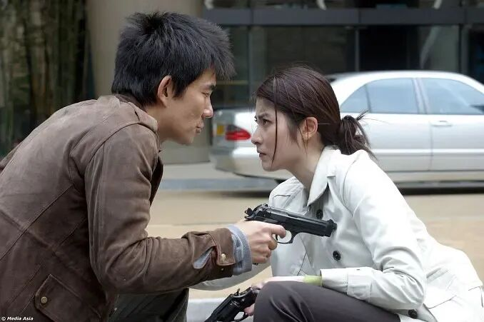
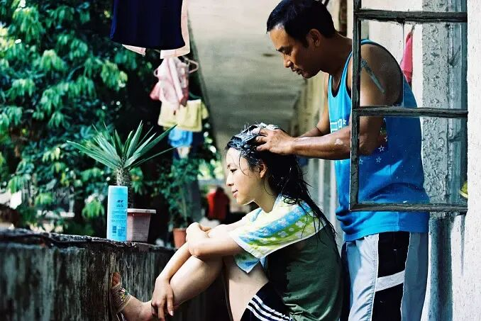
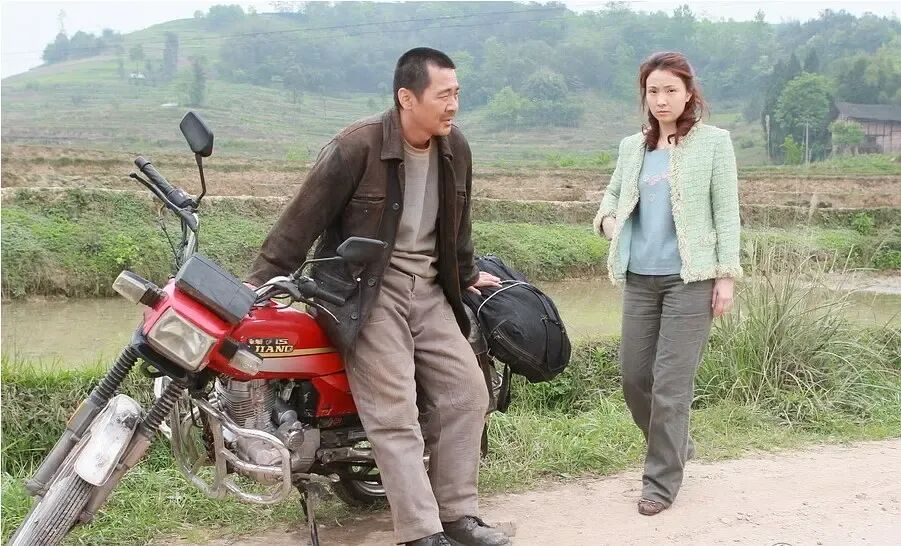

# 5部真实案件改编的电影，原型比电影里演的还狠！
> 💡 备注属性未写入，可能是备注属性名称或者类型被修改了，建议将字段类型设置为 rich_text，可以在小程序-操作-修改文章数据库页面进行调整
> 原文链接:[https://mp.weixin.qq.com/s/-0nmqN2GwshM-RRE3eASPw](https://mp.weixin.qq.com/s/-0nmqN2GwshM-RRE3eASPw)

有些片子看的时候你会想，这编剧真敢写。等看完去查才发现，不是编剧敢写，是这些事真的发生过。
下面这 5 部全是真实案件改编，年份从八十年代一直排到最近十几年，案子一个比一个大。有的导演把机器架在了当年出事的地方，有的片子拍完没多久，真凶才刚落网。
## NO.05 神探亨特张

北京海淀双榆树派出所有个便衣民警叫张惠领，七年在街上抓了一千六百多个，这片子拍的就是他。他没办过什么惊天大案，就是天天在街上站着，把偷的、骗的、碰瓷的一个个拎出来。导演高群书没按警匪片的套路拍，扛着机器在北京街头跟了几个月，成片看着更像纪录片。

有意思的是演员，张立宪、史航、宁财神、周云蓬，全是当年写文章发微博的那批人，一个专业演员都没有，演起来却一个比一个像。片子里没什么大场面，全是一地鸡毛，看着看着会笑，笑完又有点堵。那年的金马奖，它拿了最佳剧情片，算是爆冷。
## NO.04 省港旗兵

取材自中国香港第一代悍匪吴建东那伙人。几个从内地偷渡过去的年轻人凑在一起去抢金铺，出了岔子，一路往九龙城寨里躲。麦当雄没搭景，直接把人带进城寨实拍，那股潮湿拥挤的味道是实景里带出来的。主角林威当时几乎没演过戏，是导演在街上找的人。

片子里城寨那场追逐枪战，后来被无数港片抄过。里面也没什么讲义气的江湖，几个人从头到尾在互相埋怨、互相甩锅，最后谁也没跑掉。这部片子在百年百部最佳华语片里排第六，麦当雄也靠它拿了金马最佳导演。
## NO.03 大事件

杜琪峰拍的，人物原型是当年的贼王季炳雄。巧的是取景地就在八文楼，而影片上映前半年，季炳雄本人刚在那儿被飞虎队按住，屋里搜出来的军火是三十年来最多的一批。

开头那段警匪交火是个六分钟长镜头，杜琪峰先请了《指环王》的摄影师，对方说这没法拍，最后用一百六十尺的轨道加二十五尺的吊臂硬做出来，光空包弹就打掉三千发。片子讲的不是怎么抓人，是警察一边抓人一边还得操心直播画面好不好看，这条线放到今天看，比当年更扎人。
## NO.02 天水围的夜与雾

许鞍华改的是 2004 年中国香港天水围那桩灭门案。任达华演一个从香港娶了内地妻子的中年男人，张静初演他妻子，两个人从四川相识，到回港过日子，一步一步走到最坏的结局。

男人失业后整天待在家里，疑心越来越重，妻子想走又走不了，邻居听见吵闹也没人真管。片子不按时间讲，一上来先给你看结果，再回头补过程，所以越看越凉。拍这部之前她刚拍完天水围的日与夜，因为那部口碑好，这部拿到的投资是上一部的十倍。
## NO.01 人山人海

改的是贵州六盘水的一桩真事。一家五个兄弟，最小的那个在外面开摩托拉客时被人杀了，凶手跑了。警察没抓到，五兄弟就自己上路，骑着摩托一个省一个省地找，最后在广西一个砖厂里把人按住了。

陈建斌演的是大哥，全片台词少得可怜，就是骑摩托、打零工、被人骗。路上他们被人坑过钱，进过黑煤窑，也在桥洞底下睡过。这片子拿了威尼斯最佳导演银狮。国内公映的版本改了结尾，跟当年参赛的那版不是一回事。

## 摘要

（待补充）

## 我的笔记

（待补充）
