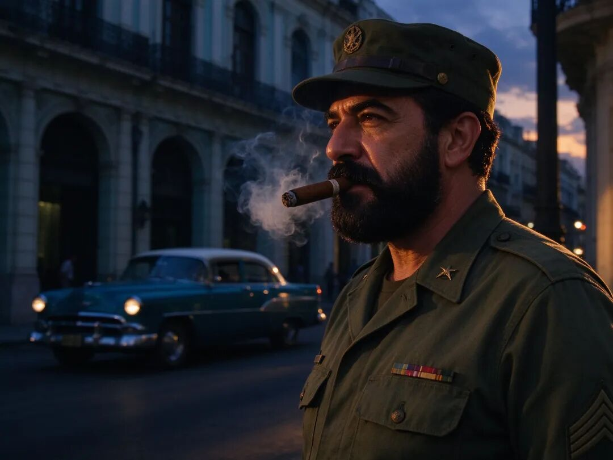
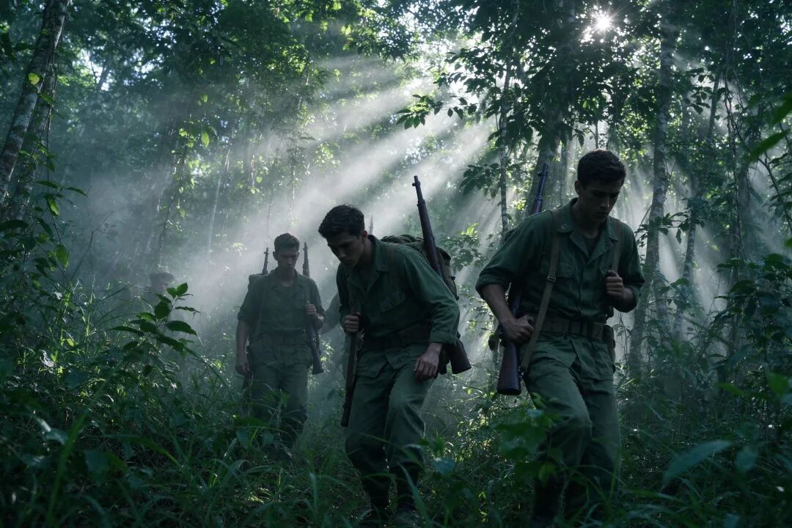
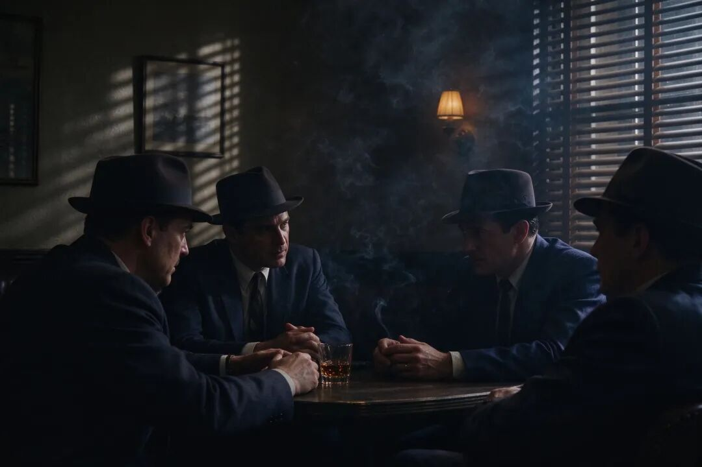
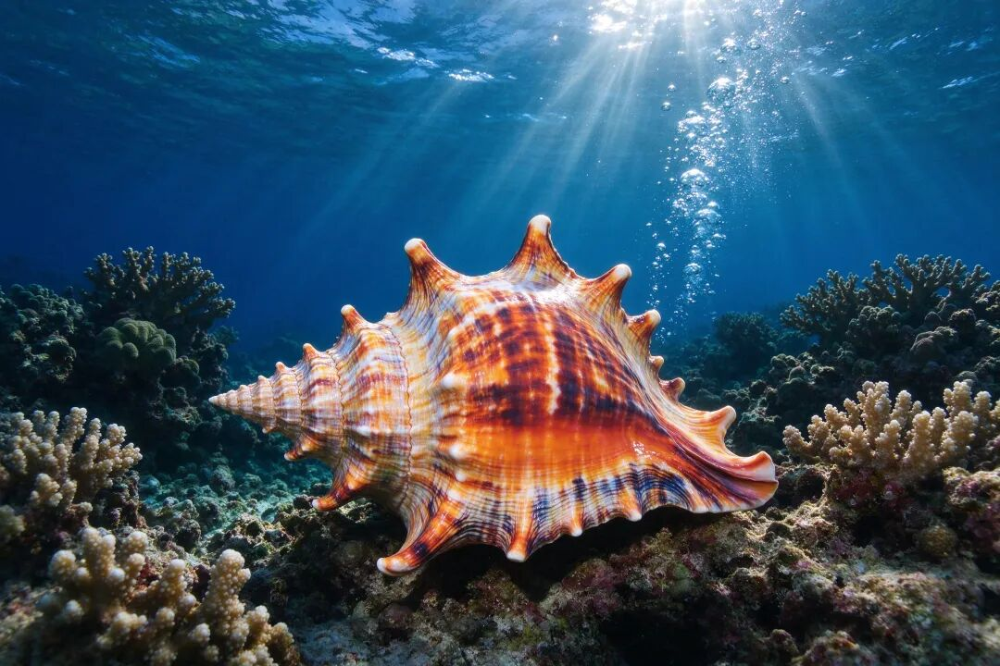
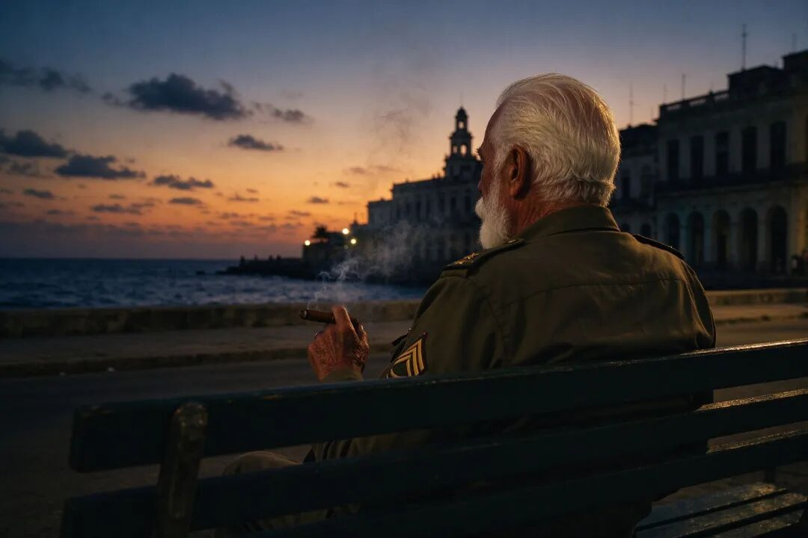

# 638次暗杀，0次成功：中情局为一个男人准备的全部死法
> 💡 备注属性未写入，可能是备注属性名称或者类型被修改了，建议将字段类型设置为 rich_text，可以在小程序-操作-修改文章数据库页面进行调整
> 💡 原文链接:[https://mp.weixin.qq.com/s?__biz=MzcwOTQ3OTM4Mw==&mid=2247483987&idx=1&sn=b6c2ade2ab5e0c20279894e7c315f2a6&chksm=f4d31c71d8a0cd7c6cf4cdc5c1a17df5f0d6b75b292434f75d5324c0b3ada4bceb92acf7f277#rd](https://mp.weixin.qq.com/s?__biz=MzcwOTQ3OTM4Mw%3D%3D&mid=2247483987&idx=1&sn=b6c2ade2ab5e0c20279894e7c315f2a6&chksm=f4d31c71d8a0cd7c6cf4cdc5c1a17df5f0d6b75b292434f75d5324c0b3ada4bceb92acf7f277#rd)
**远**
远域 · 深度观察
冷战 · 秘闻

冷战秘闻 · 638次暗杀
**638次暗杀，0次成功：中情局为一个男人准备的全部死法**
爆炸雪茄、涂了真菌的潜水服、贝壳炸弹、情人手里的毒药丸——半个世纪，超级大国始终没弄死一个岛国领导人
暗杀计划
**638**
付诸实施
**164**
成功次数
**0**
**笔**
笔者原创 · 远域深度观察 · 阅读约13分钟
1997年，美国中央情报局解密了一份长达705页的档案。里面没有国家战略，只有一份"杀人清单"——目标一个人，方法和理由，写了三十多年。
这份档案后来被反复引用。因为人类历史上，从来没有哪个情报机构，为一个人写下过这么厚的东西。
根据古巴反间谍总局前局长埃斯卡兰特的统计，1958年到2000年，美国情报机构前后策划了638个针对卡斯特罗的暗杀计划，其中164个真的付诸实施了。
638次，0次成功。
卡斯特罗本人对这个数字有一个著名的调侃："如果奥运会有一个项目是'躲避暗杀'，冠军一定是我。"
口径说明：638次系埃斯卡兰特著作《刺杀卡斯特罗的638种方法》的统计，部分版本作634次；164个为实际实施数量。美国官方从未确认过总数，只承认自1960年起至少组织过8次独立行动。
今天这篇文章，就把这份清单从头翻一遍。
◆ ◆ ◆
一、后院里的"红色钉子户"
先说这块地为什么这么要紧。
古巴在加勒比海上，离佛罗里达最南端只有90英里，约145公里。这个距离，游泳健将能横渡。国土面积不到美国的九十分之一——是名副其实的"美国后院"。
1926年8月13日，菲德尔·卡斯特罗出生在古巴东部一个甘蔗种植园主家庭，父亲是从西班牙加利西亚来的移民。他后来在哈瓦那大学读法律，是标准的"学霸加硬汉"——书读得好，街也上得勤。
1953年7月26日，26岁的他带着150多个年轻人攻打圣地亚哥的蒙卡达兵营，想抢武器起事。失败，被捕。法庭上他自己为自己辩护，最后一句是："历史将宣判我无罪。"
1955年他流亡墨西哥，在那里组建"七二六运动"，遇见了切·格瓦拉。1956年12月，82个人挤在"格拉玛号"游艇上登陆古巴，被打得只剩12个人逃进马埃斯特腊山。
就是这12个人，两年多后打进了哈瓦那。

1959年1月1日，独裁者巴蒂斯塔仓皇出逃。1月8日，卡斯特罗进入哈瓦那。
新政权很快开始兑现承诺。1959年5月，土地改革法出台，大庄园被没收。1960年2月，苏联部长会议副主席米高扬飞到哈瓦那，签下第一份贸易协定——古巴的糖，换苏联的石油。同年6月，古巴接管了拒绝提炼苏联原油的美国炼油厂；8月，把美国在古巴的资产全部收归国有。
这一下彻底惹毛了华盛顿。一个苏联阵营的政权，就杵在美国家门口90英里的地方，这还了得？
文的行不通，就来武的。1961年4月17日，中情局训练的1400多名古巴流亡分子在猪湾登陆。
结果上岸就被人民军迎头击中：100多人阵亡，1100多人被俘。
这就是冷战史上著名的"猪湾事件"，美国情报界几十年抬不起头的大笑话。而登陆失败之后，华盛顿只剩下一个选项——杀人。
**二、第一枪：大学同学在天台上崩溃了**
有意思的是，卡斯特罗遭遇的第一次暗杀，出手的不是中情局，是他的大学同学。
此人叫恩里克·奥瓦莱斯。1945年，他和卡斯特罗同年进入哈瓦那大学——卡斯特罗读法律，他读建筑。两人一起参加学生运动，一度是要好的朋友。
但奥瓦莱斯出身地主家庭。革命胜利后的土改，让他一夜之间从公子哥变成了普通人。当年一起空谈的"自由平等"，真革到自己头上，他心结顿起。
1959年的一天，奥瓦莱斯得到消息：卡斯特罗要到哈瓦那城郊一家露天餐厅吃饭。他抄起一支步枪，摸上了对面楼房的天台。狙击位置很好，角度也合适。
但就在要扣扳机的瞬间，他崩溃了。
这个"语言上的巨人、行动上的矮子"，瘫在天台上，眼睁睁看着卡斯特罗吃完饭，安然离去。此后他流亡美国，后来死于癌症。
这是638次里，唯一一次不是中情局策划的。也是唯一一次，枪口离那颗脑袋只差一根手指的力气。
三、官匪一家：15万美元，六颗毒药丸
中情局亲自下场后，最早的一个方案，透着股"脑洞大开"的味道。
卡斯特罗那把大胡子，是他最醒目的标志。中情局琢磨：要是把他的胡子搞没了，民众会不会就不崇拜他了？
他们盯上了铊盐——一种无色无味、脱毛能力极强的化学品。计划是：趁卡斯特罗出国访问，夜里把皮鞋放在门外等人擦的时候，把铊盐粉末撒进鞋里。皮肤吸收后，胡子会一把一把掉光。
据美国国家档案馆解密文件，1960年3月到7月，这个计划已经推进到动物实验阶段。它最终没能实施，原因很朴素——卡斯特罗临时取消了那次出访。
如果说撒铊盐还只是"恶作剧"，接下来的计划，就是赤裸裸的官匪勾结。
1960年9月14日，纽约。中情局秘密行动负责人理查德·比塞尔批了预算，由前联邦调查局特工罗伯特·马胡出面，在曼哈顿一家酒店的房间里，见到了拉斯维加斯的黑帮头目约翰·罗塞利。
价码15万美元，买卡斯特罗的命。
罗塞利觉得一个人干不了，又拉来两个重量级人物：芝加哥黑帮老大山姆·詹卡纳，和佛罗里达黑手党头目桑托·特拉菲坎特。其中詹卡纳，当时正位列"全美十大通缉犯"名单。

中情局技术服务处很快造出了肉毒杆菌毒素药丸，先在猴子身上做实验，效果"很好"。一共六颗，三颗交给了罗塞利。
黑帮的计划是：买通卡斯特罗总理办公室主任胡安·奥尔塔，由他把药丸放进卡斯特罗的食物或饮料里。神不知鬼不觉，还追查不到美国政府头上。
结果呢？据解密档案，药丸在1961年初送进古巴，奥尔塔却临阵退缩——另一种说法是，他很快就被卡斯特罗解职了。毒丸计划就此泡汤。
黑帮不死心，又说还能买通卡斯特罗的贴身医生，只要再付一万多美元。
就在这时，猪湾打输了。
四、瞄准他的爱好下手
强攻、下毒、买黑帮都失败后，中情局换了个思路：研究卡斯特罗的个人爱好，准备"精准打击"。
卡斯特罗有三大爱好：抽雪茄、潜水、棒球。
先说雪茄。他的雪茄是特供的，外人递的他从来不碰。中情局设想过会爆炸的雪茄——这是流传最广的版本，但档案里没有记载，多数历史学家认为它是传说。
真正有白纸黑字记录的，是毒雪茄。丘奇委员会的报告写得很细：1960年8月16日，一名官员领到一盒卡斯特罗最爱抽的牌子，被指示用致命毒素处理。雪茄里的肉毒杆菌毒素，"只要放进嘴里就会立刻死亡"。1960年10月7日制备完成；1961年2月13日，交给了一名身份不明的人。
档案到这里就断了。这批雪茄有没有送到卡斯特罗手上，到今天也没人知道。
再说潜水。这一招有两套，一套比一套离谱。
第一套，是一件涂满真菌的潜水服。这种真菌能让皮肤慢慢溃烂，引发多种疾病，最终致命。1962年，纽约律师詹姆斯·多诺万作为肯尼迪的特使赶赴古巴，谈判猪湾被俘人员的释放。中情局把潜水服交给他，让他当"礼物"送给卡斯特罗——多诺万完全不知情。
结果多诺万看了一眼就拒绝了：这件潜水服又旧又破，怎么能当国礼送人？他自己掏钱买了一件新的。
那件"夺命潜水服"当晚就被扔进了垃圾桶。中情局的人知道后，估计欲哭无泪。
第二套更离谱：一枚"贝壳炸弹"。他们计划在卡斯特罗常去潜水的那片海底，放一枚色彩艳丽、塞满炸药的大贝壳，吸引他上前观看、拿取，然后引爆。为了这个方案，中情局主管还专门让人从国外进口贝壳，挑足够大的。

这个计划最终流产——那片海域水太深、流太急，中情局的小艇根本靠不近，连放炸弹的机会都没有。
五、美人计，和一支能杀人的钢笔
中情局还用过一个最古老的招数：美人计。
卡斯特罗有过一个德裔情人，叫玛丽塔·洛伦茨。1959年2月28日，她随父亲当船长的游艇抵达哈瓦那，那年19岁，他33岁。两人一见钟情。
后来她怀孕，七个月时突然昏倒流产，只能回纽约治疗。
就在治疗期间，中情局找上了她。特工告诉她：孩子是卡斯特罗弄掉的；这个人不仅威胁美国，还威胁全世界。玛丽塔后来说："我其实不信他们，但他们在洗脑这方面很在行。"
1960年1月，她带着几颗毒药丸回到哈瓦那，药丸藏在面霜盒里。
但凝胶胶囊被面霜泡化了。她把毒水倒进马桶，卡斯特罗就在这时走了进来。
他掏出手枪，递给她："你是来杀我的吧？给，开枪吧。"
玛丽塔哭了，把枪扔到一边："菲德尔，我不能。"
卡斯特罗笑了："没人能。"
如果说前面这些还停留在"荒诞"，那接下来这个代号"AMLASH"的行动，是中情局最接近成功的一次——因为他们发展的内鬼，是一位革命英雄。
此人名叫罗兰多·库维拉，曾是"七二六运动"的重要指挥官，军衔"司令"，在革命军中威望很高。中情局给他取了个代号：AM/LASH。
1963年11月22日，巴黎。中情局官员德斯蒙德·菲茨杰拉德交给库维拉一件特殊武器：一支看似普通的圆珠笔，笔里藏着一根极细的注射针头，只要轻轻一刺，毒液就进入体内，受害者几乎毫无察觉。笔里装的，是一种高浓度尼古丁硫酸盐杀虫剂。

这个日子值得多看一眼：1963年11月22日，正是肯尼迪在达拉斯遇刺的同一天。巴黎的秘密交接完成了，而几个小时后，下令搞这些事的人，自己先死了。
库维拉最终没有动手。1966年，他在古巴被捕，判处徒刑。
**六、1976年10月6日，一架客机**
写到这里，得停一下。
前面那些计划之所以好笑，是因为它们全都失败了、全都荒唐、全都没伤到人。但暗杀这件事本身，从来不只是一场闹剧。
1976年10月6日，古巴航空455航班在飞行途中爆炸，机上73人全部遇难。
炸弹是在巴巴多斯经停加油时被送上飞机的。这架飞机上坐着古巴击剑队——刚刚在中美洲运动会上拿下全部金牌的年轻人，回程路上，一起没了。
委内瑞拉警方很快逮捕了两名运送炸弹的嫌疑人。审讯查明，他们属于一个叫"CORU"的反古巴恐怖组织联合体，幕后主使是路易斯·波萨达·卡里莱斯和奥兰多·博什——两个都是中情局亲手训练出来的人。
美国天天喊反恐，而这起空难的凶手，恰恰出自它自己的训练营。从这里开始，这件事就不再是段子了。
时间快进到2000年。当年11月，巴拿马举行第十次伊比利亚美洲国家首脑会议。卡斯特罗在讲台上当众亮出一张照片——就是波萨达——揭露他计划在讲台下面安放炸药，再次实施暗杀。据事后披露，那批炸药的当量，足以把半个会场夷平。
这一次，阴谋在实施前就被古巴安全部门摸清了。波萨达在巴拿马被判刑，几年后被特赦；2005年他进入美国，直到2011年才被起诉。
**七、一份347页的报告，和一条至今有效的禁令**
1975年，美国参议院成立了专门委员会，由参议员弗兰克·丘奇主持，调查情报机构的滥权行为。
那份名为《涉及外国领导人的暗杀阴谋》的报告长达347页，第一次把中情局的暗杀网络摊在阳光下。报告里列出的工具清单，今天读来仍然刺眼——"从大威力步枪，到毒药丸、毒原子笔、致命细菌粉末，极尽想象之能事"。
值得注意的是，这份报告只确认了8次针对卡斯特罗的独立行动。剩下的六百多次，来自古巴方面的统计——两边的账，从来对不上。
报告之后，1976年2月，福特总统签署11905号行政令，禁止美国政府雇员策划或实施政治暗杀。这条禁令后来被12333号行政令延续，一直有效到今天。
2007年6月，中情局又公开了一批代号"传家宝"（Family Jewels）的内部文件。1973年，当时的局长要求全体特工交代"有没有做过越界的事"，交上来的材料被订成厚厚一叠。关于卡斯特罗的那几页，大段大段涂着黑。
暗杀被禁止了。对古巴的封锁没有。某种意义上，那条禁令就是被卡斯特罗一次次"死里逃生"逼出来的。
**八、他为什么总能活下来**
讲了这么多失败的计划，该说说最后那个问题了：为什么是他？
法比安·埃斯卡兰特，古巴反间谍总局前局长，十几岁就参加地下抵抗，后来长期负责卡斯特罗的安保。他写了一本书，叫《刺杀卡斯特罗的638种方法》——中情局的家底，被他翻了个底朝天。
埃斯卡兰特的厉害之处，不只是被动防守，而是主动渗透。古巴反间谍部门把大量线人安插进迈阿密的流亡组织，中情局的很多计划还没出迈阿密，就已经被哈瓦那掌握。他们还擅长放假情报，让对手分不清哪条是真、哪条是假。
卡斯特罗自己的习惯也帮了大忙：据公开报道，他常在二十多个住处之间轮换，用替身，行程临时更改。
所以那638次，不是运气。是一个国家的情报系统，在替一个人挡子弹。
九、杀不死的，慢慢老死
2006年7月，卡斯特罗因肠胃出血接受手术，随后把权力移交给弟弟劳尔。2008年2月，他正式宣布卸任。
2007年6月28日，小布什在美国海军军事学院演讲后被问到卡斯特罗，他说："总有一天，上帝会把菲德尔·卡斯特罗带走。"
卡斯特罗当天就发了声明。他说：我现在明白，我为什么能从布什和其他总统的暗杀令里活下来了——原来是上帝在保佑我。
2016年11月25日，菲德尔·卡斯特罗去世，享年90岁。按照他的遗嘱，遗体火化。
从1960年中情局第一次认真策划暗杀，到2016年他安然离世，半个多世纪里，638个计划、无数种毒药和炸弹，没有一个能伤他分毫。

他没能被杀死，于是慢慢老了。

而一个小国，在超级大国的眼皮子底下，

按自己的方式活了下来——

这本身，就已经是历史。
翻完这份清单，最凉的不是那些毒药和炸弹，是1976年那架飞机上，一群刚拿完金牌的年轻人。
638次里，最让你后背发凉的是哪一个？是那盒不知道有没有送到的毒雪茄，还是那架飞机？评论区聊聊。
**资料来源：**
· 美国参议院丘奇委员会报告《涉及外国领导人的暗杀阴谋》（1975年，347页）
· 美国国家档案馆解密文件：卡斯特罗暗杀计划年表、中情局督察长报告（1997年起陆续解密）
· 中情局"传家宝"（Family Jewels）文件，2007年6月公开
· 法比安·埃斯卡兰特《刺杀卡斯特罗的638种方法》
· 中国日报、新华社、中国新闻网、环球网相关报道
· 中国社会科学院拉丁美洲研究所相关研究
· 文中638次与634次为不同统计口径，164个为实际付诸实施的数量；涉及具体手段的描述均取自上述公开档案与公开报道，不含任何操作细节
远域 · 深度观察 ｜ 冷战深处的另一种历史
本文为笔者原创，转载请在后台留言
