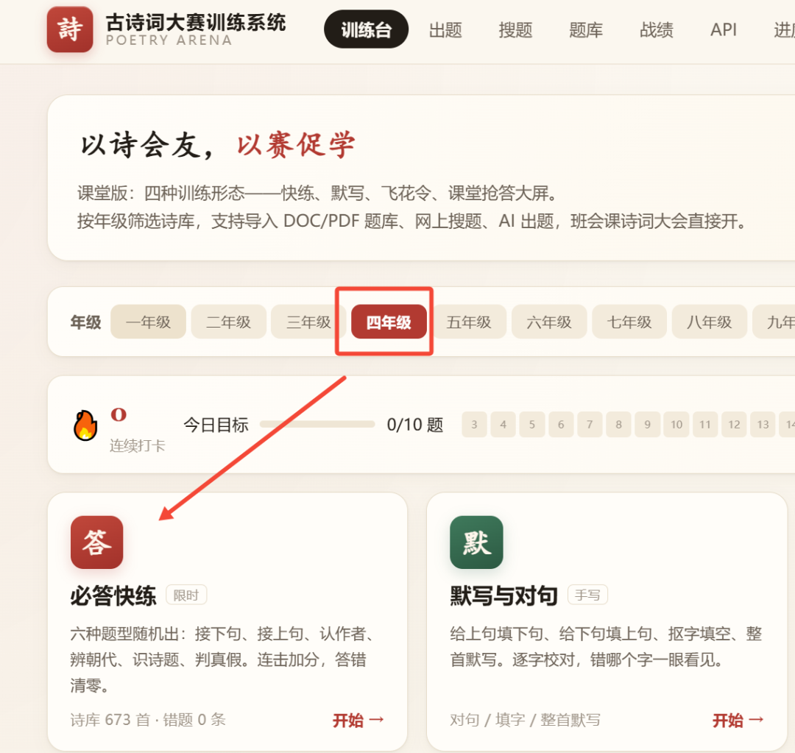
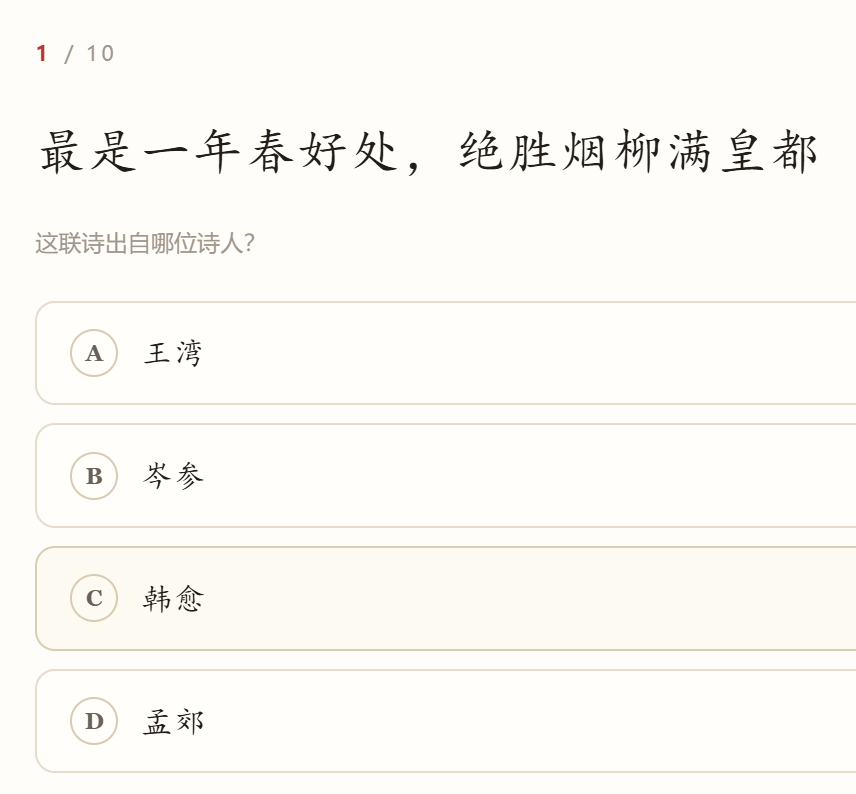
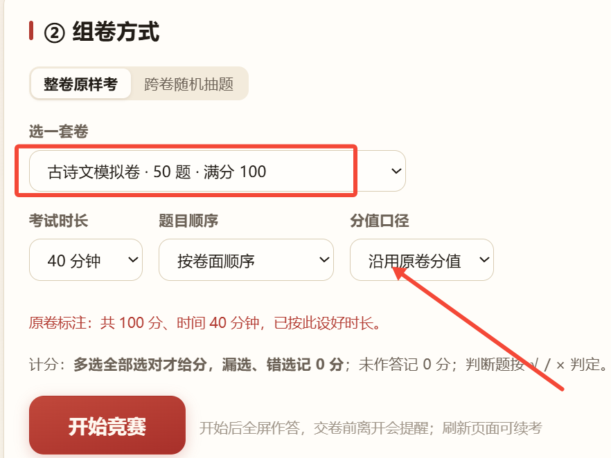

# 7685次，家长都在用古诗词大赛训练系统5.0版
> 💡 备注属性未写入，可能是备注属性名称或者类型被修改了，建议将字段类型设置为 rich_text，可以在小程序-操作-修改文章数据库页面进行调整
> 💡 原文链接:[https://mp.weixin.qq.com/s?__biz=MzAxNzc5MDgyMg==&mid=2649970340&idx=1&sn=14c8746aa5141d94038bff6373850189&chksm=82d9ea349eb32f175758f6f9b17d4139f42219704084b5e7bec5b2df2d4e8f71aad8116329a9#rd](https://mp.weixin.qq.com/s?__biz=MzAxNzc5MDgyMg%3D%3D&mid=2649970340&idx=1&sn=14c8746aa5141d94038bff6373850189&chksm=82d9ea349eb32f175758f6f9b17d4139f42219704084b5e7bec5b2df2d4e8f71aad8116329a9#rd)
**现在已经到5.0版，**
**5.0有上机模拟**
**3.0有分篇复习**
[5.0版来了，古诗词训练系统班级上机模拟赛](https://mp.weixin.qq.com/s?__biz=MzAxNzc5MDgyMg%3D%3D&mid=2649970306&idx=1&sn=c5c83fe2c9992334307c48693269f53b&scene=21#wechat_redirect)
[3.0版来了，古诗词大赛训练系统+分篇复习](https://mp.weixin.qq.com/s?__biz=MzAxNzc5MDgyMg%3D%3D&mid=2649970248&idx=1&sn=5fd7ecd8f1aa9b1405c7dcfd119da554&scene=21#wechat_redirect)
[语文老师的课本剧神器： 3 个按钮，把短剧全包了](https://mp.weixin.qq.com/s?__biz=MzAxNzc5MDgyMg%3D%3D&mid=2649970328&idx=1&sn=471c61a59e283a07d14aff42f96dbe10&scene=21#wechat_redirect)
注意是
左下角

| **来自各方好评** |
大家不妨来看看这个使用量
近七天
使用量已经达7685次

**
用法其实很简单：**

**第一步：手机点击左下角的阅读原文**

就进入训练系统，然后**选择相应的年级**。

**第二步：可以选择训练台**
手机在家长手里，
可以边看题目边问孩子

自己感兴趣，
还可以当成训练
练完**马上出得分**
| **第三步：可以进行分篇复习** |
特意安排了分篇复习
这个要进入3.0版本，也是点击左下角的
**阅读原文**
[3.0版来了，古诗词大赛训练系统+分篇复习](https://mp.weixin.qq.com/s?__biz=MzAxNzc5MDgyMg%3D%3D&mid=2649970248&idx=1&sn=5fd7ecd8f1aa9b1405c7dcfd119da554&scene=21#wechat_redirect)

上完全部之后，来次总复习也是好的

据说，
这个系统好就好在，
改变了原来的记记背背
**让训练形式**
**变得丰富多样**

**第四步：进行上机模拟练习**
这个最好让孩子进行参与
手机屏幕太小
可以用电脑

输入：123456

采用是百分制

说了这么多，
最终还得靠
**多读，多背，多写，多理解**
这个不过是个辅助
随时随地可以用
