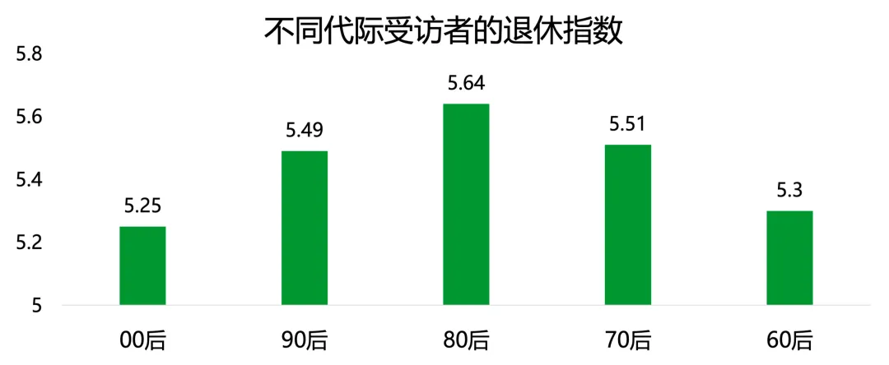
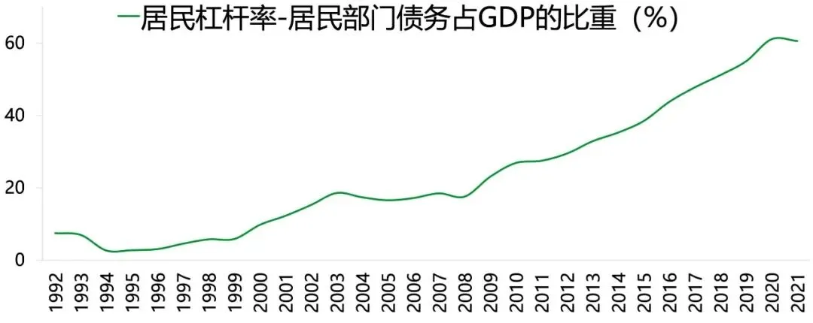
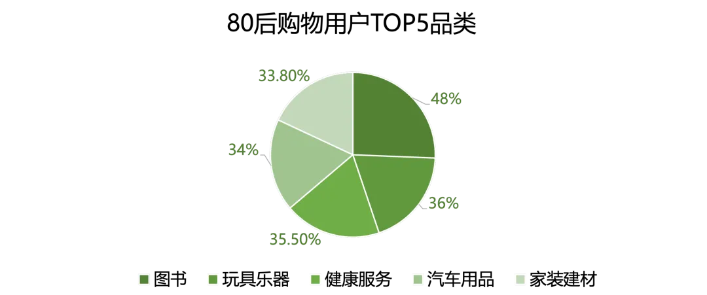

# 80后这代人，真是什么都赶上了
> 💡 备注属性未写入，可能是备注属性名称或者类型被修改了，建议将字段类型设置为 rich_text，可以在小程序-操作-修改文章数据库页面进行调整
> 💡 原文链接:[https://mp.weixin.qq.com/s?__biz=MjM5OTc2NzA2MQ==&mid=2651336751&idx=1&sn=1fa0f92e66219b37e573934f94d56bcc&chksm=bd82eee33448d1fbf8e31d11cc82ec103e7ad4808ef35cebe30d919662189de296432b15415b#rd](https://mp.weixin.qq.com/s?__biz=MjM5OTc2NzA2MQ%3D%3D&mid=2651336751&idx=1&sn=1fa0f92e66219b37e573934f94d56bcc&chksm=bd82eee33448d1fbf8e31d11cc82ec103e7ad4808ef35cebe30d919662189de296432b15415b#rd)

**作者：刘润 主笔：景九 编辑：橙子**
**来源：刘润（ID：runliu-pub）**
互联网上有个话题，吵了十几年：
到底哪代人最不容易？
是60后、70后、80后，还是90后，00后？
好吧。这个争吵，其实不太可能会有结论。因为每代人，都有自己更不容易的理由。
但有这么一代人，确实不容易得挺特殊：
**80后。**
最近，我读到了青山资本的一份报告，心里浮出这么一句话：
**80后这代人，真是什么都赶上了。**
他们成长的几十年，恰好是中国发生巨变的几十年。这些变化，给他们带来了不少机会，也让他们承担了不小的代价。
为什么这么说？
先从80后这些年，遇到的一道道难题说起。
**01**
**80后，好像一直在学着解新题**
提问。你今年多大？
如果你是1985年出生的，那么今年，你已经40岁出头了。
40岁。按理说，这个年纪，不少事应该已经很通透了。比如读书，工作，结婚生子。
可你总觉得，好像不是这样的。
小时候，觉得好好读书、努力工作，人生就能走上正轨。可后来才发现，很多事和自己想的不一样。后来结了婚有了娃，又发现，原来经营家庭，教育孩子，也没什么现成答案。
**都40了，怎么要学的反倒越来越多了？**
这种感觉，其实很正常。
因为回看80后的过往，你会发现，他们好像一直在学着解新题。
报告系统总结了几个方面。
**比如，工作。**
打小，80后就被教育好好学习，有个好学历，什么都解决了。可等自己毕业才发现，因为扩招，学历成了门槛。想在职场中站稳脚跟，还要靠能力，更要积累经验。
好不容易从什么都不懂的年轻人，熬成了经验丰富的中年人，技术革命又来了。经验，好像一天天在贬值。尤其是AI，进展简直吓人。不加紧学习，好像又要跟不上了。
于是你会看到，很多四五十岁的职业困境，在不少行业里，提前到了35岁。
**比如，婚姻。**
很多80后的观念，还是挺传统的。年纪到了，就找个条件合适的人，安顿下来。
可真轮到自己又发现，两个人在一起，不光要条件合适，感情性格生活习惯，缺一不可。
复旦大学曾调查过80后的择偶观念。发现无论评价男性还是女性，排在前面的条件都是：生活习惯、性格、智商。女性受访者，还特别重视男性是否会做家务。
**又比如，做父母。**
虽然很多80后小时候，家里关心的是吃饱穿暖、学习成绩。可等当了父母，他们不仅关心这些，还关注孩子的情绪、兴趣和独立人格。
为什么会这样？
虽然80后对好父母有了新的理解，但因为自己确实通过教育获得了机会，所以才会一边希望孩子自由成长，一边又担心教育投入不够。
自己小时候，努力做个好学生。等有了孩子，又得重新学习，怎样做个好父母。
**还有，养老。**
根据复旦大学调查，九成受访上海80后认为，作为子女，应该承担照顾父母养老的责任。
这不奇怪。80后从小接受的教育，就是孝顺父母、赡养老人。
可自己晚年时，他们却不愿意依赖孩子，而是考虑储蓄保险、养老机构。有研究发现，80后退休准备指数达5.64，显著高于其他世代。

这无疑体现了不少80后的想法：
赡养父母的责任，要努力承担。可轮到自己养老，却又不希望给孩子增加负担。
**人生不同的阶段，遇到的问题在变，所以，需要学习的东西也一直在变。**
这就是80后这代人，一种很特别的不容易。
可是，为什么偏偏是他们？为什么不是70后，不是90后？
**02**
**80后**
**既赶上了机会，也承担了代价**
要回答这个问题，我们得先看清楚，过去几十年，中国到底发生了什么样的变化。
报告列了一组数据：
> 1980年，中国人均GDP只有约195美元；2025年，接近14000美元。城镇化率从19%上升到67%，互联网用户从0到11亿，居民杠杆率从4.8%到60%，老龄化率从4.9%到22%。
> 
短短几十年，中国人的生活，翻天覆地。
无数人从农村走进城市，从小城镇走向大城市。以前少数人才能享受的教育、交通、医疗和生活设施，现在也进入了普通人的生活。
**80后，就是在这场巨变里，长大的一代人。**
他们小时候，随处可见泥土路、蜂窝煤和公共电话。但长大之后，乘高铁出差、用手机购物、线上工作，都成了日常。
这些变化，给80后带来了实实在在的机会。
高校扩招，让更多人有机会读大学。城市化和互联网经济的发展，催生大量岗位。很多80后，因此走出了家乡，在大城市里安家立业。
可机会，也伴随代价。
**最典型的，就是房子。**
过去几十年，中国修建了大量的基建。公路、铁路、地铁……这当然是好事。但如此规模的城市建设，需要钱。需要很多钱。
钱从哪来？
报告提到了当时一种很重要的方式：
**土地财政。**
简单来说，地方政府通过土地出让等办法筹钱，修建道路地铁。基建越完善，周边房价就越高，地产商就会用更高价拿地。等房子住进来更多人，又能带来商业和税收。
这套办法，虽然迅速推动了城市化进展，但也相当于把城市建设的部分成本，通过土地和住房价格，传导给了买房的家庭。
看一组时间数据。
> 💡 1998年，福利分房基本退出。那一年，最年长的80后才18岁。2003年，中国房地产市场进入快速发展阶段，80后开始参加工作。2008年，80后不断结婚买房。2015年，80后又成为改善型住房的重要购买群体。

从参加工作，到结婚成家，再到改善生活，80后完整经历了房地产扩张和贷款普及过程，集中买了首套房和改善房。
**因此，他们也背上了更多的债务。**
报告引用招商证券的测算，80后家庭的平均房贷支出达到10.73万元。相比之下，70后家庭为6.24万元，60后家庭为5万元。
但比较房贷支出与存款之比，80后达到了106%，70后是59.9%，60后只有54%。
报告也总结：
> 简而言之，中国现代化发展的重资产模式，以高杠杆形式落到了80后一代身上。
> 
根据测算，中国居民杠杆率，2000年的不到10%，2021年就到了60.6%。住房贷款，占了增量2/3以上。核心购房群体，就是80后。

但贷款压力，还不是全部。
一个人买了房子，结了婚，接下来会发生什么？要养孩子，要装修房子，父母年纪也大了，需要照顾。
所以，你会看到很多80后，可能一边还着10年前的买房贷款，一边还要为孩子的教育操心，要考虑父母的身体状况。
而这些支出，往往集中发生在80后人生中的同一段时期。
这也是为什么，虽然很多80后明明比父母收入更高，却仍然觉得肩上的担子很重。
回头看，80后确实赶上不少机会。通过教育改变命运，通过工作进入城市，通过买房建立家庭。但为了维持这样的生活，他们也要持续投入大量时间和金钱。
**他们赶上了机会，也承担了代价。**
而这些经历，也慢慢改变了80后花钱的方式。
**03**
**80后**
**家庭之后，才是自己**
怎么改变的？直接影响，就是：
**每个月，都有一笔不小的固定支出。**
收入到账，先要安排的就是房贷、孩子、父母，以及家庭的必要开支。
具体怎么安排？一句话总结，是：
**该省省，该花花。**
该省省，是买日用品，尽量挑性价比高的。手机、家电，只要还能用，就不急着换新的。
该花花呢？涉及孩子教育、家人健康、家庭保障，他们又往往舍得投入。
报告展示了一组数据。
80后购物用户数的TOP5品类，是：图书、玩具乐器、健康服务、汽车用品和家装建材。

图书，既是孩子的教辅资料和科普读物，也是自己学习考证的专业书籍。玩具、乐器，可能是为了培养孩子的兴趣。健康服务、汽车用品和家装建材，也大多与家人有关。根据数据，31-40岁互联网保险消费者中，75%的家庭年度保险支出，超过5000元。
报告给80后这一阶段的消费，起了个名字：
**家庭运营型消费。**
家庭运营期，就是以家庭优先。为家庭舍得花，为自己省着花。充面子的钱，少花。降低风险的钱，多花。

可照顾一家人，也不是完全不考虑自己。
80后，给自己怎么花钱？
报告里，有一个很有意思的观察：80后存在两种看起来完全相反的消费。
**一种是节省时间，一种是故意消耗时间。**
节省时间，就是把繁琐的，不愿意做的事情，通通“外包”。
比如，购买家政服务，省下打扫卫生的时间。用即时零售，节省跑超市的时间。2024年，即时零售消费者中，31-45岁占55%。当然，还有买扫地机器人、洗碗机做家务。
消耗时间，就是找一个下午，专门做自己喜欢的事情。
比如，骑行、钓鱼、徒步。2023年，户外运动参与者中，80后占比达到37.13%。比其他代际都高。比如，演唱会和长期兴趣社群。
为什么会有这个倾向？报告有个归因。
很多80后的共同记忆，就是一枚游戏币、一套漫画。所以评判产品价值，他们更喜欢看它能否提供足够久的沉浸体验。
他们，只是长大了，不是不喜欢玩了。
再补充一个让人会心一笑的细节。
这些悦己消费，往往要套一个“有用”的借口，才能进入预算。比如，徒步骑行，是因为有利于健康。旅游，是因为要陪伴家庭。
无论是花钱节省时间，还是花钱去消耗时间，这两种消费，其实指向了一个愿望：
**希望时间，能更自由地被安排。**
不想干的就外包，想干的就多干会。
报告里，也给这种消费趋势起了个名字：
**夺回时间的控制权。**
哎，真是不容易。
年轻时，80后忙着学习、工作、成家。到了40岁上下，工作和家庭逐渐有了着落，可每天依然有那么多需要操心的事情。
那么，往后呢？
他们的日子，会不会轻松一点？
**04**
**以后，可能终于有条件轻松点了**
报告给出的判断，是相对乐观的。
为什么？
**未来十年，80后的账本可能会发生变化。**
首先，是房贷。
很多80后，在2008年至2015年买房。随着时间推移，这些贷款会逐渐进入尾声。
还有。孩子。
随着孩子长大，家庭就会陆续走出教育支出最集中的阶段。而且，孩子渐渐独立，需要父母操心的事情，也可能比小时候少一些。
据此，报告里做了一项测算。
到2035年，80后家庭，每年可能释放出约1.21万亿元的现金流。如果有30%转向个人消费，就可能带来约3000多亿的新增消费空间。

当然，这些只是推算。因为，随着80后自己年龄增加，父母越来越年长。未来的医疗、照护和养老支出，仍然可能增加。
账本变化，不是说80后以后没压力了。
而是随着人生进入新阶段，一部分固定开支，终于开始减少了，怎么花钱就得重新配置了。
**往后的日子，80后，可能终于有条件轻松一点了。**
**最后的话**
好了。
关于报告的具体内容，我们就先聊到这里。
最后，我还是想先提醒你一件事。
虽然报告的推算，是乐观的。但这终究只是一家之言。因为数据，毕竟只是平均。每个人的情况，却都不一样。
但无论如何，有件事是确定的。
**过去这些年，80后确实挺不容易的。**
小时候，他们努力读书。长大后，忙着工作、买房、成家。好不容易把日子安顿下来，又有孩子要养，有父母要照顾。
一路走来，他们赶上过不少机会，也为此付出了很多。工作要做好，家庭要照顾，时代在变化，自己还得不断学习、不断适应。
想想，也挺感慨。
20多岁，总觉得未来还有大把时间。可工作稳定了，要买房。房子买了，要养娃。娃长大，父母又老了。
好像，总有更重要的事，排在自己前面。
**只是忙啊忙，一回头，自己已经40多岁了。**
曾经那个精力充沛，觉得未来有无限可能的年轻人，也开始感觉累了。之前一口气能爬上去的山，现在要休息好几次。之前能一口气熬完的夜，现在要缓好几天。
我当然希望，报告的预测是对的。
未来几年，80后会逐渐卸下担子，拥抱生活。
**但我更希望，即便那一天还没到来，你也可以从现在开始，就对自己好一点。**
有些事情，不尽善尽美，也没关系。有些期待，暂时实现不了，也不用苛责自己。
因为这么多年，你已经很努力了。
**版权声明：部分文章推送时未能与原作者取得联系。若涉及版权问题，敬请原作者联系我们。**

