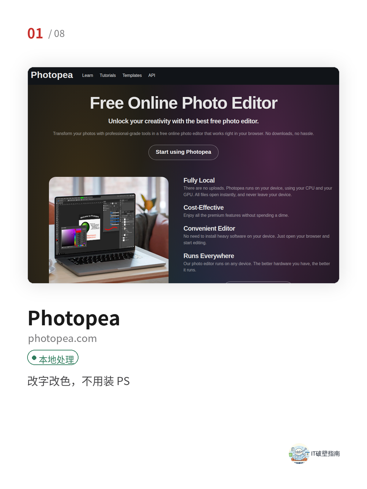
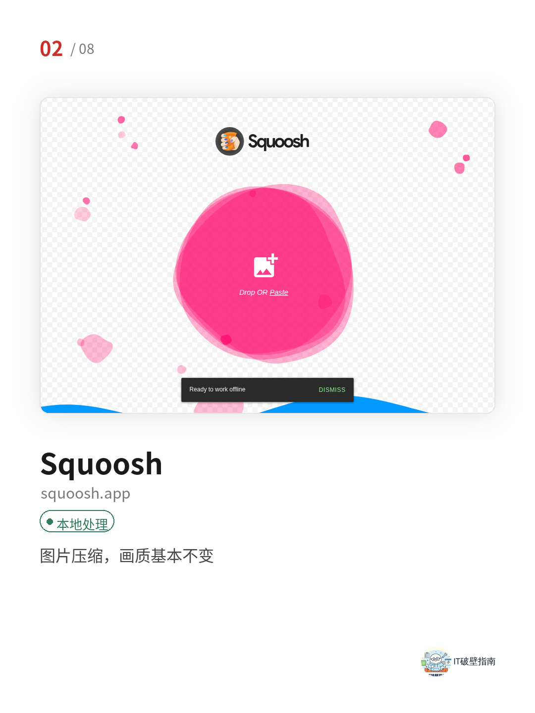
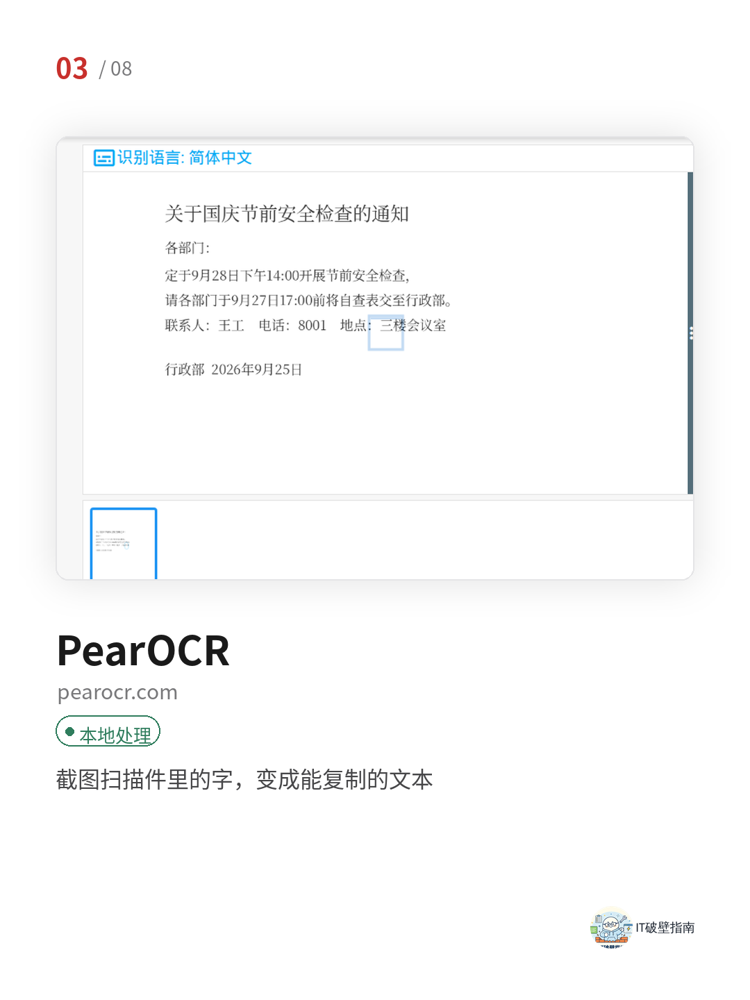
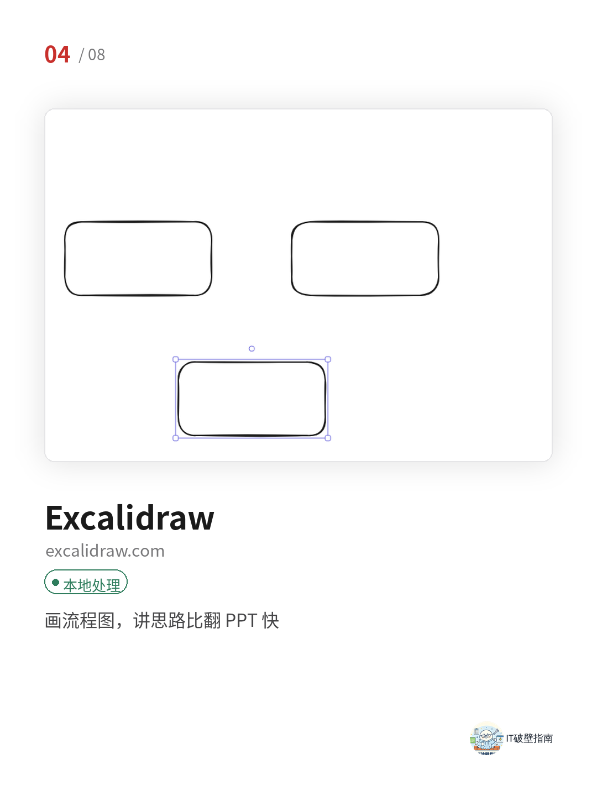
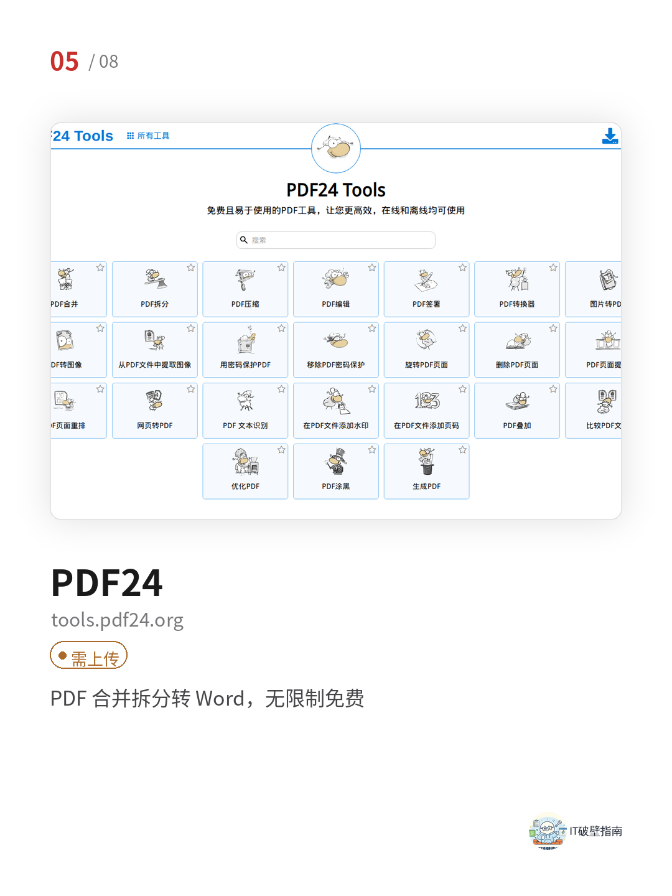
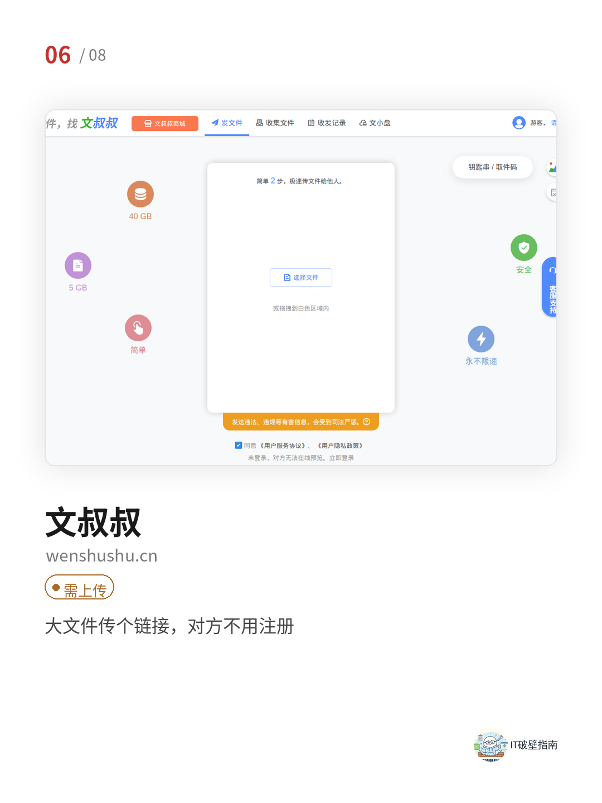
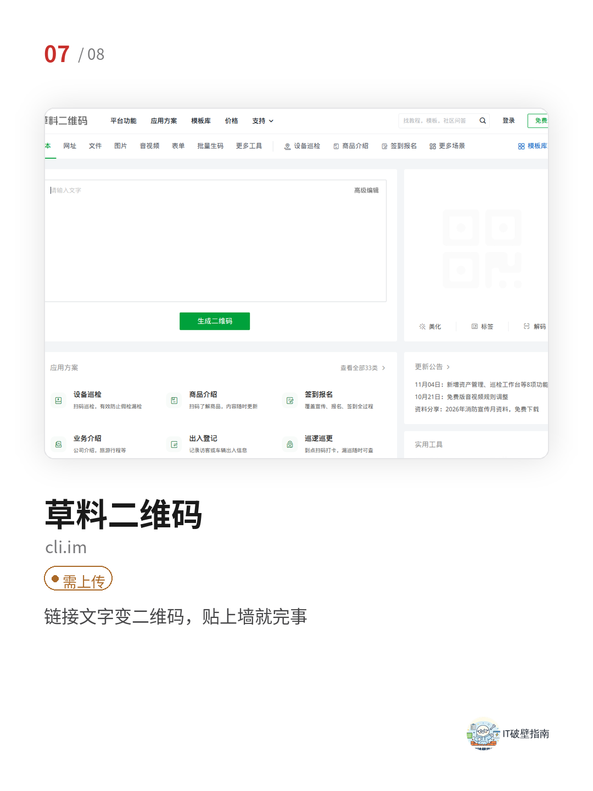
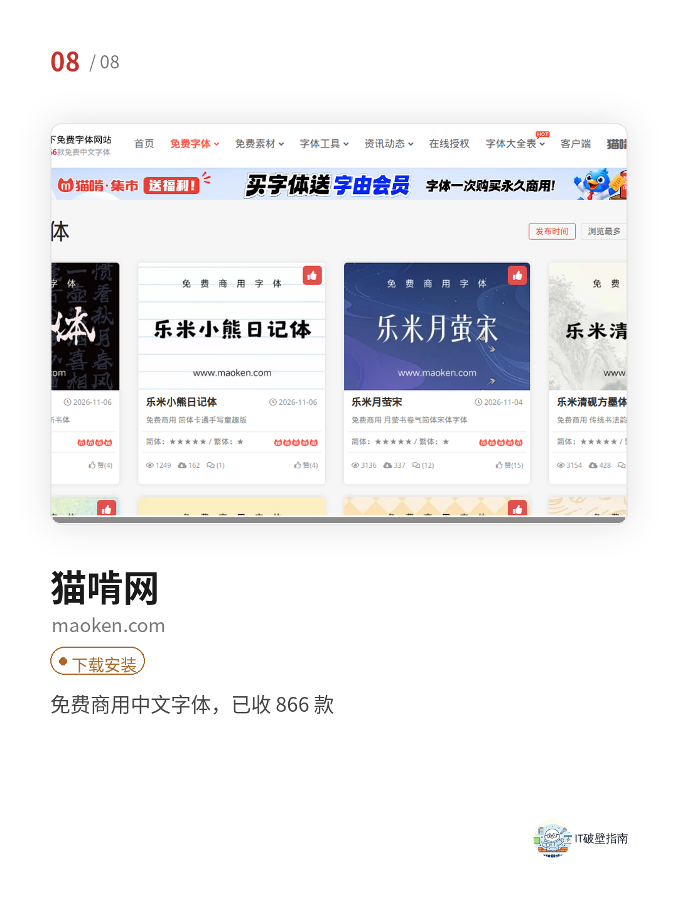

# 8个免费办公网站，前4个文件根本不上传
> 💡 备注属性未写入，可能是备注属性名称或者类型被修改了，建议将字段类型设置为 rich_text，可以在小程序-操作-修改文章数据库页面进行调整
> 原文链接:[https://mp.weixin.qq.com/s/kWfvatxBBOyKZPuaTCcZdg](https://mp.weixin.qq.com/s/kWfvatxBBOyKZPuaTCcZdg)
上周帮同事改一份 PPT 里的图。她电脑装了 PS，但不会用，折腾半小时没弄明白。我让她把图拖进浏览器，十分钟改完发回给她。
这 8 个站都是这样：打开网页就能干活，不用装软件，也不用买会员。除了最后那个字体要下载装一次，其余全在浏览器里完成。
有个区别得先说清楚。前四个在你自己的浏览器里算，文件不上传，带公司名字的表、客户名单也能放心用；后四个要联网、上传或者下载，敏感的东西别往里放。
这段区别不是我编的。我一个个打开试过，也看了它们自己写的隐私说明，才敢这么分。
---
一、Photopea
photopea.com
网页版的 Photoshop，PSD、AI、Sketch 都能直接打开。同事发来的设计稿要改个字、换个颜色，不用装 PS，也不用求人。
页面边上挂着广告条，忽略就行，功能不受限。文件在浏览器里处理，不上传。

二、Squoosh
squoosh.app
谷歌做的图片压缩，压完画质基本看不出差别。公众号配图、简历附图、PPT 里图片塞不进去的时候用它。
它也是本地压缩，图片不出你的电脑。

三、PearOCR
pearocr.com
截图和扫描件里的字，拖进去就变成能复制的文本，表格也认。做会议纪要、抄合同条款，比一个字一个字敲快得多。
免费，本地运算，图片不上传。这一条对处理内部材料的人最实用。

四、Excalidraw
excalidraw.com
手绘风格的流程图和白板。跟领导讲思路，边画边讲比翻 PPT 页快，画完导出图片贴进文档。
开源软件，完全免费，没有会员这一说。

— 上面这四个，文件都在你自己浏览器里算 —
五、PDF24
tools.pdf24.org
PDF 的活它全包：合并、拆分、压缩、转 Word、加页码、盖章。官网上写着无任何限制地免费使用所有工具，不是先免费后收费那种。
不方便上传的话，它还有离线版，装在电脑上以后连网都不用。

六、文叔叔
wenshushu.cn
发大文件用的。拖进去生成链接，对方不用注册、不用装客户端，点开就下载。免费空间 40GB，单个文件 5GB，不限速。
微信传大文件会压缩，网盘下载限速，这两个当口它能救急。不过它本来就是往外发的工具，不该传的别传。

七、草料二维码
cli.im
链接、文字、表格都能变成二维码。设备标签、会议室预约表、资料下载页，做一张贴上墙就行。
基本功能长期免费，生多少个码、扫多少次都不限。

八、猫啃网
maoken.com
免费商用中文字体库，站里已经收了866 款。做 PPT 标题、海报字体，不用再到处问这个字能不能商用。
站里混着付费字体，认准标了开源的那些，别下错。不注册也能下，走它给的网盘链接，蓝奏云那个不用登录；注册一下是直链，不限速也没广告。字体下回来装一次，之后一直能用。

---
存着吧。平时用不到，真要赶活儿的时候，比现搜省半小时。
白天在办公室，晚上写这个号。
只写自己跑通的：AI 工具、免费网站，能用的才发。
攒到能用的就写一篇。
