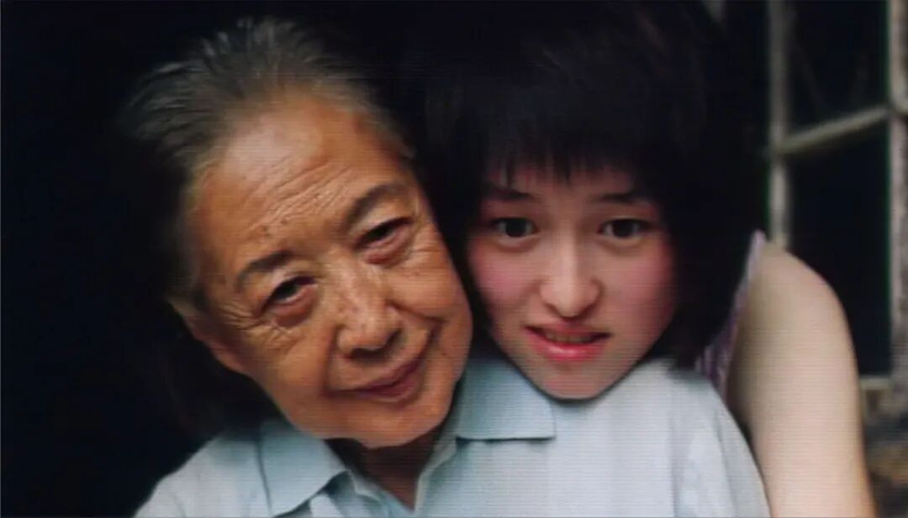

# 8部被埋没的好电影，少有人全部看过
> 💡 备注属性未写入，可能是备注属性名称或者类型被修改了，建议将字段类型设置为 rich_text，可以在小程序-操作-修改文章数据库页面进行调整
> 💡 原文链接:[https://mp.weixin.qq.com/s?__biz=MzA3ODI2MDc0Mg==&mid=2652309784&idx=1&sn=b40f099d3bb3890fffa8e9354c22a444&chksm=854783729d19f3346612315f3ff45159705fcc0bd8e3dc3ee31e01c7dd248f4c09b0a85b276e#rd](https://mp.weixin.qq.com/s?__biz=MzA3ODI2MDc0Mg%3D%3D&mid=2652309784&idx=1&sn=b40f099d3bb3890fffa8e9354c22a444&chksm=854783729d19f3346612315f3ff45159705fcc0bd8e3dc3ee31e01c7dd248f4c09b0a85b276e#rd)

文/王宇
或许是因为名气小，因为宣发的原因，或者是因为电影排期排档的因素，还或者是因为电影题材的原因，总之有一些质量非常不错的电影，其实被我们错过了。
这些电影当然不是大商业片，他们的宣发费用相对很少，又没有话题可以炒，所以真正上映的时候，没有多少人知道，到后来等人看过了，才知道这片子不错。
我要推荐的第一部电视是《我们俩》。
这部电影的节奏是我非常喜欢的，电影的内容其实很简单，算是一种家庭片，全程围绕一间老北京四合院一位孤僻老太太和一个租房的年轻女学生之间展开。 
电影用一年四季的时间为轴，拍人与人之间的那种羁绊和关系，拍人和人的斤斤计较互相嫌弃，也拍因为感情的变化，到慢慢依赖彼此温暖。
这部电影娓娓道来，安静而又真实，节奏不快，没有冲突噱头，但整个故事能在结尾瞬间引爆，一下子就击穿人心。
如果真正看懂了，就知道了陪伴与别离在我们一生中的重量。
另外一部是《无声言证》，这是一部1995年的恐怖片，虽然是恐怖片，但是里面却没有鬼，完全靠气氛窒息感，来达到恐怖的效果。
电影中的女主角是一个天生失语的道具师，意外在片场撞见一场真实谋杀。电影的设定就此展开，她亲眼见证了案发，但因为她不能说话，发不出自己的声音，而凶手却能言善辩而颠倒黑白，所以所有人都选择不信她。
什么是人性的黑暗，什么是绝境求生，这部电影拍出了深深的恐惧。
《一次别离》也是一部好电影，或许很多人听过这个电影的名字，但我相信极少有人认真地看完了。
电影讲述的是一桩普通的夫妻离婚纠纷，还有一场意外流产的事故，导演是通过这件小事，然后剖开了社会的阶层，所谓的信仰和谎言，以及人性中的多面等全部真相。
另一部不错的电影是《鳄鱼波鞋走天涯》，这部电影让我们看到什么才是最干净最纯粹的童年友谊。
这是一部几乎零热度没有任何宣传，要看到完全靠运气撞上的欧美温电影，电影讲述两个患病小孩的出逃，在这个过程发生的一些事情。
少年都是孤独的，然而当有了其他的陪伴，就有了温柔和甜美，其实这才是人最善良最美好的地方，人长大了不是变好了，其实是变复杂了，变坏了。
另外一部电影是《完美陌生人》，这部电影非常简单，也是小成本电影，电影就是围绕一个场景几张餐桌展开，讲述一群老朋友在一起聚餐，一时兴起玩了一场手机公开游戏，在场的所有人把自己所有短信电话消息全部公开。就这样，把每个人的婚姻的脆弱、友情的不堪，以及人性中的灰暗都扒了出啦。 
我还推荐两部电影《彗星来的那一夜》和《里斯本丸沉没》，也是冷门电影，大家有空可以去看看。
其实这种电影，完全是靠自己有心去搜，或者有缘去碰上，然后就需要耐心去看，不能看个一两分钟就关了，觉得没意思，如果你沉不下去看，始终是得不到自己想要的，或者他本身就不是你所追求的。
