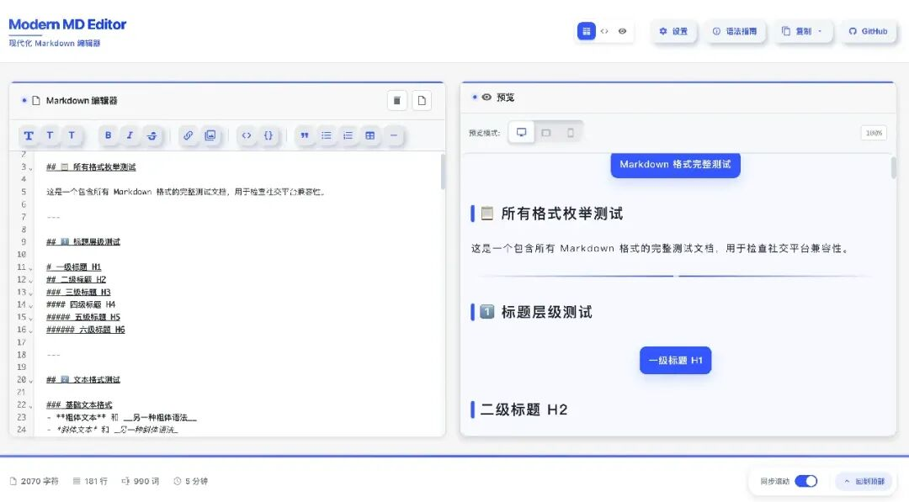
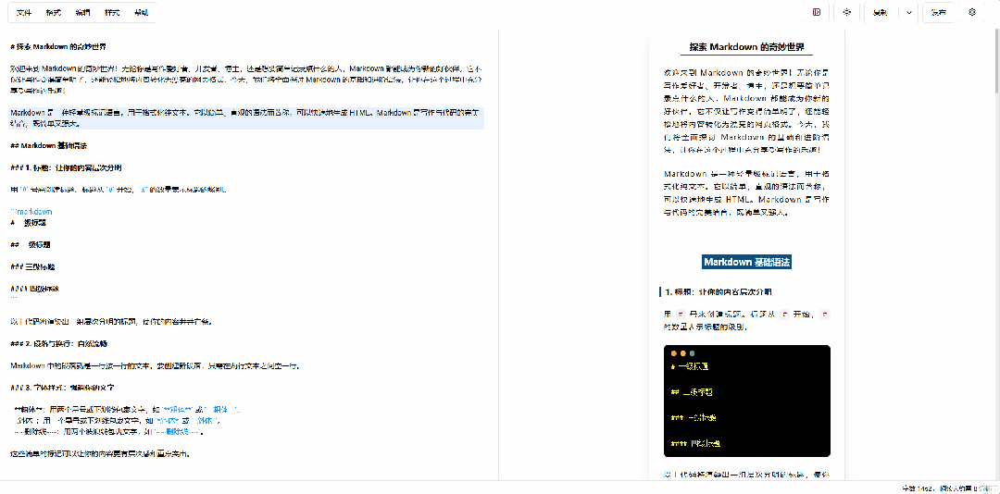
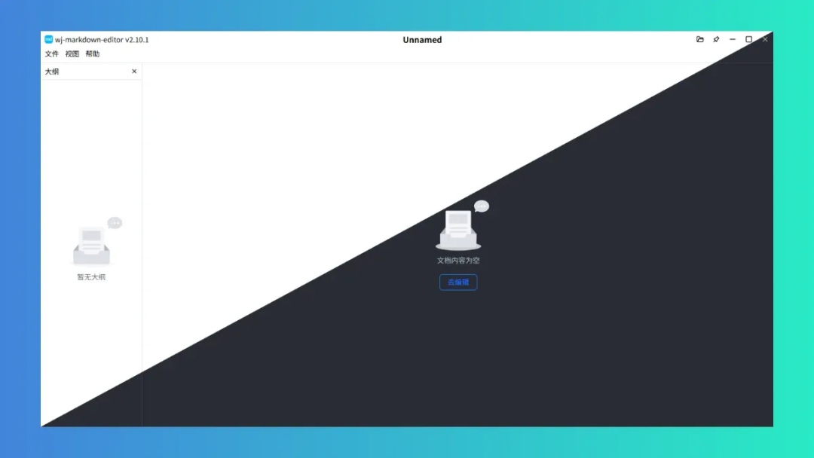
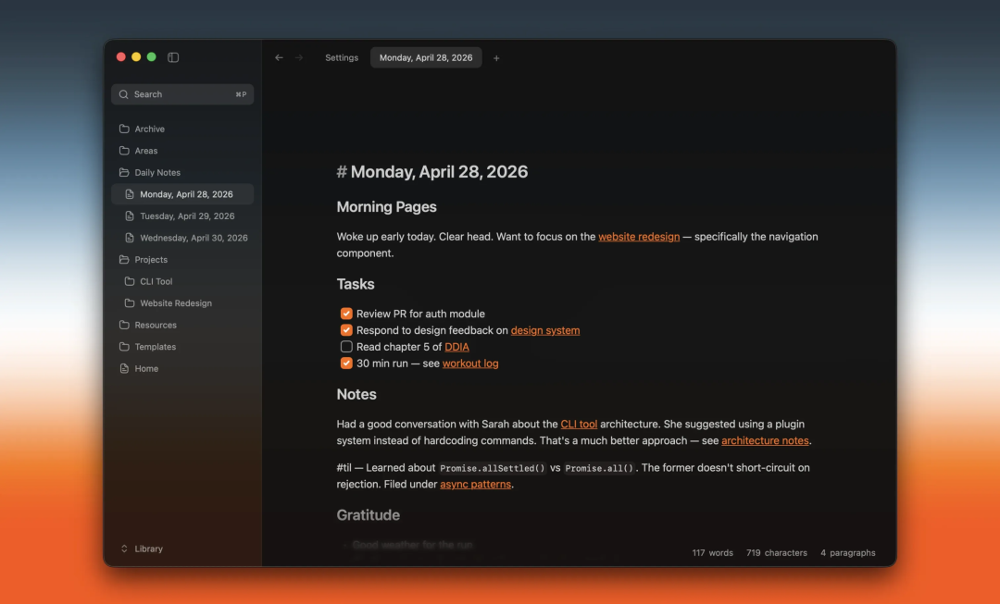
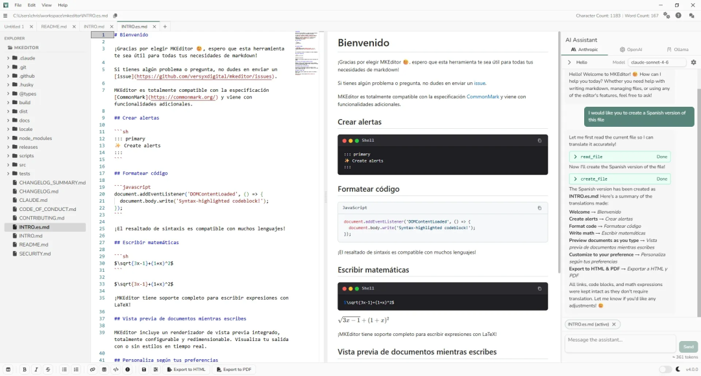

# 9 款免费开源的 Markdown 编辑器，从公众号排版到本地写作全搞定
> 💡 备注属性未写入，可能是备注属性名称或者类型被修改了，建议将字段类型设置为 rich_text，可以在小程序-操作-修改文章数据库页面进行调整
> 💡 原文链接:[https://mp.weixin.qq.com/s?__biz=MzU0NTkzODQwNg==&mid=2247485219&idx=1&sn=5255c186ca7f7925f4f69a052781080f&chksm=fab7248386843e0cce3bcad4ed6232f3932bac80f5c5a6f130b99c9af6c6325a3d85cd10618e#rd](https://mp.weixin.qq.com/s?__biz=MzU0NTkzODQwNg%3D%3D&mid=2247485219&idx=1&sn=5255c186ca7f7925f4f69a052781080f&chksm=fab7248386843e0cce3bcad4ed6232f3932bac80f5c5a6f130b99c9af6c6325a3d85cd10618e#rd)
写东西这件事，工具不该是门槛。
但一搜 Markdown 编辑器，收费的一堆，
如果你只是想要一个顺手的写作和排版工具，
免费开源的这 9 款基本够用了。
当然，付费和大厂工具在插件生态和稳定性上仍然更强，这批免费开源工具更适合需求明确、愿意自己动手折腾的人。
下面我按场景分类的说：
### 写公众号的
1、mdeditor

高颜值的社交发布编辑器，核心能力是一键复制为适配微信公众号的富文本，内联样式、字体、行高这些细节自动处理好，不用对着后台一点点调。它还支持 LaTeX 数学公式和 Mermaid 图表，能导出 PDF 和高清图片，主题、代码样式、排版系统都能自定义。
安装包下载：https://durushi.com/p/KLCPSZEU.html
2、md

更在意图床和 AI 的选这款。doocs 社区专为公众号创作者做的排版编辑器，支持 KaTeX 数学公式、Mermaid 和 PlantUML 图表，内置本地草稿管理和自动保存。图床集成了 GitHub、阿里云、腾讯云等十余种，还接入了 DeepSeek、OpenAI 等主流 AI 模型辅助创作。不想装软件可以直接用在线版 md.doocs.org，也可以 npm 安装 md-cli、或用 Docker 私有化部署。
安装包下载：https://durushi.com/p/VLPPTDVH.html
### 本地写作
1、wj-markdown-editor

Windows 和 Linux 用户先看这款。编辑、预览、导出、资源管理一体化，内置文件管理栏，图片、附件、音频、视频都能直接插入管理。编辑区和预览区精准同步滚动，配了 72 套代码高亮主题和 8 套预览主题，个性化空间够大。
安装包下载：https://durushi.com/p/PXZVBSTJ.html
2、writer-computer

macOS 和 Linux 用户的本地优先选择。文档直接存在磁盘上，自动尊重工作区的 .gitignore 规则，支持多窗口同时编辑，表格和 Mermaid 图表都能渲染。习惯用 Git 管文档的人会觉得很顺。
安装包下载：https://durushi.com/p/JHHEJSWX.html
3、simple-markdown-editor
只想要一个打开就能写的轻量工具，这款够纯粹。黑暗模式、并排编辑实时预览、语法高亮，拖进文件就能打开，导出 HTML 和 PDF。目前只有 Windows 版。
安装包下载：https://durushi.com/p/IKNKCRXG.html
### 想要有AI的
1、mkeditor

AI 驱动的免费编辑器。AI 助手可以连接 Anthropic、OpenAI 或本地 Ollama，还带工具目录，能读、编辑和创建文件，不只是聊天补全。代码高亮、LaTeX 数学公式、实时预览、导出这些基本功也都齐。有 Windows、Linux 桌面版和浏览器版可用。
安装包下载：https://durushi.com/p/LOFNKYFK.html
2、markdown-online-editor
名字普通，功能不普通。在线编辑器 Arya 基于 Vue2 和 Vditor，支持流程图、甘特图、时序图，能 PPT 预览、解析音视频，导出 PDF、PNG、Word 多种格式。粘贴 HTML 自动转回 Markdown，实时预览加本地存储，不怕丢稿子。直接打开 markdown.lovejade.cn 就能用。
项目页：https://durushi.com/p/OVISXULZ.html
### 开发者和移动端
1、tiny-markdown-editor
严格说它不是给你写作的，是给你嵌进网页的。JS 核心不到 90KB，去掉工具栏不到 80KB，同类 EasyMDE 大约 280KB。可以直接替换页面里的 textarea，还针对手机输入法和自动纠错做过优化。
项目页：https://durushi.com/p/VAFIHEZK.html
2、FlutterMarkdownEditor
在手机上写 Markdown 的选择不多，这款用 Flutter 开发，支持 Windows、Linux 和 Android，能从文件管理器直接打开 .md 文件。亮暗主题加动态颜色，双视图单视图切换，JPEG、PNG、GIF 图片预览都支持。
安装包下载页：https://durushi.com/p/GUHRTYCV.html
