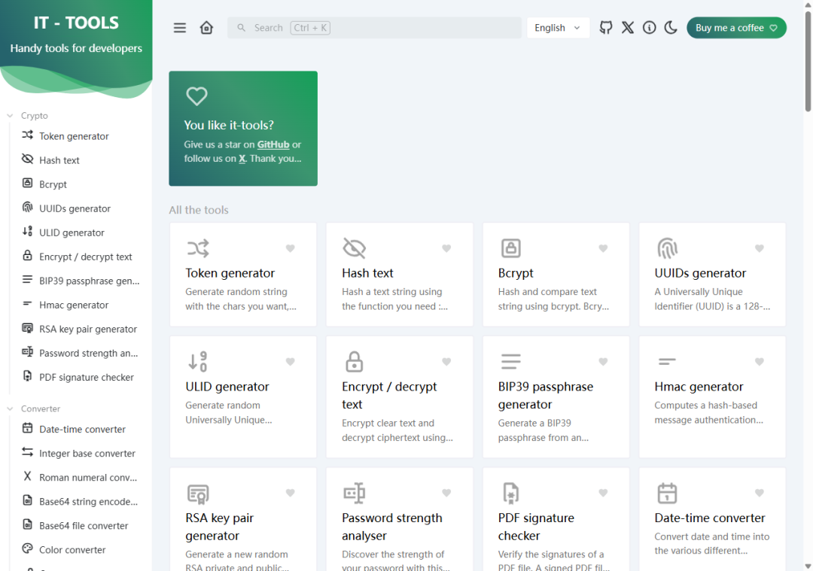

# 90 多个在线工具，塞进一个 3.9MB 的网页
> 💡 备注属性未写入，可能是备注属性名称或者类型被修改了，建议将字段类型设置为 rich_text，可以在小程序-操作-修改文章数据库页面进行调整
> 💡 原文链接:[https://mp.weixin.qq.com/s?__biz=MzcwMzQ5NTIyNQ==&mid=2247484474&idx=1&sn=1d071f33ab27369b3f49d46d7dc59a50&chksm=f555fd94c5daa22269343349fd8134b04bcd98d0a0c194ad0e114b4fa84e03ad9e6c3bbfa4ba#rd](https://mp.weixin.qq.com/s?__biz=MzcwMzQ5NTIyNQ%3D%3D&mid=2247484474&idx=1&sn=1d071f33ab27369b3f49d46d7dc59a50&chksm=f555fd94c5daa22269343349fd8134b04bcd98d0a0c194ad0e114b4fa84e03ad9e6c3bbfa4ba#rd)
昨天手头一堆杂活：json 要格式化，base64 要解，cron 表达式看不懂，时间戳要转。一样开一个网站，四个标签页，收藏夹里那排工具站眼看着又厚一层。同事看不过眼，丢过来一个链接：这些一个网页就够。
**01 · 一个网页，90 多个工具**
打开就是满屏工具格子，按类分好：编解码、格式转换、网络、文本、时间、随机数、加解密。
json 格式化带错误定位，错在哪行直接标出来。base64 编码解码一键互换，粘进去就出结果。cron 表达式填进去，解析成人话告诉你下次什么时候跑。正则测试边写边高亮匹配，时间戳转换精确到毫秒。
日常碰到的格式杂活，这里基本都有，而且全免费。

**02 · 真正值钱的是离线包**
在线版当然能用，但往第三方网站贴公司的 json 这种事，能避免就避免。数据过别人服务器，回头说不清。
它官方发离线包，3.9MB 的 zip，解压双击 index.html，全功能本地跑，数据不出浏览器。存 U 盘里带着，换台电脑照样用，没网也不影响。

**03 · 版本停在 2024 年，先把话说清楚**
release 最新是 v2024.10.22，两年没更新。作者节奏佛系，但工具类软件不追新，90 多个工具个个还能打，json 格式化和 base64 十年也不会变。
想要新功能可以去在线版提 issue，或者自己改，GPL-3.0 的代码摆在那。
**04 · 给谁用**
前端后端、运维测试，天天和数据格式打交道的人，它能给收藏夹减掉一半。纯办公场景需求它没有，它不是给行政财务准备的，是给敲键盘的人准备的。
源码在 github.com/CorentinTh/it-tools，不要钱。
拿下载地址：后台回复 **M135**，官方地址和两条下载线路都发你。
本站只做 GitHub 官方 Release 的索引，文件不存、不改。
