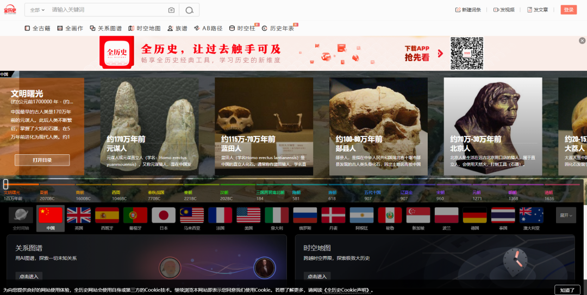
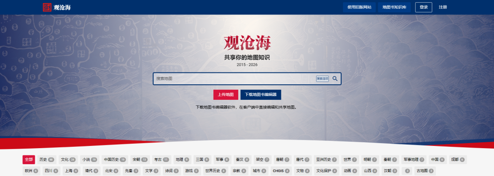
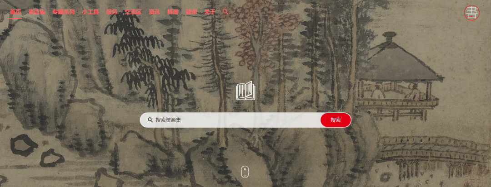
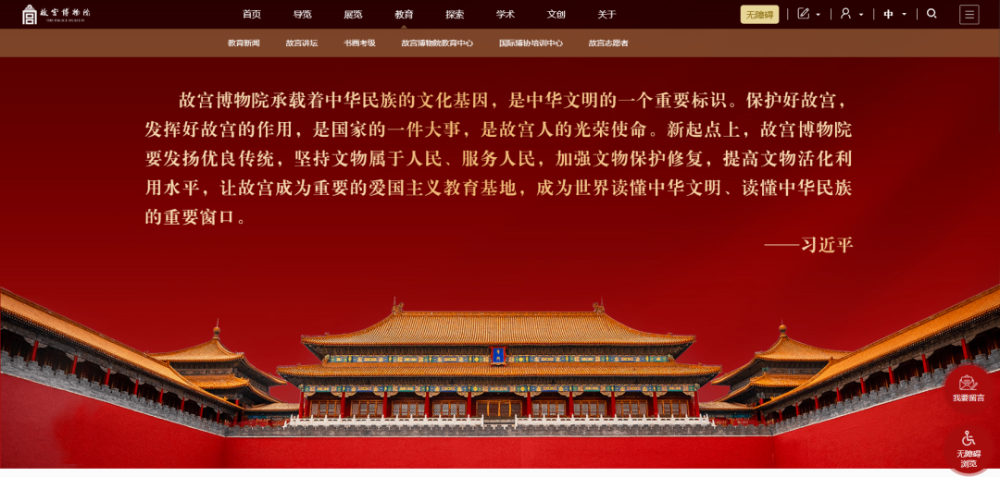
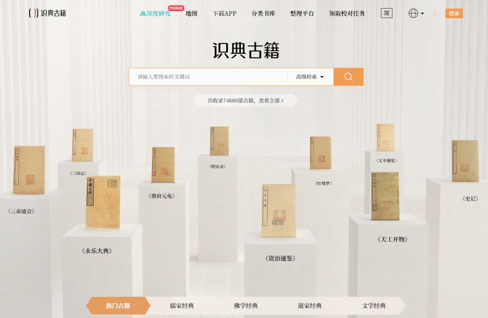
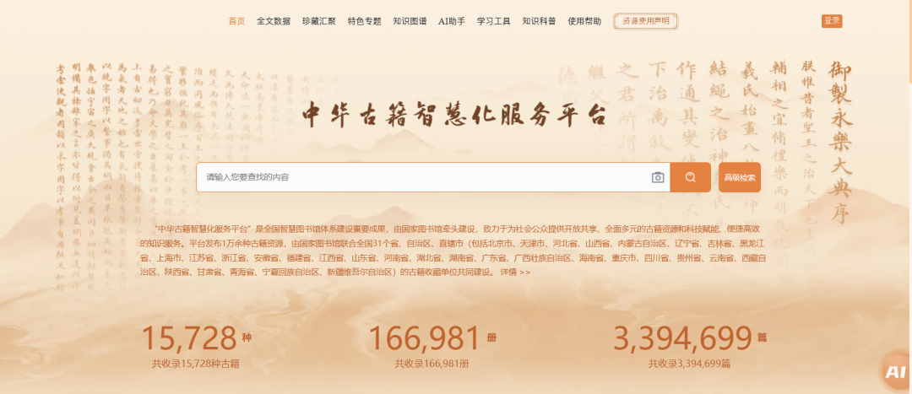
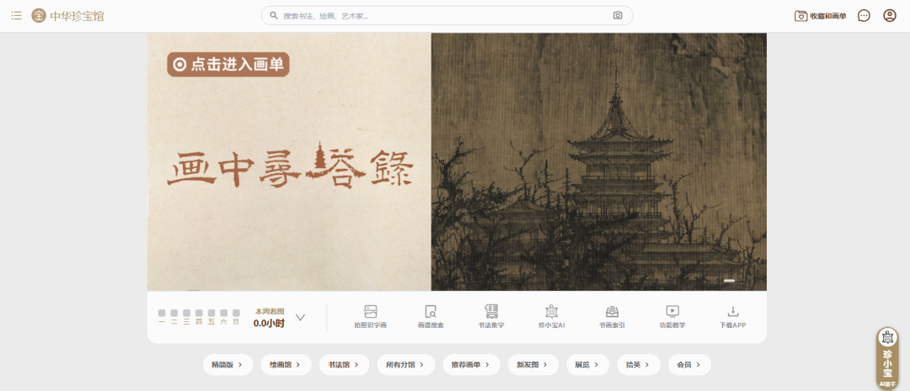
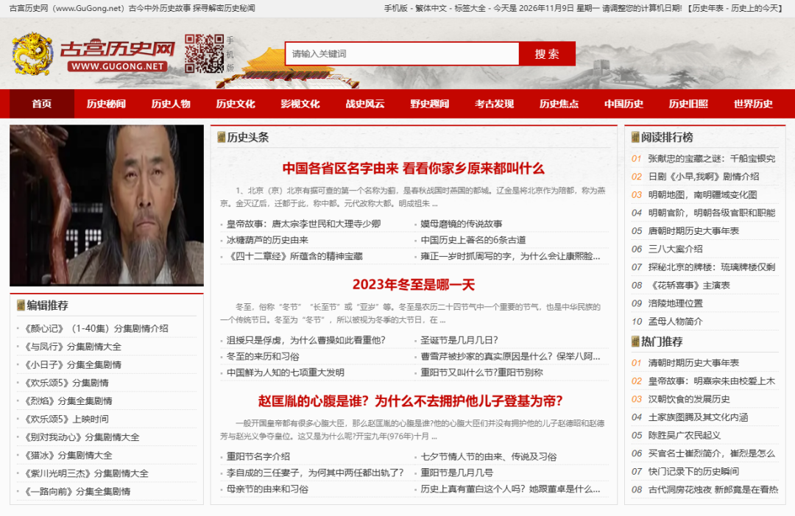
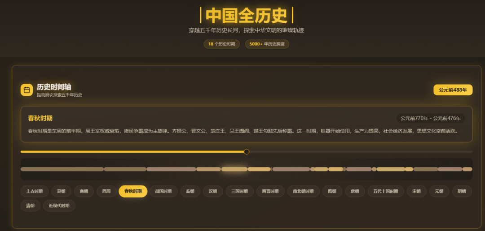

# 9个免费历史网站，带你一口气看完上下五千年
> 💡 备注属性未写入，可能是备注属性名称或者类型被修改了，建议将字段类型设置为 rich_text，可以在小程序-操作-修改文章数据库页面进行调整
> 💡 原文链接:[https://mp.weixin.qq.com/s?__biz=MzA3NDU2Njc4Nw==&mid=2652234718&idx=1&sn=19194f5af46ae35a063c684f1719ea05&chksm=854edbd5bda8b276d52b721d3d473ea917236694eb8becf592442cf492815617efd0ff01f5da#rd](https://mp.weixin.qq.com/s?__biz=MzA3NDU2Njc4Nw%3D%3D&mid=2652234718&idx=1&sn=19194f5af46ae35a063c684f1719ea05&chksm=854edbd5bda8b276d52b721d3d473ea917236694eb8becf592442cf492815617efd0ff01f5da#rd)
学历史最难受的地方，不是记不住年份，是记了也用不上。
课本上一年一年的编年，人物、事件、制度、文物全被打包成考点，考完就散。
可历史本来是连着的：一个朝代为什么起，一座城为什么偏偏建在那儿，一幅画里的衣服为什么那样穿。
下面这9个网站，全部免费，它们各管一个角度——有人管时间轴，有人管地图，有人专收古画，有人把古籍整理成能读的文本。
从头到尾刷一遍，上下五千年就串起来了。
**一、全历史**
**网址：https://www.allhistory.com/**
这是我最先想推荐的一个。
它把历史做成了一张能拖动的网：首页是国家历史时间轴，点开任意国家的任意时期，政治、经济、科技、社会、文化、军事六个面向全给你摊开。
关系图谱更好玩，输入孔子，他的师从、亲友、影响过谁，一层一层浮出来；还能用“路径”模式，输入两个看起来八竿子打不着的人，看系统怎么把他们连起来。
时空地图把地理和历史叠在一起，大航海时代、三国、春秋战国，势力、人物、事件都钉在地图上对应的位置，还能切成卫星图、地形图，顺手量个距离。全画作、全古籍这些库也在同一个入口里。
一个网站顶半个图书馆，适合从零开始搭历史框架。

**二、观沧海**
**网址：https://ageeye.app.ditushu.com/**
**这是一个专门做地图的知识共享平台。**
它的核心不是文章，是地图：古代战役怎么打的、疆域怎么变的、古道和水系怎么走的，都有人做成图挂在上面，还配着文字解说。
地图走CC协议共享，可以直接看，也能下载下来自己标注。
对空间感差的人特别有用——“为什么守住潼关就能卡住关中”这种问题，看一眼图比读三页文字快。

**三、书格**
**网址：https://www.shuge.org/**
自由开放的数字图书馆，2013年办到现在。
挑书的标准很讲究：艺术类、影像类、珍稀类、刊印水平高的优先，宋刻本、永乐大典零本、古代木刻画、中医典籍都单独做了专题。
新版发了764套精选资源，旧版还有约1500套，按经史子集排着，绘画、书法、稿钞本、碑拓、舆图各有分类。
高清影像直接下载，全部走CC授权。首页那张背景图也能下，一期换一幅，质量高得离谱。

**四、故宫博物院**
**网址：https://www.dpm.org.cn/**
很多人只知道它能订票，其实官网“探索”那一栏里藏着数字文物库、名画记、数字多宝阁和全景故宫。
藏品总目挂着186万多件/套，瓷器、玉器、书画、织绣都能按类别翻，放大看细节。
名画记把书画长卷一段一段拆开，比在展厅隔着玻璃看强；全景故宫可以一间殿一间殿地走。
不用买票不用排队，适合先在网上认个门，再决定去不去现场。

**五、识典古籍**
**网址：https://www.shidianguji.com/**
北京大学和字节跳动合作做的古籍平台，2022年上线，现在免费开放的古籍已有几万部。
它的好处是“能读”：影印原文旁边配整理好的文本，自动标点、简繁体转换、图文对照都有，遇到看不懂的一句，点一下问AI，翻译、出处、相关段落一起给你。
想查某个词在哪本书里出现过，分词检索比翻目录快得多。爱读古文又常被竖排无标点劝退的，从这个入口进去最省力。

**六、中华古籍智慧化服务平台**
**网址：https://guji.nlc.cn/**
国家图书馆牵头，联合全国31个省区市的古籍收藏单位一起建，一万多种、十多万册，经史子集都齐。
它的工具比一般平台多：竖版阅读、注疏展示、在线词典、纪年转换、版本比对，做考据的人用得着。专题也编得好看，《古籍里的黄河》《山海经》《百部经典》都是把散在各处的材料重新串过的。
不注册就能看全部资源，只有做笔记、加书签才需要账号。

**七、中华珍宝馆**
**网址：https://g2.ltfc.net/**
看中国书画的地方，绘画馆、书法馆分开，另有若干分馆。
分辨率是真高，一张手卷能一直放大到看清绢纹和笔锋，题跋、印章都在。
它还有AI书画索引，搜个题材或者输入一位艺术家，相关作品成串出来；喜欢某种字体的，能把字帖里的字提出来看结构。
作品可以下载，找配图、做课件、临摹都用得上，比在搜索结果里翻图强。

**八、古宫历史网**
**网址：https://www.gugong.net/**
偏故事性的一站。
中国历史按朝代排到明清，世界历史按洲分，另外有历史秘闻、野史趣闻、历史人物、战史风云、考古发现、历史旧照几个栏目。
长处是“随手翻”：等车、睡前想看两段轶事，这儿量大、更新勤，不少冷门人物和老照片只有这类站点会整理。
需要提醒一句，它属于公益性站点，文章一部分来自网络整理，考据的严谨度比不上前面几个官方平台，看到关键结论最好再核一遍，当消遣读物用最合适。

**九、中国全历史**
**网址：https://app-7z8motkjdrlt.appmiaoda.com/**
九个里面体量最小的一个，网页小应用，打开就能顺着时间轴把中国历史从上古翻到现代，每个时代给一段文明脉络的概述。
不用下载、不用注册，手机浏览器直接开，适合给孩子做第一遍启蒙，或者自己吃饭时刷两眼找感觉。
内容停在概览级别，真要深挖还得回前面几个。

**写在最后**
不用九个全收，挑两三个先用起来，剩下的存进收藏夹，等哪天真需要了再翻。收藏夹的意义本来就在这儿。
这些学习网站真正值钱的地方，是把“历史”从要背的年份里拽了出来，变成能看、能放大、能自己走一遍的东西。孩子问“唐朝到底什么样”的时候，你手里有东西可以给他看，比讲十遍道理管用。
要是这篇对你有用，点个赞，再转发给家里有学生的、当历史老师的、爱逛博物馆的朋友。
免费的好东西留在自己收藏夹里，只能帮到你一个人，转出去才真的有人用上。也欢迎在评论区留下你私藏的历史网站，攒够了我整理第二期。
**您可能还喜欢：**
[这10个优质英语学习网站，竟然全免费!(亲测可用,附中文指南)](https://mp.weixin.qq.com/s?__biz=MzA3NDU2Njc4Nw%3D%3D&mid=2652234672&idx=1&sn=b81b0c71bd6aa1830881496bef47abf0&scene=21#wechat_redirect)
[比B站还好用的6个学习网站，知道的人还不多！](https://mp.weixin.qq.com/s?__biz=MzA3NDU2Njc4Nw%3D%3D&mid=2652234621&idx=1&sn=51cc13f0d08259978ec9142b01eaa2ba&scene=21#wechat_redirect)
[收藏！10个语文学习网站，我用了3年才攒齐](https://mp.weixin.qq.com/s?__biz=MzA3NDU2Njc4Nw%3D%3D&mid=2652234557&idx=1&sn=fa7b715b30f0c87124a3808e52f892b9&scene=21#wechat_redirect)
#历史 #学习网站 #免费网站 #历史学习 #古籍
