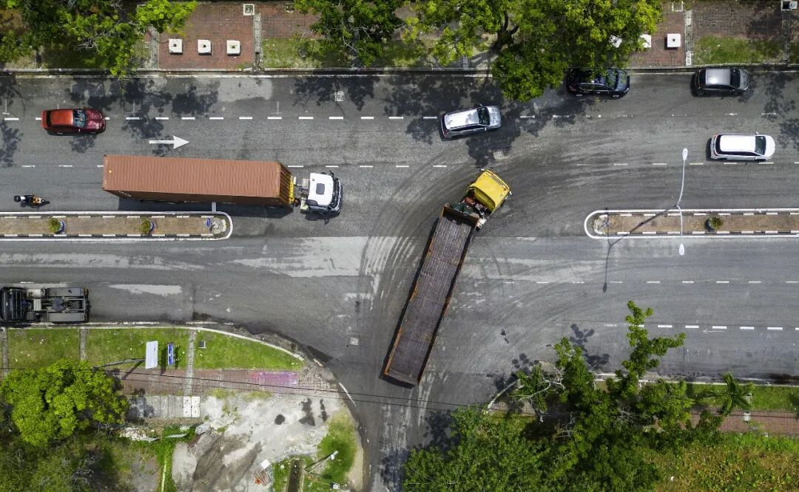
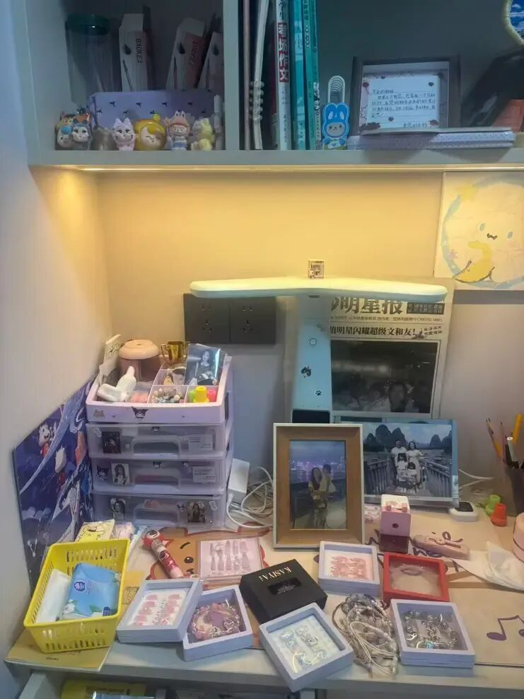
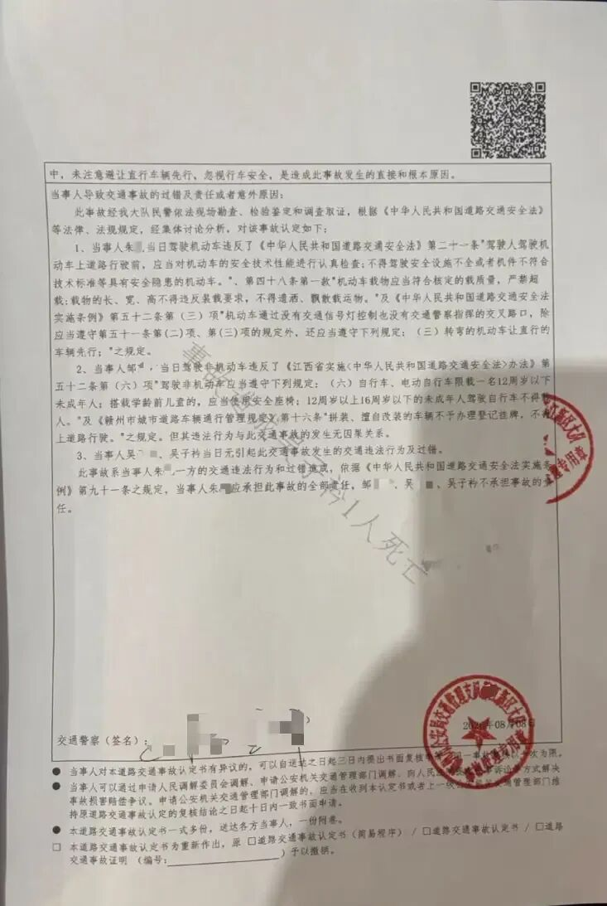
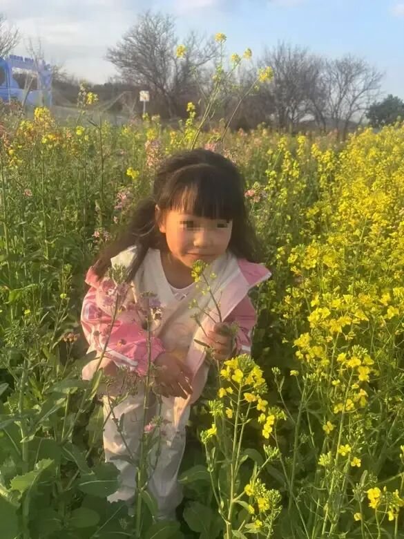
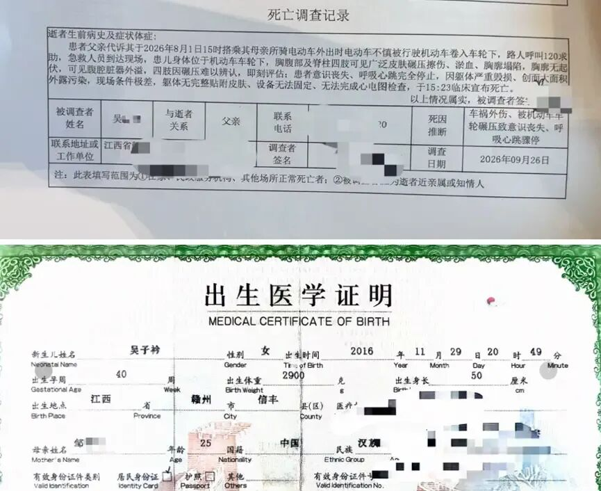
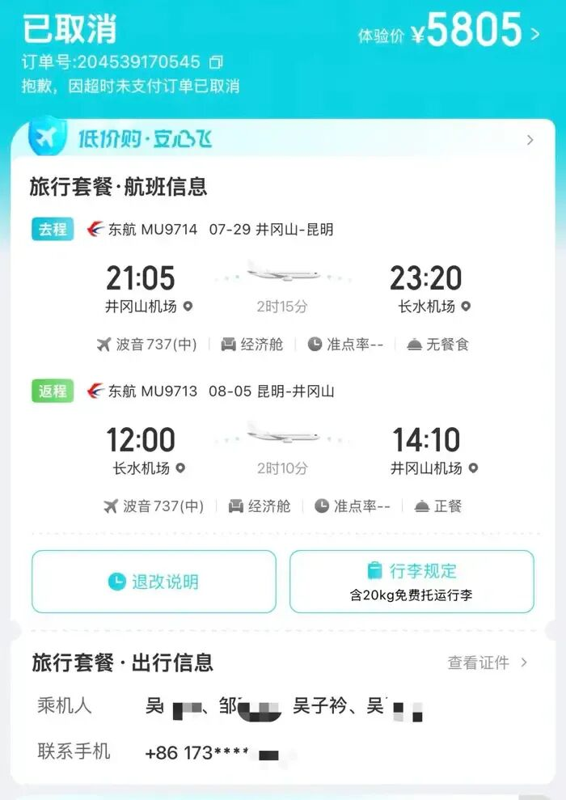
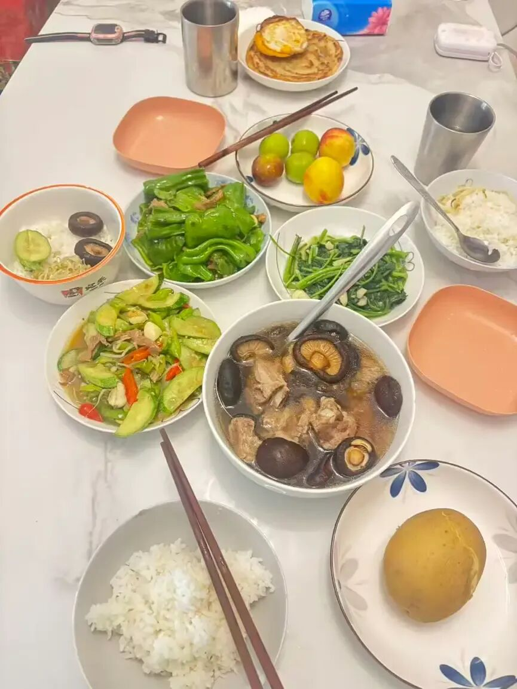
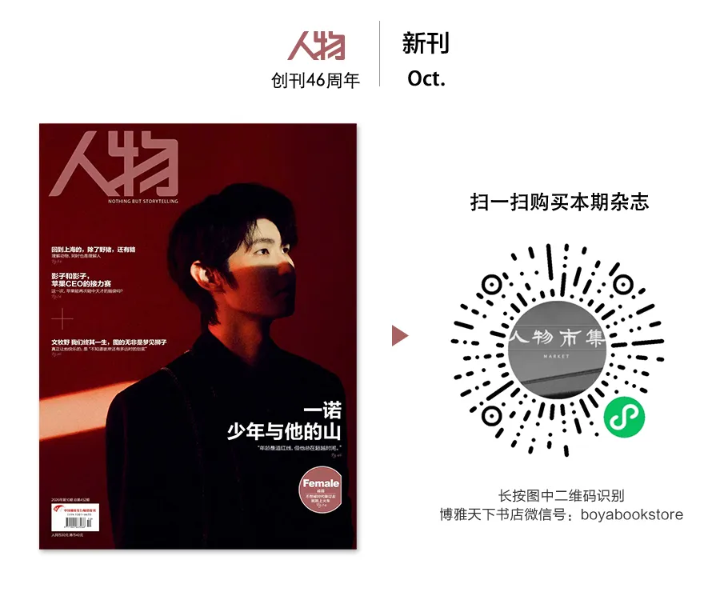

# 9岁女儿车祸离世后，他在路口追踪违法货车
> 💡 备注属性未写入，可能是备注属性名称或者类型被修改了，建议将字段类型设置为 rich_text，可以在小程序-操作-修改文章数据库页面进行调整
> 💡 原文链接:[https://mp.weixin.qq.com/s?__biz=MjEwMzA5NTcyMQ==&mid=2653258286&idx=1&sn=96dde7c320ea65a7857b60e002de0878&chksm=4f20e38250065306cd54ca1e26be0e96c3d58608b71ad860971033ca6e1fe267c7ee6b87ff19#rd](https://mp.weixin.qq.com/s?__biz=MjEwMzA5NTcyMQ%3D%3D&mid=2653258286&idx=1&sn=96dde7c320ea65a7857b60e002de0878&chksm=4f20e38250065306cd54ca1e26be0e96c3d58608b71ad860971033ca6e1fe267c7ee6b87ff19#rd)

3个月前，吴志胜的大女儿倒在了一辆渣土车下。事故发生在「普通的一天」，事发路口离家1.5公里，是一家人出游的必经之路。
3年前，为了女儿上小学，这家人花光积蓄从县城搬到赣州市区。女儿的遗体还在殡仪馆，家里布置一切没变。为了讨要公道，36岁的吴志胜开始追踪路上违法的货车，拍下20多辆货车的违法行为，包括闯红灯、逆行、超载等。
事故路口早已恢复如常，他和家人却卡在那里，靠行动短暂「忘记」现实。
**文｜**罗晓兰
**编辑｜**王之言
**本文来源公众号极昼工作室（media-fox）**
**气味**
江西赣州，蓉江新区平安大道与荷花路交叉口。
这是吴志胜家往返市中心的必经之路。整个8月，他都会刻意避开这个路口。有次打车回家，没注意路线，距离路口还有一两百米，他闭上了眼睛，「脑子是空白的」。
车祸发生后的那一周，吴志胜一直睡在医院陪护受伤的妻子和5岁的小女儿，不敢回家。附近的亲戚邀请他到自家住，他想，还是要迈出这一步，独自回了自己家。
打开门，家里很安静。吴志胜在客厅转了一圈，看到大女儿子衿平时喝水的杯子，吃饭的碗，写作业的文具，小玩具捏捏。往沙发上扫一眼，放着一套子衿的睡衣，蓝白色短款，印着她喜欢的卡通人物Kuromi。
这肯定是子衿8月1日当天换下来的，吴志胜「扑上去」，抱在怀里闻，「大口地、拼尽全力地呼吸」。上面有独属于女儿的气味，他描述不出来，但闻了近10年，他很熟悉。此刻，这种气味让他身体抽搐。
这套睡衣再没洗过。为了更久地保存气味，吴志胜把它放进衣柜。另一个还保留女儿味道的物品，是她洗澡的拖鞋。有次他也拿起来闻。
那些天，吴志胜不敢看子衿的照片。他和妻子的手机里，存着几万张这个女孩的照片——她今年9岁，瘦高，拍照时喜欢摆出舞蹈姿势，大眼睛直视镜头，含着笑，脸上酒窝浅卧。照片没有温度，也没有气味。
事故现场的照片和视频，吴志胜至今不敢细看。这些女儿最后的影像，是路人和外卖小哥在抖音上给他发来的，他转存在微信聊天记录里，再一键转发给媒体，不会点开。
8月1日，周六，晴天。放暑假的子衿和妈妈、妹妹在家，吴志胜做生意，照常上班。下午3点05分左右，他接到妻子打来的视频电话，接通后，屏幕里出现一双充满恐惧和泪水的眼睛。妻子说，你赶紧过来，在摩天轮这里。
吴志胜匆忙骑电动车出发，走到一半，想起忘了问具体位置。打过去微信，得知在平安大道与荷花路交叉口。他追问了一句，「两个小孩怎么样？」那头说，「子衿已经没有了。」
一路上他都在想，大女儿可能被小车撞了，可能只是昏迷不醒，拉到医院还能抢救。哪怕是成了植物人，至少还能够触碰到她的肌肤，闻到她的气味，他后来说。
子衿这个名字，是他和妻子翻遍《诗经》和字典，在好几个备选中挑选出的。名字的寄托在后一句诗句，「悠悠我心」。子衿第一次开口说话，喊的是「爸爸」。
两三分钟后，吴志胜到了现场。子衿倒在一辆渣土车后轮下，车身大概有两个成年人叠起来那么高，她的胸部以下遭碾压，四肢难以辨认。吴志胜不忍心再看第二眼。
遗体被运到殡仪馆，一直没处理。留个念想，起码还能看见她，虽然他从不敢去看。他总忍不住幻想，会不会像神话故事一样，有天他一觉醒来，子衿就站在床前，喊「爸爸，起床了」。
家里的一切布置都没改变。子衿吃饭的位置留着，她的房间也如往常。书桌上，三年级下册的数学习题空白着，四年级上册英语字帖提前写完了，字母工整，没有一个超出横线。《安徒生童话》折痕在97页，《卖火柴的小女孩》。她还没看完。

子衿的房间一角讲述者供图
但睡衣放在衣柜里，气味仍在消散。
8月1日下午，路口很快聚起了人。吴志胜看着妻子和小女儿被抬上救护车担架，消防人员把大女儿从车轮底下挪出来。不知是谁把渣土车开走，去称重了。
回忆起来，吴志胜说他做不了任何事情，傻傻地站着。担心他承受不了，工作人员喊他上警车坐着。透过车窗，他看到交警在测量现场痕迹，刚结束，殡仪馆把女儿的遗体装袋，带走了。
几分钟后，来了一台洒水车，吴志胜看着它，把血迹等痕迹全部冲洗干净。现场解除封锁，恢复了交通。事故发生一个小时后，吴志胜看到路口又热闹起来，家长骑电动车载孩子去附近游乐场玩，又一辆拉水泥的渣土车驶过。「好像一切没有发生过一样。伤口被刀切开来，立马又缝回去了。」

事故现场视频截图
**路口**
在赣南大道的一个十字路口，红灯，吴志胜刚踩下刹车，一台绿色搅拌车「唰」地从右侧直直蹿出去。这条路他走过，以前没怎么留意过这些大车。
还有两个红绿灯就到医院了，吴志胜没停下，跟着搅拌车又走了几公里，直到抵达搅拌站。这一路，他们驶过了六七个路口，吴志胜的行车记录仪拍下那辆搅拌车闯了3次红灯。他把线索上报给交警，很快收到了处罚反馈。
这是9月2日，距离女儿的事故已经过去1个月。吴志胜不时打开小天才电话手表App，翻看和子衿的聊天记录。子衿连着两年发来父亲节祝福，在电子贺卡里夸他是顶天立地的「避风港口」，有爸爸在身边，「我总是安全感爆棚」。吴志胜无法再忍受自己站在那个路口，却什么都做不了。

吴志胜收到的事故认定书讲述者供图
由当地交警部门出具的道路交通事故认定书写道，当事人（货车驾驶员）当日驾驶严重超载且机件不符合安全技术标准的机动车行驶至事发路口时，在右转弯过程中，未注意避让直行车辆先行……「应承担此事故的全部责任」。
在描述货车违法行为的时候，吴志胜使用了四次「痛恨」这样的字眼，他愤怒的对象也从肇事车辆蔓延到所有违法大车身上。
吴志胜开始追踪大车，货车、工程车、搅拌车、垃圾车……只要是拿B照（B2驾驶证）的，他都留心记录，哪怕只是出去吃饭、散步的工夫。他至今拍下过20多辆货车的违法行为，包括闯红灯、逆行、车牌污染、违规拉货、超载等。有时，他蹲守在路口，10分钟内拍下3辆大车闯红灯。
他开始熟悉货车的分类、设计，一眼识别出是否超载——货物跟车厢基本持平，货物堆满再盖上布等等，都是超载。如果车厢经过改装加高，盖上雨棚，更值得怀疑。
吴志胜停下了手头所有事，把这当成「一种工作」。忙起来，能让他短暂地「忘记」丧女之痛。
事故认定书写道，涉案重型自卸货车载有货物，核定总质量 25000KG，实际总质量48159KG。这些数字，吴志胜看得烂熟。他计算过，货车超载92%，大女儿子衿48斤，压在她身上的重量，是她体重的2000倍。
他想起子衿怕疼，被蚊子咬一口，都要找他撒娇。她从小骨头柔软，经常性脱臼，3岁就学跳绳和中国舞，是学校的啦啦操和舞蹈领队，在赣超赛场上表演。7月底，她刚通过中国舞5级考试。
除了大车，路口是吴志胜的另一个关注点。尤其是学校、游乐场附近，人群密集的地方。有天晚上，他路过赣南师范大学附近，看到一台渣土车右转没停，差点撞上直行的电动车。拐弯处，右转标记上面悬挂着红色的「停」字。根据当地交通法规，大型车辆「右转必停」。
这里和事故路口相似，车辆都需要从主干道转入支路。那晚，吴志胜守了40分钟，拍下6辆大车右转都没停车礼让。这里离师大一两百米。这个父亲曾设想过，子衿高考就奔着家门口的这两所大学，另一所医科大学他站在阳台上就能看见学校，「以后你天天回家吃饭」，子衿听了很高兴。
在事发当天，那辆肇事的渣土车在路口右转，本要驶向一处工地。吴志胜估算，这里距离渣土车的目的地——一个正在修建的小区，仅剩200米左右。距离他家大约1.5公里，骑电动车最快三四分钟。
吴志胜36岁，妻子小一岁，夫妻俩都来自赣州乡下。3年前，为了子衿上小学，一家人从县城搬到市区。新家在蓉江新区，夫妻俩看中了小区附近从幼儿园到大学一应俱全的教育资源，环境绿化好，还有摩天轮、冰雪世界，适合孩子游玩。妻子还在县城乡镇小学当数学老师，每天开车往返160公里。那时，他们没注意，新区仍在建设，附近一两公里有几处工地。
这个小家花光了所有积蓄。100平方的新家，120多万，又添30万花了两年装修。夫妻俩「富养女儿」，想把自己童年的遗憾都弥补在孩子身上。子衿有自己的房间，桌上摆着拉布布盲盒、女明星的贴纸，以及各地旅游的合影和纪念品。
7月31日，事发前一天，一家人在景德镇旅游，吴志胜给了两个女儿各200块钱，「随便买」。子衿是小财迷，不舍得花，她看中一个淡绿色的玉手镯，嫌30块不划算，一路找同款，其他家却要50、80块，她兜了一大圈，又回到第一家店买。最后，这200块也没花完，一家人回到赣州已是傍晚。
9月4日，律师提出要看看事发路口的情况，吴志胜「有点不敢去」，但想到对案件有帮助，答应了。
和8月1日一样，这天也是晴天，吴志胜第一次回到路口。律师拍下的一段视频记录了吴志胜当时的状态，他远远看着，下意识抿紧了嘴。走到路口，律师不断询问，还原当天的场景，吴志胜感觉「跟电影一样在回放」。他看着马路上的沥青，心想，子衿就是倒在这个位置。他仔细搜寻，连路边的绿化带都没看到一点碎片。事故的痕迹都消失了。
调查组认定，本案属于一般生产经营性道路交通责任事故，肇事司机因涉嫌交通肇事罪，已经移送法院。吴志胜想以重大责任事故罪，再追究司机及货车所属企业的负责人。警方不予立案，他多次申请复核，都维持原决定。他不再逃避回看子衿的照片，频繁发抖音，还打印出子衿的遗照。他自费几千块，去西安接受一家媒体的采访。他成了这个家中第一个往前走的人。
在西安酒店的最后一晚，他第一次梦见子衿，即使短暂得仿佛只有短短几秒。事情有了进展，他感到压力有所纾解，终于可以面对女儿了。此后每晚，他都能梦到和以往一样的日常相处片段。
白天的他，开始羡慕晚上的自己。

子衿生前旧照讲述者供图
**止痛药和安眠药**
电话响了，是娘家的老人。邹玲接通，对面第一句话就问：「志胜对你好不好？」邹玲流下了眼泪。
老人担心孙女婿埋怨孙女，甚至抛弃她。邹玲说，这件事后，丈夫没有怪过她一个字，这让她更加愧疚和自责。
一个无法回避的事实是，8月1日，是邹玲骑的电动车。小女儿坐在前座，被邹玲夹在腿间，大女儿子衿坐在后座。
离家五六分钟，她们来到了那个路口。邹玲回忆，她们在非机动车道正常直行，一辆渣土车突然转过来，她本能向右避让，子衿被甩了出去。她眼前一黑，一两秒后反应过来时，她和小女儿被电动车压着，子衿已经倒在轮胎下。她爬过去，一直喊「大宝」。
每逢周末和节假日，这家人出游都会经过这个路口。去万象城逛商场，看电影。春天去中央公园露营，夏天赏荷花，秋天看银杏叶。去方特乐园也要从此路过，孩子爱玩，连续办了3年的年卡。
去离家近的地方，夫妻俩各骑一辆电动车，各载一个女儿。子衿爱吃醋，每次都想霸占妈妈的后座，让她跟妹妹轮着来，她耍脾气：「凭什么？」需要爸妈哄，她还要爸爸发红包，依据气性大小定金额，大到70元，小到1.5元。邹玲感觉子衿性格敏感，有些固执，她更关注子衿。生二胎住院，坐月子，都是子衿陪她，晚上和她一起睡。
事故后，邹玲受伤住院，想过自杀。但生与死都是难题，子衿和小女儿只能选择陪一个。作为母亲能抓住的，只有子衿留下的痕迹。子衿刚学了一年的作文，越写越长，字迹也肉眼可见地越发端正。邹玲几乎每篇都拍下保存，她反复看那篇《爱唠叨的妈妈》，当时子衿写好，她看完就笑了，结尾让她欣慰：「我觉得妈妈唠叨是对我的爱。」
中秋节，邹玲时隔56天第一次回家。进了门，她忍不住走向子衿的房间，看见遗像，抱着哭了。「彩色的照片她还有灵动的感觉，黑白照就代表她真的死掉了。」她把遗像倒扣起来，收进收纳盒里，放在不常用的飘窗上。书桌上仍摆着子衿彩色的照片。
死亡调查记录、遗体处理通知书都是黑白的。她翻出了子衿的出生证，绿色，带花纹，子衿的信息下面紧跟着她这个母亲的。

子衿的死亡调查记录和出生证讲述者供图
装修新房时，子衿的房间参照了她自己的意见，刷成了粉色。平时上学，长马尾上她最喜欢别深红色蝴蝶结。子衿爱美，是「颜值控」，邹玲每次做饭会讲究摆盘，颜色搭配。暑假，一家人拍了全家福，子衿第一次拍写真，大唐古风，她穿了全身粉，裙子上绣着小花。母女俩约定，明年暑假去体验美甲。子衿收集了一抽屉的美甲和手链、项链，多是她喜欢的粉色和紫色。
住院以来，邹玲婉拒了所有朋友的探视，也不跟身边人倾诉。安慰会再次提醒女儿的离去。她的朋友都认识子衿，「子衿在他们那里会更加具象化，更加深刻」，她想保留子衿和他们之间的记忆，鲜活的、有颜色的，不被现实覆盖。

子衿（左一）和家人的全家福讲述者供图
事故造成邹玲左脚撕脱性骨折、皮肤脱套伤，骨裂之余，皮全部撕裂，「骨肉分离」。8月第一次手术后，她连着高烧几天几夜，到40度，出现幻觉，看到子衿在床边，喊她「妈妈」。邹玲嘴里应着，伸手去摸，发现什么都没有。
打针吃药都无效，医生怀疑是邹玲的身体对药水产生抵抗，将止痛药、消炎药都停了，她才退烧。疼痛无法再被药物掩盖，她只能硬扛。
9月，邹玲连着做了清创和植皮手术，这回插的是止痛泵。身体又有了反应，头晕，呕吐，只能再次停掉。邹玲有时晚上睡着，感觉左腿疼得不受控制，猛地抽动一下。
出事以来，邹玲说要靠安眠药才勉强入睡。愧疚感来自于一个母亲的本能，「我给了她生命，但是我没有保护好她」。
但子衿从没出现在梦里，她觉得是安眠药麻痹了思想，将药片从一颗减到半颗。丈夫在往前走，她也要站起来了。她开始每天发好几条抖音，都是子衿的旧照和视频，「这是我跟子衿唯一的情感联络点」。
10月20日，她决定停掉安眠药。次日凌晨，她迷糊了个把小时，终于梦见了子衿。梦里一家四口坐在床上，突然出现两条大蛇，更大的一条爬向子衿，她和丈夫慌忙想办法弄走蛇。下一个场景，一家人到了户外，一群恶犬扑向子衿，夫妻俩又一直尝试引开。直到醒来，保护女儿都停留在驱赶的动作上。她没梦见最终是否成功了。
**「普通的一天」**
今年7月，一家人原本计划去云南玩。先抵达昆明，再到丽江和大理，子衿看了网上的照片，很期待洱海和泸沽湖。之前旅游都是自驾或坐高铁，马上要第一次坐飞机了，子衿很兴奋，缠着吴志胜问：坐飞机什么感觉？飞机那么重为什么能飞起来？飞在天上会不会掉下来？
在网上提交了机票订单，到付款环节，吴志胜取消了。他们计划转道井冈山去昆明，但只有一趟深夜的航班，小女儿还小，拖家带口又这么多行李，终究不方便。最后改成省内游，7月31日回家。子衿闹了很久，一直说爸爸是骗子。
如果去云南，按规划的时间，他们7月29日去，8月5日返程。

一家人去云南的机票取消了订单讲述者供图
这个中年男人大专毕业，先在南昌打拼了一两年，此后一直在赣州做生意，白手起家，买了奔驰和奥迪。相比妻子的严格，他更关心女儿开不开心，暑假去哪里玩。他一有时间就陪孩子，微微发福的脸上笑嘻嘻的。妻子在镇上加班回不来，也是他做饭。寻常日子，没太大抱负，孩子能读就读，「读不进去就多吃点饭」。
几个月以来，吴志胜在豆包自学了有关货车和法律的知识，还让它帮忙拟好起诉书。以前，子衿经常拿他的手机跟豆包聊天。事发大概一两天后，他跟豆包说，以前天天跟你聊天的小女孩吴子衿、我的女儿，8月1号在一场惨烈的交通事故中去世了。豆包回复他，你别伤心，我记得吴子衿，她是个爱跳舞的女孩。
还有「人」记得子衿。他看了子衿和豆包的所有聊天记录，有时子衿调皮，发语音让豆包猜猜她是谁，或让豆包给她的粉色床上P一头猪。吴志胜询问关于女儿的一切，从名字、性别、学校、年级再到喜欢的明星和卡通人物，豆包全答对了。「子衿多少岁了？」
「今年她9岁了，马上（11月）她就要到生日了。」
他让豆包计算出了子衿在世的时间：9年8个月1天15时15分29秒。他曾从交警部门提供的监控里，看到了子衿倒下去的确切时间，8月1日15:04:29。
问了太多案件的细节，吴志胜害怕影响了他这段时间唯一的「工作」，9月初的一天他「脑子一热」，卸载了豆包。他以为只是清理聊天记录。当天他重新安装，发现无论再问什么，豆包都没有了关于子衿的记忆，回答不了了。
这些纷乱而反复的心理，他没有和妻子聊太多。他5岁的小女儿青青也不主动提起那场事故。
事发时，青青被邹玲护在身下，是现场最清醒的。邹玲回过神时，看到青青趴到子衿身边，不停喊：姐姐，你怎么了？此后，青青常做噩梦，在梦里抽搐哭醒。但白天，她闭口不提姐姐，看到妈妈哭，拿纸巾给妈妈擦泪，抱着妈妈。
邹玲每隔一段时间就引导青青，你想姐姐了，不要憋在心里，要告诉妈妈。青青说，好。她再问，你有没有不开心？青青说，没有。
有天，青青跟邹玲说，奶奶骗人，说姐姐去广东读书了。她记得妈妈说的是，姐姐去了天上，变成了星星。邹玲不想瞒她，小女儿也得学会接受离别。住院时，青青每天做手工，折纸船、彩扇，串珠子，画蛋糕，做完，一笔一划写下姐姐的名字。过去，是姐姐每天早上喊她起床，给她梳头，扮演老师用识字卡逐字教她认读、组词。
事故给青青留下了伤疤，她的左小腿处有个成人巴掌1/4大的疤，已经增生凸起。邹玲的更严重，或许是永久性的。她最近出了院，能拄着拐杖行走，但左脚手术后有些变形，关节活动幅度受限，以后无法久站。医生建议她过段时间去评估，「大概率会留下10级伤残」。
现在，邹玲避免在青青面前哭，情绪崩溃时就躲起来。她再没经过那个路口，她想，可能一辈子不会骑电动车了。
吴志胜时常去路口。对那里的情感，变化成了挂念。他不再绕路，路过时放慢车速，有时停下来待会儿。不出门，他也要骑车专门过去，看看四周的花草、建筑有没有变化。他感觉子衿就在那里，至少离她近一点。
10月21日傍晚，感冒失眠几天后，吴志胜再次骑上电动车，到了路口。非机动车道新增了3个减速带，法国梧桐的树叶泛黄了。

8月1日当天的午餐讲述者供图
8月1日上午，母女三人看了电视，吴志胜待在房间里。中午，邹玲做了三荤一素，有子衿爱吃的香菇和豆芽，搭配了水果和粗粮。午饭后，吴志胜照常去工作，出门前，子衿叮嘱他：爸爸你早点回来，到时候把你车上的景德镇买的陶瓷玩具带回来。
下午，子衿想去万象城做拼豆，她念叨了很久。顺路去书法班见老师，上个月她一直在准备舞蹈考级，耽误了报班。
母女三人没有午休，要出门，都洗了头。路上，子衿在后座上聊着拼豆，洗过的长发披散下来，是她喜欢的公主造型。风一吹，她的自来卷更蓬松了。邹玲在后视镜看了一眼，说你这个跟爆炸头一样。子衿听了，也探出头在镜子里看自己，笑得很开心。
邹玲说，「就是很普通的一天。」
（应讲述者要求，文中吴志胜、邹玲为化名。）
本文转载自【极昼工作室】关注查看更多故事

---
---
**亲爱的读者们，不星标《人物》公众号，不仅会收不到我们的最新推送，还会看不到我们精心挑选的封面大图！星标《人物》，不错过每一个精彩故事。希望我们像以前一样，日日相伴。**

