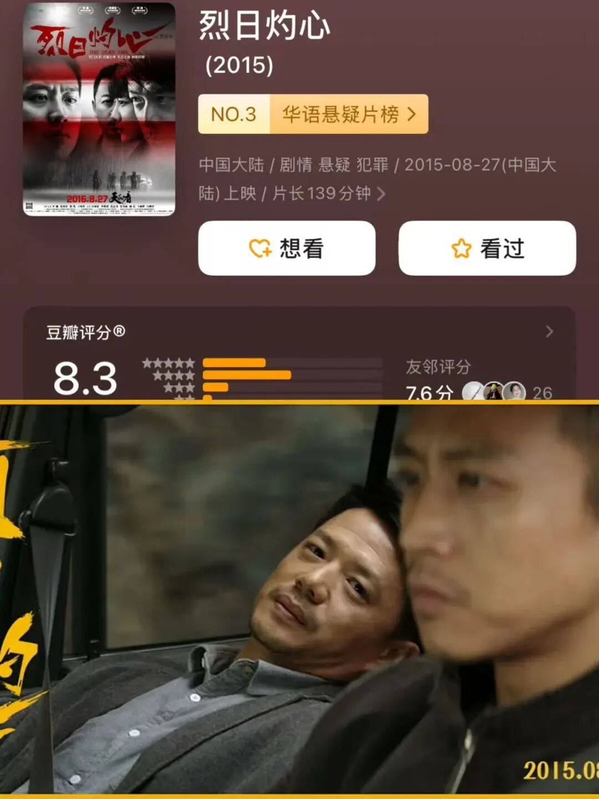
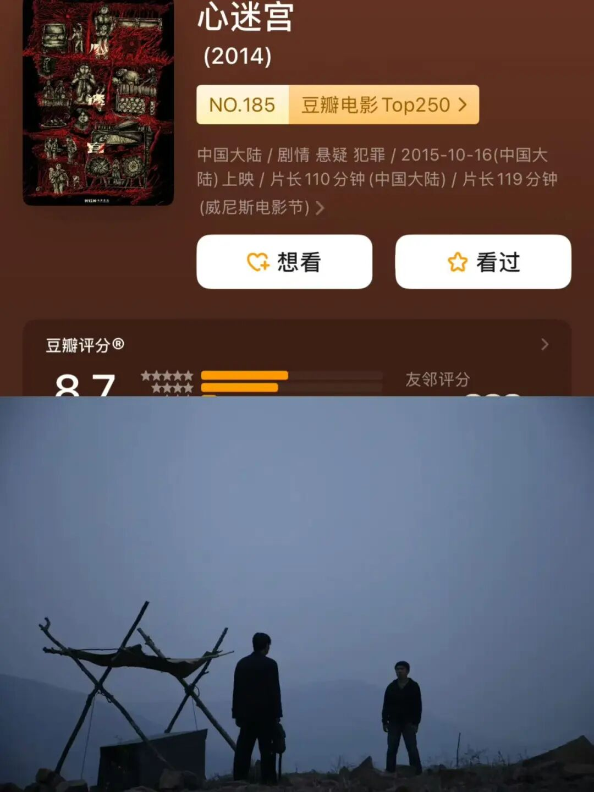
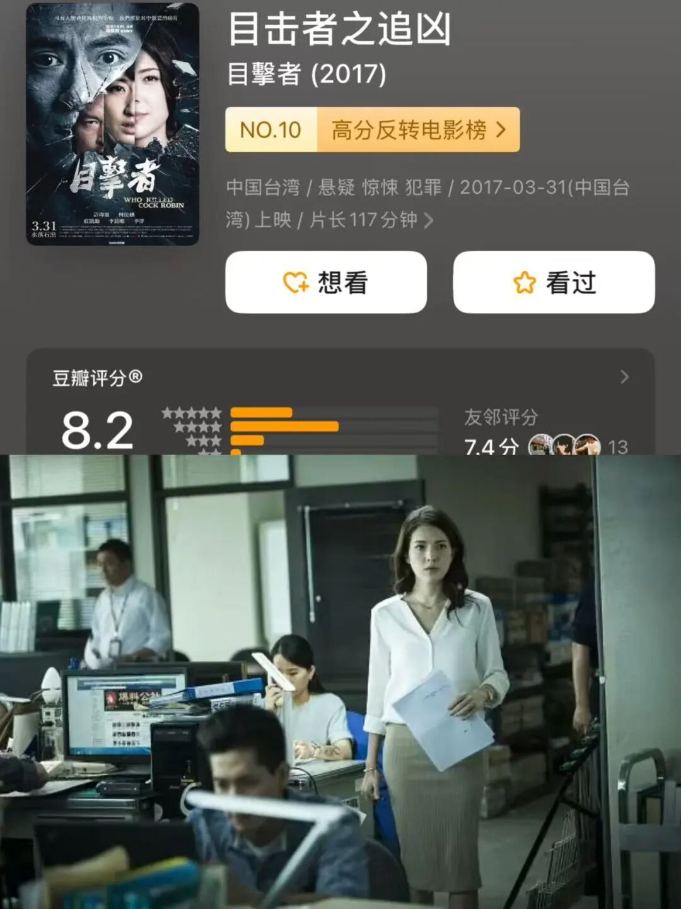
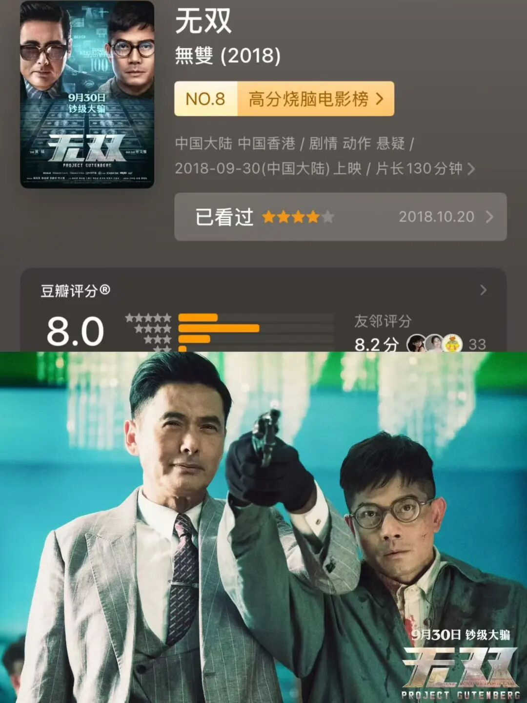
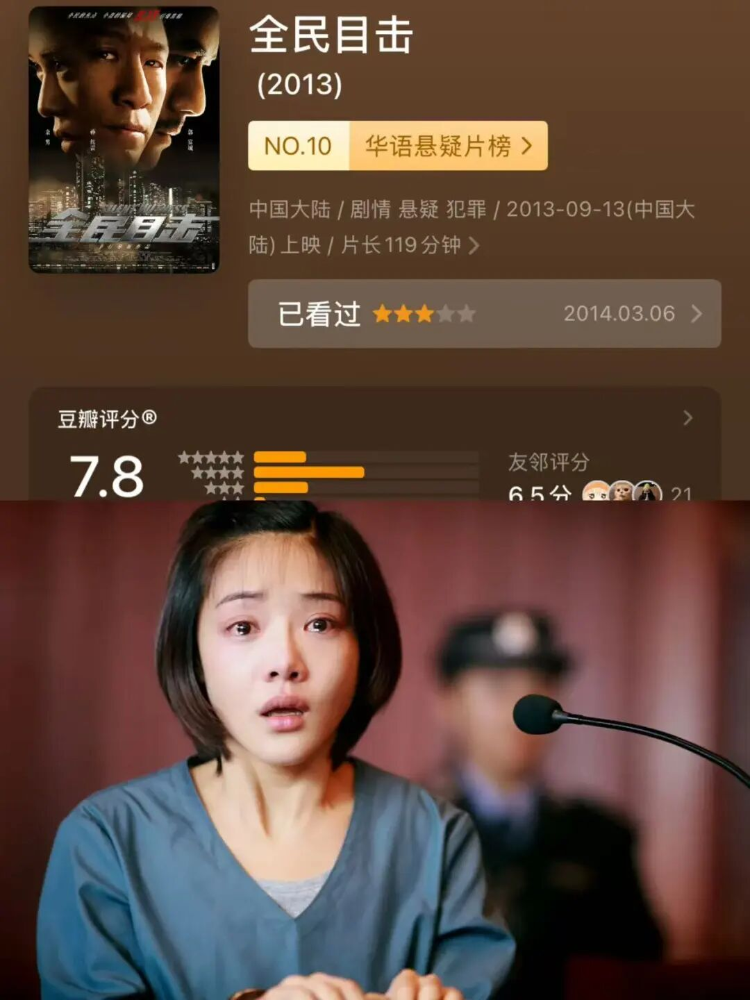

# 9部华语悬疑，一部比一部敢拍
> 💡 备注属性未写入，可能是备注属性名称或者类型被修改了，建议将字段类型设置为 rich_text，可以在小程序-操作-修改文章数据库页面进行调整
> 💡 原文链接:[https://mp.weixin.qq.com/s?__biz=Mzk1NzEzNjcyMA==&mid=2247488222&idx=1&sn=f084a61cec24472055b836611400d721&chksm=c2c31ba344f7df69d20b552f60c84edf7b4a1caee136121551667aa02bafff5f2ed9a32fc3e6#rd](https://mp.weixin.qq.com/s?__biz=Mzk1NzEzNjcyMA%3D%3D&mid=2247488222&idx=1&sn=f084a61cec24472055b836611400d721&chksm=c2c31ba344f7df69d20b552f60c84edf7b4a1caee136121551667aa02bafff5f2ed9a32fc3e6#rd)
hi，大家，周二快乐， 之前推荐过很多好看的悬疑好片，今天一起来看看一些咱们国产的悬疑好片吧~每个都很精彩~

**01 ｜《盲井》 （2003 · 内地）**

井下的规矩很简单：谁落单，谁就是那场“事故”。
两个在矿区混了多年的男人，专门找落单的打工者认作亲戚，带下井，制造矿难，再以家属身份向矿主索赔。这是他们的营生，熟练得像一门手艺。直到一个十六岁的少年出现，其中一个人动了恻隐之心。改编自刘庆邦小说《神木》，2003年拿下柏林电影节最佳艺术贡献银熊奖。全片粗粝、没有配乐、没有救赎。
**有些地方，命是有价钱的。**
**02 ｜《暴裂无声》 （2017 · 内地）**

哑巴的儿子丢了，他一个字也说不出来。
2004年，北方一个矿区的村子。矿工张保民因为早年打架咬断了舌头，说不出话。儿子放羊没回来，他一个人找。找的过程中撞上了矿老板昌万年和律师徐文杰——两个有身份、有秘密、也都在找东西的人。全片几乎没有一句多余的台词，结尾那面山洞墙是华语片近年最狠的一个镜头。
**有些声音，喊不出来，也传不出去。**
**03 ｜《血观音》 （2017 · 台湾）**

一家三代女人，没有一个手上是干净的。
棠夫人是政商圈里的掮客，靠一手好手腕在权贵之间牵线；女儿棠宁替她办事，也替她背锅；外孙女棠真安静得像不存在，其实什么都看见了。一桩灭门案把这一家三口卷进去，她们的反应不是害怕，是算计——怎么把这件事变成筹码。
**最毒的爱，是“我是为你好”。**
**04 ｜《烈日灼心》 （2015 · 内地）**

三个凶手，一起养大了那家人的孩子。
七年前一桩灭门案，三个年轻人逃了出来。此后一个当了的哥，一个当了协警，一个装傻躲在海边。他们共同抚养案发那晚抱走的女孩，为她的心脏病拼命攒钱
**有些债，还一辈子也还不清。**
**05 ｜《心迷宫》 （2015 · 内地）**

村里烧S一个人，三天里三家人抢着认尸。
一具在山上被烧焦的尸体，引出三条互不相干又死死咬合的线：想跟人私奔的村主任儿子、跟人偷情的丈夫、欠了赌债的兄弟。每个人都以为尸体是自己认识的那个人，每个人都基于这个误会做了下一步，误会就滚成了命案。河南农村真实事件打底，靠一个环形结构把中国乡村的人情、面子、算计全串起来了。
**没有人撒谎，可没有一句话是真的。**
**06 ｜《目击者之追凶》 （2017 · 台湾）**

九年前那场车祸，唯一的目击者就是他自己。
社会线记者小齐买了辆便宜的二手车，查出是事故车，顺着查下去，发现车主九年前就死于一场肇事逃逸。更让他后背发凉的是，当年的目击者签名栏上，写着他的名字。他一边追这条新闻，一边把自己也追进了案子里。剧本把九年前和现在两条线拧成一股，每一次“原来如此”后面都还藏着一次。
**真相不是被藏起来的，是被一层层愿意相信的谎言盖住的。**
**07 ｜《无双》 （2018 · 香港）**

他给警察讲了一个天才罪犯的故事，讲得太好，好到没人怀疑讲故事的人。李问被抓后，向警方供出一个叫“画家”的人——伪钞集团的首脑，行事狠辣，从不留活口。他讲得细致，讲得投入，讲到自己怎么被胁迫、怎么一步步陷进去。警方信了，观众也信了。庄文强自编自导，周润发和郭富城正邪对戏，把伪钞的工艺拍得像纪录片。
**最容易骗过你的，是你自己讲的故事。**
**08 ｜《追凶者也》 （2016 · 内地）**

贵州山村，一起摩托车抢劫杀人案。宋老二是修车工，因为跟死者有过节被怀疑，警察还没查明白，他自己先跑了，要去把凶手揪出来。另一边，张译演的杀手正提着刀到处找人。两条线在一个个误会里越缠越紧，黑色幽默一层层往上叠。
**越想证明自己清白，越像在逃。**
**09 ｜《全民目击》 （2013 · 内地）**

富豪林泰的准新娘死在地下车库，嫌疑人是他的独生女林萌萌。林泰请来顶尖律师周莉辩护，对面坐着的是跟他结怨多年的检察官童涛。庭审一场接一场，证据一次次反转，每次你以为看清了，下一场又被推翻。非行自编自导，把整个故事压在法庭这一方空间里，靠对话和证据链推进。孙红雷演的父亲，是全片最复杂的那个人。
**法庭上每一个证据都是真的，拼起来却是假的。**

**点个喜欢吧**
[九部温情治愈高分电影清单](https://mp.weixin.qq.com/s?__biz=Mzk1NzEzNjcyMA%3D%3D&mid=2247488039&idx=1&sn=d0409867f887c38dbf1abfe67209e302&scene=21#wechat_redirect)
[这10部美剧，一部比一部上头](https://mp.weixin.qq.com/s?__biz=Mzk1NzEzNjcyMA%3D%3D&mid=2247487995&idx=1&sn=c22c83d651d140694c5b5608ff17a2a8&scene=21#wechat_redirect)
[9部治愈好剧！每一部都让你想立刻出发](https://mp.weixin.qq.com/s?__biz=Mzk1NzEzNjcyMA%3D%3D&mid=2247487775&idx=1&sn=1164b182266fb0748cb0b8094b44a969&scene=21#wechat_redirect)
