# AI 可以改造iPhone了：5年前的iPhone，变成了Mac电脑
> 💡 备注属性未写入，可能是备注属性名称或者类型被修改了，建议将字段类型设置为 rich_text，可以在小程序-操作-修改文章数据库页面进行调整
> 💡 原文链接:[https://mp.weixin.qq.com/s?__biz=MjM5OTU4MDk0OA==&mid=2449551939&idx=1&sn=77f78e793aebbb47b04fe9c3df0a8a44&chksm=b1151062f8d86964701d37699d6cd732e3dbf4662207e7ae1814e3d093ed0a59d9e108e8c9bd#rd](https://mp.weixin.qq.com/s?__biz=MjM5OTU4MDk0OA%3D%3D&mid=2449551939&idx=1&sn=77f78e793aebbb47b04fe9c3df0a8a44&chksm=b1151062f8d86964701d37699d6cd732e3dbf4662207e7ae1814e3d093ed0a59d9e108e8c9bd#rd)
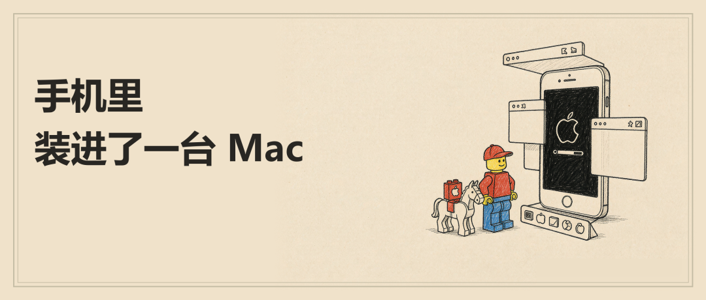
我是非马，之前我用 AI 改造过 Kindle，给它装上了微信读书；也改造过电视，把一台旧电视变成了 Apple TV。后来我在想，还能用AI改造什么呢？
刚好我在网上看到一个开源项目，给iPhone安装macOS：不用越狱，不重装系统，不写一行代码，往手机里装进一个完整的macOS，把它变成一台迷你 Mac。
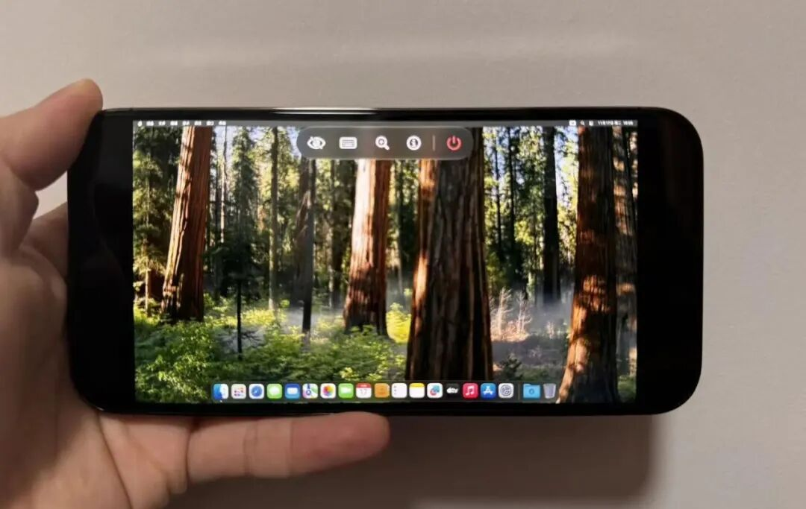
iPhone13promax运行macOS的效果
这个项目叫：Henge，11 月 2 日才在 GitHub 上出现，它做的事用一句话就能说清：在 iPhone 和 iPad 上完整模拟运行 macOS，让你的手机和平板变成一台迷你 Mac。不仅仅是iPhone可以装macOS，iPad也可以。
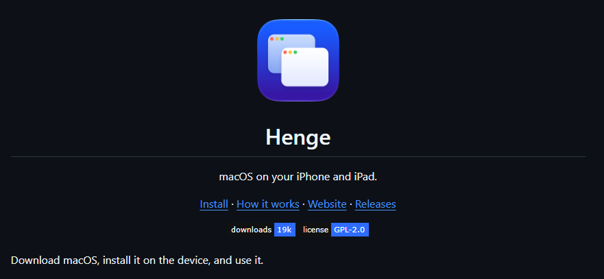
```javascript
开源地址：https://github.com/Leviidev/Henge
```
这个项目的厉害之处在于，在手机上运行macOS系统，不是连着别的电脑看画面。装系统也不需要另一台 Mac，Henge 直接从苹果官网下载 macOS 的恢复镜像，跟给一台新 Mac 装系统走的是同一个流程。

而且还可以外接显示器。。。手机屏幕就是触控板。
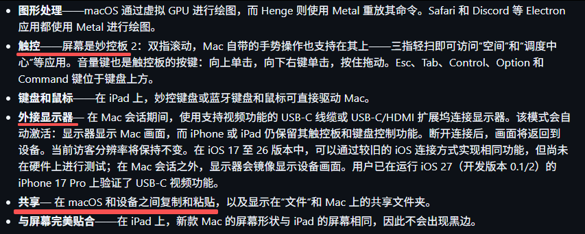
如果搁以前，这个项目偏极客开发者，技术小白很难上手，但是有了 AI 以后就不一样了，这些过程都可以交给 AI 解决。
我刚好有一台闲置的iPhone13promax，处理器A15，存储空间也够，那就开始吧。
**实操环节：先把项目地址给个AI**
项目发起人用 iPhone 17 Pro安装成功，但5年前的13 Pro Max能不能安装成功，我心里没底，我把项目的 GitHub 地址直接丢给了 AI。
复制下面的地址发给AI，先询问：
https://github.com/Leviidev/Henge
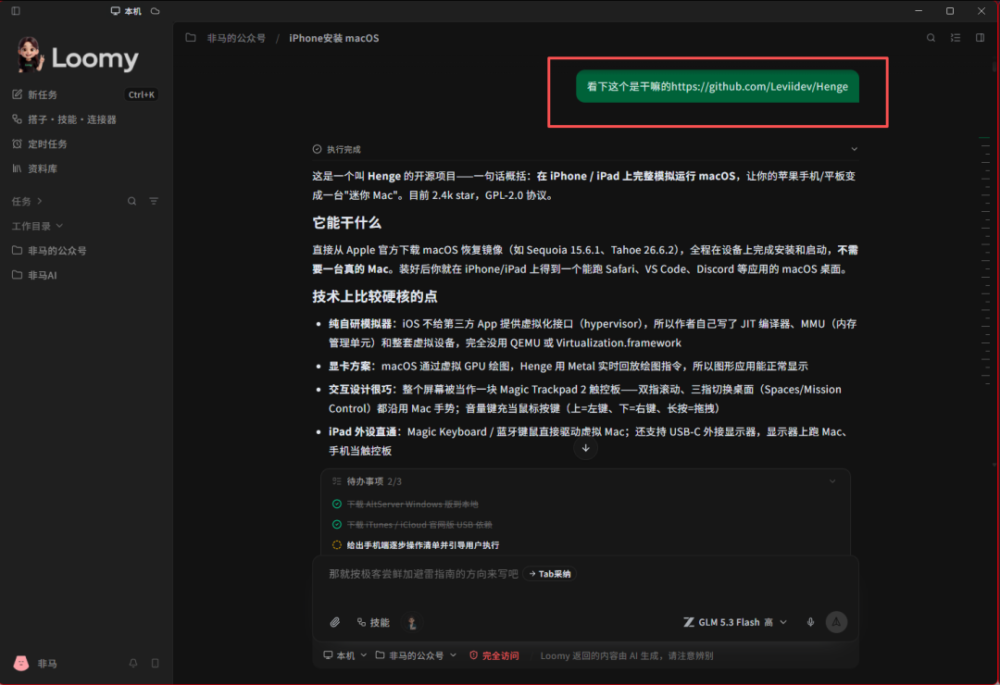
我这次用的 AI工具是Loomy，模型选的是GLM 5.3 Flash。因为送的积分比较充足，积分闲着也是闲着，不如用起来。
[免费10亿Token教程续集：WorkBuddy最强对手上线，每天白送 19.9 元](https://mp.weixin.qq.com/s?__biz=MjM5OTU4MDk0OA%3D%3D&mid=2449551680&idx=1&sn=ffb6c5c697506acd5c5e4c356e9eb9a5&scene=21#wechat_redirect)
你用其它Agent：Work buddy DeepSeek harness、codex、Claude都可以。只需要把项目地址发给AI让他帮你实现就可以了。
我把地址发给AI后，AI给我讲了项目的来龙去脉，接着我问它：那你可以帮我实现吗？
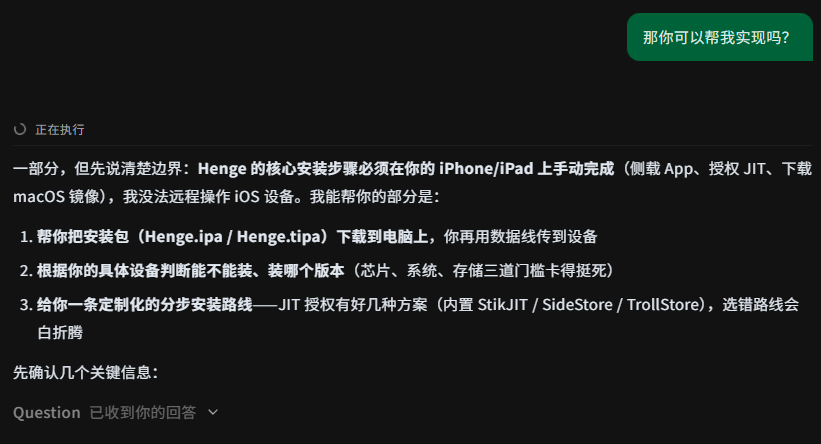
AI说可以，这些必须手机上手动干的活它碰不了，但电脑上的事它全包：把安装包下载到电脑上、根据我的设备判断能不能装、再给我一条定制好的分步安装路线。
它先问了我几个问题：手机型号、系统版本、剩余存储。这个项目**最低要求 A14 芯片，也就是 iPhone 12 起步**，我的 13 Pro Max 是 A15，过线，现在还能流畅运行。
存储是硬门槛，50GB 以上才能装推荐的那个系统。
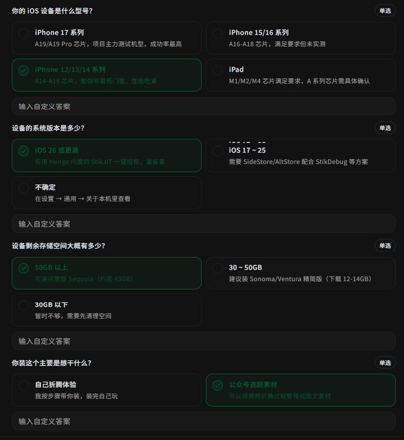
设备过关，AI 给了一条五步安装路线，让我一眼看懂整个安装流程。
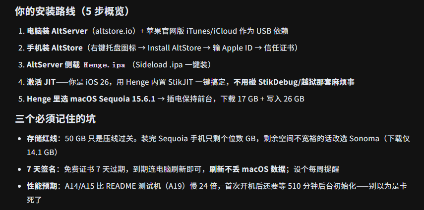
**需要动手的都在手机端，电脑上的活 AI 全包**——跟上次改造 Kindle 一样，我只负责在手机上点。
我说：开始吧。AI 开始干活，干完给了一张收工清单：Henge.ipa 下载好了（ipa 是 iOS 的安装包格式），AltServer 的 Windows 安装包下载解压好了，USB 驱动检查过说本来就有，iTunes 免装。它把后面的顺序都排好了，接下来轮到我。
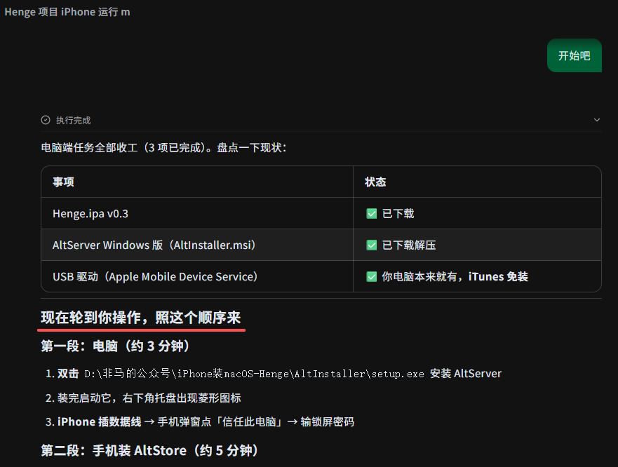
它还写了一份安装指南，跟安装包放在同一个目录里（图上能看到 ipa 文件、AltServer 安装包和那份指南文档）。
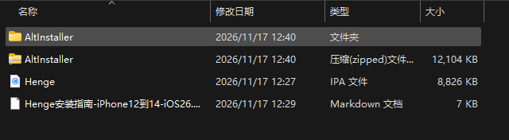
**第一步，电脑上装 AltServer。**
AI 把东西都放在了指定目录，打开一看，安装包和程序都在。
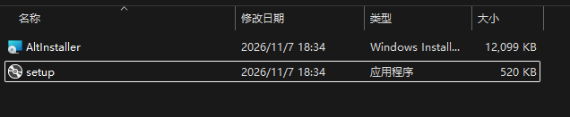
Windows 先拦了一下，弹窗说运行来路不明的应用有风险，**点仍要运行，装完。**
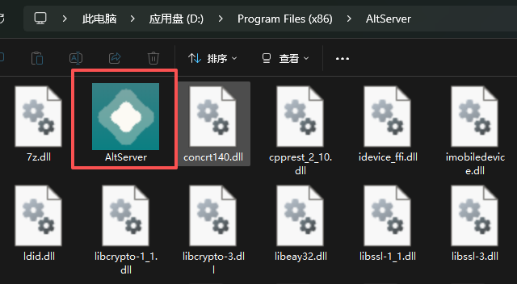
装完遇到第一个小坑：桌面上没有出现 AltServer 的图标。我跑进安装目录，找到那个菱形图标的程序打开它（图上红框标的就是它）。
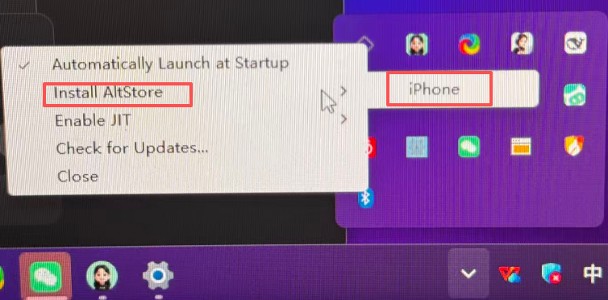
程序跑起来后，**电脑右下角托盘出现菱形图标，**选 Install AltStore，再选 iPhone（图上两个红框就是这两步）。这一步是往手机上装 AltStore，不用越狱。
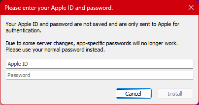
点下去弹出一个 Apple ID 验证框（图上就是那个输入账号密码的弹窗），输完等几秒钟，手机上的 AltStore 装好了。
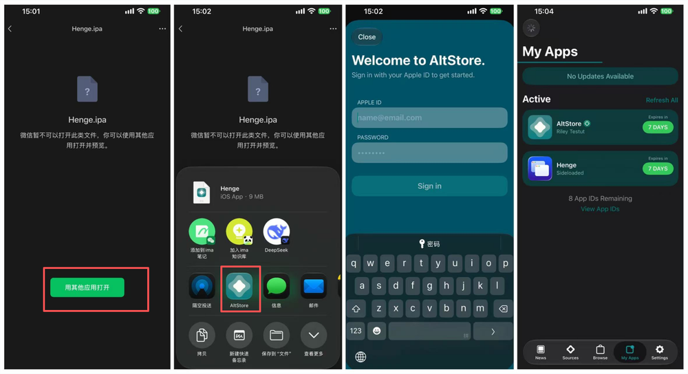
**接下来轮到手机操作：**
桌面多了 AltStore 图标、点开运行AltStore，系统提示要先信任开发者，去设置里打开隐私与安全，再打开开发者模式，按提示重启手机。图上四格连起来就是这套流程：信任开发者、开发者模式开关、重启确认。
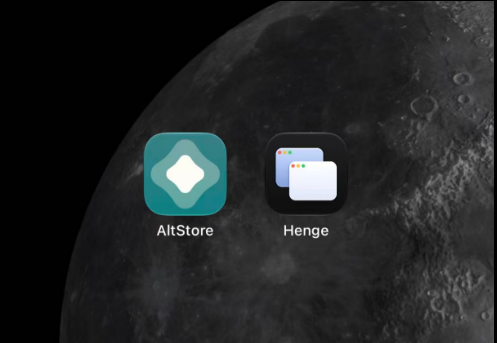
**第二步，给 iPhone 装 Henge。**
安装包在电脑上，我通过微信传输助手把它发到手机。点用其他应用打开，选 AltStore，再输一次 Apple ID，Henge 就装进手机了。图上从微信收文件一路到装完的 My Apps 页，Henge 排在 AltStore 下面，都写着 7 天有效期。所有软件准备完毕。
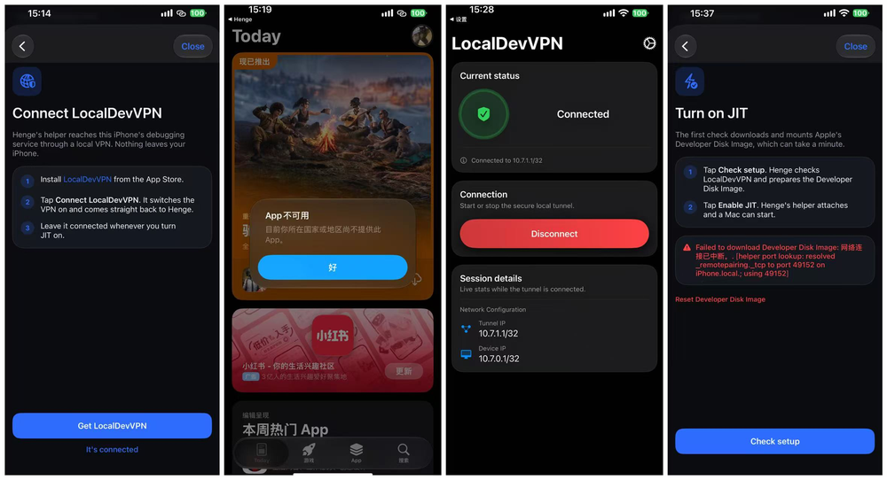
henge安装成功

**第三步，在 Henge 里装 macOS。**
打开 Henge，界面上是一台还没出生的Mac。点Install macOS，选系统版本：Henge 推荐的是 Sequoia 15.6.1，我就选它。系统下面让选给 macOS 分多少运行内存，我一开始选了 4GB——记住这个数字，它害我白装两次。
然后点 Turn On JIT 激活，选第一项 Pair on this iPhone，按提示跟手机配对。图上四格：Henge 主界面、系统选择页、JIT 的几种激活方式、配对的操作页。

配对完它让我装一个叫 LocalDev的东西，这是激活 JIT 的前置。App Store 打开它的页面，弹出来一句：App 不可用，此 App 在你所在地区尚不提供。这是个卡点，它需要外区的 Apple ID。我手上刚好有一个别区的账号，重新登录了一下，直接就下载了。

你要是没有外区账号，直接问 AI。我问过怎么注册，它给了一份七步指南：其实注册不难，几分钟的事。

装好之后，到了激活 JIT 这一步我卡住了：反复提示网络连接中断，图上那行红色的报错就是我试到最后一遍的样子。我问 AI，它说是苹果网络抽风的原因，让我等一会再试。我试了几次都不行，索性放弃。
**本来打算放弃了，但是第二天早上我重新打开页面，网络连接成功了，JIT激活通过，还好没放弃。**
进入下载页面，又失败了一次。我返回页面，**把内存从 4GB 改成了 3GB**。后来我想明白了，iPhone 13 系的运行内存只有 6GB，分 4GB 给 macOS，手机自己就不够用了，中间会卡掉。
你要是 iPhone 15 以下的机型，直接选 3GB，别像我一样白等两次。改完，下载，写入，安装成功。

回头看整个折腾的时间线：从我把 GitHub 地址丢给 AI，到手机里进 macOS 桌面，跨了一天。但动手点来点去的时间其实不长，主要是等苹果的网络。
打开Henge 主界面，点 Start。
**见证奇迹的时刻来了：**屏幕变黑，白色的苹果 logo 亮起来，下面一条进度条在走，跟按下 MacBook 的电源键看到的一模一样。
两分钟就进去了，选语言、地区、设置，进桌面。终于成功了。

这真的是一台 Mac 电脑。桌面、菜单栏、Dock 栏，全都对。

所有设置都能点击，点开启动台是一整屏的应用图标，交互跟 Mac 电脑一模一样,触摸屏当触控板也好用。

换个壁纸看看：
打开 Safari还能上网，搜新闻、点开视频，扬声器都有声。
别说，真有内味了。

App Store 也能打开逛，就是不能登录Apple ID。

要说缺点，就一个：不能登录 Apple ID。除了这一点，我感觉其他都挺好，不管是交互还是系统。
装完我坐在那儿想，这台迷你 Mac 我拿它干嘛呢，好像暂时没有什么非它不可的活。但我还是挺高兴的——其实我也不知道用它来干嘛，可能就是喜欢折腾吧，看到闲置iPhone化身mac，我还挺惊喜的。
喜欢用AI 做以前做不到的事情，这大概就是 AI 的意义吧。
