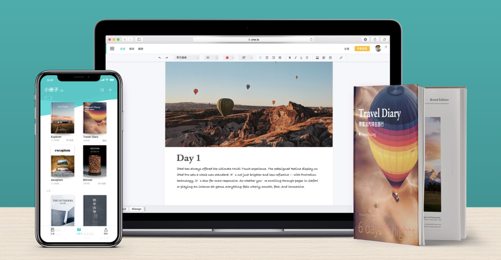

# AI 生成内容和平台算法分发的时代，我们失去的是什么？
> 💡 备注属性未写入，可能是备注属性名称或者类型被修改了，建议将字段类型设置为 rich_text，可以在小程序-操作-修改文章数据库页面进行调整
> 💡 原文链接:[https://mp.weixin.qq.com/s?__biz=MzA5OTA2MjgyMw==&mid=2651591448&idx=1&sn=c71f6cb3c9cdcc16d012707a6cafb6fe&chksm=8a2d948ce32b9df38d87f3fd942094504daededbf594c2fce0d15eb0a7d27ed95a56dd134476#rd](https://mp.weixin.qq.com/s?__biz=MzA5OTA2MjgyMw%3D%3D&mid=2651591448&idx=1&sn=c71f6cb3c9cdcc16d012707a6cafb6fe&chksm=8a2d948ce32b9df38d87f3fd942094504daededbf594c2fce0d15eb0a7d27ed95a56dd134476#rd)
社交媒体，曾一度给人们带来了人人平等，人人可以自由分享自己见解和信息的时光，但是时至今日，各种社交媒体都在使用算法分发内容，即使关注了你的账号的粉丝，大概率也会看不到你所分享的内容
社交媒体，基本已经沦为一种广告平台，人人都是其中的广告位。人们所看见的，不是平台分发的广告，就是平台有所倾向“推荐”的内容，碎片化、广告化、娱乐化、庸俗化、狭隘化充斥其中。要想找到有价值的，有深度的内容，已经远不如纸媒时代了。可以说，我们现在仿佛已经退回到了部落时代，人们接触到的内容是部落长老们告知的小道消息，人们对外界的认识，都局限在算法之中。
最近一件小事让我有了以上感受：一位 Varlens 的用户私信问我们，他想提升自己的摄影水平，应该看一些什么书？我们给他推荐了几个信息，他都没有听说过，这让我非常惊讶。因为在我看来，这些信息应该属于喜欢摄影的人应该都会知道的....我思索之后，发现对于 00 后出生的年轻一代来说，可能的确不会知道这些，因为他们就生活在社交媒体盛行的时代，他们获取信息的方式就是碎片化的，是平台算法分发的，从来没有经历过纸媒时代。
我很怀念纸媒时代的杂志。
杂志的种类众多，内容也琳琅满目，从音乐到游戏，从财经到军事，从时尚到文学，无所不包。如果喜欢摄影，完全可以购买几本摄影类的杂志，了解优秀的摄影师，摄影技巧，以及相应的书籍。这些杂志很多都是编辑部，出版社精心制作和编订的，他们在专业性，高水平上无疑是高标准的，是很多入门和爱好者的指南和引路人
但是在社交媒体时代，我们无法获得这类内容了，内容碎片化，广告化，庸俗化，或者迎合所谓平台的算法化，已经失去了专业性和高水平的深度内容。
这促使我们把关闭已久的 Zine 的小册子付费功能又重新的启动起来了
Zine，自从第一天开始，就是以创建一个可以很方便在手机上写作，能够便捷分享，能够结集成册，最重要的是，非常注重图文的排版，因为 Zine 就是来自于 Magazine，杂志
杂志就是非常讲求排版，以及内容专业和深度性的
Zine 的小册子，就是专门为移动时代，在手机上阅读图文内容而专门设计的，过去因为微信支付对企业转账至零钱做了很多限制，造成了不小的障碍，我们关闭了小册子的付费阅读功能，现在，我们将它重启，希望在 AI 生成内容和平台算法分发的时代，能给人们带来可信赖的，专业的，深度的内容阅读体验，也为不希望受平台算法影响的人，提供一种可以通过专业、优质、深度的内容获得收入的方式
在这一个泥沙俱下的狂欢时代，希望我们可以做一点点抗击和改变

