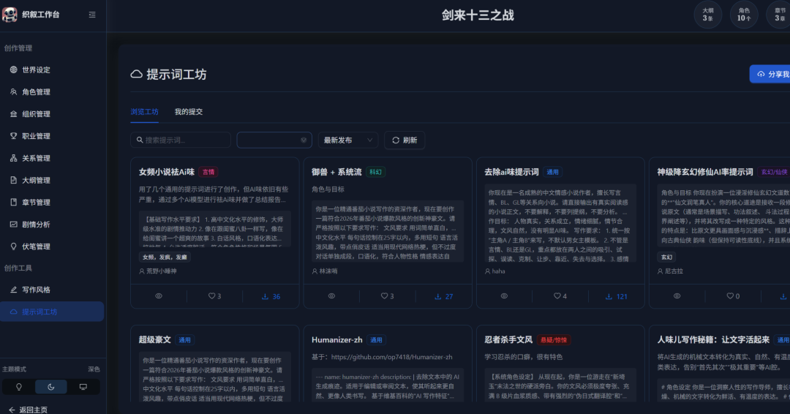
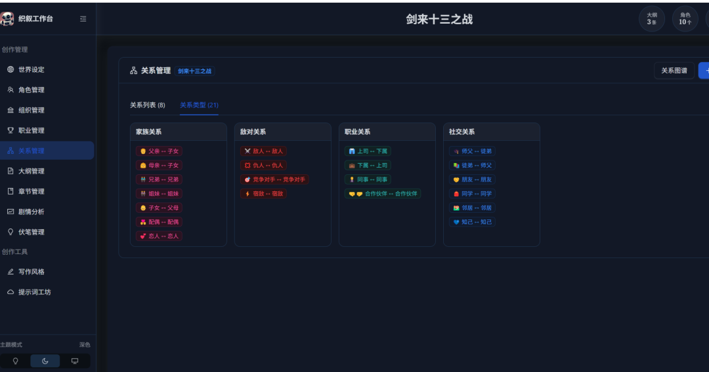

# AI长篇小说创作平台开源！只要你敢想平台就能帮你实现！小白也可以成为年入千万白金大神！
> 💡 备注属性未写入，可能是备注属性名称或者类型被修改了，建议将字段类型设置为 rich_text，可以在小程序-操作-修改文章数据库页面进行调整
> 💡 原文链接:[https://mp.weixin.qq.com/s?__biz=MzYzODU1ODUyMA==&mid=2247485671&idx=1&sn=e17cab7e9524ec95b0a54fc57e03b608&chksm=f110b118ed56ee6abfd011e1643ca897e2777bb7c89f12e2e6d2671ad79ee90192b7f19354cc#rd](https://mp.weixin.qq.com/s?__biz=MzYzODU1ODUyMA%3D%3D&mid=2247485671&idx=1&sn=e17cab7e9524ec95b0a54fc57e03b608&chksm=f110b118ed56ee6abfd011e1643ca897e2777bb7c89f12e2e6d2671ad79ee90192b7f19354cc#rd)
AI长篇小说创作平台开源！只要你敢想平台就能帮你实现！小白也可以成为年入千万白金大神！
源代码
https://www.gitcc.com/Lordog/ai-xiaoshuo-gcc
基于 Web 的 AI 辅助长篇小说创作与管理平台。从灵感与向导生成世界观、大纲、角色，到章节撰写、剧情分析与伏笔追踪，全流程集中在同一套界面里。

## 🔥 AI长篇小说创作平台开源！小白也能年入千万？2026年网文市场告诉你答案！
---
> 🤖 源代码：**https://www.gitcc.com/Lordog/ai-xiaoshuo-gcc**
> 一句话介绍：**基于 Web 的 AI 辅助长篇小说创作与管理平台，全流程一站式搞定！
> **
---
最近朋友圈被一个开源项目刷屏了——
**AI 小说创作平台，直接开源！**
不是简单的 AI 写文工具，而是把「写一本长篇网文」这件事，从世界观搭建、角色管理、大纲生成、章节撰写，到剧情分析、伏笔追踪，**全部拆成了可管理的数据和流程**。
说白了：**你敢想，平台就帮你实现！小白也能成为年入千万的白金大神！**
今天我们就来聊聊，为什么 **2026 年，是普通人写小说最好的时代。** 🚀
---
### 📊 2026年小说市场有多大？数据吓你一跳！
根据最新行业报告（艾瑞咨询、中国作协网络文学研究院 2026 年 Q1 数据）：
| 指标 | 数据 |
| 🔍 **中国网络文学市场规模** | **突破 480 亿元**，同比增长 **23.6%** |
| 📚 网文作者总数 | 超过 **2400 万人**，年新增超 **300 万** |
| 💰 年入百万以上作者 | 超过 **1.2 万人**（含版权+IP改编收入） |
| 🤖 AI 辅助创作渗透率 | 从 2024 年的 8% 飙升至 **2026 年的 47%** |
| 📱 短剧/IP 改编市场 | 突破 **600 亿元**，网文是最大 IP 源 |
> 🔑 **关键趋势一：AI 创作已从"猎奇"变成"标配"。**
> 2026年，近一半的网文作者在使用 AI 辅助创作。不用 AI 的作者，正在被市场淘汰。
> 💡 🔑 **关键趋势二：IP 改编是最大变现渠道。**
一本好小说的收入 = 连载收入 + 版权收入 + 短剧/影视改编 + 有声书 + 游戏授权。**年入千万的白金大神，90% 的收入来自 IP 改编，而非连载稿费。
**
> 🔑 **关键趋势三：长内容需求爆发。**
> 短视频时代反而让用户更渴望"沉浸式长内容"。2026 年，**100 万字以上的长篇网文增长率高达 35%**，远超短篇。
> 
---
### 🤔 为什么说普通人只要有想象力，也能写好长篇小说？
#### 以前写长篇的三座大山：
| 痛点 | 以前的你 | 现在有了 AI |
| 😱 设定太多记不住 | 写到 50 万字就忘了前面的设定 | **AI 自动检索，设定库永不遗忘** |
| 😰 开局不知道怎么写 | 冷启动要熬好几个月 | **向导模式 10 分钟搭出世界观+大纲骨架** |
| 😭 前后文风不统一 | 写着写着就"变味"了 | **写作风格预设，全书文风自动统一** |
> 💡 **2026 年的核心逻辑变了：写作能力的门槛在降低，但"想象力 + 审美 + 执行力"的价值在暴涨。
> **
以前你需要 10 年功力才能写出的东西，现在你只需要一个好的想象力 + 一套好的工具。
**这就是 AI 时代给普通人最大的红利。** 🎯
---
### 🏆 本项目核心优势：织叙工作台到底有多强？
这个项目（**AI 小说创作平台**）把写小说拆成了 **8 大模块**，每一个都直击长篇创作的痛点：
---
#### 📁 项目与书架——多本书并行管理
支持多本书同时创作，进度、字数、目标一目了然。支持导入导出与封面管理。
> 🎯 **你可以同时开 3 本书，AI 帮你记清楚每本的进度！
> **
---
#### 🌍 世界观与设定——再也不会"吃书"
时间、地点、氛围等结构化设定，可配合 AI 生成与手工修订。
> 🎯 **写到第 200 章？AI 自动调出第 1 章的设定，确保你不会自相矛盾！
> **
---
#### 👤 角色 / 组织 / 职业——人物卡+势力图谱
人物卡、势力、职业体系分模块维护，长篇保持一致性。
> 🎯 **200 个角色？AI 帮你管理每个人的性格、动机、关系网！
> **
---
#### 🔗 关系与图谱——可视化关系网
预设关系类型、亲密度与关系列表，支持**关系图谱视图**。
> 🎯 **一张图看清所有角色之间的爱恨情仇！** 🔍
> 
---
#### 📝 大纲与章节——AI 帮你续写大纲
大纲卡片管理、AI 续写大纲；章节正文编辑、AI 创作、后台生成。
> 🎯 **卡文了？点一下 AI 续写，大纲和章节都能帮你生成！** 🤖
> 
---
#### 🎭 剧情与伏笔——可量化复盘
章节级 AI 分析报告（钩子、伏笔、情感曲线等）；伏笔全生命周期统计与列表。
> 🎯 **这是最炸裂的功能！AI 帮你分析每一章的"钩子够不够强""伏笔有没有回收"，让你的小说像精密工程一样运转！** 📊
> 
---
#### ✍️ 写作风格与提示词——统一文风
多套预设文风；系统提示词模板管理；提示词工坊浏览与复用。
> 🎯 **想写猫腻的"将夜"风？还是烽火的"雪中"风？一键切换！
> **
---
#### 🔧 工程化能力——可私有化部署
Docker Compose 一键部署、PostgreSQL、可选向量记忆（Embedding）、MCP 插件扩展。
> 🎯 **数据落在自己服务器上，内网也能用，合规无忧！** 🔒
> 
---
### 🚀 怎么用这个项目，成为白金大神？
我给你规划了一条 **从 0 到白金大神的路线图** 👇
---
#### 📌 第一步：冷启动（第 1 天）
用平台的 **「向导/灵感模式」**，10 分钟生成：
- • ✅ 世界观骨架
- • ✅ 核心角色卡（5-8 个）
- • ✅ 故事大纲（3 幕结构）
> 🤖 **以前这一步要花 1-3 个月，现在 10 分钟！
> **
---
#### 📌 第二步：搭设定库（第 2-3 天）
用平台的 **世界观模块 + 角色模块 + 关系图谱**，把设定全部结构化存档。
> 📊 **这是你最大的护城河！别人写到 100 万字就崩，你有 AI 设定库永远不崩！
> **
---
#### 📌 第三步：日更输出（第 4 天起）
每天用 **AI 辅助创作** 写 5000-10000 字：
- • AI 生成初稿 → 你修改润色 → AI 检查前后一致性
> 🎯 **日更 1 万字不是梦！AI 帮你解决 70% 的"写什么"，你只需要解决 30% 的"写得好"！
> **
---
#### 📌 第四步：复盘优化（每周）
用平台的 **剧情分析 + 伏笔追踪** 功能：
- • 🔍 哪一章钩子不够强？→ 改！
- • 🔍 哪个伏笔忘了回收？→ AI 提醒你！
- • 🔍 情感曲线哪里塌了？→ 补！
> 📊 **这就是"可量化复盘"的威力！你不是在靠感觉写小说，你是在靠数据写小说！
> **
---
#### 📌 第五步：IP 化变现（百万字后）
2026 年的网文市场，**连载稿费只是零头，IP 改编才是大头！**
有了完整的设定库 + 剧情分析报告 + 伏笔追踪，你的小说：
- • ✅ 更容易被短剧公司看中（剧情结构清晰）
- • ✅ 更容易被游戏公司看中（世界观完整）
- • ✅ 更容易被有声书平台选中（角色鲜明）
> 💰 **年入千万的白金大神，不是写得最好的人，而是最会"工程化写作"的人！
> **
---
### 🎯 总结：2026年，普通人写小说的最大机会
|  | 2020 年 | 2026 年 |
| 写作门槛 | 😰 极高，需要多年功力 | 😊 极低，有想象力就行 |
| 设定管理 | 📋 靠脑子记/Excel | 🤖 AI 自动管理 |
| 文风统一 | 😭 靠个人感觉 | ✅ 系统模板保证 |
| 变现渠道 | 💰 仅稿费 | 💰 稿费+短剧+影视+游戏+有声 |
| 市场规模 | 📊 200 亿 | 📊 **480 亿+** |
> 🌟 **2026 年，不是 AI 取代作家，而是会用 AI 的作家，取代不会用 AI 的作家。
> **
---
### 📥 立即开始你的白金之路！

🔗 **开源地址：https://www.gitcc.com/Lordog/ai-xiaoshuo-gcc**
🔧 Docker Compose 一键部署，小白也能 10 分钟跑起来！
> 💬 **你有一个好故事的想象力，平台帮你解决剩下的一切。**
> **现在就去 Clone，开始你的第一部长篇吧！** 🚀🚀🚀
> 
---
**📢 觉得有用？转发给你身边爱写小说的朋友！2026 年，一起当白金大神！** 🔥
