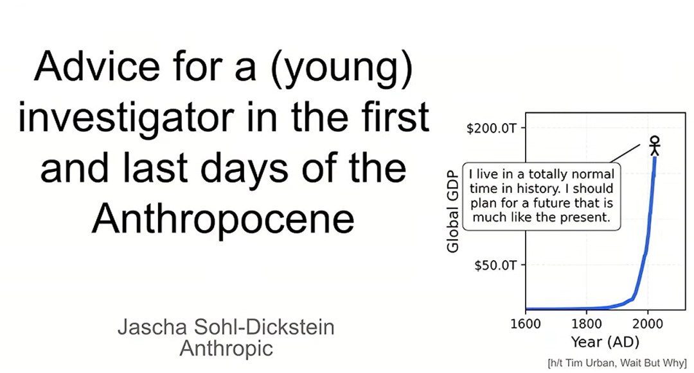
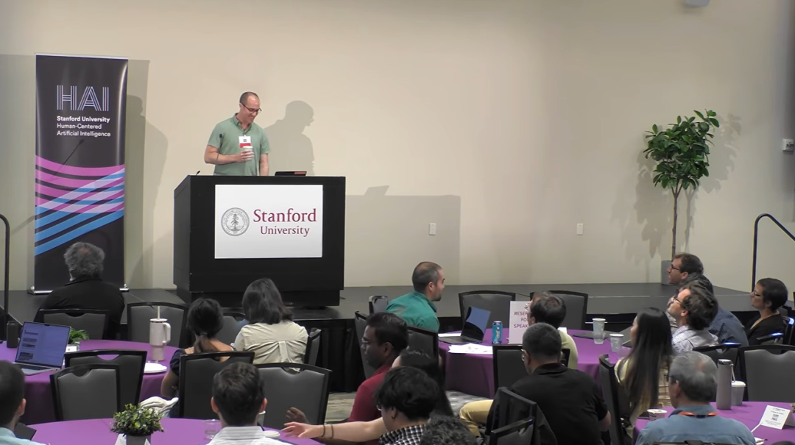
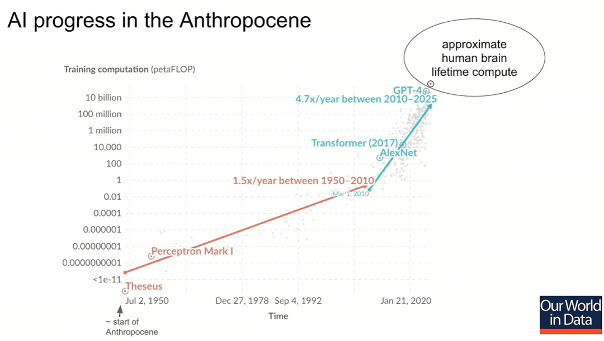
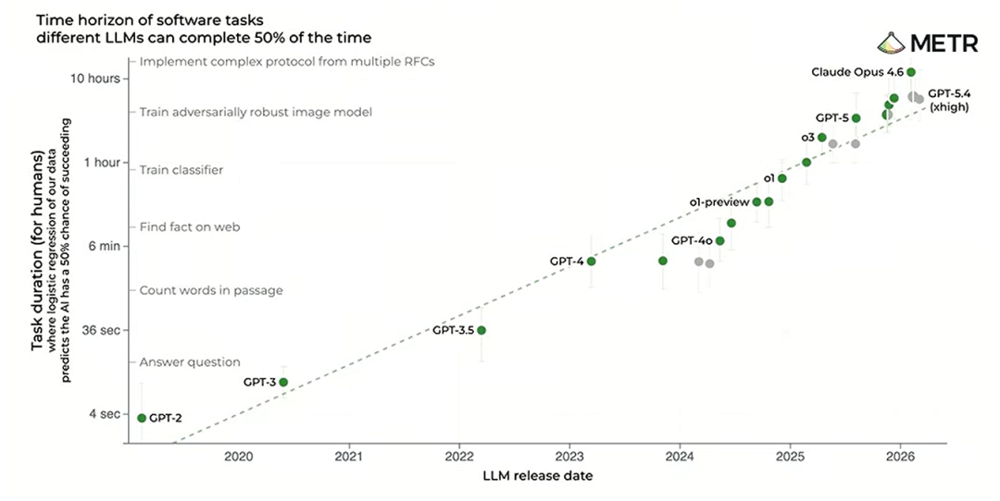
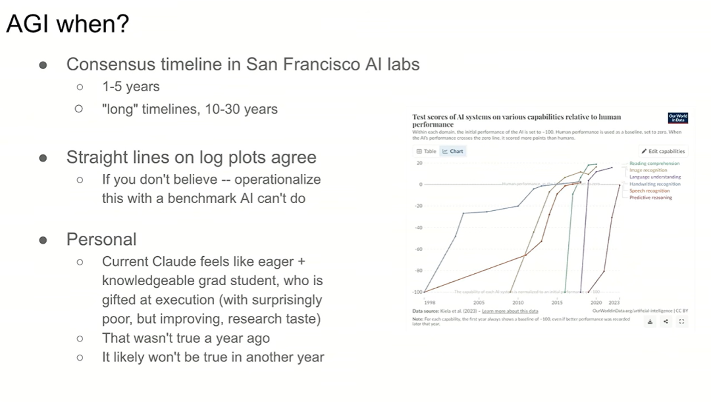
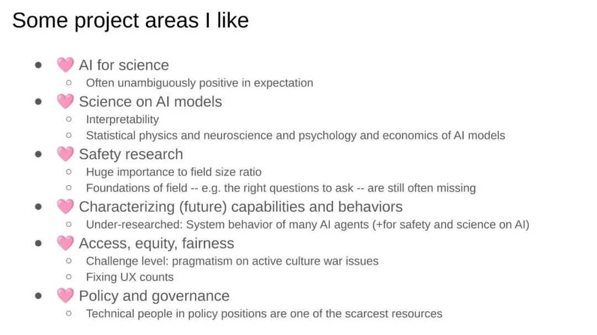

# Anthropic科学家：如果AGI三年内到来，读博士和终身教职规划还有意义吗？
> 💡 备注属性未写入，可能是备注属性名称或者类型被修改了，建议将字段类型设置为 rich_text，可以在小程序-操作-修改文章数据库页面进行调整
> 💡 原文链接:[https://mp.weixin.qq.com/s?__biz=MjM5OTc2NzA2MQ==&mid=2651336461&idx=1&sn=3a69ec84100696458b0337ec198ff2a8&chksm=bd7739c371310c1635ca76fc09d7814d4f674c2987784be3fe9e5282eba95b0c0fb968e08f45#rd](https://mp.weixin.qq.com/s?__biz=MjM5OTc2NzA2MQ%3D%3D&mid=2651336461&idx=1&sn=3a69ec84100696458b0337ec198ff2a8&chksm=bd7739c371310c1635ca76fc09d7814d4f674c2987784be3fe9e5282eba95b0c0fb968e08f45#rd)

**作者：李海伦 编辑：徐青阳
**
**来源：腾讯科技（ID：qqtech）**
最近，一场来自Anthropic科学家的演讲被重新翻出，并在社交平台X上引发关注和热议。
Anthropic科学家、扩散模型早期研究者之一雅沙·索尔-迪克斯坦(Jascha Sohl-Dickstein)于2026年6月，在斯坦福大学举办的物理学与AI会议上发表了题为《人新世最初与最后日子里，给青年研究者的建议》(Advice for a Young Investigator in the First and Last Days of the Anthropocene)的演讲。在他看来，**AI能力的快速进步不仅会改变科研方式，也可能动摇沿用多年的学术职业规划。**
这个观点是当下AI时代一个值得重视和思考的问题：当技术可能在几年内深刻改变科研体系，我们已经深刻感知到AI技术的发展之快速，人们是否还能沿用过去几十年的经验规划自己的职业生涯?
索尔-迪克斯坦的判断建立在一组有关计算规模和AI能力的数据之上：过去十年，最大模型的训练计算量增长约1000万倍。他认为，过去约七个月里，AI模型开始解决此前长期困扰数学家的部分埃尔德什(Erdős)问题;如果增长趋势延续，到2030年，计算能力可能达到2025年的约1万倍。在他看来，**指数增长环境下，沿用过去的职业规划，未必还能提供预期中的稳定性。**

他的建议集中在几个方面：尽早将AI融入日常研究，把研究方向放在能够从算力和模型能力提升中持续受益的问题上；重新评估传统学术路径的风险，不要把博士、博后和终身教职视为天然稳妥的选择;善用AI承担编码、执行和检验工作，同时保留自己对问题的判断与思考。
演讲中最受关注的一句话是：**“写作即思考。如果你将写作外包出去，你实际上也将思考外包了。”**
这一观点也体现了索尔-迪克斯坦对AI时代科研工作的判断：使用AI提高效率，并不意味着可以放弃独立思考。面对可能在未来几年到来的重大变化，年轻研究者既要学会利用AI，也要重新审视自己的研究方向和职业规划，思考哪些能力仍然重要，哪些选择值得长期投入。
以下为索尔-迪克斯坦演讲实录，在未改变原意情况下有所删减：

**01**
**AI的指数增长才刚刚开始**
这场演讲的标题借鉴了诺奖得主、现代神经科学奠基人之一圣地亚哥·拉蒙-卡哈尔的著作。
先看全球GDP增长曲线。先看全球经济增长曲线。我们习惯把未来理解为现在的线性延伸，但如果用对数坐标观察GDP的长期变化，就会发现，指数增长已经持续了很长时间。AI也正在经历类似的过程。

如果接受这一判断，就应该重新考虑自己的职业、研究项目和人生规划。
人类活动已经在地球上留下了难以消除的痕迹。比如，**目前大规模物种灭绝正在发生，核试验产生的放射性物质也留在了地层中，即使数十亿年后，这些痕迹仍可能证明人类曾经存在。**基于此，科学界有人提出，将人类深刻影响地球环境的这一时期称为“人新世”。
随着AI能力不断增强，人类或许很快就不再是唯一能够大规模改变世界的智能力量。这个时代何时结束，将在很大程度上取决于AI的发展。
过去十年，用于训练最大AI模型的计算量增长了约1000万倍。按照我的粗略估算，这一规模已经逐渐接近人类大脑一生所完成的计算量。
AI能力也在快速提升。一项研究考察了模型在50%成功率下能够独立完成的软件任务，并用人类完成同类任务所需的时间衡量其能力。不到一年的时间，模型能够处理的任务时间跨度就增长了约10倍，超过了我此前对2026年至2027年的预测。

数学领域也出现了类似变化。保罗·埃尔德什留下了大量尚未解决的数学问题。过去约七个月里，AI模型开始解决其中一些问题，推动数学研究的已知边界。
这些进展说明，**AI的能力不只是在既有任务上提高效率，**也开始进入过去需要人类研究者探索和突破的领域。
**02**
**AGI可能什么时候到来**
一年前，我在哈佛大学讲过这场演讲的早期版本。当时，有人认为讨论AGI即将到来过于激进。但现在，这已经是可以公开认真讨论的问题。

英国前首相里希·苏纳克曾强调，AGI竞争具有根本性的地缘政治意义。美国前总统奥巴马也指出，AI的影响将超过智能手机，而且来得更快。谷歌前CEO埃里克·施密特则预测，AI将在几年内达到甚至超过顶尖人类的智力水平。
虽然程序员的工作尚未被整体取代，**但AI已经接手了其中许多任务，工作内容也在随之变化。**
如果你身处旧金山的AI行业，问人们AGI什么时候到来，很多人会回答：几年之内。即使有人认为时间线更长，进一步追问后，也可能发现他们说的长期只有十年左右。
这与其他科学领域的讨论很不一样。例如，在生物技术领域，如果你询问癌症什么时候能够治愈，研究者通常会解释其中的困难，以及为什么还需要很长时间。但我与AI研究者交流时，他们往往认为，从当前模型到超级智能之间，并不存在明确的技术障碍。
另一个值得关注的现象是，**过去许多AI基准需要十几年才能达到人类水平，如今新基准可能在几个月到几年内就被突破。**我曾参与创建Big Bench基准，甚至在论文正式发表之前，就有研究在其中部分任务上取得了新的最佳成绩。
如果你认为AI在某项关键能力上不会继续进步，我建议把这个判断转化为可量化的指标，建立基准，持续跟踪。不要只停留在“AI还不够聪明”这样的模糊判断上。
在通往AGI的道路上，我们的方法显然还很低效。与当前方法相比，人脑在数据利用效率方面可能高出几个数量级。但低效并不意味着方法不起作用。
让我反复感到惊讶的是，我们只是把一些相当朴素的方法扩大一个数量级，它们就仍然能够带来明显进步。因此，我暂时看不到某个明确的硬性障碍，能够阻止我们继续前进。
如果我们认真对待这些时间线，首先要考虑的是：如何确保自己正在做的研究，在完成时仍然有价值。一种需要警惕的情况是，你花两年时间做出一项看似显著的进展，但等你完成时，其他人只需给最新的基础模型一个提示，就能得到更好的结果。
因此，我建议选择有针对性的研究项目，与他人合作，尽快推进工作，确保自己的研究进度跟得上AI能力的增长。
理查德·萨顿(Richard Sutton)在2019年发表的《苦涩的教训》(The Bitter Lesson)提供了一个重要视角：长期来看，能够充分利用计算资源的通用方法，往往比依赖人工设计的特定方法更有效。
**这条经验有两个方面：**
一方面，如果你的研究能够随着计算量和智能水平的提升而持续改善，甚至能反过来推动AI能力的发展，那么它的价值可能远超预期。
另一方面，如果某个问题注定会被模型规模扩大解决，你就应该认真考虑，等自己完成研究时，这项工作是否还具有独立价值。
最终，机器人会进入实验室并承担实际工作。虽然很难预测具体时间，但如果未来10到15年，我们仍然没有能够替人类进行物理实验的机器人，我会感到惊讶。
此外，如果理论长期无法有效预测实验结果，这本身也说明理论研究还有改进空间。如果AI能够提高理论的预测能力，我们就有机会减少需要进行的实验数量。
当然，效果取决于具体应用，也取决于工具是否足够好用。如果使用AI的交互成本超过了它带来的收益，那么它就很难真正发挥作用。
**03**
**把AI变成日常研究工具**
我每天都使用Claude。对我来说，它就像一名执行能力极强、工作意愿很高的研究生，但目前研究直觉和判断力仍有明显不足。
一年前，我还需要深入检查它完成的每一个细节。现在，我可以给它一个高层次的问题，让它生成图表，再根据结果判断下一步该做什么。我认为这种工作方式还会继续改变。
我现在基本不再亲自写代码，甚至很少阅读代码，但每天仍然在使用代码完成研究任务。
我建议大家尽可能使用现有的AI工具，包括用它们头脑风暴、迭代研究想法、分析数据、生成可视化结果，以及检查论文和研究中的漏洞。
我经常因为好奇某个问题，就让AI帮我建立一个定制化仪表板，生成几页图表供我分析。这类工作过去可能需要更多时间，现在已经容易得多。
即使Claude已经能够写出我们大部分研究代码，研究生仍然需要理解代码在做什么，但不一定需要像过去那样亲自编写每一行代码。这有点像从打孔卡编程转向Python。使用更高层次的工具，意味着你可能不再需要理解计算机内部的每个细节，但可以把精力放在更高层次的问题上。
**关键是，你必须能够质疑模型的结果。**例如，让模型生成图表后，你需要检查图表是否一致、结论是否合理，而不是直接接受它的解释。尤其对研究生而言，应该认识到自己的时间很有价值。使用工具的目的，是把时间投入更值得做的事情，**而不是为了证明自己能够独立完成每个技术步骤。**
我鼓励大家使用AI写作反馈，但不要让它替你写第一稿。原因很简单：写作即思考。如果你将写作外包出去，你实际上也将思考外包了。你需要通过亲自组织语言，弄清楚自己究竟想表达什么、论证是否成立，以及哪些问题还没有想明白。
让AI帮你寻找漏洞、提出反对意见、检查论证，这些都很有价值。但如果你直接让它生成初稿，你可能还没有真正理解自己的研究，就已经得到了一篇看似完整的文章。
**04**
**如果相信AGI即将到来，**
**就应该改变职业规划**
这场演讲的直接起因，是我和一名能力很强的研究生的一次谈话。他告诉我，自己认为AGI可能在三年内到来。但几分钟后，他又开始规划：几年后完成博士学位，接着做博士后，然后申请大学教职。
我觉得这里存在明显的矛盾。如果你相信一种足以改变世界的技术即将到来，那么你就应该让自己的其他判断与这一信念保持一致。
我不知道十年或二十年后的学术研究会是什么样，也不知道届时大多数工作会是什么样。**但我相当确定，它们会与今天非常不同。**
人们通常会在风险和回报之间权衡，选择一条相对安全的道路，即使另一条路可能带来更高的回报。但如果AI确实可能引发大规模社会变化，那么你本来就面临很高的系统性风险。传统的安全选择未必能降低这种风险，反而可能让你放弃更大的潜在回报。所以，我建议大家做有意思的事情，而不是一味追求看起来安全的选择。
如果你的时间有限，未来的影响又如此重大，就应该选择那些值得自己为之骄傲的事情。等到多年以后回顾自己的职业生涯，你会希望自己曾经为一个重要的结果做出贡献。这也意味着，我们应该关注那些可能积极影响AGI发展方向的研究，而不是只追求短期成果。
有些人认为，AI发展已经超出了个人能够影响的范围。我认为这种想法是错误的。按照目前的趋势，**到2030年，计算能力可能达到2025年的1万倍。**届时，今天的计算规模放在线性图上，几乎会与零无法区分。
这意味着，我们仍然处在指数增长的早期阶段。而在这个阶段，小的决策可能产生非常大的长期影响。
历史上有很多类似的例子。电子邮件协议的标准化，让不同系统之间能够交换信息;哈伯-博施法使大规模合成氨成为可能，深刻改变了农业和粮食生产;美国早期建立的医学和法律组织，也长期影响着这两个行业的制度结构。
这些发展都不是不可避免的。早期的一些技术选择和制度安排，最终塑造了今天的世界。AI也一样。你选择研究什么问题、在哪里工作、如何评价某项能力与风险、是否公开自己的伦理立场，都可能影响未来的技术发展方向。
我认为，在某个阶段，人类能够通过管理和协调AI智能体团队，完成过去整个职业生涯都无法完成的工作。你可能只需要一周，就能完成过去需要数年探索的任务。这将是一个令人惊叹的时期。
但我也认为，之后可能会出现另一个阶段：AI在越来越多的认知任务上超过人类，人类不再能够通过自己的智力为AI提供同样程度的增益。因此，我们应该充分利用眼前的机会，尽可能掌握这些工具，用它们去做更有价值的事情。
**05**
**哪些研究方向值得投入**
我想强调几个方向，但这份清单远远不完整。真正有影响力的研究，也许是目前还没有人想到的。

**首先是AI for Science，**也就是利用AI推动科学研究，包括材料发现、蛋白质结构研究、天气建模和聚变反应堆等领域。更好地理解自然世界，通常能够带来明确的价值，而AI有机会提高我们探索这些问题的效率。
其次是直接研究AI模型本身。我们可以借鉴其他学科的方法，把AI作为研究对象。例如，可解释性研究可以被看作对AI模型开展神经科学研究;**我们也可以用统计物理、心理学和经济学的方法，理解模型内部的行为和机制。**
**第三是AI安全。**这个领域仍有许多重要问题尚未得到清晰定义，其重要性与目前投入的研究资源并不匹配。能够从头参与其中的人，仍然有机会找到关键问题。
此外，还有AI能力预测、技术公平、资源获取以及政策和治理等方向。
如果你具备相关技术背景，又愿意参与公共事务，可以考虑进入政策和治理领域。政府需要真正理解技术的人，帮助制定AI监管和发展政策。对于学术研究者而言，这也是一个可能产生较大影响的方向。
最重要的是，结合自己的专业知识，思考哪些能力可以转向研究AI本身，或者帮助社会更好地应对AI带来的变化。
**本文作者李海伦，首发于公众号"腾讯科技”(ID:qqtech)，欢迎关注。**
**版权声明：部分文章推送时未能与原作者取得联系。若涉及版权问题，敬请原作者联系我们。**

