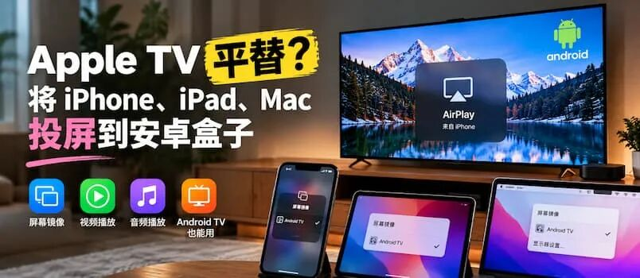

# Apple TV 平替？将 iPhone、iPad、Mac 投屏至安卓盒子上
> 💡 备注属性未写入，可能是备注属性名称或者类型被修改了，建议将字段类型设置为 rich_text，可以在小程序-操作-修改文章数据库页面进行调整
> 💡 原文链接:[https://mp.weixin.qq.com/s?__biz=MjM5NDMwMTI2MA==&mid=2651702854&idx=1&sn=403fc3f54aa42cfbaaa2167555ab28c9&chksm=bc3561305f726070173f4fa7c6fa40b399b5238f5afa27772ab3c9ba3d1708400e132b2ed71d#rd](https://mp.weixin.qq.com/s?__biz=MjM5NDMwMTI2MA%3D%3D&mid=2651702854&idx=1&sn=403fc3f54aa42cfbaaa2167555ab28c9&chksm=bc3561305f726070173f4fa7c6fa40b399b5238f5afa27772ab3c9ba3d1708400e132b2ed71d#rd)
没有 Apple TV，也想把 iPhone、iPad、Mac 的画面投到电视上？
如果家里正好有 **Android TV**、安卓电视盒子，甚至闲置的安卓平板（手机也行），现在可以直接把它们变成一台 AirPlay 接收器。

### AirPlay Receiver for Android
AirPlay Receiver for Android 是一款免费开源应用。它模拟了 Apple TV 的 AirPlay 功能，把安卓设备变成了一台“Apple TV”，让局域网内的所有苹果设备，都可以通过**隔空投送**功能，将屏幕投屏过去。
最重要的一点是，青小蛙测试了一阵子，稳定性极佳，推送视频时，声音也完全同步，没有任何问题。
**堪称 Apple TV 平替。**
### 视频演示
### 主要特性
- • 支持 **iPhone、iPad、Mac 屏幕镜像**
- • 支持 **H.264 / H.265（HEVC）** 视频解码
- • 支持 **AAC-ELD、AAC-LC、ALAC** 音频播放
- • 支持 **HLS 视频流、下载播放和远程控制**
- • 播放音乐时可显示 **歌曲信息和封面**
- • 针对 **Android TV** 适配遥控器方向键和快进快退
- • 支持 **画中画**
- • 可自动切换 **分辨率和播放模式**
- • 支持 **PIN 验证**
- • 可调整 **分辨率、帧率、Overscan 和音频延迟**
- • 硬件解码不兼容时，可回退到 **软件解码**
- • 提供调试信息，可实时查看 **FPS、码率、编码格式、分辨率、帧数和音量**
- • 集成 Android 原生媒体控制，可直接通过通知栏控制播放
**不支持 DRM 内容**，例如 Apple TV App 中受保护的视频。
### UxPlay
AirPlay Receiver for Android 的底层使用了开源项目 **UxPlay**。
UxPlay 本身就是一个成熟的 AirPlay 接收器，可以让 Linux、macOS 等设备模拟 AirPlay 接收端，接收来自 iPhone、iPad 和 Mac 的屏幕镜像、音乐和视频。
### 获取
- • GitHub https://github.com/jqssun/android-airplay-server
- • 搬运 https://d.appinn.com/airplay-receiver-for-android/
最后，感谢开源 & AI，青小蛙也参与了微小的贡献：

---
原文：https://www.appinn.com/airplay-receiver-for-android/

窝在家中，两件事都没发生

## 摘要

（待补充）

## 我的笔记

（待补充）
