# DeepSeek Harness 全网最全使用教程：从安装到进阶的保姆级指南
> 💡 原文链接:[https://mp.weixin.qq.com/s?__biz=MzY4NzM2MzUyNQ==&mid=2247484881&idx=1&sn=f44445310e12d2d28dab7f2a403bb3fe&chksm=f2c68c69564abd51537528f6251b393528da0e625b7d79f24760167dae31f01c963029665c58#rd](https://mp.weixin.qq.com/s?__biz=MzY4NzM2MzUyNQ%3D%3D&mid=2247484881&idx=1&sn=f44445310e12d2d28dab7f2a403bb3fe&chksm=f2c68c69564abd51537528f6251b393528da0e625b7d79f24760167dae31f01c963029665c58#rd)
**TECHNOLOGY · 技术指南**
VOL.02 · 2026.08
**DeepSeek Harness 完整使用教程**
—— 从安装到进阶的保姆级指南
**DSH**
**Agent**
**开源**
**教程**
**插件**
约 12000 字 ｜ 阅读约 30 分钟 ｜ 含 6 张配图
从零开始掌握 DeepSeek 官方开源 Agent 框架：安装、配置、权限、模式、插件生态，一条龙讲透，照着做就能跑起来。
本文是一份面向所有水平用户的 DeepSeek Harness（DSH）实操手册，内容十分长，基于官方公开资料整理：GitHub 仓库（65.6k★）、官方文档、Web UI 指南、模型配置指南与社区技术拆解。目标是让你照着做就能跑起来，跑起来之后还能用出花。
◆
**01**
**项目速览：你即将认识的这个工具**
**DeepSeek Harness**（命令行缩写 dsh）是 DeepSeek AI 官方出品的开源 Agent 框架，MIT 协议，仓库地址：
· 官方仓库：https://github.com/deepseek-ai/deepseek-harness
· 官方页：https://www.deepseek.com/harness/en/
· 官方文档：https://deepseek-harness.github.io/deepseek-harness/en/guide/quickstart
它的核心理念只有一句话：**“Everything is a Plugin“（一切皆插件）**——模型接入、工具调用、会话存储、审批策略、界面组件，整个系统的每一个环节都是可替换、可组合的插件。
它的架构由 **Cordis** 框架驱动（Koishi 生态的插件内核，设计来源于论文《A Programming Paradigm for Spatiotemporal Composability》）。
**快速了解项目的几个关键事实：**
**维度**
**数据**
定位
本地运行的 AI Agent 工作系统（agent harness）
开源协议
MIT License
当前状态
开发者预览版（developer preview），官方明示将快速迭代、可能出现破坏性变更
仓库规模
65.6k★ / 5.5k forks / 12,293 commits
生态标签
GitHub topic dsh-plugin
社区
GitHub Discussions、官方企微群、微信公众号
**它和 Claude Code / Codex 有什么区别？** 市面上的同类工具（Claude Code、Codex、WorkBuddy 等）通常把核心逻辑写死，用户只能在预留的少数接口上做有限定制。DSH 反其道而行：**从模型接入到工具注册表，从会话日志到审批策略，全部插件化**。换搜索引擎、接自家模型服务，改配置即可，不用动框架代码。

◆灵魂=模型，身体=harness
◆
**02**
**安装与启动：先把它跑起来**
1.1 环境要求
**项目**
**要求**
Node.js
**≥ 22.19**（LTS 即可）
操作系统
Windows / macOS / Linux 均可
包管理器
npm（Node 自带）
先检查环境，打开终端（Windows：Win + R 输入 powershell；macOS：Command + 空格 输入“终端“）：
bash
node -v
· 能打印出 v22.19 或更高版本 → 直接跳到 1.2
· 提示 command not found: node → 到 nodejs.org 下载 LTS 版，一路“下一步“安装。**务必保留安装器默认勾选的“添加到 PATH“选项**，否则终端找不到命令
· 版本低于 v22.19 → 下载新 LTS 覆盖安装
1.2 四种安装方式
**方式 A：一行命令快速启动（最省事，推荐首次体验）**
bash
npx @deepseek-ai/dsh web
npx 会自动拉取并运行，不需要先安装。缺点是每次都要解析下载。
**方式 B：全局安装（日常使用推荐）**
bash
npm install -g @deepseek-ai/dsh
dsh --version # 验证安装，能打印版本号即成功
dsh web # 启动
**方式 C：从源码运行（开发者）**
bash
git clone https://github.com/deepseek-ai/deepseek-harness.git
cd deepseek-harness
pnpm install
pnpm run build
pnpm dsh web
**方式 D：让 AI 帮你装**
如果你已经有 Claude Code、Codex、Cursor 这类能操作终端的 AI 工具，直接把下面这段丢给它，它会把环境检查、安装、启动全流程跑完：
bash
在这台电脑上安装并启动 DeepSeek Harness（DSH）：
1. 检查 Node.js，版本需 22.19 及以上，没有则安装 LTS 版；
2. 执行 npm install -g @deepseek-ai/dsh 全局安装，并用 dsh --version 验证；
3. 在 D:\projects\dsh-demo 目录执行 dsh web 启动；
4. 启动后把终端打印的本地访问地址告诉我。
1.3 启动后的三个关键认知
**终端窗口不能关**。dsh web 这个进程是真正干活的 Host，浏览器里的网页只是操作界面（遥控器）。终端一关，网页立刻失联——这不是故障，是设计。
**默认只监听本机**。访问地址默认是 http://127.0.0.1:3080，局域网其他设备访问不到，这是安全设计。
**端口可换**。3080 被占用时：dsh web --port 8080。
1.4 安装排错速查表
**现象**
**原因**
**解决**
command not found: node
Node 未安装或未加入 PATH
重装 Node，保留“添加到 PATH“勾选；已安装则**关掉终端重开**（PATH 变更需新会话生效）
node -v 版本低于 v22.19
版本过旧
官网下载最新 LTS 覆盖安装
command not found: dsh
全局安装未成功
重跑安装命令看报错；改用 npx @deepseek-ai/dsh web 兜底
端口被占用
3080 被其他程序占用
dsh web --port 8080
网页打不开
启动失败或端口冲突
看运行终端里的报错输出；Ctrl + C 停掉重启
**排错第一原则**：先看跑 dsh web 的那个终端窗口——绝大多数问题的答案都在它的报错输出里。
◆
**03**
**首次配置：接入模型**
DSH 是“BYO 模型“模式——框架本身不带模型，需要你自己配置一个可用的模型端点。
2.1 三步拿到 API Key
**注册**：浏览器搜索“DeepSeek 开放平台“进入官方站点，注册登录
**充值**：进入“账户余额“，先充少量（如 10 元）即可。日常试用消耗极低，摸清用量后再决定充值规模
**创建 Key**：进入“API Keys“页创建。**创建后立即复制保存**——Key 只在创建那一刻显示明文，关掉页面就再也看不到了
2.2 填入 DSH
打开 Web UI → **设置 → 模型**：
在 DeepSeek 卡片中粘贴 API Key → 保存
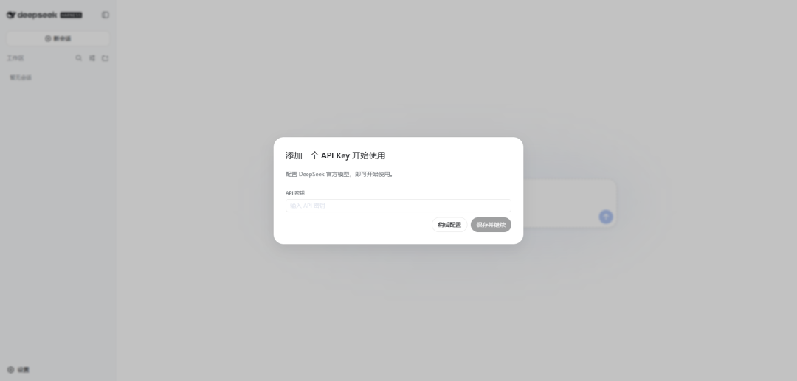
模型选择器中选择 **DeepSeek V4 Flash**
**配置即时生效**，模型路由在保存后立即可用，**无需重启服务器**。
**密钥安全机制**：密钥字段是**只写**的——保存后页面只能看到脱敏描述符，永远不会回显明文。密钥存储在 $DSH_HOME/.credentials.yaml，settings 里只保留凭据引用。Key 相当于密码，别截图、别发到公开渠道。
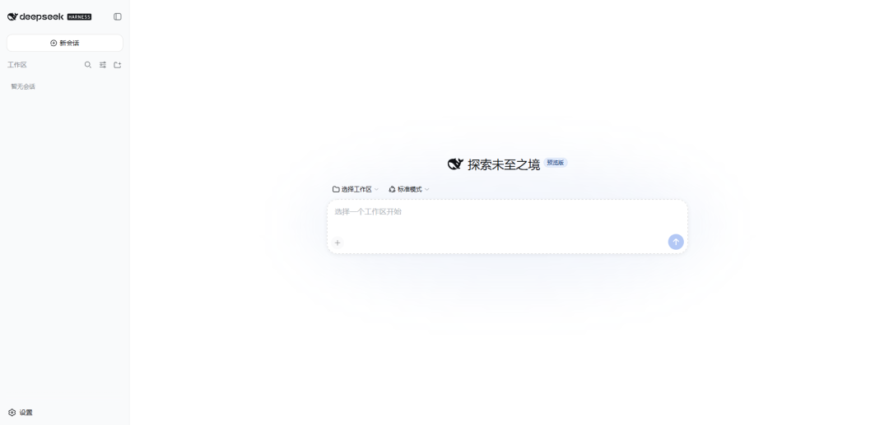
2.3 配置其他模型提供商
不想用 DeepSeek 官方 API？DSH 的模型接入是开放体系：
**添加目录提供方**（Anthropic / OpenAI 等）：
设置 → 模型 → **添加提供方** → 选择提供方 → 输入 API 密钥 → 保存。已安装的目录会提供该提供方的端点、协议和模型列表。
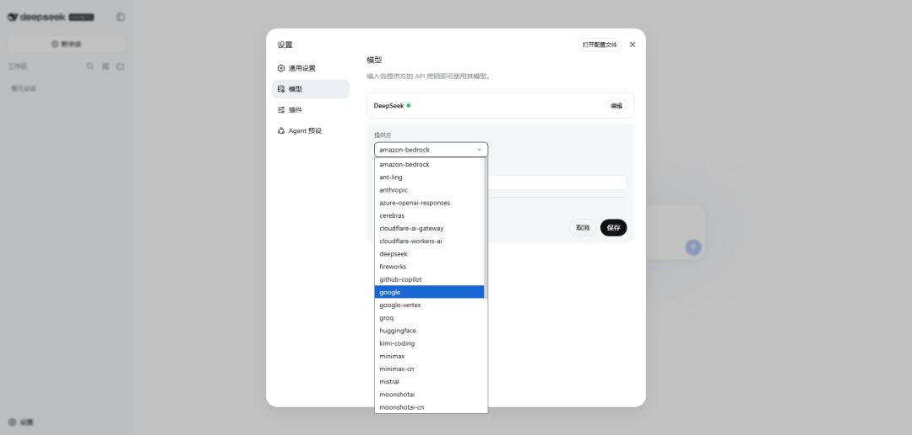
**注意 NOTE**
：使用原生认证的提供方（Bedrock、Vertex、Azure、Codex）需要各自的专属凭据——如 AWS 凭据与区域、ADC 项目、api-version、OAuth。**只填 API Key 字段是无法完成配置的**。
**添加自定义提供方**（公司网关、自建服务器、目录里没有的服务）：
设置 → 模型 → **添加自定义提供方**，填写：
**字段**
**说明**
Provider ID
小写标识，**永久性**——请求、已保存会话、模型默认值和凭据引用都会用到它；重命名 = 新建一个再删旧的
显示名称
可随时修改
基础 URL
你的 API 地址，可编辑
API 协议
如 openai-completions
凭据
API Key 或环境变量引用（如 apiKeyEnv: GATEWAY_API_KEY）
模型
至少一个模型 ID
填写时可点**获取可用模型**，DSH 会调用 OpenAI 兼容的 GET /models 端点自动发现模型列表（只更新草稿，保存前不会真正存储）。不提供该端点的服务，手动输入模型 ID 即可。
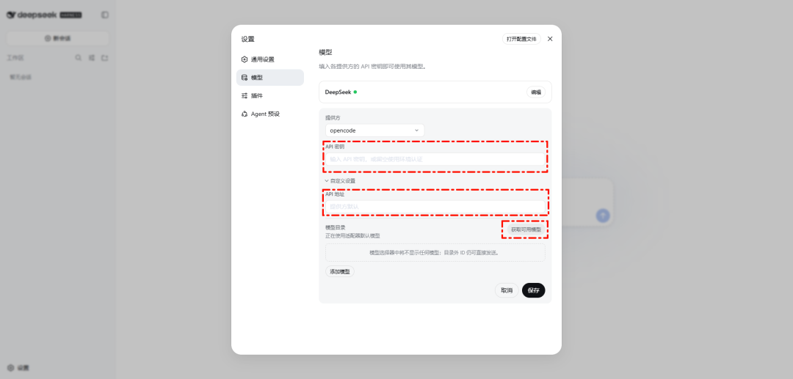
**视觉模型注意**：自定义模型在声明能力之前一律按纯文本对待。要让它能接收图片，需在 $DSH_HOME/settings.yaml 中给该模型加 input: [text, image]：
yaml
llm-pi-ai:
 providers:
 my-gateway:
 apiKeyEnv: GATEWAY_API_KEY
 api: openai-completions
 baseURL: https://gateway.example/v1
 models:
 - id: legacy-chat
 - id: vision-preview
 input: [text, image]
多个模型都支持图片时，可用路由级 defaultInput: [text, image] 统一设置（它是回退值而非覆盖值，默认 [text]）。
2.4 选择模型与会话默认值
· 已配置的提供方会出现在**模型选择器**中
· 选择的模型会自动成为**新会话的默认值**
· 已发送过请求的会话会**保留日志中记录的模型**（即中途换模型只影响新会话）
2.5 配置阶段排错
**报错**
**含义与解决**
MISSING_CREDENTIAL
密钥未配置：通过模型页存储密钥，或提供 settings 引用的环境变量
UNKNOWN_MODEL
模型未配置：选择已配置模型，或向自定义提供方添加缺失的模型 ID
获取可用模型返回 401
密钥无效：检查 Key；该服务不支持 GET /models 时请手动输入模型
图片在发送前被拒
模型未声明图片能力：给自定义模型加 input: [text, image]
带图片请求被提供方拒绝
模型声明了端点并不支持的图片能力：从 input / defaultInput 移除 image，并**开启新会话**（旧会话日志会反复重放该请求）
2.6 怎么确认配置成功
不需要研究完所有设置项。直接跑一个任务——能正常返回结果就说明一切就绪（下一章就是任务实操）。
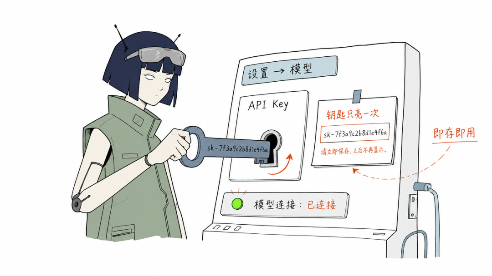
◆钥匙插进控制台，即存即用
◆
**04**
**工作区与权限：搞清楚它能在哪动手**
3.1 Workspace：Agent 的“手“能伸到哪
**Workspace（工作区）是 Agent 读写文件的边界目录，不是聊天标签页。** 你希望它在哪个文件夹里干活，就把哪个文件夹添加为 Workspace。
操作路径：Web UI → **选择工作区** → 添加启动 dsh 时所在的项目目录 → 选中。
一个容易忽略的细节：**选中工作区之前，会话输入框是禁用的**。这是强制你先划定边界再干活。
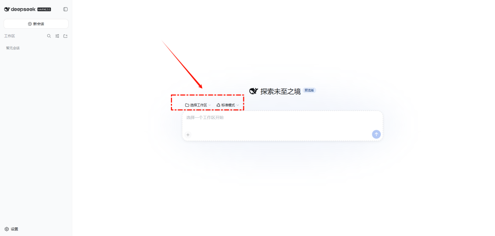
dsh 进程会把**启动时所在的目录**作为默认文件系统位置，但新 Web UI 在你主动添加前不会选中任何工作区。
3.2 三档权限模型
**权限档**
**内部名**
**允许做什么**
**典型场景**
Read Only
—
只读，不能修改任何文件
调查、总结、出方案
Workspace Write
—
只能在工作区内写文件
**日常默认**
Full Access
danger-full-access
全盘读写，无边界
高风险操作，切换前会二次确认
danger-full-access 的内部名已经说明了风险等级——它是“危险模式“，不是“高级模式“。选择它之前界面会弹出确认。
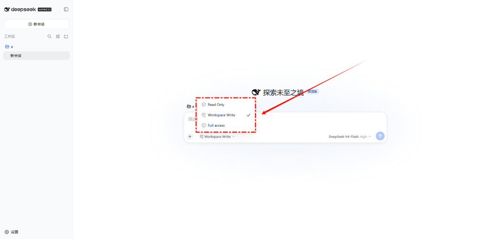
3.3 一个必须建立的认知：权限限制的是“写“，不是“看“
Workspace Write 只限制**写入范围**。读取文件、联网、查看系统进程**不受同等限制**——它的“手“被绑住了，但“眼睛“是自由的。
所以不要以为选了 Workspace Write，Agent 就“看不到“工作区以外的文件。涉及敏感的操作（联网上传、系统级改动）会触发**审批弹窗**，由你确认后才会执行，不会静默放行。
3.4 底层沙箱实现
三档权限有真实的操作系统级沙箱支撑：
**平台**
**沙箱机制**
Linux
bwrap（bubblewrap）/ Landlock
macOS
Seatbelt
Windows
ACL 受限令牌
此外还有两个常驻纠偏插件：**重复无效动作检测**（防止 Agent 对着同一个失败方案反复重试）和**超时强制中断**（防止任务无限期运行）。
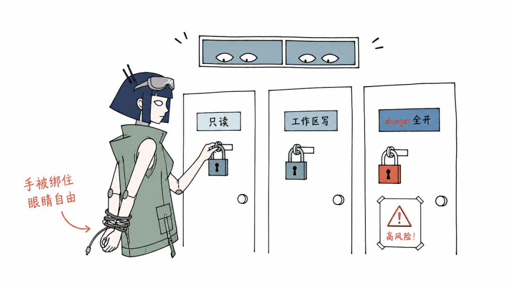
◆三道门：只读、工作区写、danger全开
◆
**05**
**日常使用：界面、会话与上下文**
4.1 界面布局
DSH 的 Web UI 与主流 Agent 产品布局趋同，上手零成本：
**区域**
**作用**
左侧
工作区文件树、会话列表
中间
对话区
右侧
产物预览（HTML、文档、图表等）
4.2 会话（Session）管理
**操作**
**说明**
新建
点“新会话“，选择模式、权限、模型
重命名 / 搜索
会话多了之后靠它们找历史
恢复
历史会话随时接着聊
**归档**
从列表隐藏，**数据不删**，可随时从“已归档“恢复
**Fork**
从某一轮对话分出一条新会话，原会话不受影响——适合“同一个起点，试不同做法“
4.3 上下文管理
· DSH 通常会自动整理较早的对话（自动压缩）
· 需要立即压缩时手动执行 /compact，把早期对话整理成摘要
· **压缩不会删除原始历史**——完整日志仍然保留（见第 8 章“可追踪性“）
4.4 快捷操作
**按键**
**作用**
Shift + Enter
换行，不发送
终端 Ctrl + C
停止整个 DSH Host
◆
**06**
**模式与命令：Agent 的“岗位“与“口令“**
5.1 四种 Preset 模式
Preset（预设）是**能力组合包**——同一种模型，挂上不同的工具集和规则，就能承担不同的岗位。新建会话时选择，**开始运行后锁定**（模式决定工具集，中途切换会破坏会话可复现性，所以不允许切）。
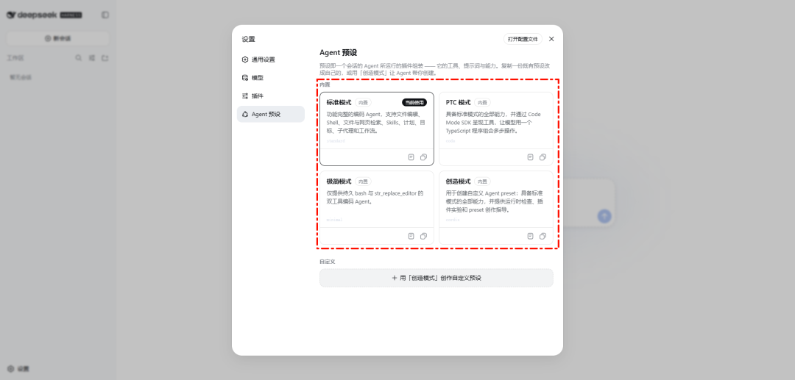
**模式**
**工具集**
**适合场景**
**标准模式（Standard）**
全功能：文件编辑、Shell、检索、Skills、计划、子代理、工作流
功能最完整，拿不准就选它
**PTC 模式（Code Mode）**
模型编写 TypeScript，把多步工具操作组合成一段程序一次执行
步骤多、追求速度与省上下文的任务
**极简模式（Minimal）**
仅持久 Bash + str_replace_editor 两个工具
基准测试、教学演示
**创造模式（Creator）**
可读写运行时本身（Shell 级信任）
定制新预设、改造 DSH 自身
**安全提醒**：创造模式的信任等级等同于 Shell 访问权限——它执行的代码可以直接修改 DSH 运行时。只建议在受信任环境使用。
5.2 计划模式（Plan Mode）
计划模式让 Agent **只调查、只出方案，不修改任何内容**，等你确认后才动手：
· 开启：输入 /plan（或新会话选计划模式）
· 退出：输入 /plan off
适合的场景：让 Agent 先评估一个仓库、先拆解一个复杂需求、先给出方案再决定要不要执行。
5.3 斜杠命令总表
输入框敲 / 会弹出命令列表，内置命令和已安装的 Skills 都在里面：
**命令**
**作用**
/plan
进入/退出计划模式
/goal
为当前会话设定长期目标（Goal 管方向，Todo 管当前任务）
/compact
立即压缩早期对话为摘要
/permission
切换权限档
/model
切换模型
/export
将会话日志打包为 ZIP 下载
/feedback
提交反馈

◆同一个 Agent，四个档位
◆
**07**
**与 Agent 高效协作：把话说清楚**
6.1 任务描述四要素
Agent 任务效果的好坏，七成取决于你的描述质量。高质量的任务描述包含四个要素：
**要素**
**解决的问题**
**示例**
**目标**
要什么结果
“把 report.docx 按新版式规范重排“
**范围**
可以碰哪些文件
“只处理 report.docx 这一个文件“
**禁区**
绝对不能动什么
“正文内容零改动，数据表格和图表原样保留“
**验收**
怎样算完成
“完成后按标题层级输出一份清单供我核对“
6.2 好与坏的对比
❌ “帮我弄一下这个报告。“——没有格式、没有范围、没有验收，Agent 只能猜。
✅ “请重排 report.docx：正文宋体小四、1.5 倍行距，一级标题黑体三号加粗（**目标**）；只允许改动这一个文件（**范围**）；正文内容一字不改、图表原样保留（**禁区**）；完成后列出所有标题层级清单供我验收（**验收**）。“
对比之下很容易看出问题：不是模型不够聪明，而是第一句话根本**没有给出足够的信息**。描述越具体，返工越少，这是所有 Agent 产品的通用规律。
6.3 长期规则：AGENTS.md
需要反复交代的规则（“公司名称一律用全称““金额保留两位小数“），写进工作区根目录的 **`AGENTS.md`** 文件。DSH 同时识别 CLAUDE.md。**每次会话开始它都会读取这份文件**——一次配置，永久生效，不必每次重复强调。
6.4 任务运行中的三种介入方式
任务进行到一半，你发现了新需求或想纠偏：
**方式**
**行为**
**适用**
**停止 / 取消**
终止当前这轮执行
方向错了及时止损。注意：只停当前轮次，**不会关闭 DSH，也不会回滚已改动的文件**
**Queue（排队）**
新消息排在当前任务结束后处理
不想打断它，但先表达诉求
**Steer（中途引导）**
新指令立即插入正在执行的工作
发现跑偏，立刻纠正
◆
**08**
**实操示例：三个由浅入深的任务**
7.1 任务一：验证环境（官方推荐）
配置完成后发第一条消息，官方文档的推荐用例：
Summarize this repository and identify its main packages.
（总结这个仓库，并指出它的主要模块）
它会读取文件、运行命令、给出结构化总结。能顺利返回，说明模型、工作区、权限链路全部打通。
7.2 任务二：生成办公文档
考验“读写文件 + 格式化输出“能力：
在当前工作区生成 Word 周报模板「本周工作周报.docx」：标题黑体二号居中；四个一级标题黑体小三加粗；正文宋体小四、1.5 倍行距、首行缩进 2 字符。
任务结束后打开工作区文件夹，本周工作周报.docx 已经躺在那里。**“产出真实文件“就是 Agent 与聊天机器人的本质区别。**
7.3 任务三：结合计划模式做一个改造
先不要动手（用 /plan）。分析一下 worktree 目录下的 node 项目：当前用了哪些依赖、构建脚本怎么写的、如果要加一个 lint 步骤需要改哪些文件。给出方案后我再确认执行。
先看方案、再批准执行，是日常开发中最稳妥的协作节奏。
◆
**09**
**看懂执行过程：它到底干了什么**
8.1 对话标签的顺序
每轮对话按顺序展示：**上下文注入 → 思考（Think）→ 工具调用 → 审批请求 → 最终回答**。
· 上下文注入：开工前把提示词、可见工具、历史记录组装给模型
· 工具调用：点开可看到**完整命令、匹配到的文件和具体行号**
· 审批请求：越界操作等待你的确认
8.2 Trajectory（轨迹）视图
如果 Agent 说“改好了“但你打开文件发现没变化，去**轨迹标签**查——它记录了 Agent 每一步的实际行为：
· 读取过哪些文件
· 执行过哪些命令
· 完成了哪些修改
· 每一步的耗时
这是排查“嘴上说改了、实际没改“类问题的第一现场，社区评价为同类框架中最好的审查工具。
8.3 日志的不可篡改性
Session 日志是 **append-only（只追加、不可改写）** 的：系统提示词、模型思考、每次工具调用与返回、每次上下文注入，全部原样落盘。**上下文压缩不会删历史**。恢复、Fork、回放依赖的都是这份完整日志。
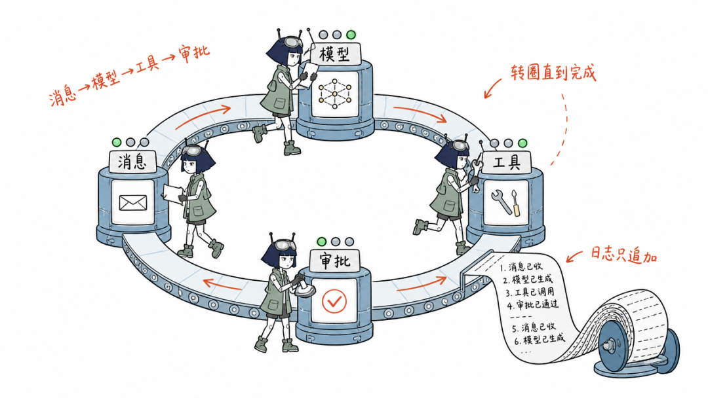
◆消息在环形轨道上转圈，直到完成
◆
**10**
**多智能体与自动化**
9.1 多 Agent 协作能力
**能力**
**说明**
**Subagent（子代理）**
可续跑的后台子代理，结果自动回传，运行中可发消息
**Subagent_fork**
一次性子代理，任务结束即回收
**Workflow（工作流）**
脚本化的确定性编排，多 Agent 按步骤协作
**Ralph 循环**
每轮启用全新子代理试错，直到通过
配合 **Skills**（可复用的技能包），复杂任务可以拆解给多个 Agent 并行处理。
9.2 Headless：无界面运行
不开网页，一行命令跑完一个任务，输出结果后退出：
bash
dsh run "把 docs/ 目录下所有 md 文件合并为一个 README.md"
典型场景：**CI/CD 流水线、定时脚本任务、批量处理**。
9.3 生态兼容层
· **MCP**：任意 MCP 服务器可接入（复用海量现成工具）
· **Hooks 桥**：复用 Claude Code / Codex 的钩子脚本
· **ACP**：内置 ACP 服务端实现
· **Python SDK**：官方提供，供 Python 程序调用 DSH 能力
◆
**11**
**插件生态：DSH 的灵魂**
10.1 “一切皆插件“到底意味着什么
**你看到的整个 Web UI 就是由 122 个插件组合而成的**——权限审批、计划模式、上下文压缩、Skills、侧边栏、甚至“连接模型“本身，都是插件。
意味着你可以：
· 替换默认组件（换掉侧边栏、换掉审批策略）
· 添加新能力（新工具、新渲染器、新交互）
· 改造 DSH 自身的行为
10.2 安装插件
bash
dsh plugin --profile web add 
**装完必须重启才生效。**
10.3 安全警告（重要）
**插件能执行任意代码，三档权限体系管不住它。** 安装插件前务必确认来源可信——把装插件当成装系统软件对待。
10.4 社区生态现状
GitHub dsh-plugin topic 下已有 **250+ 个公开插件仓库**（数字还在增长）。以下为代表性项目：
**插件**
**功能**
**DSH-better-sidebar**
侧边栏完整工作台：文件渲染编辑、终端、Git、子代理，支持三方 Tab 扩展
**dsh-open-in-vscode**
从 Web UI 一键在 VS Code 中打开工作区
**dsh-at-file**
Codex 风格 @file 引用：搜索工作区文件并附加内容到提示词
**dsh-notification**
任务完成桌面通知，支持按结果类型与关键词规则过滤
**dsh-annotation**
网页选中批注：选文字→批注→随消息发送，回复逐条对照
**dsh-custom-tool**
Monaco 编辑器创建沙箱化 JS 工具，模型驱动工具生命周期
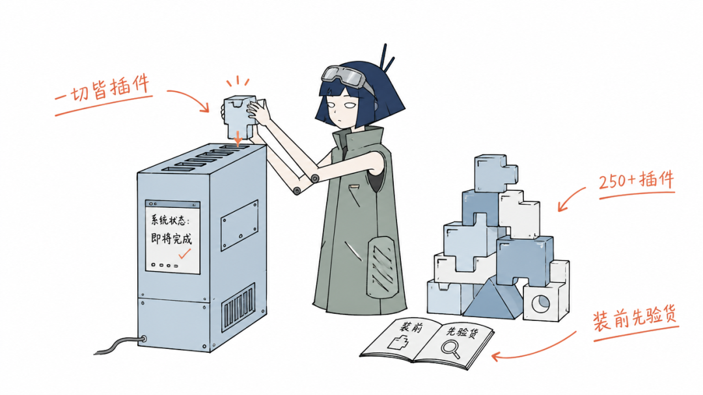
◆一切皆插件：把积木插进插槽
◆
**12**
**进阶玩法：改造 DSH 本身**
11.1 创造模式的真实用例
DSH 的独特之处在于**可自我修改**。一个典型场景：科研用户需要直接查看蛋白质的 PDB 三维结构，他没有去搜插件、没有手写代码，**只在创造模式里提出需求**——Agent 随即接入 3Dmol 渲染库，在界面中生成了可交互的结构卡片。该用户后来又接入了十几个 MCP 外部数据库，一个通用 Agent 最终变成了专属科研工作站。
这个过程展示了“一切皆插件“的最终形态：**Agent 自己给自己加能力**，定制门槛从“会写代码“降到“会提需求“。
11.2 面向开发者的架构速览
**Cordis 内核**：DSH 基于 Cordis（Koishi 生态插件内核）负责插件的加载/卸载与依赖关系管理。
**配置层级（插件树）**：
bash
bundle（官方成套配置）→ profile（本机具名组装清单）→ patch（精确覆盖层）
上层配置覆盖下层。
**能力三角色分离**：服务定义（接口规范）/ 提供方（实现）/ 消费方（使用）三者独立。例如 bash 工具的接口、本地实现、工具暴露是三个独立包——模型看到的接口恒定，换实现不影响调用方。
**执行模型**：
· **Turn**：一条用户消息引发的完整活动
· **Step**：一次模型请求 + 其要求的工具调用
· 每个关键位置（开始前/工具执行前后/模型请求前）都是**可拦截扩展点**：审批、改写、记录都挂在这里
**完整链路**：用户消息 → 组装上下文 → 模型 → 工具调用 → 权限/审批 → 工具结果 → 模型 → 最终回答（循环直至完成）。
**值得一读的文档**：插件开发指南 docs/user/develop/、配置目录 docs/config-catalog.md、架构文档 docs/architecture.md。
◆
**13**
**常见问题汇总**
12.1 配置类
**问题**
**排查路径**
网页能打开，一发消息就报错
优先查余额与 Key 状态（开放平台：余额是否耗尽、Key 是否被误删）
昨天能用，今天网页打不开
终端被关了。重新 dsh web 即可
模型选择器是空的
未配置任何提供方：设置→模型→添加
提示“选择模型“且无法输入
会话保存的默认模型指向了已删除的提供方：重新选择模型
12.2 使用类
**问题**
**说明**
会话中途不能换模式
设计如此：模式决定工具集，切换破坏可复现性。新建会话再选
Agent 说改好了但文件没变
看轨迹标签核对实际执行
想要“只读分析“
用 Read Only 权限或 /plan
会话太多找不到
搜索 + 归档管理
12.3 性能参考
官方公开的性能数据（DeepSeek-V4-Flash High 实测）：缓存命中可达 100%，首 token 平均约 0.3s，输出速率约 120 tck/s。
12.4 项目现状与风险提示
· **开发者预览版**：核心插件和 API 仍在演进，未来有破坏性变更的可能，生产环境接入需评估
· **认准官方仓库**：网上存在同名第三方仓库与 SEO 营销内容，请以 deepseek-ai/deepseek-harness 为准
· **生态竞争**：Claude Code / Codex 已占据大量开发者心智，DSH 的生态仍在建设期，但有 DeepSeek 官方战略投入
12.5 社区入口
· GitHub Discussions：反馈与讨论
· 官方企微群：扫码企微小助手填问卷入群
· 微信公众号：官方动态
· dsh-plugin topic：发现插件
◆
**14**
**一页速查（收藏这一节就够了）**
bash
# 安装与启动
node -v # 检查版本（需 ≥ 22.19）
npm install -g @deepseek-ai/dsh
dsh --version # 验证
dsh web # 启动（终端保持开启）
dsh web --port 8080 # 换端口
npx @deepseek-ai/dsh web # 免安装启动
# 插件
dsh plugin --profile web add  # 装插件（装完重启）
**日常使用要点**：
首次配置：设置→模型→填 Key→选模型，即存即用
先选工作区再说话（没选工作区输入框是灰的）
权限默认 Workspace Write，Full Access 有风险
描述任务四要素：目标/范围/禁区/验收
长期规则写进 AGENTS.md
想让它先想清楚就 /plan
看它干了什么就看轨迹标签
归档≠删除，Fork 适合平行实验
插件有完整权限，来源要可信
终端别关
◆
**15**
**参考来源**
· DeepSeek Harness 官方仓库：github.com/deepseek-ai/deepseek-harness（README / README.zh）
· 官方 Web UI 指南：docs/user/guide/index.md
· 官方模型配置指南：docs/user/guide/providers.md
· 官方配置目录：docs/config-catalog.md
· 官方页：deepseek.com/harness/en
· 社区技术拆解：V2EX、OSCHINA、LINUX DO
如果你读到了这里
这篇指南值得被更多人看到
**👍 点赞**
**👀 在看**
**↗ 转发**
感谢你的阅读时间 · 我们下篇文章见
