# DeepSeek Harness 零基础无压上手教程，手把手教你使用！
> 💡 备注属性未写入，可能是备注属性名称或者类型被修改了，建议将字段类型设置为 rich_text，可以在小程序-操作-修改文章数据库页面进行调整
> 💡 原文链接:[https://mp.weixin.qq.com/s?__biz=Mzk2NDU0NDczMg==&mid=2247495678&idx=1&sn=5160cdba9a39b28d669cce5118eac0cd&chksm=c5a6c7edbf9c07f58f211b78cc3c7ce3cdda17dac7e6b11d3d072d3a5518c2f85a158bf11755#rd](https://mp.weixin.qq.com/s?__biz=Mzk2NDU0NDczMg%3D%3D&mid=2247495678&idx=1&sn=5160cdba9a39b28d669cce5118eac0cd&chksm=c5a6c7edbf9c07f58f211b78cc3c7ce3cdda17dac7e6b11d3d072d3a5518c2f85a158bf11755#rd)
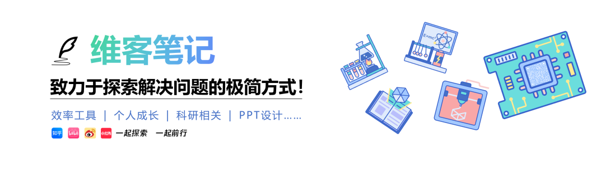
大家好，我是来自1037号森林的维客！
💡
Tip
🎉 [写给大家的 AI 实战案例专栏](https://mp.weixin.qq.com/mp/appmsgalbum?__biz=Mzk2NDU0NDczMg%3D%3D&action=getalbum&album_id=4469519143632912386#wechat_redirect) 25+本人亲身实战案例
 🍀 [我的实用工具库分享](https://mp.weixin.qq.com/s?__biz=Mzg5Njk3MDUyMQ%3D%3D&mid=2247491296&idx=1&sn=07629f3b2a2915a0d13601ba46abcc43&scene=21#wechat_redirect)
## 01 引言
 
昨天分享了一篇文章👉 [找了这么久，我终于遇到一款喜欢的国产 AI Agent](https://mp.weixin.qq.com/s?__biz=Mzk2NDU0NDczMg%3D%3D&mid=2247495641&idx=1&sn=35687188bbec845b72b4ac31a56028cc&scene=21#wechat_redirect)，向大家介绍了 DeepSeek 官方开发的开源 Agent，DeepSeek Harness。
在文章发布之后，收到了一位读者的留言：
那是不是下载后要买 API 之类的，还是说要买会员用？我除了认识会员，API 这些不懂，求博主教如何使用，感谢。
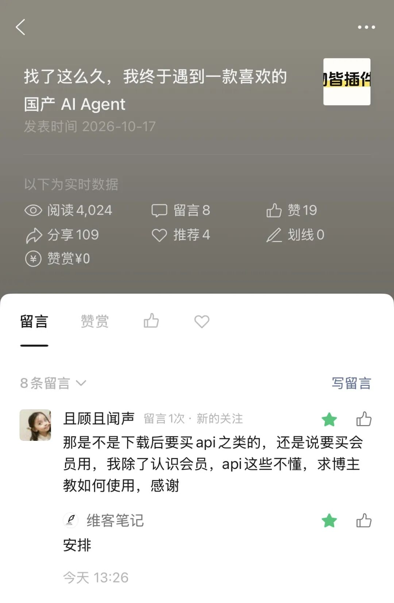
看到这条留言，我也反思了一下，确实有些考虑不周。
上一篇文章主要介绍了 DeepSeek Harness 的设计理念、功能以及我为什么喜欢它，却没有详细介绍具体怎么使用。
对于平时经常折腾各种 AI 工具的小伙伴来说，可能下载之后就知道怎么用了。
但对于第一次接触 AI Agent 的朋友，什么 API、Token、模型配置，可能一下子就有点懵了。
所以今天专门写一篇零基础无压入门教程。
从下载安装到模型配置，再到实际使用，一步一步带大家把 DeepSeek Harness 用起来。
💡
Tip
强烈建议大家直接安装使用 deepseek harness 桌面版
## 02 需要购买会员或者 API 吗？
 
先回答一下前面那位读者的问题。
DeepSeek Harness 软件本身完全免费，也不需要额外购买 Harness 会员，也没有会员可以买。
另外，对于零基础用户，我建议也先别折腾 API。
因为 DeepSeek Harness 桌面版已经支持直接登录 DeepSeek 账号了。
也就是说，你可以先通过 DeepSeek 开放平台账号登录，然后使用账户内可用的模型额度（如果没有的话就直接充值），无需自己创建&配置 API Key 了，其实和买会员也差不多。
接下来，我还想啰嗦几句，简单介绍几个概念，方便大家理解。
### 会员
这个大家应该都很熟悉。比如 ChatGPT Plus、Gemini 的付费会员，通常按月或者按年订阅。购买之后，就可以在对应的产品中使用会员提供的 AI 功能和模型额度。当然，会员不代表可以无限制使用，具体还要看各平台的使用规则。
这也是我个人比较喜欢的一种方式，既能享受网页中 chat 额度，同时又能享受到一些 agent 的额度，可以直接在我的电脑上帮我处理各种文件。 不用过于担心额度的问题，反正每周一重置，基本能够满足日常生活需要。
### API 和 API Key
API可以简单理解为软件之间进行通信的一个接口。
举个例子：我们在 DeepSeek Harness 中发送一条消息，它通过 API 将我们的请求发送给 DeepSeek 模型，模型处理完成后，再通过 API 把结果返回给我们。
整个过程就是一次 API 调用。
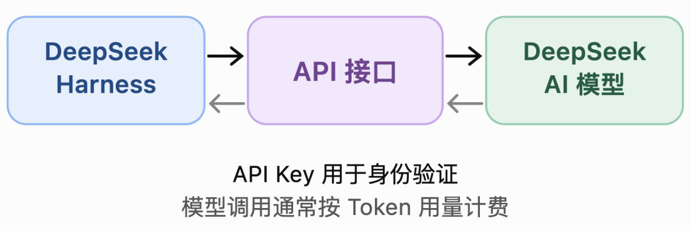
而 API Key 相当于使用这个接口的钥匙。
当你需要通过 API 使用某个模型时，通常需要在模型服务商那里申请一个 API Key，再将其配置到 DeepSeek Harness 中。
这样软件就知道该使用哪个账户来调用模型，以及如何统计费用。

### Token
这是在 AI 时代经常出现的一个词。
它是大模型处理文本时使用的基本单位，也可以理解成 AI 的一种计量单位。
比如，我们向 AI 提问，模型需要读取我们输入的内容，然后生成回答。
输入和输出都会消耗一定数量的 Token。
很多模型 API 就是根据 Token 的使用量收费的。
不同模型的价格可能不同，而且输入和输出的 Token 价格也可能不一样。
所以，使用 API 时，用多少、付多少，当然前提是所选服务采用按量计费的方式。
## 03 安装
 
本次文章仅以使用 deepseek 官方平台的模型来介绍。
### 3.1 下载安装
首先进入 DeepSeek Harness 官网：**https://deepseek.com/harness/**
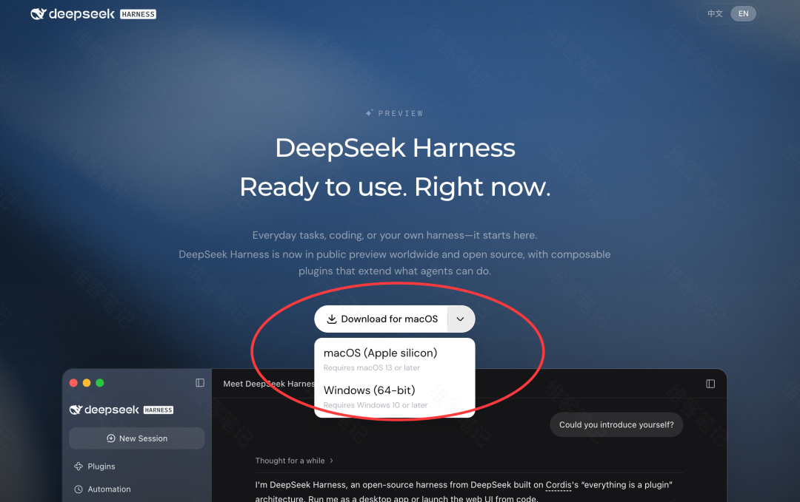
目前仅提供 macOS 和 Windows 两个平台的客户端。
根据自己的电脑选择相应版本。
下载安装之后，和我们平时安装其他软件一样一样的。
这里就不展开了。
### 3.2 登录 DeepSeek 账号
直接选择左下角的更多--登录
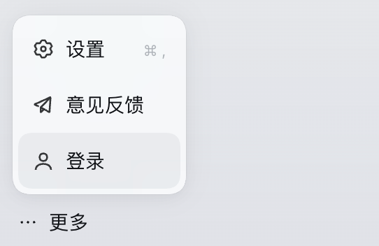
接下来会自动打开浏览器，跳转到 DeepSeek 的登录及授权页面。
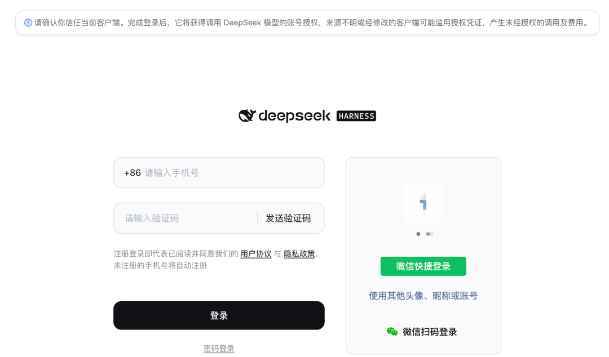
如果之前使用过 DeepSeek，可以尝试直接登录已有账号。
没有账号的话，直接手机号注册即登录
登录授权成功之后，返回 DeepSeek Harness，在左下角就能看到你的账号名称了。
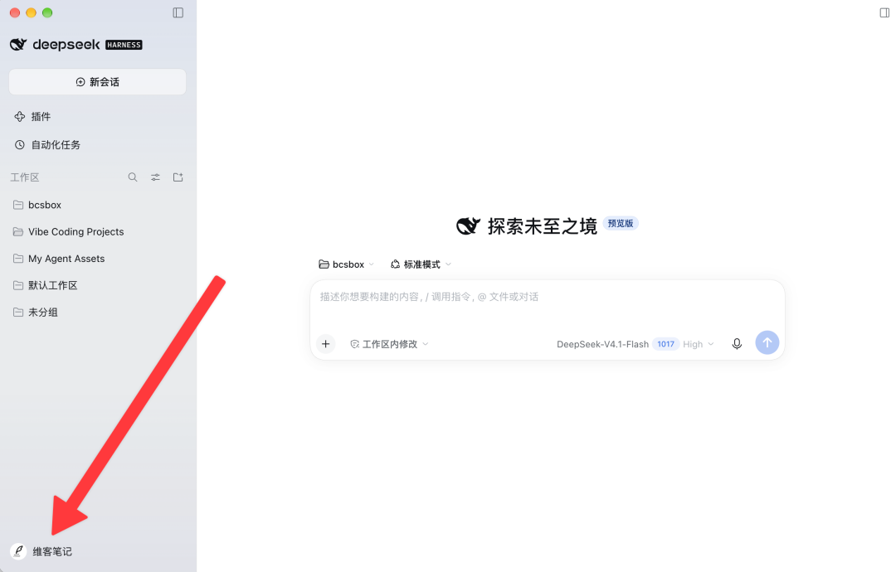
最近注册还赠送 6 块钱的额度，其实可以直接开始使用了
是不是很简单？
### 3.3 查看账号余额
在正式使用之前，我建议大家先看一下自己的账户余额。
通过左下角的账号名称进入设置
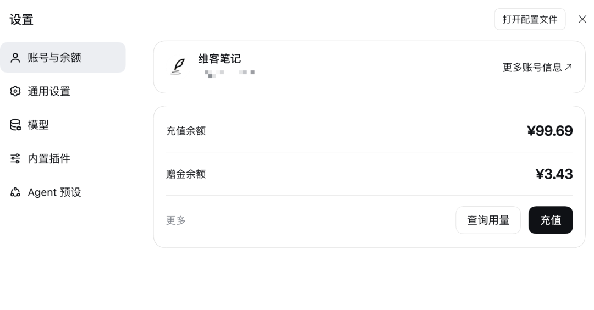
其中第一项就是账号与余额，这里可以查看账户当前的可用额度，包括充值余额和可能存在的赠金余额。
如果有赠金，大家可以先用来体验。
如果没有可用额度，可以直接单击上图中的充值即可跳转到充值界面，支持微信、支付宝和对公汇款，很方便。
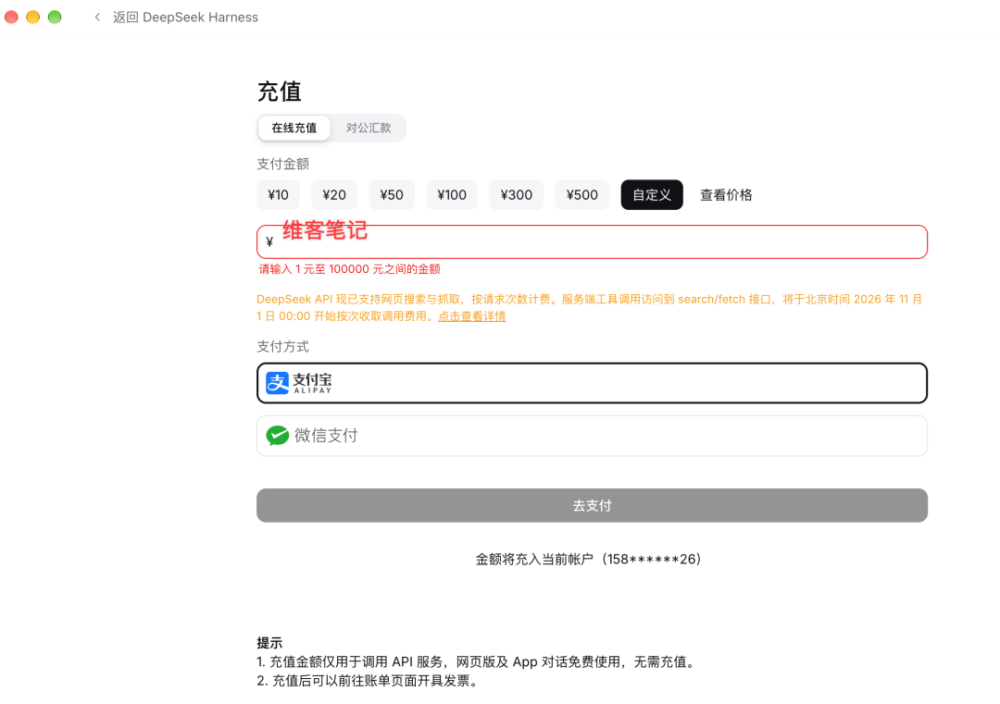
至于充值多少，我觉得没必要一开始就充很多。
先少量充值，熟悉软件之后，再根据自己的实际需求决定。
关于具体模型价格，可以参考  DeepSeek 官方说明[1]。
## 04 DeepSeek Harness 的界面与配置
 
登录完成后，就可以正式使用 DeepSeek Harness 了。
不知道大家还记不记得，上一篇文章我说过，我特别喜欢它的 UI。
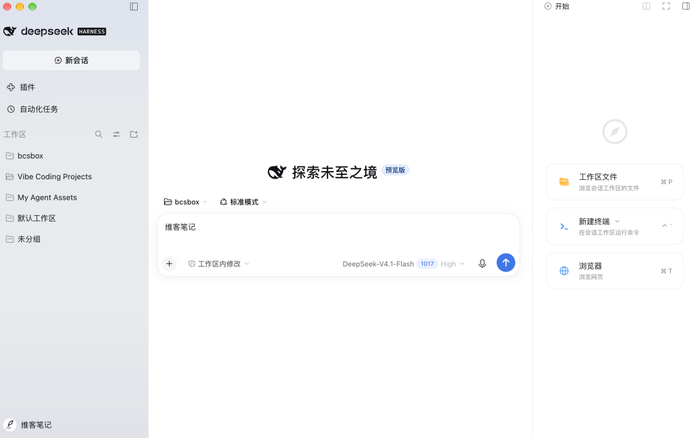
整体非常简约。
左侧主要是会话、工作区、插件等功能入口，中间则是熟悉的 AI 对话界面，右侧边栏可以浏览工作区的文件、打开终端和打开浏览器。
如果你之前用过Codex，对于这个界面你会非常熟悉。
即便没有用过，我觉得熟悉下面几个地方就够了。
### 4.1 添加工作区
这一步，我建议大家认真了解一下。
因为它和我们后面如何使用 Agent 有很大关系。
所谓工作区，你可以简单理解成电脑上的一个文件夹。
DeepSeek Harness 可以围绕这个文件夹读取、创建和修改各种文件。
和之前使用 Codex 一样，**我自己习惯先添加项目文件夹，然后针对这个文件夹开展各种操作。**
比如，我要整理一个项目的资料，就将这个项目对应的文件夹添加进来。
如果想让它处理 Obsidian 笔记，也可以添加相应的笔记库。
当然，对于第一次使用的朋友，我建议先别直接添加自己的 Obsidian 笔记库或者其他重要文件夹。
可以先在电脑上创建一个文件夹，命名为：**DeepSeek Harness 测试**
然后，在 DeepSeek Harness 中添加这个文件夹作为工作区。
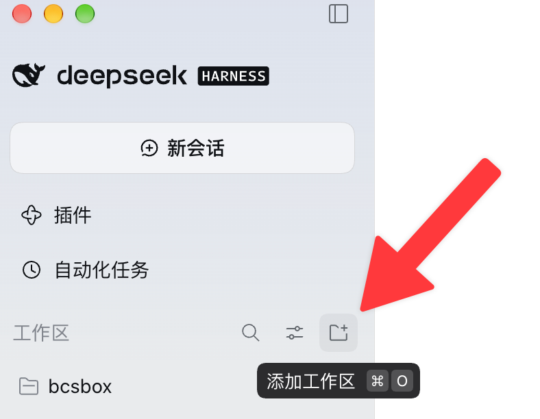
接下来，我们就可以围绕这个文件夹进行各种操作了。
当然也可以直接使用默认工作区。
### 4.2 配置模型
接着看一下模型配置。
在对话框附近，可以找到模型选择器。
如果已经通过 DeepSeek 账号登录，就可以选择当前账号支持的 DeepSeek 模型。
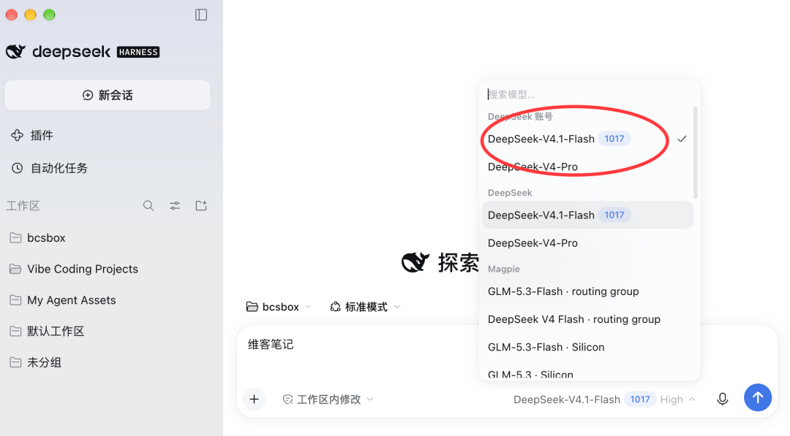
目前 DeepSeek 提供 Flash 和 Pro 等模型，我建议大家直接使用这个 V 4.1 flash 模型，这个是昨天刚发布的，据说性能很强，不过我还没有系统测试。
另外 flash 模型比 pro 模型更便宜。
至于推理等级、上下文窗口等参数，第一次使用完全可以先保持默认，如果想调的话，在聊天框这里也可以直接设置，我喜欢设置为 high 或者 max。
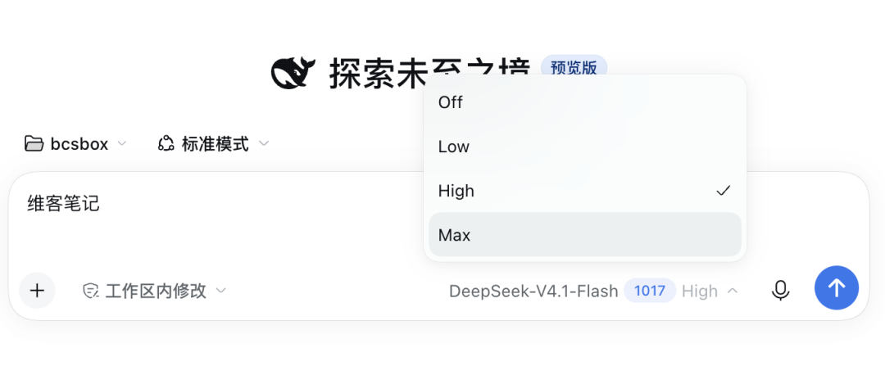
### 4.3 操作权限
这个我觉得很重要。
毕竟 DeepSeek Harness 可以直接操作我们电脑上的文件。
同样在对话框附近，可以找到权限设置。
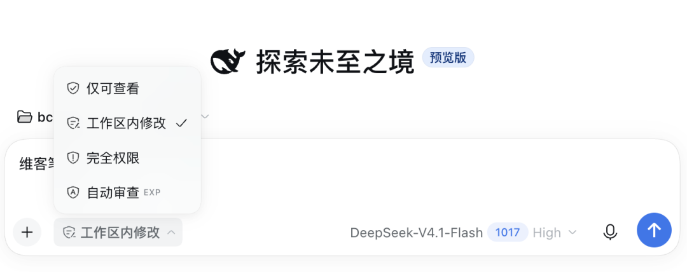
目前常见的权限模式包括：
• 
**仅可查看**：适合阅读、分析文件，不需要修改文件的任务。
• 
**工作区内修改**：允许 Agent 在工作区内进行一定范围的文件修改。
• 
**完全权限**：授予更广泛的操作能力，需要谨慎使用。
• 
**自动审查：** 介于工作区和完全权限之间的一种权限吧，会由当前 agent 相同的模型自己审查决定，如果被拒绝，还需要你自己来决定。
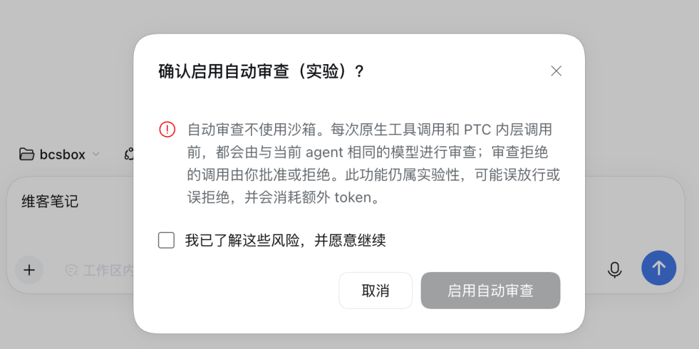
我自己目前主要使用「工作区内修改」。
一方面，DeepSeek Harness 还在快速迭代；另一方面，我也不希望 Agent 随意修改工作区之外的东西。
所以对于新手，我建议先从「仅可查看」开始。
等需要它创建或修改文件时，再切换到「工作区内修改」。
此外，建议养成备份文件的习惯，权限控制可以降低风险，但不能保证绝对安全。
## 05 开始使用
 
前面已经完成了基本配置。
接下来，我们通过一个非常简单的例子，看看 DeepSeek Harness 究竟怎么用。
还记得前面创建的「DeepSeek Harness 测试」文件夹吗？
现在切换到这个工作区，新建一个会话。
把权限设置为「工作区内修改」。
然后直接在对话框中输入：
请在当前工作区创建一份 Markdown 格式的「AI 学习计划」。
我是一名刚开始接触 AI Agent 的普通用户，希望通过 7 天时间学习 AI Agent 的基础使用。
请帮我制定一份简单、容易执行的学习计划，每天包含学习目标、具体任务和预期成果。
请将最终内容保存为「AI 学习计划.md」。
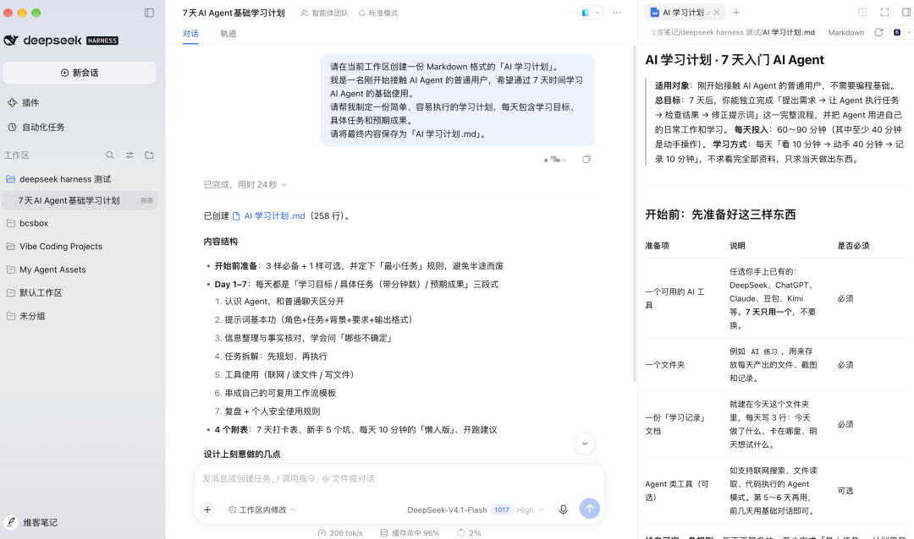
接下来，就交给 DeepSeek Harness 了。
它会根据我们的要求规划任务，必要时调用工具，在工作区中创建相应的文件。
如果中途弹出权限确认，记得先看清楚它要执行什么操作，再决定是否允许。
任务完成后，可以看到直接就有一个 AI 学习计划.md 文件，单击它就会自动在右侧边栏打开该文件，可直接阅读。
在我们的 DeepSeek Harness 测试文件夹中也会有该文件
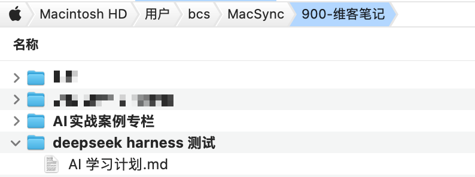
到这里，我们就完成了第一个任务。
但我觉得还可以继续。
比如，打开刚才的对话，再告诉它：
刚才的学习计划有些简单了。
 我希望每天的学习任务都附带一个具体的实践案例，并增加一个完成情况的复选框。
 请直接修改之前创建的文件，保留原有的 7 天结构。
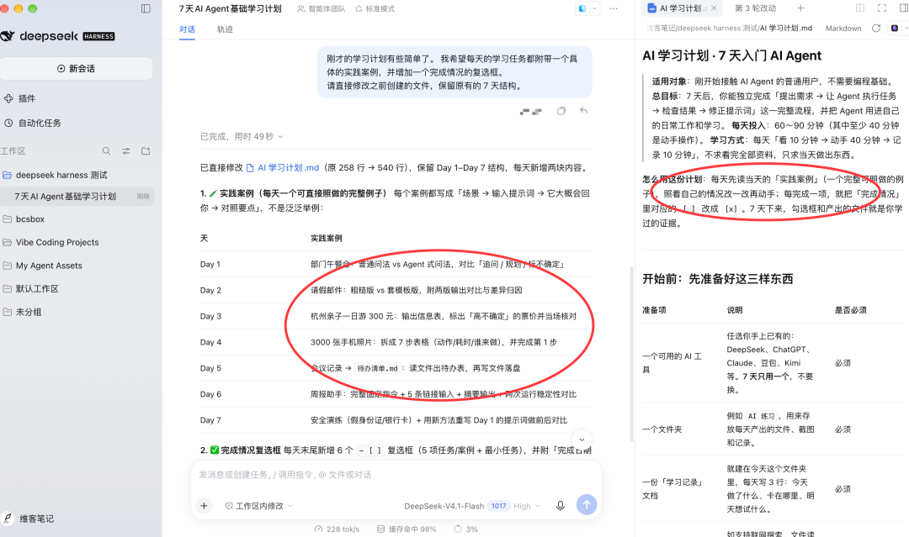
这样一来，我们就可以通过对话，让 AI 不断修改、完善文件。
如果你之前只使用过普通的 AI 聊天工具，可能会觉得这种操作很方便。
因为它可以直接帮我们处理本地文件。
当然，我上面举的只是一个很简单的案例。
实际使用中，你还可以让它整理文献资料、处理 Excel 表格、分析数据，甚至编写程序。
这些我之前在 [AI 实战案例专栏](https://mp.weixin.qq.com/mp/appmsgalbum?__biz=Mzk2NDU0NDczMg%3D%3D&action=getalbum&album_id=4469519143632912386#wechat_redirect)中也分享过不少，很多思路都可以迁移到 DeepSeek Harness。
### 06 写在最后
关于 DeepSeek Harness 的基础使用，今天就先分享这么多。
回顾一下，其实整个过程很简单：
下载软件、登录账号、查看额度、添加工作区、选择模型，然后直接告诉它你想做什么。
至于 API、Skills、插件这些东西，完全可以后面慢慢研究。
对于第一次接触 AI Agent 的朋友，我建议先从一些简单的文件处理任务开始。
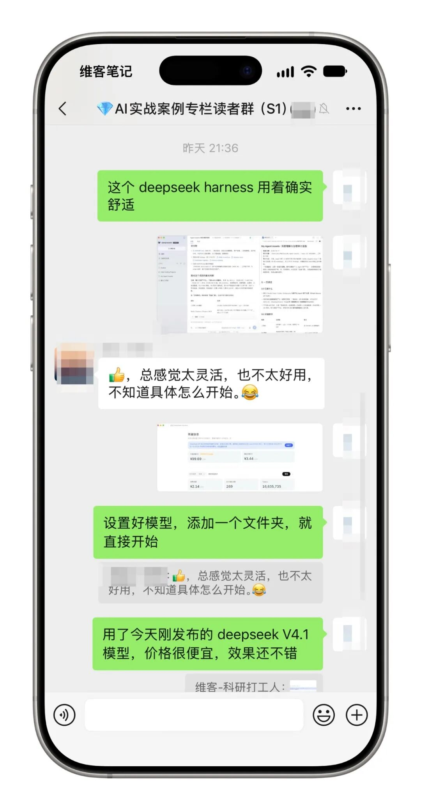
**先用起来，再一点点探索它的更多能力。**
其实，使用 Obsidian 也是同样的逻辑，先新建一个 md 笔记，写起来，其他的根据自己的实际需求慢慢添加。
之前写 [Codex 入门教程](https://mp.weixin.qq.com/s?__biz=Mzk2NDU0NDczMg%3D%3D&mid=2247494347&idx=1&sn=fb187f15ae3d2a6f586376898cacf5d9&scene=21#wechat_redirect)时，我就提到过，很多 Agent 的基本使用方式其实都很相似。
DeepSeek Harness 也是这样。
真正值得花时间学习的，我觉得是如何让 Agent 更好地理解我们的需求，以及如何通过它解决实际问题。
 哈哈😄，此刻应该去看我的 [AI 实战案例专栏](https://mp.weixin.qq.com/mp/appmsgalbum?__biz=Mzk2NDU0NDczMg%3D%3D&action=getalbum&album_id=4469519143632912386#wechat_redirect)
当然，我自己也还在继续探索 DeepSeek Harness。
尤其是它「万物皆插件」的理念，我非常期待对 DSH 丰富的插件生态的探索。
也许后面我会尝试自己开发一些插件，或者把之前的一些 AI 工作流迁移过来。
到时候再和大家分享。
祝大家玩得愉快！
💡
Tip
非常感谢&欢迎大家订阅我花费了很多心思和精力打造的[写给大家的AI 实战案例专栏](https://mp.weixin.qq.com/mp/appmsgalbum?__biz=Mzk2NDU0NDczMg%3D%3D&action=getalbum&album_id=4469519143632912386#wechat_redirect)，每个案例都是我自己的亲身经历，目前已更新了 26 期，第 2 季正在打造中。
---
欢迎关注维客笔记，一起探索解决问题的极简方式！
 A better you, A bigger world！
非常感谢【点赞👍、推荐❤️、赞赏💰】，因为有你，所以坚定前行！
[1] DeepSeek 官方说明：https://api-docs.deepseek.com/zh-cn/quick_start/pricing/

## 摘要

（待补充）

## 我的笔记

（待补充）
