# DeepSeek Harness 首发实测 + 入门教程，夯爆了！
> 💡 原文链接:[https://mp.weixin.qq.com/s?__biz=MzUzMjUyMDQ5Mw==&mid=2247489325&idx=1&sn=eb0a69416cc7c3aad424e0cfcf9ee1f5&chksm=fbbe945258c878992e777d88f3ccbec9861719633fc9272f1a2bdd38e82903e38e6f186984e2#rd](https://mp.weixin.qq.com/s?__biz=MzUzMjUyMDQ5Mw%3D%3D&mid=2247489325&idx=1&sn=eb0a69416cc7c3aad424e0cfcf9ee1f5&chksm=fbbe945258c878992e777d88f3ccbec9861719633fc9272f1a2bdd38e82903e38e6f186984e2#rd)
大家好，我是程序员小灰。
前两天 AI 圈子传出一个重磅消息：DeepSeek 官宣了他们的 **Harness **项目。
DeepSeek Harness 从发布开始，GitHub 的关注度就在一路飙升，截至本文发布之时，已经超过 109k Star。
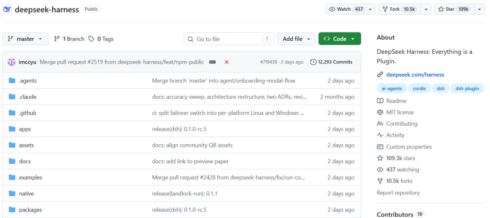
或许还有人不知道什么是 Harness，小灰在这里一句话给大家讲清楚。
官方有个公式：Agent = Model + Harness，翻译成人话就是"AI 智能体 = 会思考的大脑 + 能干活的身体"。
Harness 就是那个"身体"，让 AI 不只会聊天，还能自己动手干活，比如读写文件、上网查资料、写代码、操作电脑。DeepSeek 把它开源了，还支持插件，也就是说，大家可以在这套 “工具箱” 里自行拓展功能。
今天这篇文章，我们的重点不是理念，而是实操。
我自己刚刚装了 DeepSeek Harness，配好环境，拿它跑了四个不同类型的任务，从做 PPT 到做网站再到项目分析、最后让它给自己造插件，耗时、效果、花费都记录在案。
不吹不黑，就让我来分享一下跑出来的真实效果。
### 一、准备：只需要两样东西
1. Node.js：去官网下载 LTS 版本，一路下一步装完
1. DeepSeek API Key：到 DeepSeek 开放平台创建，记得充点钱，API 按量收费
看不懂命令没关系，安装过程中遇到不懂的命令，可以交给任意 AI 工具生成指令，两分钟就能完成配置。
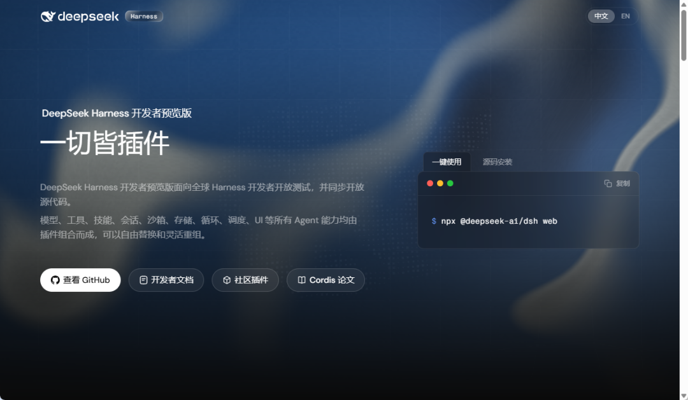
### 二、安装：两种方式任选
**方式一：一行命令（推荐新手）**
打开终端，输入：
npx @deepseek-ai/dsh web
**方式二：从源码运行（进阶，方便自己改）**
按顺序执行：
git clone https://github.com/deepseek-ai/deepseek-harness.git
cd deepseek-harness
pnpm install
pnpm run build
pnpm dsh web
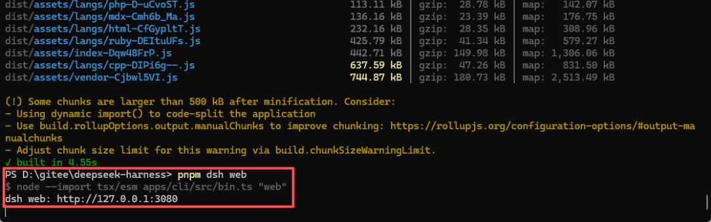
两种方式跑完，终端都会输出一个本地网址，一般是 `http://127.0.0.1:3080，`
浏览器打开，第一次填 API Key，粘贴进去就进首页，安装完成。
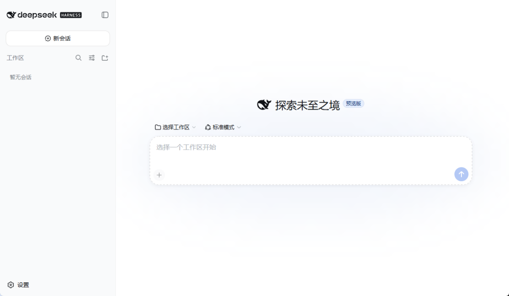
### 三、进去之后，四个设置点几下
| 设置项 | 怎么选 |
| 工作模式 | 一共四种（标准、PTC、极简、创造），新手默认「标准」就行，后面有详解 |
| 模型和推理等级 | 模型选 Flash 便宜、Pro 更强，还能接别家模型；推理等级有 default、off、minimal、low、medium、high 六档，默认就行，想让它多想一会儿就调高 |
| 工作区 | 点「选择工作区」，添加一个项目目录，这就是 AI 能碰的文件范围 |
| 操作权限 | 默认逐个确认，图省事直接放开，让 AI 自己执行命令 |
然后选一个你想让它操作的项目文件夹，就可以开始干活了。
### 四、实测：我跑的四个任务
我让它干了四件事：做 PPT、做网站、分析项目，最后是让它自己造插件。
#### 任务 1：直接做一份 PPT（标准模式）
打工人最刚需的场景，先热身。这次用**标准模式**跑，它是能力最全的默认档，文件、网页、子任务全都有，做内容活正合适。给它一份主题和要点，让它直接产出能用的 PPT，而不是只给建议。
**提示词：**
```
帮我做一份 PPT，主题是「AI 工具入门」，面向完全没接触过 AI 的普通人。
一共 10 页，结构如下：
第 1 页 封面：大标题 + 副标题「写给不想被时代抛下的你」+ 一句点题的话
第 2 页 目录：四个部分
第 3 页 为什么现在要学 AI 工具：不讲大道理，讲三个具体场景（写材料、做图、查资料）
第 4 页 最值得先学的 3 个工具：对话类、生图类、办公类各一个，每个一句话讲清楚干嘛用的
第 5 页 普通人怎么开始上手：三步走，第一周做什么、第一个月做什么
第 6 页 常见坑 1：别囤课，别收集一堆工具不用
第 7 页 常见坑 2：AI 会一本正经胡说八道，重要的事要核对
第 8 页 常见坑 3：别把隐私信息喂给 AI
第 9 页 一张「学习路径图」：从今天到三个月后的节奏
第 10 页 结尾：一句话总结 + 行动号召
视觉要求：整体风格简洁现代，每页一个大标题 + 3 到 5 条短要点，
一页不要堆太多字；配色统一，标题色和强调色一致；
封面要抓眼球，结尾页要有记忆点。
用网页形式做出来（HTML 幻灯片，支持键盘翻页），
做完了告诉我文件在哪、怎么打开，我先检查一遍版式和内容。

```
**过程与结果：**
10 页完整，没有缺页，结构是按提示词一步步来的。
|  |  |
|  |
版式和配色我个人觉得能直接用，文字量也控制住了，每页就几条要点。耗时 3 分 34 秒（6 轮对话、11 步工具调用），输入 149K、输出 20.4K token，缓存命中 73%，首 token 平均 6.9 秒。费用按 V4-Flash 算，空闲时段约 1 毛 6，高峰时段约 3 毛 2。
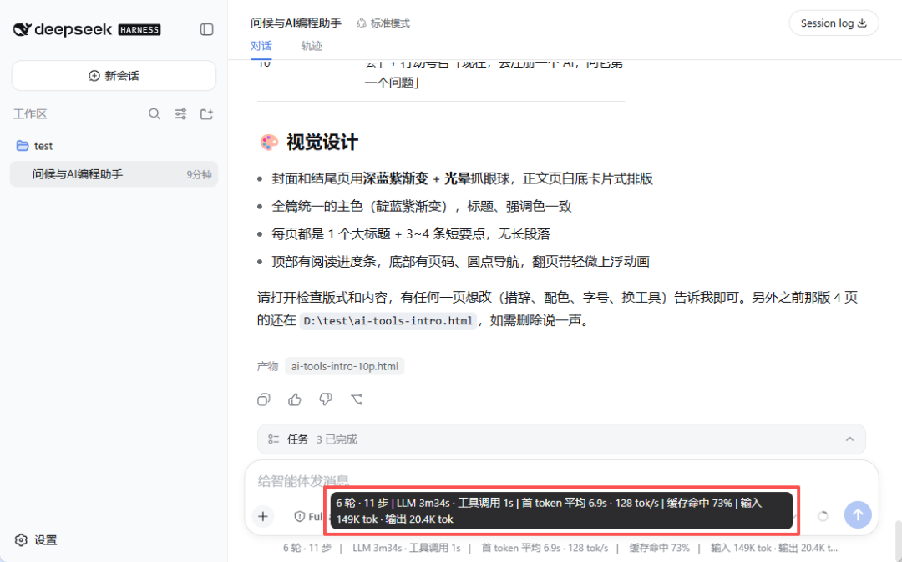
#### 任务 2：做一个 AI 工具集合网站（PTC 模式）
难度上来一截，要真写代码、真出页面。这次特意切到 **PTC 模式**试试，它能让 AI 一次生成代码把多步工具调用串起来，适合写网站这种步骤多但逻辑清晰的任务。做一个聚合常用 AI 工具的分类导航站，做完就能打开用。
**提示词：**
```
帮我做一个「AI 工具集合」网站：
1) 按分类展示常用 AI 工具，比如对话、生图、生视频、编程
2) 每个工具一张卡片：名称、一句话简介、官网链接
3) 支持按分类筛选和关键词搜索
4) 界面好看，手机和电脑都能用
做完告诉我怎么打开，我先试一下。

```
**过程与结果：**
做出来挺能打的：网站能直接打开，分类、搜索、筛选功能都是真的能用，不是摆设。审美也在线，手机和电脑都适配，响应式做得到位。

耗时 7 分 05 秒（1 轮对话、8 步工具调用，工具实际执行耗时 27 秒），输入 318K、输出 41.4K token，缓存命中 83%，首 token 平均 2 秒，生成速度 101 tok/s。费用按 V4-Flash 算，空闲时段约 2 毛 8，高峰时段约 5 毛 6。
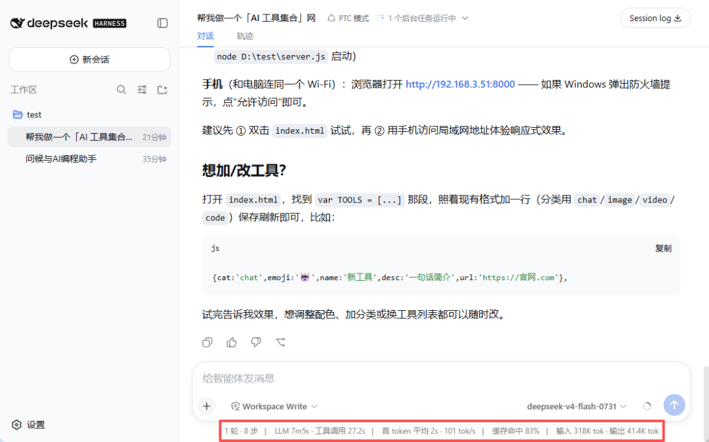
#### 任务 3：做项目分析（极简模式）
最难的一关，要真读代码、真做判断。这次用 **极简模式**跑，它只留两个工具，官方说主要是拿来测模型的，我就想看看在这种"几乎裸奔"的环境下，AI 还能不能完成深度分析。给它一个开源项目，让它读完整理出分析报告，说清楚这项目到底行不行。
**提示词：**
```
工作区里有一个开源项目（D:\gitee\deepseek-harness，DeepSeek Harness 的源码）。
帮我做一份项目分析报告：
1) 这个项目是干嘛的、解决什么问题
2) 整体架构和核心模块有哪些
3) 代码质量和设计思路怎么样
4) 它的优缺点，以及适合什么样的人用
输出成一份结构清晰的分析报告，存成新文件。

```
**过程与结果：**
结果完全超出我预期。极简模式只有两个工具，它居然产出了一份 222 行的完整分析报告；不是泛泛而谈：项目定位、Cordis 插件树架构、核心包、Turn/Step 运行流、事件溯源会话日志都讲到了，还给出了代码质量评价和"适合谁用"的判断，连"不接受外部 PR"这种细节都挖出来了。
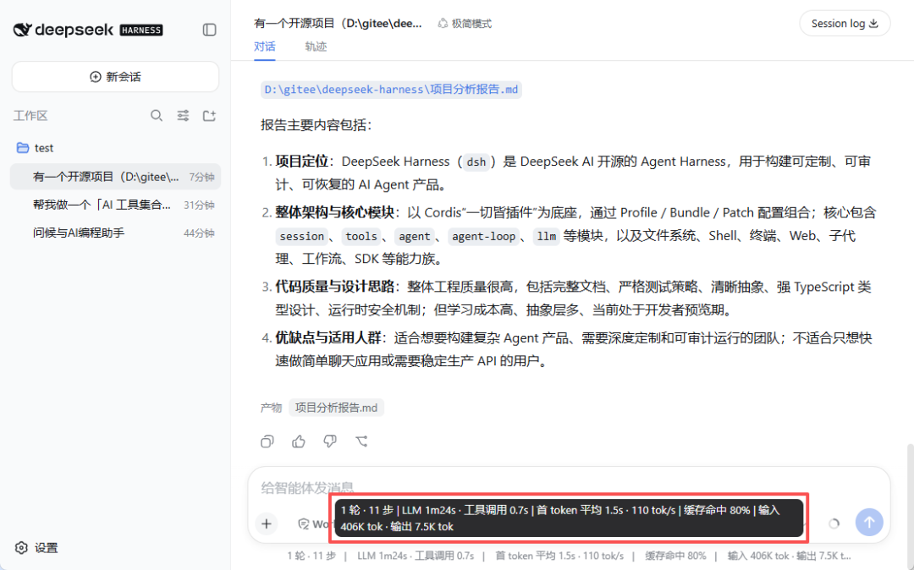
耗时 1 分 24 秒（1 轮对话、11 步工具调用），输入 406K、输出 7.5K token，缓存命中 80%，首 token 平均 1.5 秒。费用按 V4-Flash 算，空闲时段约 1 毛 7，高峰时段约 3 毛 4。
#### 任务 4：让 AI 给自己造个插件（创造模式）
前三关都是"让 AI 干活"，这一关玩点不一样的：用 **创造模式**让 AI 给自己造个工具。创造模式能检查系统里现在装着哪些插件、现场试验新插件，是 Harness「一切皆插件」理念最直接的体现。我让它做一个跑任务时能实时看到账户余额的悬浮窗插件，一边干活一边看着钱扣，肉疼感直接拉满。
**提示词：**
```
帮我在界面上做一个「余额悬浮窗」插件：
实时显示 DeepSeek 账户剩余金额，跑任务时能看着钱一点点扣。
写完先给我审批，没问题再装。

```
**过程与结果：**
插件正常装上，余额悬浮窗显示的数字和账户实际余额对得上，装完就能用。
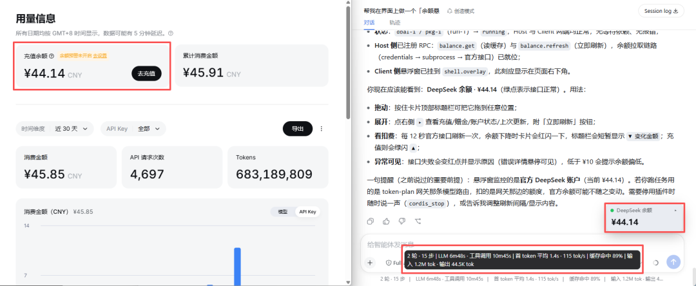
耗时 6 分 48 秒（2 轮对话、15 步工具调用，工具执行 10 分 45 秒），输入 1.2M、输出 44.5K token，缓存命中 89%，首 token 平均 1.4 秒。费用按 V4-Flash 算，空闲时段约 4 毛 5，高峰时段约 9 毛。
### 五、实测感受
四个任务跑下来，我的感受是：
| 维度 | 感受 |
| 速度 | 快的慢的都有：做 PPT 3 分 34 秒，项目分析 1 分 24 秒，最快的是分析 |
| 透明 | 每一步都看得见：读了哪些文件、调了哪个工具全程展示，还有个轨迹面板能翻历史 |
| 费用 | 四个任务加起来，闲时约 1 块，高峰约 2 块出头 |
最让我震惊的是缓存命中率，按总消耗口径算高达 93%。看来我们都错怪梁圣了，就这个定价来看，涨价确实无可厚非。
DeepSeek 已经官宣 8 月 17 日起涨价，涨好几倍，想体验的趁早。即便涨价之后，命中缓存部分的计费单价依旧很低，实际跑任务开销依旧不大。
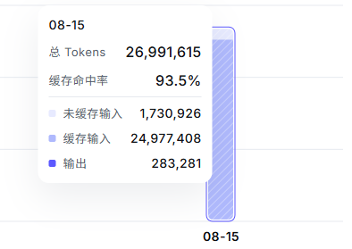
这东西值不值得装，取决于你想干嘛。会折腾的，拿来当主力干活工具，四类活全能接；不爱折腾的，装上也只会用标准模式，那它就是个比普通聊天 AI 更能干的高级助手。模型便宜是它最大的杀手锏，这个价位的干活能力，市面上找不到第二个。
### 六、插件：装完不折腾一下插件，等于白装
Harness 主打「一切皆插件」，连操作界面都是插件，所以换皮肤这档子事，在它这儿特别简单。我拿它给界面换了个皮肤，全过程四步走。
#### 第一步：安装 dsh 命令（已经安装的请忽略）
插件是通过 dsh 命令管理的，所以先把 dsh 全局装上，装完命令行里直接能用 `dsh：`
npm install -g @deepseek-ai/dsh
#### 第二步：安装 UI 插件
我装的是 `dsh-web-ui`（插件包 + 皮肤合集），一条命令装齐：
dsh plugin --profile web add @linxin666/dsh-web-ui-all@0.1.12
#### 第三步：重启网页生效
装完按提示重启一下 Harness 网页：
dsh web
#### 第四步：看效果
装完重启，进「设置 → 插件」就能看到 Web UI 插件了，还默认开启了宠物功能，界面右下角有只鲸鱼娘跟着智能体的工作状态切换动画，挺有意思：
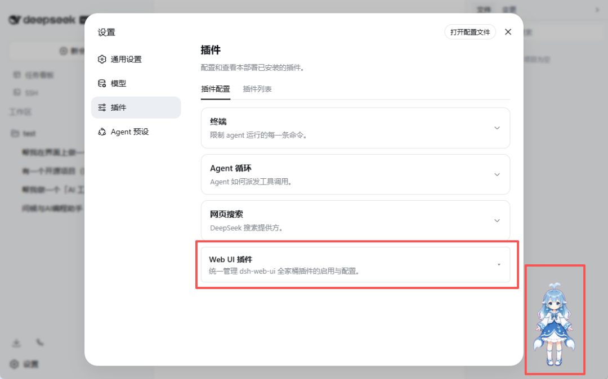
皮肤中心有 10 款皮肤随便换，装上就能试穿，比如这个 Windows XP 怀旧风：
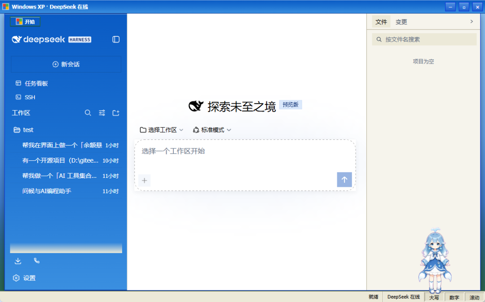
这个插件包不止换皮，功能还挺全：任务看板（能让 AI 定时自动干活）、Git 图谱、右侧预览面板、实时 token 统计、移动端远程控制、SSH 远程连接。具体每个功能长啥样，大家可以安装了自行体验。
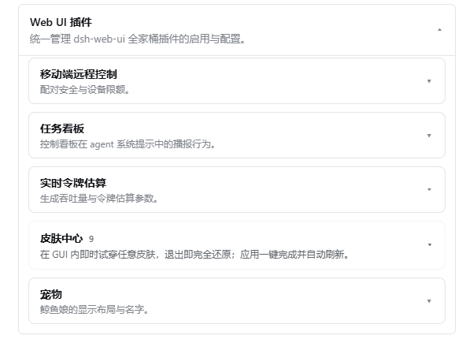
其他插件玩法大同小异，我就不一一展开了，感兴趣的朋友可以自己去折腾。
| 插件 | 干嘛用的 |
| ModLens | 让模型"看图"，把图片解析成结构化文字（OCR、布局、内容），补上纯文本模型看不了图的短板（https://github.com/liustack/modlens） |
| dsh-deepcel | 把整个界面改成 Excel 表格样式，摸鱼神器（https://github.com/Small-tailqwq/dsh-deepcel） |
| dsh-at-file | 输入框用 @ 符号快速引用文件（https://github.com/omdsh-dev/dsh-at-file） |
| DSH-better-sidebar | 优化侧边栏交互体验（https://github.com/omdsh-dev/DSH-better-sidebar） |
#### 让 AI 自己造插件
装别人的只是入门，更狠的是让 AI 给自己造插件，这个我在前面任务 4 里演示过了：用「创造模式」造了余额悬浮窗。
### 七、写在最后
折腾完这四个任务，我的判断是：DeepSeek Harness 现在是开发者的玩具，不是普通人的玩具。安装需要懂一点命令行，玩插件要懂一点代码，但它的能力上限已经验证过了，从内容创作到插件开发都接得住，成本低到可以忽略。
再说点对未来的看法。现在很多人觉得 AI 模型会越来越强，强到不需要 Harness 这类工具。我不太认同，恰恰相反，模型越强，越需要一个好环境来约束它、验证它、让它稳定干活，这个需求只会越来越值钱。
对于还未尝试 DeepSeek Harness 的朋友，我的建议是先装起来，安装成本极低，一条命令的事。装完先干一件你最想干的事，再折腾几个插件，你就知道它跟别的 AI 工具差在哪了。
好了，关于 DeepSeek Harness 的实测，我就先分享到这里。

正在读这篇文章的朋友，你有尝试过 DeepSeek Harness 吗？你对 Harness 如何看待？欢迎在评论区聊一聊你的想法。
我是程序员小灰，我会持续为大家分享最新的AI工具和AI玩法。如果想第一时间收到推送，也可以给我个星标⭐我们下次再见~~
