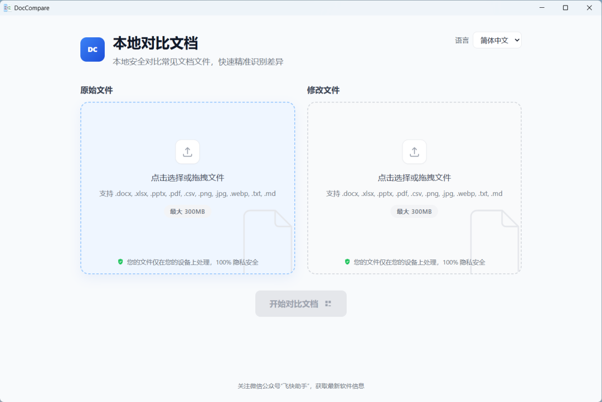

# DocCompare 3.0 来了：大文件、扫描件、网页离线都能比
> 💡 备注属性未写入，可能是备注属性名称或者类型被修改了，建议将字段类型设置为 rich_text，可以在小程序-操作-修改文章数据库页面进行调整
> 💡 原文链接:[https://mp.weixin.qq.com/s?__biz=MzU5MzY2MDkzNQ==&mid=2247484365&idx=1&sn=3e2e34b9f55d3cd4a55aa8ab97842f5c&chksm=ff848090b7c822e6d2751020e190a120876986af1abe442d191a608b8488c62503e3376d71e3#rd](https://mp.weixin.qq.com/s?__biz=MzU5MzY2MDkzNQ%3D%3D&mid=2247484365&idx=1&sn=3e2e34b9f55d3cd4a55aa8ab97842f5c&chksm=ff848090b7c822e6d2751020e190a120876986af1abe442d191a608b8488c62503e3376d71e3#rd)
在热心网友的反馈与支持下，DocCompare 迎来 3.0 更新。这次更偏好用：文件更大、操作更顺、场景更全。

这次更新了什么？
1. 大文件对比上限提升
 单文件上限由约 100MB 提升到约 300MB，长手册、厚报告也能直接比对。
2. 键盘上下键快速看差异
 对比结果里可用方向键上下浏览差异点，不必全程依赖鼠标。
3. 扫描件 PDF 也能比、也能标
 扫描版 PDF 支持差异对比，并在图上标注变化，纸质扫描进电脑后也能审改。
4. PDF 与 Word 图文对比更稳
 跨格式图文对齐与表格、列表等呈现继续增强，Word ↔ PDF 对照更清晰。
5. 实验性：网页端离线比较
 可在浏览器离线使用（实验特性），方便国产化、内网或不便安装桌面端的环境。
 感谢每一位提建议、报问题、帮测试的朋友。欢迎继续试用 3.0，有想法随时告诉我们。
软件下载地址：
https://pan.baidu.com/s/1ms5kwO3xM19Os8fMizGzIw?pwd=xpxq

## 摘要

（待补充）

## 我的笔记

（待补充）
