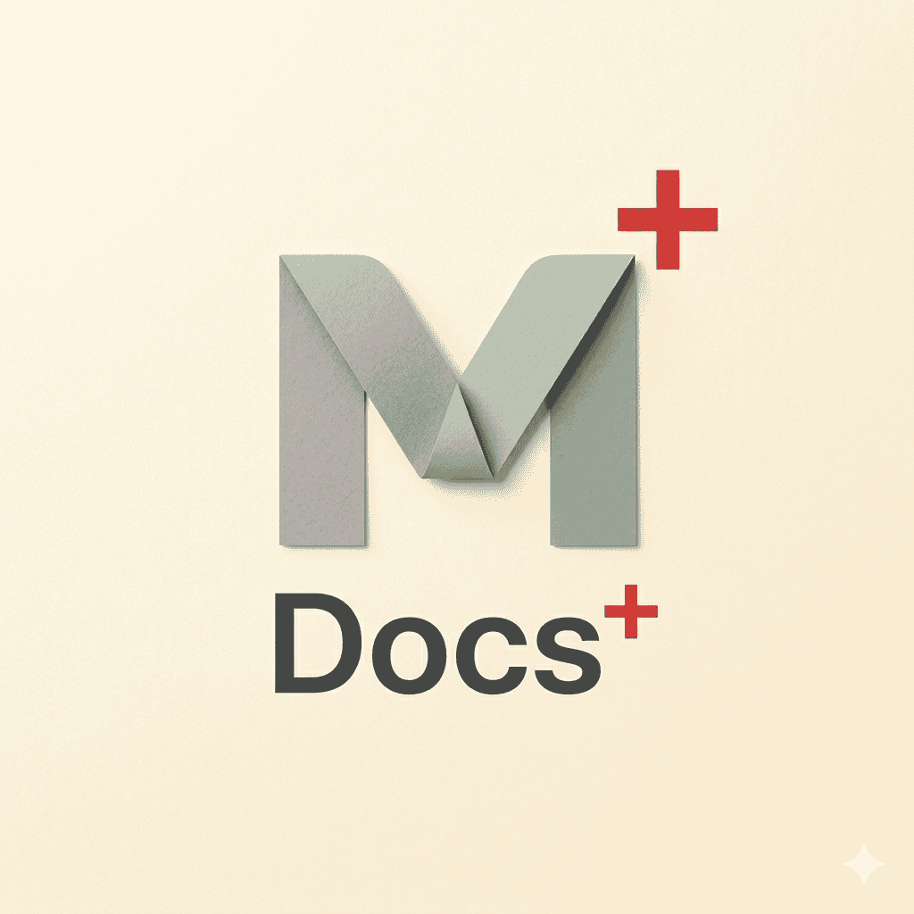

# Docs+ 3.6.0 发布：让 Markdown 承载更多表达
> 💡 备注属性未写入，可能是备注属性名称或者类型被修改了，建议将字段类型设置为 rich_text，可以在小程序-操作-修改文章数据库页面进行调整
> 💡 原文链接:[https://mp.weixin.qq.com/s?__biz=MzE5ODI1MTI4Mg==&mid=2247484365&idx=1&sn=569c15c5d61d8fee63c6bddefc380801&chksm=9731df65edb17d688b6947aa358dae0cebc889d5fba14097eabc9da5538c17838fa29dab471a#rd](https://mp.weixin.qq.com/s?__biz=MzE5ODI1MTI4Mg%3D%3D&mid=2247484365&idx=1&sn=569c15c5d61d8fee63c6bddefc380801&chksm=9731df65edb17d688b6947aa358dae0cebc889d5fba14097eabc9da5538c17838fa29dab471a#rd)
我是 Aui 团队的小胖，也是 Docs+ 的开发者。从 3.5.0 到 3.6.0，隔了九个多月，一共 215 次提交。现在你可以下载桌面端[链接1]获得最好的体验[注释1]，也可以体验网页端[链接2]，或者构建自己的本地网页端。网页端少了一些桌面端的功能。
这次更新没有改变我对 Docs+ 的定义，它永远首先要是一个好用的 Markdown 写作工具：
- 对办公场景更友好
- 稳固、美观
- 外部零依赖
- 隐私至上
- 不延展到浏览器插件等扩展途径
- 一键复制功能，除了微信公众号和知乎文章外不兼容更多平台
总之更新还是围绕三个主题展开：能不能写得更自由，能不能排得更省心，能不能发得更稳定。
下面简单讲几个新版本的特色，详细见应用内说明及语法文档[链接3]。
### Chat 语法
这是 v3.6.0 最值得先说的一项能力。过去想在文章里呈现一段对话，要么截图，要么手动排版；现在只需要一个 `!!! chat` 块：
```
!!! chat
roles:
 小胖 as pang, avatar=头像链接, side=right

 Docs+ as docs, avatar=头像链接, side=left

>> boss
介绍一下自己

>> docs
我是一个 markdown 写作工具
!!!
```
效果是：

小胖
介绍一下自己

Docs+
我是 markdown 写作工具
`roles` 定义角色、头像和左右位置，`>>` 开始一条消息，`>> notice` 可以插入时间、提示等系统消息，`styles` 则能调整整体宽度。
用 Docs+ 语法写的表格、代码块、图片、Mermaid、Infographic 都能直接嵌在聊天气泡里。写访谈、产品演示、教程对话，甚至一段有来有回的评论，都不再需要额外拼图。我们的机器学习系列文章都是用 Chat 语法写的，比如[机器学习中的极简数学（七）](https://mp.weixin.qq.com/s?__biz=MzE5ODI1MTI4Mg%3D%3D&mid=2247484188&idx=1&sn=fdfa5ec80607aba6dfa17ce23ab13128&scene=21#wechat_redirect)
### 图标与表情
新版本加入了 FontAwesome 图标语法，例如 （只展示效果）。并支持动画、颜色、大小等效果。它可以出现在正文、GFM Alert 标题甚至 Infographic 中。
GFM Alert 现在支持自定义标题与图标，容器也从 `blockquote` 换成了 `section`，复制到微信公众号后不会再被默认引用样式干扰。
表情输入同样补齐了：内置 Unicode、微软 Fluent 3D 和自定义表情包三套来源，支持搜索、调整尺寸与对齐方式；自定义表情包还能导出为 JSON，换设备时可以直接导入。
### 效率提升
输入 `/` 可以唤出 Slash 菜单，公式、表格、代码、Chat、Mermaid、Infographic 都能快速插入；`Ctrl/Cmd + O` 打开命令面板，最近文件、全文搜索和常用命令集中在一个入口。
这一版还有一个重要更新是还引入了 MathLive。现在你可以通过 `/` 或者 `Command + Option + L`
 快捷键唤出编辑器便捷输入公式；要修改时点击预览页里的公式就能重新编辑！不用回到源码中寻找对应行。没有这个功能，估计我的同事老油条写机器学习系列会疯掉 
还有就是，搜索、替换支持区分大小写和正则，从搜索结果打开文章时会保留上下文。编辑、双屏、预览三种布局可以随时切换，也能切到手机尺寸查看效果。行高、段间距、系统深浅色跟随、中文引号与括号自动配对、Excel 表格粘贴识别，这些小事都被做成了可配置项。
### PDF、HTML、图表
PDF 导出现在支持页眉、页脚和页边距，可以按 H1 自动分页，也可以用 ` +++` 手动分页；新增的 Vivliostyle 排版引擎，为复杂版式提供了另一种选择。Electron 桌面端还支持静默导出，不再弹出新窗口。
导出的 HTML 可以切换深色或浅色，也能跟随系统；标题、描述、最大宽度和页边距都可以自定义。
Mermaid 和 Infographic 这一轮改动很多：透明背景、深浅主题适配、SVG 兼容模式、一键转成透明 PNG 并自动替换源码，预览窗口还支持缩放。对公众号作者来说，图表终于可以更接近“所见即所得”。
### 稳定和兼容性
微信端的段落、引用和 Alert 样式兼容；图片迁移的进度显示、上传失败可重试；公式编辑的定位与 LaTeX 输出；Mermaid 渲染错位；多文档撤销隔离；以及粘贴、搜索、滚动位置等细节。这些修复未必会出现在更新日志的显眼位置，却决定了每天打开编辑器时，是顺手还是别扭。
### 自豪地总结
我说过了 Docs+
 首先得是一个好用的 Markdown 写作工具，其它都是其次
。比如
`一键复制`功能，Docs+
 依然只兼容微信公众号和知乎文章。但说句不怕挨打的话：这类开源的社区微信公众号编辑器没有比我这个兼容性更好的了
快来打我脸。
使用上有建议，有问题联系我。顺手帮忙点赞、转发，谢谢。
---
**文章注释**
`1.` 桌面端打包没用签名，所以安装需要一点点小知识，不懂问 AI↩︎

---
**引用链接**
`[1]` 桌面端: _https://github.com/iniself/md/releases/tag/v3.6.0_
`[2]` 网页端: _https://docs.auiapps.top/_
`[3]` 语法文档: _https://auiapps.top/docs/_
