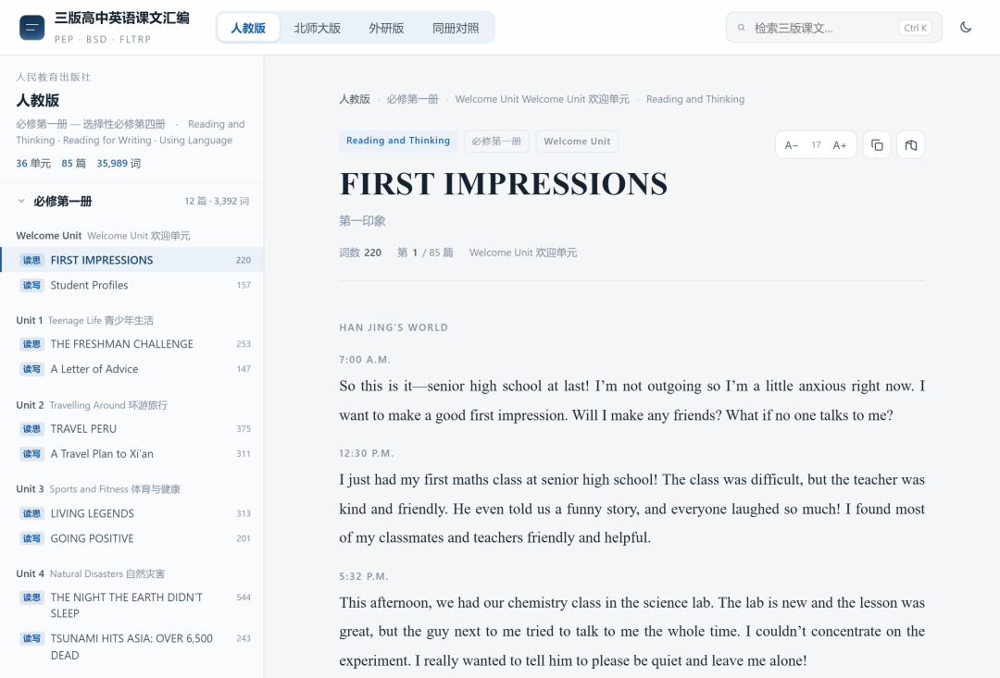

# GitHub 2.1k Star！AI 写 100 章不丢伏笔，这个开源桌面工具太懂作者！
> 💡 备注属性未写入，可能是备注属性名称或者类型被修改了，建议将字段类型设置为 rich_text，可以在小程序-操作-修改文章数据库页面进行调整
> 💡 原文链接:[https://mp.weixin.qq.com/s?__biz=MzkwMjQ0NzI0OQ==&mid=2247507261&idx=1&sn=fffdd0c2c2061131b5d85fd7f8087cc0&chksm=c13007abcb6834c3fdb7a60e148e82c22593ccd3d8fc4caf6e231da86fbb4d3faea37e310b2d#rd](https://mp.weixin.qq.com/s?__biz=MzkwMjQ0NzI0OQ%3D%3D&mid=2247507261&idx=1&sn=fffdd0c2c2061131b5d85fd7f8087cc0&chksm=c13007abcb6834c3fdb7a60e148e82c22593ccd3d8fc4caf6e231da86fbb4d3faea37e310b2d#rd)
最近在 GitHub 上挖到一个叫 **书童 Pagekin** 的项目。它解决的是：**把长篇小说的创作流程结构化，让 AI 辅助每一步，而不是让 AI 一把梭。**

书童 Pagekin 是 EthanYoQ 开发的一款**开源免费的 AI 小说写作桌面软件**，专为长篇小说和网文连载设计。
它以 GPL-3.0 协议开源，目前在 GitHub 上已有 **2100+ stars**，最近一个多月就涨了 1000+，增长势头相当猛。
和市面上那些"输入一句话生成一万字"的 AI 写作工具不同，书童的思路完全不一样：
**你是作者，AI 是书童。AI 负责起草、续写、检查，每一步都由你确认。**
它把写一本小说拆成了一条清晰的流水线：**前提设定 → 故事架构 → 章节蓝图 → 正文写稿 → 审稿 → 修稿 → 定稿**。
每一步的产出都会保存下来，作为下一步的输入。AI 不会替你做决定，但它会帮你把"通常会烂掉的那部分"——人物关系、伏笔管理、前后一致性——变得可控。

📦 3 Parts + Conclusion
👉 滑动
**PART 01**
**核心亮点**
**PART 02**
**快速上手**
**PART ///**
**写在最后**
**01**
**PART**
### 核心亮点
#### 1. 章节级上下文，而不是整本聊天记录
用聊天框写小说最大的问题就是"上下文污染"。
你得不断复制粘贴前文内容，而且塞得越多，模型反而越抓不住重点。
书童的做法很聪明：**写每一章时，AI 只拿到这一章的蓝图、相关角色档案、世界观摘要、前文摘要和上一章的全文**。
这意味着无论你写 10 章还是 100 章，AI 每次看到的上下文大小都是可控的。
前文摘要会随着小说的推进不断更新，相当于有一个自动维护的"剧情记忆"。这个设计从根本上解决了长篇 AI 写作的记忆衰减问题。
#### 2. 审稿-修稿的差异确认机制，不直接覆盖原稿
很多 AI 写作工具的修稿逻辑是"把你要改的内容扔给 AI，AI 给你一版新的，直接替换"。但 AI 也会犯错——改了不该改的，或者漏掉了关键细节。
书童的修稿流程是：AI 先给出**审稿报告**，列出每条具体的修改意见；你逐条勾选要处理的意见，或者加上自己的意见；然后 AI 根据这些意见重新生成，**修改结果和原稿逐段对比呈现**，由你逐段决定用哪一版。
不会一键覆盖，每一个改动都在你的掌控之中。这个细节让我印象特别深——它在很多地方都强调"确认权在作者手里"。
#### 3. 拆解参考小说来仿写
想模仿某本书的文风，但又不想直接抄？
书童可以导入 `.txt`、`.md` 或 `.epub` 格式的小说，让 AI **拆解它的结构、提取文风特征、反推章节蓝图**，生成仿写约束。
这些参考数据只存在于项目内部的知识库和拆解结果里，不会混进你的正文。
另外还有两种导入模式：**导入原稿续写**（把你已经写好的章节导入为定稿，AI 接着后文继续写）和**段落续写**（在正文里选中一段，让 AI 接着往下写）。
#### 4. 写作 Skill 系统：导入你的写作规则
这是一个非常实用但容易被忽略的功能。
你可以从本机或者 GitHub 上导入**提示词型的写作 Skill**——比如"去 AI 味"的规则、某种特定文风的写法、某类题材的专业规范。
装好后可以把它绑定到规划、写稿、审稿或修稿等特定阶段，之后这一阶段的每次 AI 生成都会自动带上你的 Skill。
只支持自包含的 SKILL.md 提示词，不会执行任何脚本或 hook。安全、简单，而且高度可定制。
#### 5. 完整的作品管理，写长篇不丢线索
书房页面列出你写过的全部作品，点封面可以看概览：写到第几步了、正文字数多少、定稿了几章、有多少角色。
更实用的是**剧情与伏笔追踪**——你可以按章节查看主线、支线和伏笔的进度，记下每条线索在哪一章埋设、推进或解决。
还有版本历史、知识库（支持本地全文检索 + 向量检索）、WebDAV 云端备份等配套功能，都是为长篇创作场景打磨的。
**02**
**PART**
### 快速上手
#### 下载安装
书童提供两种安装方式：**从 GitHub Releases 下载正式安装包**，或者从源码构建。
**方式一：下载安装包（推荐）**
访问书童的 GitHub Releases 页面（https://github.com/EthanYoQ/AI-Novel-Writer/releases/latest），按你的系统选择对应安装包：
`# Windows x64
ai-novel-writer-setup-&amp;lt;版本号&amp;gt;.exe

# macOS Apple Silicon (M1/M2/M3/M4)
ai-novel-writer-mac-arm64-&amp;lt;版本号&amp;gt;-installer.dmg

# macOS Intel
ai-novel-writer-mac-x64-&amp;lt;版本号&amp;gt;-installer.dmg
`
Windows 端：直接运行 `.exe` 安装。升级时不会删除你的作品和设置。
macOS 端：把 DMG 里的应用拖进「应用程序」文件夹。注意两个安装包都是 ad-hoc 签名，没有经过 Apple 公证。如果 Gatekeeper 阻止，在 Finder 里按住 Control 点按应用 → 选择「打开」，或者去「系统设置 → 隐私与安全性」里手动允许。
**方式二：从源码构建**
如果你想折腾源码，需要 **Node.js 22.14+** 和指定版本的 **pnpm**：
`git clone https://github.com/EthanYoQ/AI-Novel-Writer.git
cd AI-Novel-Writer
pnpm install --frozen-lockfile
pnpm dev
`
正式安装包由 GitHub Actions 云端自动构建，Windows x64、macOS Apple Silicon 和 macOS Intel 三个平台各自通过资格检查后才会发布到同一个 Release。
#### 配置模型
安装完成后，打开书童，第一步就是在**设置 → 模型**里配置你的 AI 服务。书童不自带模型，你要自己接入。
支持两种协议：
**
OpenAI 兼容协议** Chat Completions 接口兼容的服务都能用
**
Gemini 原生协议** Google Gemini
内置了主流服务商的预设配置，直接选就行：
| **服务商** | **协议** | **预设地址** |
| DeepSeek | OpenAI 兼容 | https://api.deepseek.com |
| SiliconFlow（硅基流动） | OpenAI 兼容 | https://api.siliconflow.cn/v1 |
| BigModel（智谱） | OpenAI 兼容 | https://open.bigmodel.cn/api/paas/v4 |
| OpenAI | OpenAI 兼容 | https://api.openai.com |
| xAI（Grok） | OpenAI 兼容 | https://api.x.ai/v1 |
| Google Gemini | Gemini 原生 | https://generativelanguage.googleapis.com |
| Ollama（本地） | OpenAI 兼容 | 见下方说明 |
| NovelAI | OpenAI 兼容 | 最小兼容支持 |
| 自定义 | OpenAI 兼容 | 填任意兼容服务的地址 |
**用 Ollama 跑本地模型（完全免费）**
如果你不想花 API 费用，可以用 Ollama 在本地跑模型。配置如下：
`服务商： Ollama（本地）或自定义
协议： OpenAI 兼容
Base URL： http://127.0.0.1:11434/v1
API Key： 可以留空；界面要求时填任意占位值
模型： 你的 Ollama 模型名，例如 qwen3:14b
`
⚠️ 注意不要填 `http://127.0.0.1:11434/api`，那是 Ollama 的原生接口，书童用的是 OpenAI 兼容协议的 `/v1` 地址。
#### 开始写第一本小说
配置好模型后，回到书房页面，点"新建作品"。依次填写设定、架构、蓝图，然后点"写第 1 章"。剩下的就交给书童了——或者说，交给你和书童的配合。
**///**
**LAST**
### 写在最后
AI 写作工具这块赛道现在挺热闹的，从 SaaS 订阅到本地小工具，从网页版到桌面版，各种形态都有。
但绝大多数都把 AI 当成一个"一键生成器"来卖——你拍个脑子说句话，它给你吐出五千字，听起来很美，真要写长篇就露馅了。
书童 Pagekin 它承认一件事：**AI 写不了一整本小说，但 AI 能帮你把写小说这件事变得不那么孤独**。
它不抢作者的控制权，反而把更多控制权还给作者——角色关系、章节蓝图、伏笔管理、审稿修稿，每一步的确认权都在你手里。
开源仓库：https://github.com/EthanYoQ/AI-Novel-Writer

如果本文对您有帮助，也请帮忙点个 **赞👍 + 在看** 哈！❤️
**在看你就赞赞我！**

