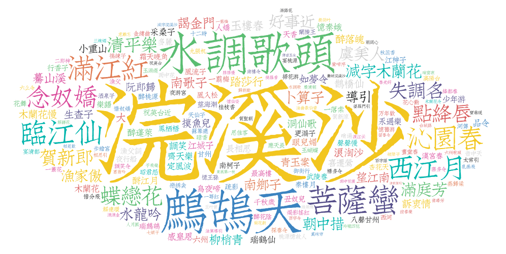

# GitHub 5万+星！最全中华古诗词数据库，唐诗宋词一键导入
> 💡 备注属性未写入，可能是备注属性名称或者类型被修改了，建议将字段类型设置为 rich_text，可以在小程序-操作-修改文章数据库页面进行调整
> 💡 原文链接:[https://mp.weixin.qq.com/s?__biz=Mzk0NDcyMjk4OA==&mid=2247502364&idx=1&sn=17e71952a625ed5bf9c0137a6bd20941&chksm=c2fd18b87c19fe0d203be82ab1aa8712ba3fff348ce95192fa395a66d7ddc6ad759d0c38bed1#rd](https://mp.weixin.qq.com/s?__biz=Mzk0NDcyMjk4OA%3D%3D&mid=2247502364&idx=1&sn=17e71952a625ed5bf9c0137a6bd20941&chksm=c2fd18b87c19fe0d203be82ab1aa8712ba3fff348ce95192fa395a66d7ddc6ad759d0c38bed1#rd)
点击上方“小妖同学学AI”，选择“**星标**”公众号

超级无敌干货，第一时间送达！！！


> AI写诗、数据可视化、诗词App……都离不开这个5万星的开源数据库
> 
### 项目介绍：当千年诗词遇见一行JSON
小伙伴们，公元618年，唐朝开国。在此后近三百年的时间里，中国诗歌迎来了历史上最璀璨的时代——李白、杜甫、白居易、王维……一个个名字如星辰般照亮了中华文明的天空。紧随其后的两宋，词人辈出，苏轼、辛弃疾、李清照、柳永，将汉语的韵律之美推向了又一个高峰。
这些诗歌，记录在《全唐诗》《全宋诗》《全宋词》等煌煌巨著之中，总计数十万首。它们是中华民族的文化瑰宝，但长期以来，这些庞大的文集以纸质书籍的形式存在，离普通人、尤其是离开发者，有着不小的距离。

2016年9月，一个名为 **chinese-poetry** 的项目在GitHub上诞生。创始人的想法朴素而直接：**把中华古典文集做成结构化的电子数据，让任何人都能方便地使用**。
近十年过去，这个项目已成长为 GitHub上星标超过53,000、被复刻超过10,000次的超级开源项目。它用一行行JSON，承载了千年的诗意。

### 核心数据：不止是“全”，更是“结构化”
chinese-poetry 的数据规模令人震撼：
- • **唐诗**：近 **5.5万首**，涵盖唐代2200余位诗人
- • **宋诗**：约 **26万首**
- • **宋词**：**21,050首**，来自两宋时期 **1,564位词人**
唐宋两朝加起来，接近 **1.4万名诗人**的作品被收录其中。

但这还不是全部。除了唐诗宋词，项目还收录了《诗经》《论语》《四书五经》、五代《花间集》、南唐二主词、纳兰性德诗集、蒙学读物等经典文集。可以说，**从先秦到清代，中华古典诗歌的主要脉络，几乎都被这条数据线串联了起来**。
所有数据以 **JSON**格式 分发，结构清晰，便于程序读取和处理。项目还内置了 **TopK分析系统**，可以自动生成高频词、高产作者、词牌名热度等统计图表。宋词中最受欢迎的词牌名、唐诗中最常出现的字词、哪位诗人作品最多——这些问题的答案，都可以直接从数据中“算”出来。
### 数据结构：一行JSON，一首诗
项目的核心数据以JSON格式组织。以一首唐诗为例，其数据结构大致如下：
```
{
  "author": "李白",
  "title": "静夜思",
  "paragraphs": [
    "床前明月光",
    "疑是地上霜",
    "举头望明月",
    "低头思故乡"
  ]
}
```
这种结构化的设计，让开发者可以轻松地将诗词数据集成到各种应用中——无论是诗词检索、朗诵App、AI写诗模型，还是数据可视化项目，都只需几行代码即可调用。
### 应用案例：从学术研究到AI写诗
chinese-poetry 的价值，早已超越了“数据存储”本身。它正在被广泛应用于多个领域：
**学术研究与数据可视化**
北京大学“可视化看中国”课程中，学生以 chinese-poetry 的《全唐诗》数据为研究对象，通过数据可视化揭示了唐诗中隐藏的规律。分析发现：白居易以近3000首诗作成为唐代最高产的诗人；杜甫的词云中充满了“兵戈”“衰年”“盗贼”等词汇，而李白则更多出现“长安”“明月”“仙人”——数据不会说谎，这种对比正是“诗圣”与“诗仙”风格差异最直观的体现。
**AI诗歌生成**
PaddlePaddle的模型库中，有开发者直接使用 chinese-poetry 的全唐诗数据作为训练集，训练AI模型自动生成诗句。基于PyTorch的诗歌生成项目、基于RNN的古诗生成器，也都以这个数据库为数据源。
**诗词类应用开发**
从诗词解谜小游戏 PeoTik，到基于浏览器的诗词网站“中文诗歌主页”，再到离线全唐诗Android应用，大量诗词类项目的背后，都站着 chinese-poetry 这个数据源。有开发者直言：“诗词数据主要来自这个 chinese-poetry 库，其中包含了几十万首唐诗宋词。”
**从文化遗产到数字创新**
正如一篇专题文章所评价的：这个包含唐宋近1.4万名诗人作品的数据库，“不仅是编程爱好者的文本挖掘素材，更是教育工作者、文化研究者的数字化工具，推动着传统文化在新时代的传播与活化。”
### 优势对比：为什么选择chinese-poetry
| 对比维度 | **chinese-poetry** | **传统纸质文集** | **散落在各网站的诗词数据** |
| **数据规模** | 5.5万唐诗+26万宋诗+2.1万宋词 | 齐全但分散在多本书籍中 | 碎片化，不完整 |
| **数据格式** | ✅ **结构化**JSON，机器可读 | 纯文本，需人工录入 | 格式不一，质量参差 |
| **获取成本** | ✅ **完全免费开源** | 需购买书籍，成本高 | 免费但需自行爬取 |
| **可编程性** | ✅ 直接导入代码，开箱即用 | 需OCR或人工录入 | 需自行解析HTML |
| **版本管理** | ✅ Git追踪，可追溯每次修改 | 无法追踪 | 无法追踪 |
| **社区生态** | ✅ 5万星，大量衍生项目 | 无 | 无 |
| **更新维护** | ✅ 持续维护，npm包活跃 | 静态 | 依赖网站存续 |
**核心差异化**：chinese-poetry 的价值不在于“有诗词”，而在于 **“把诗词变成了数据”** 。它让开发者可以像处理任何结构化数据一样处理中国古典诗词——检索、统计、分析、生成、可视化，一切皆有可能。正如项目README中所说：“此数据库通过JSON格式分发，可以让你很方便地开始你的项目。”
### 总结：让千年诗意，流动在代码之间
chinese-poetry 不是一个“写诗的软件”，也不是一个“读诗的网站”。它是一个**基础设施**——一条数据管道，把千年前的文字，输送到今天的数字世界。
它的存在，让北京大学的学生可以用数据可视化“看”懂唐诗；让PaddlePaddle的开发者可以用5.4万首唐诗训练AI写诗模型；让无数独立开发者可以在一个周末之内，搭建出自己的诗词App。
项目至今已持续维护近十年，npm包仍保持活跃更新。创始人在README中写道：“古诗是中华民族乃至全世界的瑰宝，我们应该传承下去。”他用一行行JSON，实践了这句话。
如果你正在寻找一个高质量的中文古典诗歌数据集，或者想为你的项目注入一点诗意——**这个仓库，就是你最好的起点**。
**项目地址**：https://github.com/chinese-poetry/chinese-poetry
---
感谢大家的点赞和关注，我们下期见！


## 摘要

（待补充）

## 我的笔记

（待补充）
