# GitHub 6.0k Star！把电子书拖进去，11秒变有声书+同步字幕
> 💡 备注属性未写入，可能是备注属性名称或者类型被修改了，建议将字段类型设置为 rich_text，可以在小程序-操作-修改文章数据库页面进行调整
> 💡 原文链接:[https://mp.weixin.qq.com/s?__biz=MzUxOTc4NjEyMw==&mid=2247605831&idx=1&sn=3df6c8ffe06d134937dd06e41f40ae50&chksm=f8083b611e129fbc6b1ff00dedfa202f7c74fbb0bfbeda5ecc9dc2e756960bbe12e1ae5cdb14#rd](https://mp.weixin.qq.com/s?__biz=MzUxOTc4NjEyMw%3D%3D&mid=2247605831&idx=1&sn=3df6c8ffe06d134937dd06e41f40ae50&chksm=f8083b611e129fbc6b1ff00dedfa202f7c74fbb0bfbeda5ecc9dc2e756960bbe12e1ae5cdb14#rd)
👉 **这是一个或许对你有用的社群**
🐱 一对一交流/面试小册/简历优化/求职解惑，欢迎加入「[**芋道快速开发平台**](http://mp.weixin.qq.com/s?__biz=MzUzMTA2NTU2Ng%3D%3D&mid=2247576697&idx=1&sn=a5f8a37fe0c6f05509c5bed6244471a8&chksm=fa4bd3c8cd3c5aded28a6b68a9944ce671f3d2748644f71550c0468d75058e90dd378a1babe8&scene=21#wechat_redirect)」知识星球。下面是星球提供的部分资料： 
- [《项目实战（视频）》](http://mp.weixin.qq.com/s?__biz=MzUxOTc4NjEyMw%3D%3D&mid=2247561735&idx=1&sn=1b0a95d87fc647c3cf5e2b88576a8f55&chksm=f9f7e9e3ce8060f5809daa189fea465e95fa5445797f96fd8023f424c2acf4d31751a62792fc&scene=21#wechat_redirect)：从书中学，往事中**“练”**
- [《互联网高频面试题》](http://mp.weixin.qq.com/s?__biz=MzUxOTc4NjEyMw%3D%3D&mid=2247561735&idx=1&sn=1b0a95d87fc647c3cf5e2b88576a8f55&chksm=f9f7e9e3ce8060f5809daa189fea465e95fa5445797f96fd8023f424c2acf4d31751a62792fc&scene=21#wechat_redirect)：面朝简历学习，春暖花开
- [《架构 x 系统设计》](http://mp.weixin.qq.com/s?__biz=MzUxOTc4NjEyMw%3D%3D&mid=2247561735&idx=1&sn=1b0a95d87fc647c3cf5e2b88576a8f55&chksm=f9f7e9e3ce8060f5809daa189fea465e95fa5445797f96fd8023f424c2acf4d31751a62792fc&scene=21#wechat_redirect)：摧枯拉朽，掌控面试高频场景题
- [《精进 Java 学习指南》](http://mp.weixin.qq.com/s?__biz=MzUxOTc4NjEyMw%3D%3D&mid=2247561735&idx=1&sn=1b0a95d87fc647c3cf5e2b88576a8f55&chksm=f9f7e9e3ce8060f5809daa189fea465e95fa5445797f96fd8023f424c2acf4d31751a62792fc&scene=21#wechat_redirect)：系统学习，互联网主流技术栈
- [《必读 Java 源码专栏》](http://mp.weixin.qq.com/s?__biz=MzUxOTc4NjEyMw%3D%3D&mid=2247561735&idx=1&sn=1b0a95d87fc647c3cf5e2b88576a8f55&chksm=f9f7e9e3ce8060f5809daa189fea465e95fa5445797f96fd8023f424c2acf4d31751a62792fc&scene=21#wechat_redirect)：知其然，知其所以然
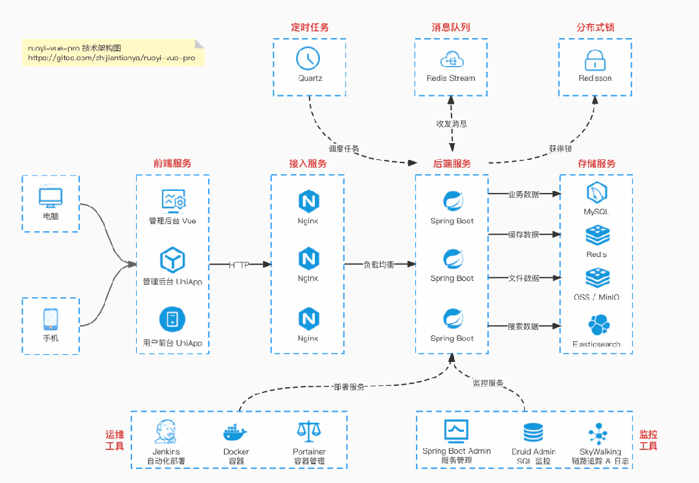
👉**这是一个或许对你有用的开源项目**
国产Star破10w的开源项目，前端包括管理后台、微信小程序，后端支持单体、微服务架构
RBAC权限、数据权限、SaaS多租户、**商城**、支付、工作流、大屏报表、**ERP、CRM、WMS、MES、HRM**、**AI大模型、IoT物联网、IM聊天**等功能：
- 多模块：https://gitee.com/zhijiantianya/ruoyi-vue-pro
- 微服务：https://gitee.com/zhijiantianya/yudao-cloud
- 视频教程：https://doc.iocoder.cn
【国内首批】支持 JDK25 + SpringBoot4、JDK17/21+SpringBoot3、JDK8/11+Spring Boot2三版本 
QUOTE
**生成之后，章节和书库也要管。**
把 EPUB 或者 PDF 拖进一个窗口，出来的是音频，还附一份带时间轴的字幕。这件事 Abogen 做得到，底层跑的是 Kokoro-82M，MIT 协议，Python 写的，仓库现在六千多 Star。名字是 audiobook generator 的缩写，作者起得很直白。
本文看点
01
**拖进去之后，它会做什么**
02
**字幕的粒度和时间轴**
03
**声音可以自己调**
**01**
CONVERT
[拖进去之后，它会做什么](https://mp.weixin.qq.com/s?__biz=MzUzMTA2NTU2Ng%3D%3D&mid=2247576728&idx=1&sn=1298645b025eb51d9078e8c3de7b3c17&scene=21#wechat_redirect)
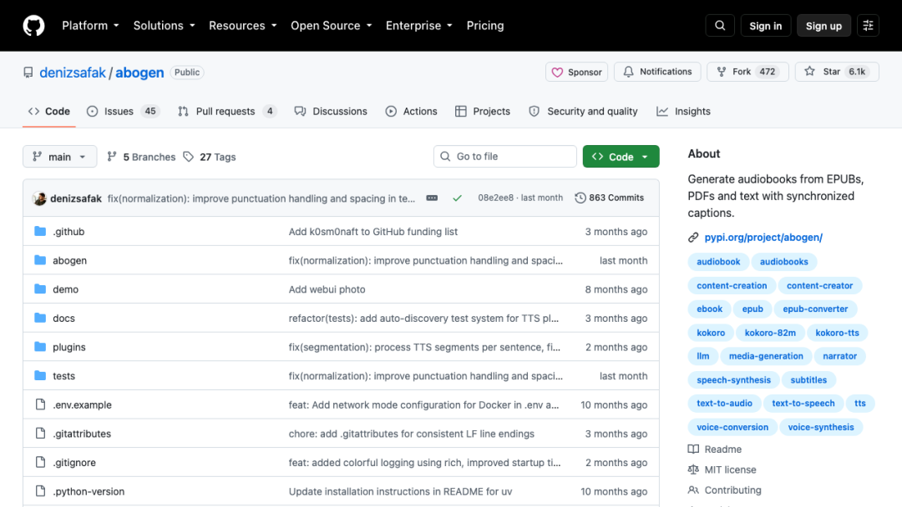
— denizsafak/abogen 仓库首页，Star 6.1k
输入这一侧能吃的东西比想象中多，除了 ePub 和 PDF，TXT、Markdown、SRT、ASS、VTT 都能直接投进去。桌面端是 PyQt6 写的，界面不花哨，拖进去之后调语速、挑声音、选输出格式，点 Start 就开始跑。
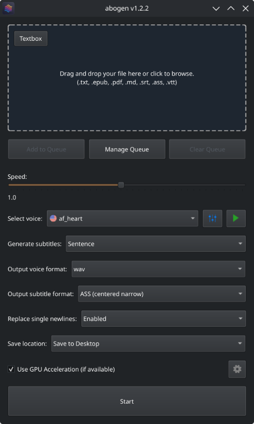
— 桌面端的完整配置面板
官方 README 里挂了一段实录，处理大约三千字用了十一秒，产出三分二十八秒的音频，而且明说机器是一台低端 RTX 2060 Mobile 笔记本。没有独显也能跑，速度慢一些而已。
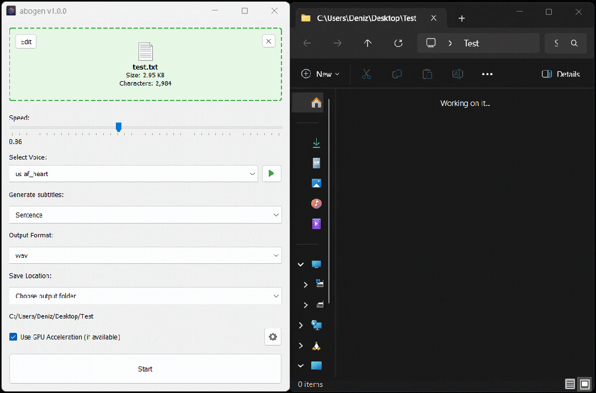
— 三千字转出三分半音频的处理过程
输出格式给了五种。WAV 和 FLAC 是无损，MP3 最通用，OPUS 官方标注压缩最好、体积最小、音质损失不明显，M4B 是带章节信息的苹果有声书格式，往 iPhone 或者 Audiobookshelf 里推就选它。语速可以从 0.1 倍拉到 2.0 倍。
**ruoyi-vue-pro**
基于 Spring Boot + MyBatis Plus + Vue & Element 实现的后台管理系统 + 用户小程序，支持 RBAC 动态权限、多租户、数据权限、工作流、三方登录、支付、短信、商城等功能
项目地址：https://github.com/YunaiV/ruoyi-vue-pro
视频教程：https://doc.iocoder.cn/video/
**02**
SUBTITLES
[字幕的粒度和时间轴](https://mp.weixin.qq.com/s?__biz=MzUzMTA2NTU2Ng%3D%3D&mid=2247576728&idx=1&sn=1298645b025eb51d9078e8c3de7b3c17&scene=21#wechat_redirect)
字幕这边可调的地方不少。可以按行切，按句子切，按句子加逗号切，还能按单词数切，比如一个词一条、两个词一条。另外有个句子高亮模式，读到哪里亮到哪里，做视频配音的时候直接能用。
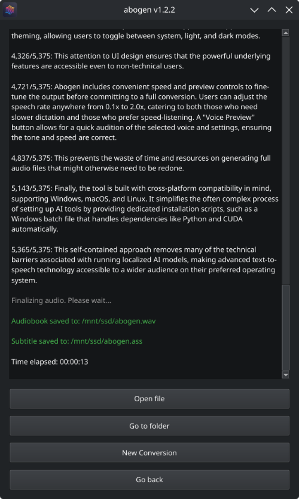
— 字幕模式与高亮选项
两条限制得提前知道。单词级字幕只对英文有效，因为 Kokoro 只给英文输出了时间戳 token，其他语言走句子和逗号拆分的路子，中文用起来差别不大，只是单条字幕会稍长一点。
另一条是英文断句。它内置 spaCy 做句子边界检测，专门处理 Mr.、Dr. 这种缩写，不开的话它见到句号就切，切出来很碎。这个开关在设置里默认是关的，处理英文内容记得手动打开。
**yudao-cloud**
基于 Spring Cloud Alibaba + Gateway + Nacos + RocketMQ + Vue & Element 实现的后台管理系统 + 用户小程序，支持 RBAC 动态权限、多租户、数据权限、工作流、三方登录、支付、短信、商城等功能
项目地址：https://github.com/YunaiV/yudao-cloud
视频教程：https://doc.iocoder.cn/video/
**03**
VOICES
[声音可以自己调](https://mp.weixin.qq.com/s?__biz=MzUzMTA2NTU2Ng%3D%3D&mid=2247576728&idx=1&sn=1298645b025eb51d9078e8c3de7b3c17&scene=21#wechat_redirect)
语音混音器是这个项目里不太常见的一块。它允许把不同的 Kokoro 语音按权重叠在一起，调出一个属于自己的音色，调完存成 profile，下次直接选，不用重调。
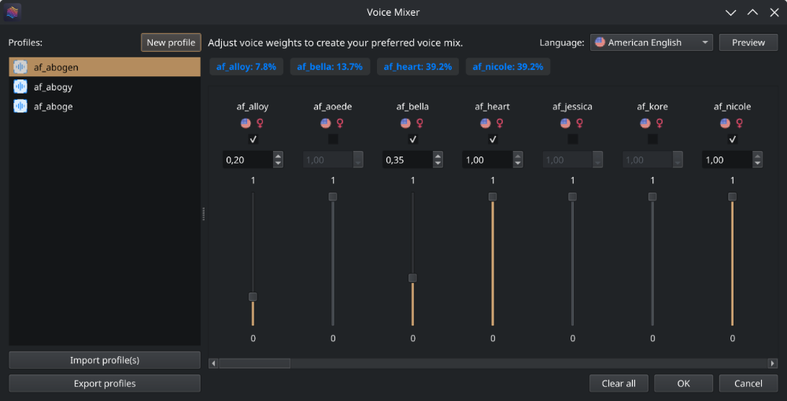
— 语音混音器，按权重叠加多个音色
可选语言有九种，美式英语、英式英语、西班牙语、法语、印地语、意大利语、日语、巴西葡萄牙语和中文普通话。日语与中文要多装一个 misaki 包，每种语言下面男女声都有。生成之前还能先试听一遍。
**04**
QUEUE
[一次排一队，出错只重跑一章](https://mp.weixin.qq.com/s?__biz=MzUzMTA2NTU2Ng%3D%3D&mid=2247576728&idx=1&sn=1298645b025eb51d9078e8c3de7b3c17&scene=21#wechat_redirect)
队列模式解决的是批量问题。txt 和字幕文件直接往队列里拖，PDF 和 EPUB 从主窗口点 Add to Queue 塞进去。
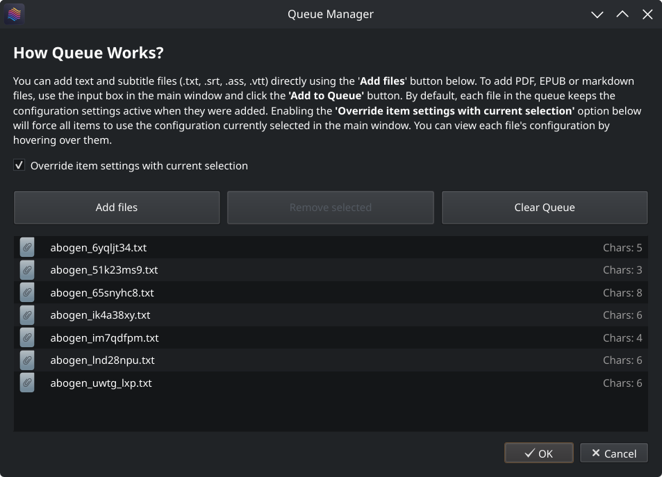
— 队列里每个文件各带一套参数
有个设计挺实用，每个文件绑的是它加入队列那一刻的设置，之后改主窗口配置不会影响已经排好的项。想强制所有文件用同一套配置，打开 Override 就行。鼠标悬停能看到每个文件绑了什么参数。
处理 ePub、PDF 和 Markdown 的时候，它会自动插入章节标记，把一本书拆成一章一个音频文件。
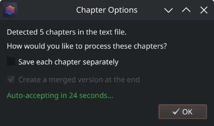
— 章节拆分选项，按章分别输出
这样某一章出错的时候只需要重跑那一章，不必整本重来。纯文本里自己手写这些标记也认。M4B 还支持元数据标签，标题、作者这些字段写进文本开头，封面图会自动从 ePub 和 PDF 里提出来嵌进去。txt 里每段前面写 HH:MM:SS
时间码也行，它会按这个时间轴出音频。
**05**
INTERFACES
[两个界面，功能不一样多](https://mp.weixin.qq.com/s?__biz=MzUzMTA2NTU2Ng%3D%3D&mid=2247576728&idx=1&sn=1298645b025eb51d9078e8c3de7b3c17&scene=21#wechat_redirect)
命令行敲 abogen-web，浏览器打开 localhost:8808，这是 Flask 写的 Web 界面，也是目前功能最全的一个。
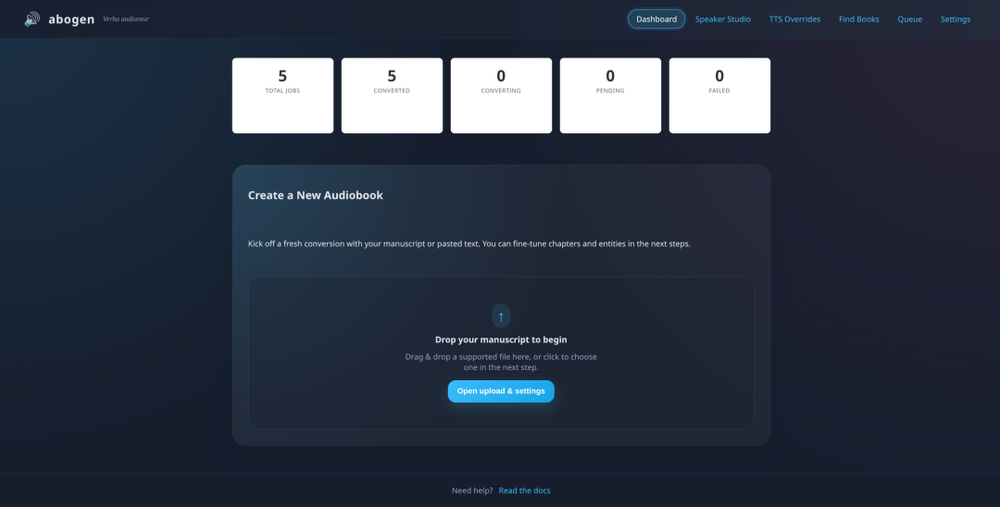
— Web 界面全貌，上传区与任务队列同屏
它比桌面端多三样东西。第一样是 Supertonic TTS，多一个合成引擎可选。
第二样是 LLM 文本规范化，把 don’t、can’t、I’ll 这类缩写先交给大模型处理再送进 TTS，接本地 Ollama 或 OpenAI 的 API 都行，开不开这一项发音差别比较明显。第三样是 Audiobookshelf 直连，填好地址、库 ID、目标文件夹和 API Token，生成的音频直接推进书库。前面要是套了 Nginx Proxy Manager，记得在 Advanced 里补上 proxy_set_header，header 丢了上传会失败。
官方 README 里有一张接口对照表，讲得很直白，桌面版是稳定但较旧的界面，Web 版走在前面，新功能还没接回桌面端。Web 版另外还提供 JSON 端点，方便接进自己的工作流。
**06**
SETUP
[两行命令跑起来](https://mp.weixin.qq.com/s?__biz=MzUzMTA2NTU2Ng%3D%3D&mid=2247576728&idx=1&sn=1298645b025eb51d9078e8c3de7b3c17&scene=21#wechat_redirect)
Windows 上没有 Python 环境的话，仓库里有个 WINDOWS_INSTALL.bat，双击跑完依赖就装好了。macOS 先装 espeak-ng，再用 uv 安装。
···bash
brew install espeak-ng
uv tool install --python 3.12 abogen
Apple Silicon 的机器还要额外装带 MPS 支持的 Kokoro 开发版。Linux 上 NVIDIA 不用单独装 CUDA，AMD 走 ROCm。
不想在本机凑 Python 环境也可以走容器，官方给了镜像和环境变量，端口默认还是 8808，上传的文件落在 data/uploads，产出的音频与字幕落在 data/outputs，Docker Compose 默认启用 GPU。
想跑 Web 界面就用这条。
···bash
abogen-web
然后在浏览器打开 http://localhost:8808 。想跑桌面端换成 abogen 就行。另有 abogen-cli 是命令行模式，启动报错的时候用它能看到详细日志。
**07**
BOUNDARIES
[它还不够精致的地方](https://mp.weixin.qq.com/s?__biz=MzUzMTA2NTU2Ng%3D%3D&mid=2247576728&idx=1&sn=1298645b025eb51d9078e8c3de7b3c17&scene=21#wechat_redirect)
已知的毛刺有几个。桌面端和 Web 端的能力还不一样多，同一个工具两套界面，同时用会像在用两个软件。单词级字幕中文用不了，这是 Kokoro 的模型限制，不是实现问题。
项目的活跃度还行，issue 有人回、PR 有人合。Roadmap 里已经划掉的有章节元数据、语音混音和深色模式，还挂着的是 PDF 扫描件的 OCR、界面多语言，以及可选的 kokoro-onnx 后端。
值不值得用，看你要的是哪一件事。要做有声书、配音素材或者带字幕的音频，它已经够用，能拖 EPUB、能吃 PDF、能批量跑、能接书库、还能让大模型帮忙清洗文本。
我最看重的是它没有停在文本转语音这一步。它开始处理生成之后那些事，章节、元数据、队列、日志、书库。这些地方不出问题的时候没人在意，一旦要返工，代价全在这儿。仓库在 https://github.com/denizsafak/abogen
END
---
欢迎加入我的知识星球，全面提升技术能力。
👉 加入方式，**“长按”或“扫描”下方二维码噢**：

星球的**内容包括**：项目实战、面试招聘、源码解析、学习路线。
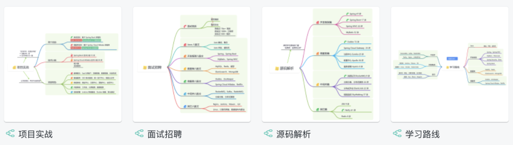
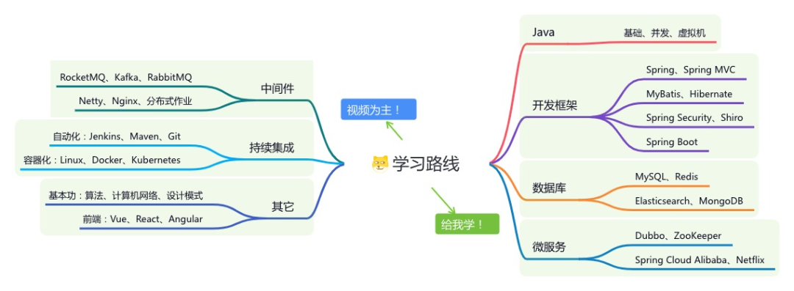
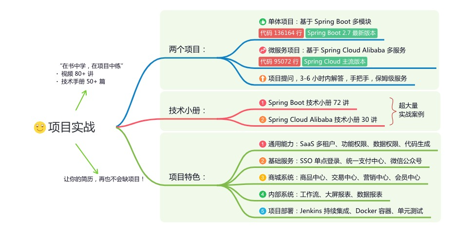
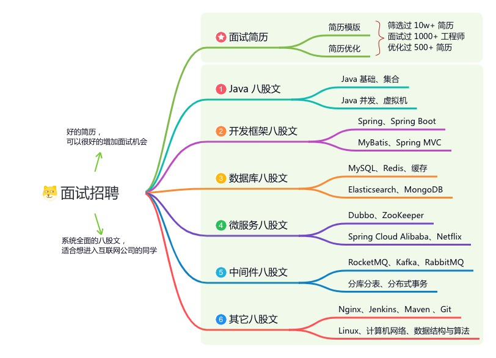

**文章有帮助的话，在看，转发吧。**
**谢谢支持哟 (*^__^*）**
